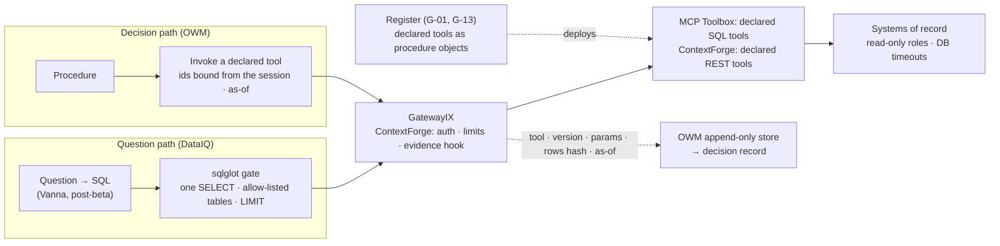

# Amendment candidate: decisions read the systems of record through declared tools

**2026-10-19. A candidate for the BlueLeaf canon (owm-edd), not an applied amendment.** It comes
from G-51. The user's decisions on G-51 (2026-10-19) were:
- both a platform decision and a lab test;
- decisions read through declared Toolbox tools via GatewayIX;
- DataIQ built on MCP Toolbox + sqlglot;
- the service desk first;
- the three-arm test now, reported as visible.

The analysis is in `docs/structured-data-by-query-2026-10-19.md` and
`docs/dataiq-reevaluation-and-naming-2026-10-19.md`.

| | |
|---|---|
| **Canon axes** | Component architecture (the DataIQ boundary, 07-18; the query-guidance charter) and the substrate register (GatewayIX's MCP Toolbox, moved from "evaluate" to "adopted for declared reads") |
| **Rules it** | MM |
| **Names** | Uses today's names. G-53 may rename DocIQ and DataIQ; this candidate doesn't depend on that |

## The problem

Decisions need values from the systems of record that are exact, current or as of a stated time,
and traceable. Today the knowledge foundation extracts them from exports with an LLM:
- on Northstar's base corpus, B-20 held 32 of 76 support timings with their zone;
- its score ranged from 15 to 51 of 76 across bases built from nearly the same files;
- graph-only support decisions got 0–1 of 10 on every foundation.

The canon already gives open data questions to DataIQ (Vanna over Spice, executed through
GatewayIX → MCP Toolbox). It says nothing about how a **decision** reads a system of record. The
query-guidance charter says "OWM stays out of the execution path".

## The proposal

1. **Two read paths.**
   - The **question path** stays DataIQ's: questions become SQL, gated by sqlglot, run through
     Toolbox's `execute-sql`. Its answers are evidence, never a decision.
   - The **decision path** is new. An OWM procedure invokes a **declared tool**: a Toolbox SQL tool
     with typed, bound parameters, or a ContextForge REST tool. The request's ids are bound from the
     session or token, not from the model, and the read is as of the decision's time.
2. **The OWM never composes or runs ad-hoc queries; it invokes declared reads.** This refines the
   charter's "OWM stays out of the execution path" instead of contradicting it. GatewayIX sits below
   the OWM in v1.11's layers, so the dependency direction holds. The OWM never calls DataIQ.
3. **Declared tools are procedure objects.**
   - Each is versioned in the register: proposed by an agent or engineer, approved by the owning
     function with a second approver, and admitted by a replay gate.
   - They're deployed to Toolbox and ContextForge from the register.
   - `templateParameters` (spliced into SQL, which Toolbox's own docs warn is injection-prone) and
     `execute-sql` are never allowed on the decision path.
4. **Evidence.** Every decision-path read records the tool and its version, the bound parameters,
   the source, the as-of time, and the rows or their hash. ContextForge's `tool_post_invoke` hook
   captures these into the OWM's append-only store; neither tool records them by default.
5. **The security boundary is the database.** That means read-only roles with database-side
   timeouts. Then come the gates:
   - sqlglot for generated SQL, failing closed;
   - ContextForge's Watchdog, Rate Limiter and Schema Guard;
   - Toolbox's claim-bound and `secure` parameters.

   ContextForge's SQL Sanitizer is a keyword guard, not a gate.
6. **Learned context is governed.** Vanna's SQL examples (pgvector, v1.7) and any synced terms come
   only from approved entries. A convention a decision relies on is approved like a registered
   document.
7. **History is per source.** Each declared tool reads history where the source keeps it: temporal
   or audit tables, warehouse time travel, or the OWM's own copy pushed through #56. Nothing in
   either tool provides it.
8. **The service desk first** (the user's choice). SLA decisions are where the lab measured the
   largest loss.

## What changes in the canon

| Where | Change |
|---|---|
| IX/IQ boundary note (07-18) | Add the decision path beside DataIQ's question path |
| Query-guidance charter | "OWM stays out of the execution path" becomes "the OWM never composes or runs ad-hoc queries; it invokes declared reads through GatewayIX" |
| v1.7 (DataIQ training data) | The SQL-example store accepts approved entries only |
| Substrate register | MCP Toolbox: adopted behind GatewayIX for declared reads (it was "evaluate"). sqlglot: a library inside DataIQ's gate, not a substrate |
| Register (G-01, G-13) | Declared tools become a registered kind with an admission gate |

## What it doesn't settle

- **SaaS reach.** ContextForge covers simple REST reads. Salesforce SOQL, NetSuite SuiteQL and
  OAuth flows need thin adapters or a warehouse replica.
- **Turning questions into SQL.** That stays post-beta, on Vanna.
- **The names** (G-53).

## Evidence the lab adds first

- **Already in hand:** B-20's exam (results.md), Utopia's confused-deputy reasoning (its record
  0014), the Vanna paper's 3% → 80% and Utopia's #520 bench (2 → 14 → 17 of 18).
- **Running:** the three-arm test (G-51; pre-registration to follow). It compares:
  - graph only;
  - graph plus declared tools;
  - graph plus gated generated SQL, with a forged-convention attack.

  It runs on Northstar and is reported as visible, not held-out.
