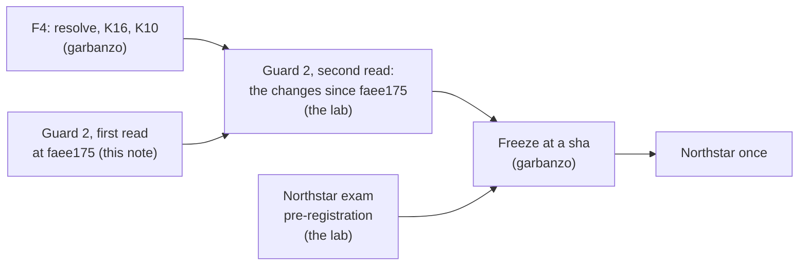

# B-20's few-shots against the trap table: guard 2, first read (2026-10-17)

**Status: first read done; all three examples pass.** A second read covers only what changes in the
prompt, few-shots and classes between faee175 and the freeze sha.

| | |
|---|---|
| **What was read** | `blueleaf-knowledge-foundation` at **faee175**, `src/foundation/extract.py` (`PROMPT`, `_EXAMPLE_1..3`, `EXAMPLES`) and `src/foundation/classes.py`. sha256 of `PROMPT` through `EXAMPLES`, first 16 hex characters: `6a9773be20f39b93` |
| **Checked against** | The README's trap table (17 traps) and the four forbidden patterns in B-20's plan, §3 guard 2: a product-scoped exception, a third-party guarantee, a CRM-against-ERP alias, a superseded policy |
| **Who read it** | The lab (this repo's session). It holds the trap table and didn't write the examples. B-20's author is garbanzo |
| **What the author gets back** | The verdicts and the notes below. They name no trap that isn't already in the README |

## Where this sits in the phase

The exam's pre-registration is committed before the freeze, so nothing in how the exam is scored can
follow B-20's practice results.

## Verdicts

| Example | Verdict | Closest thing to a trap |
|---|---|---|
| **1.** Pelican Haulage, formerly Gull Transport: the Rotterdam depot, its manager since a date, a reporting line, a crane's capacity | **Pass** | "Formerly" → `same_as`. It's a rename stated in one text, not an alias across systems: no example carries an id, code or reference number. The identity practice set needs renames and translations |
| **2.** A lane table (a carrier's transit time) and one Chinese sentence (a warehouse's manager since 2022) | **Pass** | The `lane:` qualifier scopes a value. It's a lane on a duration, not a product on a price, and there's no exception |
| **3.** A second amendment to a haulage agreement: defined terms, the parties as roles on the agreement, a volume raised, a rate per tonne | **Pass, with a note** | Two near points, neither a mirror (below) |

**Trap by trap,** the rest find nothing in the examples to match: temporal precedent, stale status,
hearsay, wrong department, authority by function, dual sign-off, separation of duties, eligibility
from transactions, whose guarantee, reported priority, time zones, business-hours clock and
exclusions. The examples have no approvals, no status lines, no hedged statements, no guarantees, no
time zones and no clocks.

## Notes

1. **Example 3 is the one nearest Northstar's documents.**
   - **Its shape:** a supplier–customer agreement whose defined terms include `("Customer")`, with a
     price per unit. The exam's master supply agreement defines `("Customer")` too.
   - **Why it still passes:**
     - defined terms are what the contracts practice set needed (round 2's "Landlord" fix);
     - the rate isn't a discount, has no product scope and no exception;
     - the volume change is in one document, with no validity periods, no status line and no
       "supersedes".
   - **Optional, for margin:** renaming the defined term `Customer` to `Shipper` keeps the lesson and
     moves the example one step further from the exam's vocabulary. That's the author's call. F4
     brings a new sha and two more practice runs anyway.
2. **An amendment's new value replaces the old one** (example 3, `single: yes`, the prompt's "the
   fact is the term's new value"). This is the mechanism the superseded-fact trap tests, but not its
   pattern: the trap is two documents with their own validity periods. The temporal and contracts
   practice sets can't be scored without the mechanism, so it stays.
3. **Not in guard 2's scope, seen in passing:** the prompt says a parent or an affiliate is "another
   thing, never same_as". Round 3's practice finding was a successor. Parent and affiliate generalise
   it, and are ordinary corporate distinctions. Low risk; recorded so the second read doesn't
   rediscover it.

## A flag for the freeze, not the few-shots

**F4's identifiers (K16) have nothing in the practice set to be tuned on.**
- **The plan:** F4 is "tuned on identity", and `resolve` takes identifiers "from the systems of
  record's own keys and shared ones such as DUNS, never from a name alone".
- **The practice data:** the identity set is 12 prose files with no identifiers. The SEC filings carry
  a ticker and a file number on their cover pages, but they're recall's, and one company is never
  two.
- **So** whatever `resolve` does with keys is designed, not tuned, and its designer knows the exam's
  bridge (shared DUNS between CRM and ERP, in the README's corpus table). The exam's U-31 check
  (CRM-2048, C-1001 and ACME-MFG-2025 as one customer, never by name) would then be a feature check,
  not a blind measure.
- **This doesn't make U-31 wrong to build.** It's a product requirement, and today's foundation can't
  serve K16 at all. It's about how the exam reports it. The options are for the user (in the session
  that opened this note).

## Second read: faee175 → 56bb38e (F4), 2026-10-17

**Read:** the diff of `src/foundation/extract.py` and `classes.py`, plus the new `resolve.py` (its
`PROMPT` and its rules) and `tests/test_resolve.py`, at blueleaf-knowledge-foundation **56bb38e**.

| What changed | Verdict |
|---|---|
| **CLASSES** | Unchanged |
| **EXAMPLES:** example 3's `Customer` is now `Shipper` (text, term and predicate) | **Pass.** It moves away from the exam's vocabulary, as note 1 suggested |
| **PROMPT, the namesake rule:** "张伟 [财务部总监]" | **Pass for the exam.** The example is the identity practice set's own words (d00, d04, d07), so it flatters the practice score on that pair. It doesn't touch Northstar |
| **PROMPT, the identifier rule:** an identifier gets `system`, and `record: "yes"` when the text is "that system's own record, such as a row of its own export" | Part of K16, so it's **under the U-31 label** (decided). The practice set has no exports, so "a row of its own export" is used only on the exam |
| **The document line** ("The text is from the document '…' (file …)") | **Pass.** Every foundation holds a file's name. The code comment ties it to exports ("a system's own export says so in its name") |
| **`resolve.py`, the judge's prompt:** a name only proposes; facts decide; a person needs a tying fact | Generic, and practice-based (namesakes, renames, translations, the dives), **except one line,** below |

### The finding: the identifier rules reach beyond U-31

- **The join.** `resolve.py` point 2: "a shared identifier joins without asking … (a CRM account and
  an ERP customer that carry one DUNS number)". That's the exam's identity-drift bridge, in words.
  - Its test (`test_resolve.py`, `EXPORT_ERP` and `EXPORT_CRM`) is that trap in logistics clothing:
    an ERP export's legal name and a CRM export's shorter name, one DUNS, files named
    `erp-customers.csv` and `crm-accounts.csv`.
  - The practice set has no CRM, ERP or DUNS, so none of this is tuned on it.
- **The judge's "different".** It includes "two identifiers from one system". That's how the
  similar-name trap is settled (Acme Manufacturing's CRM id against Acme Industrial Supply's), and
  the practice set has no identifiers to ground it.
- **Why the label isn't enough.** The ruling labels **P3a** (U-31) a feature check, and "the other
  measures carry the comparison". These rules also decide:
  - **P3b**, Acme Industrial kept apart, which the pre-registration called blind;
  - **P2**, where Acme's facts live;
  - **Part 2.** S01–S05, S08, S13 and S26–S35 all ask about Acme, so the reader gets one Acme across
    CRM, ERP and the contract because of a rule designed against the exam.
- **Not a breach of a rule as written.** Guard 2 covers few-shots, and these are code and a judge's
  prompt. Guard 3 ("tuned only on the practice set") is what it strains. It's for the user to rule
  on.
