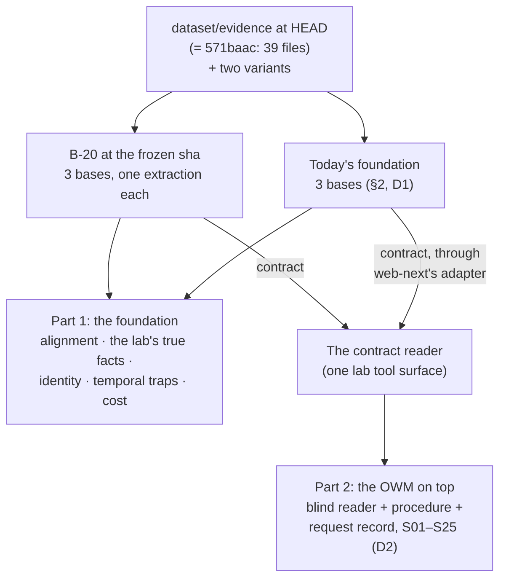
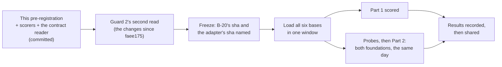

# B-20's Northstar exam: pre-registration (draft, 2026-10-17)

**Status: a draft for the user's decisions (§9).** It's committed before B-20's freeze sha is named,
so nothing in how the exam is scored can follow B-20's practice results.

**Decided (the user, 2026-10-17):**
- **Scope:** the foundation and the OWM on top of it, in one exam.
- **Acme's three records as one customer (U-31):** reported as a **feature check**, labelled "built
  knowing the corpus". The identifier rules can't be tuned on the practice set
  (`docs/b20-fewshot-review-2026-10-17.md`).

**Standing rulings this inherits:**
- **Practice set and exam** (the user, 2026-10-16): Northstar is run once, on B-20's frozen sha. A
  change after seeing the results is a new condition, labelled as one.
- **Models:** `gpt-6-luna` at effort `low`, `text-embedding-3-small`, for both foundations.

## 1. The exam in one picture

Both parts read each foundation **only through the foundation contract (v0.2)**, so the comparison
holds the reader's view fixed and changes only the foundation behind it.

## 2. What's loaded

| Corpus | Files | Scenarios that need it |
|---|---|---|
| `base` | `dataset/evidence/` at HEAD: 39 files, byte-identical to 571baac (checked 2026-10-17) | All but the three below |
| `missing-contract-evidence` | base less the master supply agreement and both pricing exceptions | S05, S19 |
| `missing-guarantee-evidence` | base less the parent guarantee | S33 |

- **Each corpus is its own base**, in each foundation. Only `dataset/evidence/` files are loaded:
  never the answer key, evaluation, truth or site.
- **B-20:** one extraction per corpus, at the frozen sha. Its sha, its classes, prompt and
  few-shots are named in the run before the first upload.
- **Today's foundation (D1, recommended):** three fresh bases on a throwaway second server, as for
  the practice baseline: the same binary, BlueLeaf's base's own settings (packs, flags, governance
  off, luna at `low`), loaded in the same window as B-20.
  - **BlueLeaf's live base** (2026-10-13: 1,907 exact of 3,241 pieces of evidence) is quoted beside
    the fresh base as a reference, never in its place. It was loaded another way (pushed through
    the API, not uploaded), and it has no variants.

## 3. Part 1: the foundation

Every measure is computed by the lab's scorers, reading only the contract, the same way for both
foundations. The scorers are committed here before the freeze (§7).

| # | Measure | How it's read | Blind? |
|---|---|---|---|
| **P1** | **Alignment.** Each fact's evidence by the contract's alignment (exact, partial, fuzzy, none), as counts and as shares | K13 over every fact, K14 for its evidence spans; a span's bytes must equal its quote (B-20's `probes/spans.py` rule) | Yes |
| **P2** | **The lab's true facts found.** The 26 `asserted` facts in `truth/facts.yaml` | One matcher per fact: the subject, found by its names in the evidence, and the value; for facts with dates, the validity too, read both through stated validity and through `x-holds` (as the practice set did) | Yes |
| **P3a** | **U-31: CRM-2048, C-1001 and ACME-MFG-2025 as one customer** | K16 for each identifier, then whether they're one entity | **No: a feature check** (decided) |
| **P3b** | **Acme Industrial Supply (CRM-2091 / C-1044) stays separate**, and no two of the lab's customers are merged | K15 by name, then the entities' identifiers and facts | Yes. The practice set has namesakes (the two 张伟) |
| **P4** | **Temporal traps at the foundation level:** the 10% exception (2023–25) and the 15% one (2025–28) both held, each with its own validity; the 2023 exception's end date held, despite its "Status: Active" line | K13 with `valid_at` on dates either side of each boundary | Yes |
| **P5** | **Cost:** calls and tokens per base, from each foundation's own logs | As the practice baseline did | n/a |

- **n = 1 per foundation per corpus**, as ruled. The practice set's noise is quoted beside each
  measure (identity F1 ±0.05; recall ±2.7 of 52). P2 and P4 are counts on 26 and 4 items, so a
  difference of one item is reported as one item, never as a rate.
- **Today's foundation's K16:** it can't serve K16 at all (U-31), so P3a scores it "not served".
  That's a capability difference, reported as such.

## 4. Part 2: the OWM on top

**The reader** is `lab/utopia/blind_reader.py`'s, with every control unchanged: Opus 5.5, the fixed
system prompt (verbatim since 2026-09-28; it names no tool), a fresh temp directory outside the
repo, no built-in tools, a strict MCP config, a probe before each batch, resumable runs.

**One change: the tool surface.** Native MCP tools differ between the foundations, so the reader
gets the **contract reader**, a lab MCP server over the contract's read routes. It has the same
tools and the same neutral descriptions for both foundations:

| Tool | Contract route | In C1 (all) | In C2 (graph only) |
|---|---|---|---|
| `find_entities` | K15 list (`q`, `kind`) | ✓ | ✓ |
| `get_entity` | K15 entity, with facts (`valid_at`, `known_at`) | ✓ | ✓ |
| `list_facts` | K13 (`subject`, `predicate`, `valid_at`, `known_at`) | ✓ | ✓ |
| `get_fact` | K14, with premises | ✓ | ✓ |
| `lookup_identifier` | K16 | ✓ | ✓ |
| `neighbourhood` | K17 around an entity | ✓ | ✓ |
| `search` | K10 | ✓ | hidden |
| `list_documents`, `read_passages` | K2, K8 | ✓ | hidden |

- **Hidden means hidden:** C2 removes the text tools with `--disallowedTools`, as B2 did. Tools left
  off an allowlist stay visible.
- **B-20** is read directly, with a service token. **Today's foundation** is read through web-next's
  adapter at a sha named before the run, with a read-only login and a read token (as in the
  reference check), held in local-only files and never printed.
- **The OWM:** `owm/procedures/discount-approval.md` appended to the system prompt, and the request
  record in the question. With curated facts that configuration got 15/15 on S01–S05, three runs
  each (2026-09-28). The procedure's path and sha256 go in each run's setup file.

**Questions (D2, recommended: S01–S25, 27 questions with S06a–c):**
- **The existing texts, byte for byte.** Only the `kb` column changes.
  - S01–S05 and S09–S20, with their request records: `runs/2026-09-30-owm-measurements/
    01-02-procedure/questions.tsv`.
  - S06a–c, S07 and S08, which aren't decisions and have no request: `runs/2026-09-28-utopia-aad5b06/
    questions.tsv`, the texts the luna baseline asked.
  - S22–S25, the submitted requests: `runs/2026-10-02-jev-probe/j3/questions.tsv`.
- **S21 has no text yet.** It's written from its scenario in the same form and committed with this
  pre-registration, before any run.
- **Not the credit and SLA scenarios (S26–S45)** unless the user chooses them: no reader has ever been
  run on them, so they would need new texts, request records and a scorer, which is a new instrument
  inside the exam.

**Runs:** C1 once and C2 three times per foundation, as the lab's reader baselines have run.

**Scoring:**
- **Primary:** each answer's outcome against the scenario's `expected:` decision, auto-scored as in
  `01-02-procedure/score.py`. Also the **unsafe count**: an approval where the key says review,
  evidence or rejection.
- **S06–S08** (fact selection, provenance, identity) are read by hand, as in the baselines.
- **The user's grades** in the Ledger settle disagreements and stand beside the auto-score, never
  overwritten.
- **Noise:** three graph-only runs of today's foundation spread 6 to 8 right of 10 on 2026-10-13. A
  difference smaller than the spread of the three C2 runs is reported as no difference.
- **The native-MCP figures** on today's foundation (luna, 2026-10-13: B1 9/1/0, B2 7/2/1 · 6/3/1 ·
  8/1/1, on the older 17-file corpus and without the procedure) are quoted as a reference for what
  the contract's view costs or gains, never as the comparison.

## 5. Order

## 6. Guards

1. **Sealed until recorded.** No Northstar result from either foundation reaches B-20's author before
   B-20's exam run is recorded. That covers the scorers' dry runs too. Today's foundation's
   live base is the only place the scorers are dry-run (§7), and those outputs stay in the lab.
2. **Frozen, then named.** B-20's sha and the adapter's sha are named in the run before the first
   upload. Any change to either after that is a new condition.
3. **The adapter is checked, not trusted.** The reference check (2026-10-16) covered facts and
   identity. Before Part 2, a parity probe compares the contract reader's search, document,
   passage and entity calls through the adapter with today's foundation's own REST on a sample.
   A gap is fixed and the probe re-run before any reader batch.
4. **One tool surface.** The contract reader's descriptions are written by the lab, name no trap,
   and are identical for both foundations. Its code is committed with its sha in each run.
5. **Never-load** holds for both foundations (CLAUDE.md).
6. **The U-31 label** goes on every place P3a is reported.

## 7. What the lab builds before the freeze

| Item | Proof |
|---|---|
| **The contract reader** (`lab/contract_reader/`, stdlib MCP over the contract's read routes) | Tests against the adapter on BlueLeaf's live base and against B-20 at faee175. K10 and K16 are added when F4 lands |
| **P1–P4 scorers** (`lab/exam/`) | Unit tests on fixtures; a dry run on today's foundation's live base, sealed (§6.1) |
| **S21's question** | Committed here, oracle-checked like the others |
| **The run scripts** (load, probe, run, score), with the spend guard | A dry run with no spend: B-20's scripted mode and a probe |

## 8. Spend

| Item | Estimate | Guard |
|---|---|---|
| B-20, three bases | About $1 in all. Practice: 134k prompt tokens per recall base, and Northstar is under twice recall's text | Stop at a projected $30 for both foundations together |
| Today's foundation, three fresh bases | About $3–5. It spent 5.4M prompt tokens on one recall base | Same guard, measured from its own log |
| The reader, S01–S25 | About $30 per foundation (C1 about $4, C2 about $9 a batch), so about $60 on the Claude Code plan | Stop at $100 on the plan |
| With S26–S45 added | About $105 | The same $100 stop, raised only if the user says so |

## 9. Decisions for the user

| # | Decision | Recommendation |
|---|---|---|
| **D1** | Today's foundation's bases: fresh, or BlueLeaf's live base? | **Fresh**, on a throwaway second server in the same window. The live base is quoted beside it |
| **D2** | Which scenarios Part 2 asks | **S01–S25**, with their existing texts. Credit and SLA would make the exam the reader's first run on them |
