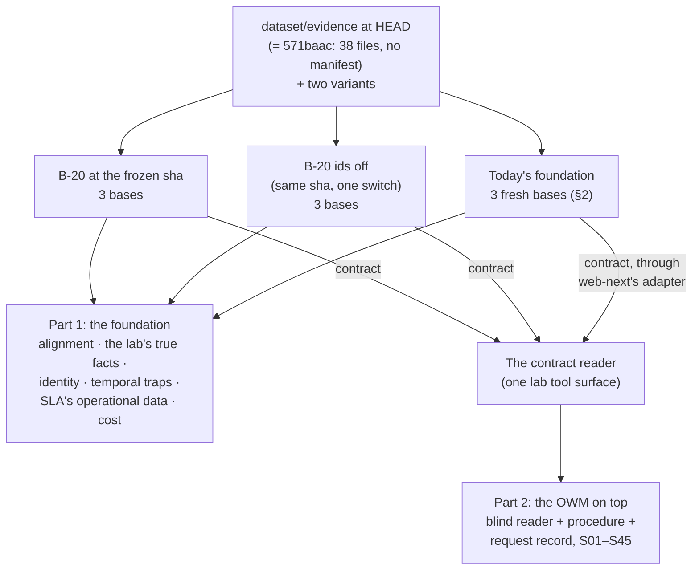
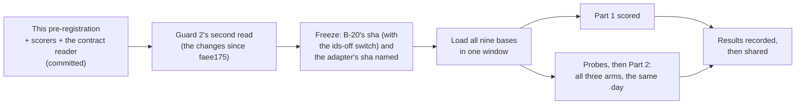

# B-20's Northstar exam: pre-registration (2026-10-17)

**Status: pre-registered; the lab's build (§7) comes next, then B-20's freeze.** It's committed
before B-20's freeze sha is named, so nothing in how the exam is scored can follow B-20's practice
results.

**Decided (the user, 2026-10-17):**
- **Scope:** the foundation and the OWM on top of it, in one exam.
- **Acme's three records as one customer (U-31):** reported as a **feature check**, labelled "built
  knowing the corpus". The identifier rules can't be tuned on the practice set
  (`docs/b20-fewshot-review-2026-10-17.md`).
- **D1, today's foundation's bases:** fresh, on a throwaway second server (§2).
- **D2, Part 2's scenarios:** delegated to the lab ("from a product manager's perspective; cost is
  relative to benefit"). **All 45: discount, credit and SLA** (§9 has the reasoning).
- **D3, the identifier rules (the user, 2026-10-17): run B-20 both ways.** Guard 2's second read
  (`docs/b20-fewshot-review-2026-10-17.md`, 7f26264) found that F4's identifier rules reach past
  U-31, into P2, P3b and Part 2's questions about Acme. So B-20 takes the exam as two arms from the
  same frozen sha:
  - **B-20** as built;
  - **B-20, ids off:** one switch in `resolve`, committed before the freeze. It makes no joins or
    proposals from identifiers, and the judge's prompt drops its identifier clause. The extraction
    rule stays, under the U-31 label.

  **The blind comparison is B-20 ids off against today's foundation.** B-20 against B-20 ids off
  shows what the identifier rules add. The two are separate extractions, so that difference carries
  extraction noise as well.

**Standing rulings this inherits:**
- **Practice set and exam** (the user, 2026-10-16): Northstar is run once, on B-20's frozen sha. A
  change after seeing the results is a new condition, labelled as one.
- **Models:** `gpt-6-luna` at effort `low`, `text-embedding-3-small`, for both foundations.

## 1. The exam in one picture

Both parts read each foundation **only through the foundation contract (v0.2)**, so the comparison
holds the reader's view fixed and changes only the foundation behind it.

## 2. What's loaded

| Corpus | Files | Scenarios that need it |
|---|---|---|
| `base` | `dataset/evidence/{documents/*.md, structured/*.csv}` at HEAD: **38 files**, byte-identical to 571baac (checked 2026-10-17) | All but the three below |
| `missing-contract-evidence` | The same from `dataset/evidence-variants/missing-contract-evidence/`: 35 files, base less the master supply agreement and both pricing exceptions | S05, S19 |
| `missing-guarantee-evidence` | The same from `dataset/evidence-variants/missing-guarantee-evidence/`: 37 files, base less the parent guarantee | S33 |

- **The corpus is pinned to lab commit 571baac**: `docs/b20-exam-corpus-571baac.sha256` lists every
  file's sha256 (38, 35 and 37). HEAD's files are byte-identical. Both foundations' loaders check
  them before the first upload.
- **Only tracked Markdown and CSV files are loaded.**
  - **Not `MANIFEST.yaml`.** It's the lab build's own file, not a source system's, and its
    descriptions point at answers: "a similarly named but different customer", "the current Acme
    NS-500 … exception" against "the earlier (2023)", "legal names differ from CRM display names".
    The lab's own runs have always uploaded only the CSVs and the Markdown, and so did BlueLeaf's live
    base: it holds 38 documents, none of them the manifest (checked through the adapter, 2026-10-17).
    B-20's plan's "39 files" counted it.
  - **Not untracked files**, such as the `.DS_Store` in one variant folder.
  - Never the answer key, evaluation, truth or site.
- **Each corpus is its own base**, in each foundation and arm. The names are neutral and the same in
  every foundation: "Northstar Industrial Systems", "Northstar Industrial Systems — missing contract
  evidence", "Northstar Industrial Systems — missing guarantee evidence". B-20 ids off adds " (2)".
  The contract reader never shows a base's name to the reader.
- **B-20, both arms:** one extraction per corpus per arm, at the frozen sha. The sha, its classes,
  prompt, few-shots and the switch's state are named in the run before the first upload. Search
  (K10) must be hybrid: K0 must say so before any reader run.
- **Today's foundation (D1, decided):** three fresh bases on a throwaway second server, as for
  the practice baseline: the same binary, BlueLeaf's base's own settings (packs, flags, governance
  off, luna at `low`), loaded in the same window as B-20.
  - **BlueLeaf's live base** (2026-10-13: 1,907 exact of 3,241 pieces of evidence) is quoted beside
    the fresh base as a reference, never in its place:
    - it was loaded another way (pushed through the API, not uploaded);
    - it has no variants.

## 3. Part 1: the foundation

Every measure is computed by the lab's scorers, reading only the contract, the same way for both
foundations. The scorers are committed here before the freeze (§7).

| # | Measure | How it's read | Blind? |
|---|---|---|---|
| **P1** | **Alignment.** Each fact's evidence by the contract's alignment (exact, partial, fuzzy, none), as counts and as shares | K13 over every fact, K14 for its evidence spans; a span's bytes must equal its quote (B-20's `probes/spans.py` rule) | Yes |
| **P2** | **The lab's true facts found.** The 26 `asserted` facts in `truth/facts.yaml` | One matcher per fact: the subject, found by its names in the evidence, and the value; for facts with dates, the validity too, read both through stated validity and through `x-holds` (as the practice set did) | Yes |
| **P3a** | **U-31: CRM-2048, C-1001 and ACME-MFG-2025 as one customer** | K16 for each identifier, then whether they're one entity | **No: a feature check** (decided), in every arm |
| **P3b** | **Acme Industrial Supply (CRM-2091 / C-1044) stays separate**, and no two of the lab's customers are merged | K15 by name, then the entities' identifiers and facts | **Only for B-20 ids off and today's foundation.** In B-20 as built, the judge's "two identifiers from one system" settles it |
| **P4** | **Temporal traps at the foundation level:** the 10% exception (2023–25) and the 15% one (2025–28) both held, each with its own validity; the 2023 exception's end date held, despite its "Status: Active" line | K13 with `valid_at` on dates either side of each boundary | Yes |
| **P5** | **SLA's operational data, held exactly.** For the ten tickets S36–S45 name: each ticket's opened and restored times (20) and its 45 events' times, and the 11 holidays in the holiday calendar: 76 items | The value served against the evidence row's own text: the same instant, with the zone the source wrote (Cedar and Akron in EDT) | Yes |
| **P6** | **Cost:** calls and tokens per base, from each foundation's own logs | As the practice baseline did | n/a |

- **n = 1 per arm per corpus**, as ruled. The practice set's noise is quoted beside each
  measure (identity F1 ±0.05; recall ±2.7 of 52). P2, P4 and P5 are counts on 26, 4 and 76 items,
  so a difference of one item is reported as one item, never as a rate.
- **Today's foundation's K16:** it can't serve K16 at all (U-31), so P3a scores it "not served".
  That's a capability difference, reported as such.

## 4. Part 2: the OWM on top

**The reader** is `lab/utopia/blind_reader.py`'s, with every control unchanged: Opus 5.5, the fixed
system prompt (verbatim since 2026-09-28; it names no tool), a fresh temp directory outside the
repo, no built-in tools, a strict MCP config, a probe before each batch, resumable runs.

**One change: the tool surface.** Native MCP tools differ between the foundations, so the reader
gets the **contract reader**, a lab MCP server over the contract's read routes. It has the same
tools and the same neutral descriptions for both foundations:

| Tool | Contract route | In C1 (all) | In C2 (graph only) |
|---|---|---|---|
| `find_entities` | K15 list (`q`, `kind`) | ✓ | ✓ |
| `get_entity` | K15 entity, with facts (`valid_at`, `known_at`) | ✓ | ✓ |
| `list_facts` | K13 (`subject`, `predicate`, `valid_at`, `known_at`) | ✓ | ✓ |
| `get_fact` | K14, with premises | ✓ | ✓ |
| `lookup_identifier` | K16 | ✓ | ✓ |
| `neighbourhood` | K17 around an entity | ✓ | ✓ |
| `search` | K10 | ✓ | hidden |
| `list_documents`, `read_passages` | K2, K8 | ✓ | hidden |

- **Hidden means hidden:** C2 removes the text tools with `--disallowedTools`, as B2 did. Tools left
  off an allowlist stay visible.
- **B-20** is read directly, with a service token. **Today's foundation** is read through web-next's
  adapter at a sha named before the run, with a read-only login and a read token (as in the
  reference check), held in local-only files and never printed.
- **The OWM:** the scenario's procedure appended to the system prompt
  (`owm/procedures/discount-approval.md` for S01–S25, `credit-limit.md` for S26–S35,
  `sla-response.md` for S36–S45), and the request record in the question. Each procedure's path and
  sha256 go in each run's setup file.

**Questions (D2, decided: S01–S45, 47 questions with S06a–c):**
- **The existing texts, byte for byte.** Only the `kb` column changes.
  - S01–S05 and S09–S20, with their request records: `runs/2026-09-30-owm-measurements/
    01-02-procedure/questions.tsv`.
  - S06a–c, S07 and S08, which aren't decisions and have no request: `runs/2026-09-28-utopia-aad5b06/
    questions.tsv`, the texts the luna baseline asked.
  - S22–S25, the submitted requests: `runs/2026-10-02-jev-probe/j3/questions.tsv`.
- **Credit and SLA, from experiments 5 and 6's own harnesses** (`runs/2026-10-03-exp5-credit/
  run_reader.py`, `runs/2026-10-03-exp6-sla/run_reader.py`): the same user message, the scenario's
  question and its request record, **less the gold evidence** those runs appended. Here the reader
  finds the evidence through the tools instead.
- **S21 has no text yet.** It's built from its scenario in the form `01-02-procedure/
  build_questions.py` uses, and committed with the build (§7).
- **A pilot** before the freeze: C1 once on S21 and S26–S45, on today's foundation's live base
  (about $7). It checks the harness end to end (the message without evidence, the tools, the
  scorers), not either foundation. Its answers are sealed (§6.1) and never scored as results.

**Runs:** C1 once and C2 three times per arm, as the lab's reader baselines have run.

**Scoring:**
- **Primary, auto-scored with each process's own scorer:**
  - discount: the outcome against the scenario's `expected:`, as in `01-02-procedure/score.py`;
  - credit: experiment 5's pass rule (outcome, eligibility and whether the requestor is authorised;
    for an approval, the approvers);
  - SLA: experiment 6's strict / core / fail, where core is the outcome, severity, breach findings and
    credit, and strict adds every obligation with its holder and due time.
  - Also each process's **unsafe count**, by its experiment's rule.
- **The gold-evidence ceiling.** The same reader with every document in its message got credit
  27/30 and SLA 16/20 strict and 20/20 core (experiments 5 and 6). Each foundation's score is reported
  beside it: what the reader loses when it has to find the evidence in that foundation.
- **S06–S08** (fact selection, provenance, identity) are read by hand, as in the baselines.
- **The user's grades** in the Ledger settle disagreements and stand beside the auto-score, never
  overwritten.
- **Noise:** three graph-only runs of today's foundation spread 6 to 8 right of 10 on 2026-10-13. A
  difference smaller than the spread of the three C2 runs is reported as no difference.
- **The native-MCP figures** on today's foundation (luna, 2026-10-13: B1 9/1/0, B2 7/2/1 · 6/3/1 ·
  8/1/1, on the older 17-file corpus and without the procedure) are quoted as a reference for what
  the contract's view costs or gains, never as the comparison.

## 5. Order

**The freeze may come before the lab's build is done.** What must come first is the scorers and the
contract reader, committed before the first exam upload, since no Northstar result exists until then.
A freeze named early only stops B-20 from moving while the lab builds.

## 6. Guards

1. **Sealed until recorded.** No Northstar result from either foundation reaches B-20's author before
   B-20's exam run is recorded. That covers the scorers' dry runs too. Today's foundation's
   live base is the only place the scorers are dry-run (§7), and those outputs stay in the lab.
2. **Frozen, then named.** B-20's sha and the adapter's sha are named in the run before the first
   upload. Any change to either after that is a new condition.
3. **The adapter is checked, not trusted.** The reference check (2026-10-16) covered facts and
   identity. Before Part 2, a parity probe compares the contract reader's search, document,
   passage and entity calls through the adapter with today's foundation's own REST on a sample.
   A gap is fixed and the probe re-run before any reader batch.
4. **One tool surface.** The contract reader's descriptions are written by the lab, name no trap,
   and are identical for both foundations. Its code is committed with its sha in each run.
5. **Never-load** holds for both foundations (CLAUDE.md).
6. **The U-31 label** goes on every place P3a is reported.

## 7. What the lab builds before the freeze

| Item | Proof |
|---|---|
| **The contract reader** (`lab/contract_reader/`, stdlib MCP over the contract's read routes) | Tests against the adapter on BlueLeaf's live base and against B-20 at faee175. K10 and K16 are added when F4 lands |
| **P1–P5 scorers** (`lab/exam/`) | Unit tests on fixtures; a dry run on today's foundation's live base, sealed (§6.1) |
| **The question files:** S21 built; credit's and SLA's messages from experiments 5 and 6, less the evidence; the three scorers wired to the reader's outputs | The pilot (§4), sealed |
| **The run scripts** (load, probe, run, score), with the spend guard | A dry run with no spend: B-20's scripted mode and a probe |

## 8. Spend

| Item | Estimate | Guard |
|---|---|---|
| B-20, both arms: six bases | About $2 in all. Practice: 134k prompt tokens per recall base, and Northstar is under twice recall's text. The judge adds calls | Stop at a projected $30 for both foundations together |
| Today's foundation, three fresh bases | About $3–5. It spent 5.4M prompt tokens on one recall base | Same guard, measured from its own log |
| The reader, S01–S45 (47 questions) | ~~About $150~~. **Measured in the pilot (§10): about $520** for C1 once and C2 three times on three arms. All-tools answers cost about $0.40 after the slimming, graph-only ones $0.75 to $2.03 | ~~Stop at $180~~. **Stop at $550 on the plan** (the user, 2026-10-17, §10) |

## 9. Why all 45 (D2, the lab's call)

The user delegated this one: "from a product manager's perspective; cost is relative to benefit".

| Scenarios | What the exam learns from them | Cost |
|---|---|---|
| **Discount, S01–S25** | The process BlueLeaf demos (the Deal Desk Agent, S22), and the lab's longest record | About $60 |
| **Credit, S26–S35** | A second decision type. It needs what a foundation must get right: ERP rows with dates (S30–S31's late invoice), and whose guarantee is whose (S32, a similar name) | About +$20 |
| **SLA, S36–S45** | A decision of another shape: event-triggered, driven by clocks. It rests on operational rows read exactly: ticket times in the site's zone, holidays, maintenance notices. That's where a foundation's precision shows most | About +$20 |

- **Credit and SLA cost little to add.** Experiments 5 and 6 already have the messages, the
  procedures, auto-scorers and a ceiling: the same reader on gold evidence. So no new instrument goes
  into the exam, and the user's grading load stays where it was.
- **What the extra $40 buys:**
  - the claim becomes "the foundation swap holds across three processes", not "on the one we've tuned
    around";
  - each process gets a three-way read, gold evidence against each foundation, so the loss is
    measured, not guessed.

  That's the claim a design partner or an investor would test first.
- **P5 stays in Part 1.** If SLA's reader results fall short of the ceiling, it shows whether the
  times were in the foundation at all.

**A correction:** the options I gave the user on 2026-10-17 said no reader had ever run on credit or
SLA. That was wrong. Experiments 5 and 6 ran one, on gold evidence, and this design reuses both.

## 10. Amendment 2, after the pilot and before the exam (2026-10-17)

Nothing below follows from either foundation's exam results: no exam base exists yet.

### 10.1 The pilot

- **What ran:** C1 once on S21 and S26–S45, on BlueLeaf's live base through web-next's adapter,
  with that one base for every corpus. It checked the harness, not the foundation. Then six
  answers (S01, S26 and S36, in C1 and C2) after the slimming below.
- **Where the answers are:** local only, sealed until the exam is recorded (§6.1). They never
  count as results.
- **What it found:**
  - **The harness works end to end.** Both probes passed (9 tools in C1, 6 in C2, connected, no
    denials). Every answer was written and scored by its process's scorer.
  - **Cost.** C1 answers cost $0.43 to $0.81 before the slimming (pilot total $12.91 for 21) and
    about $0.35 to $0.52 after it. Graph-only (C2) answers cost $0.75 to $2.03. C2's SLA answer used
    up all 40 turns without a decision.
  - **Turns.** One C1 credit answer took all 40 turns and still answered.

### 10.2 The contract reader slims its answers (lab ff428e1)

Tool output was mostly bookkeeping the reader can't use, so `shape` now drops it the same way for
every foundation:
- byte offsets, versions, hashes and ids that no tool takes;
- storage times and anchors;
- flags at their defaults, and empty values.

**A search hit's score goes too.** Today's foundation serves only a rank (1/rank), and the order
already is the rank, so a score would tell the two foundations apart.

The tool names, descriptions and routes are unchanged (guard 4).

### 10.3 The user's rulings (2026-10-17)

- **Part 2 runs as registered:** C1 once and C2 three times per arm, for all three arms. The stop
  rises to **$550** on the Claude Code plan. The reader's dollar figures are Claude usage at API
  prices; the foundations' spend is OpenAI's, about $5–7 in all.
- **The freeze is accepted:** B-20 at **02e9cc9**.
  - Its practice contracts were 14 right with 3 partial, and 16 right with 2 partial, against
    faee175's 17 and 16. Garbanzo read that as no worse within noise (glowing-garbanzo 7d108d4), and
    the user accepted it.
  - The max-turns control stays at 40. A C2 answer that runs out of turns is scored as it stands.

### 10.4 What the run names (garbanzo, at the freeze)

| | |
|---|---|
| **B-20** | blueleaf-knowledge-foundation **02e9cc9**, clean tree. The load-lab hash check (80932fb) is an ancestor |
| **Guard 2** | four reads, the last of 02e9cc9 (lab cb0fe40): extraction is unchanged since 56bb38e |
| **Its stack** | Python 3.13.9, uv 0.13.1. Locked: langextract 1.7.1, openai 3.32.0, docling 2.140.0, fastapi 0.143.3, pydantic 2.14.1. `gpt-6-luna` at effort `low` for extraction and both judges; `text-embedding-3-small` |
| **Its server** | `FOUNDATION_DATA=<fresh dir> uv run --frozen foundation serve --port 8200 --key-file <the bench key>`. K10 is hybrid with the key; K0 must say so |
| **The adapter** | glowing-garbanzo **320cb83** (web-next at HEAD 7d108d4 is identical). Its diff from 5d5a5f7 is K10 only |

## 11. Amendment 3: how P2 and P4 are judged (2026-10-17, before any exam base)

§3 said "one matcher per fact: the subject, found by its names in the evidence, and the value". The
26 facts are sentences, though ("Sarah Chen reports to Michael Torres"), and the two foundations
name predicates differently. So a matcher on predicate names would favour whichever vocabulary it
was written in. The match is made this way instead (`lab/exam/judge.py`, `lab/exam/p2_items.yaml`):

1. **Gather (deterministic, the same for both).** Each item lists anchor names. The scorer looks
   each name up with K15 (up to 10 entities each) and draws every found entity's facts as lines:
   subject, predicate, object, qualifiers, validity, and status. No evidence quotes are shown.
2. **Judge (blind).** Claude Sonnet 5.5, run through `claude -p` with no tools in a fresh temp
   directory, answers `stated`, `partly` or `not_stated` with the lines it used. Three runs; the
   majority wins, and a three-way split counts as `partly`. It's never told which foundation it's
   reading.
3. **Dated items** (F13, F14, F15, F24, and P4a–d) are judged twice: with stated validity, and with
   `x-holds` where it's served.
4. **F01–F03** are identity facts and are reported under the U-31 label.
5. **Everything is kept:** each reading's lines, each run's answer and the verdict. The user can
   overrule any verdict in the Ledger.

**P4 is four items:** the exception in force on 2024-06-01 (10%) and on 2026-09-23 (15%), both
exceptions held with their own validity, and the 2023 one's end date.

**Two notes from the dry runs** on BlueLeaf's live base (sealed, never counted as results):
- **P5's categories gain `wall`:** a clock time whose zone was dropped. Its instant can't be
  recovered, so it doesn't count as held.
- **P1 counts through the contract, for both foundations.** On the live base that's 2,636 pieces of
  evidence on 2,429 facts. The 1,907 of 3,241 quoted in §2 was counted inside today's foundation,
  not through the contract, so it's a reference only.

**Cost:** about $1.50 of Claude usage per base for the judge, so about $14 for the nine bases.
