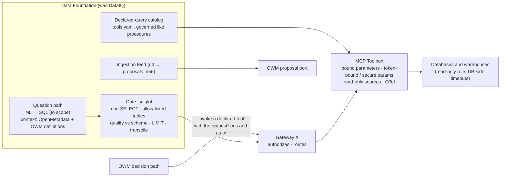

# DataIQ re-evaluated (MCP Toolbox + sqlglot), and the component names

**2026-10-19. An analysis for the user, not a decision.** The user proposed two things:
1. Re-evaluate DataIQ in today's context. Google's MCP Toolbox for Databases and sqlglot could
   handle database introspection, query sanitation and execution, which closes some of G-51's gaps;
   then scope the rest.
2. Rename the components to avoid collisions: the OWM stays; DocIQ becomes the Knowledge Foundation;
   DataIQ becomes DataHub "or something similar".

This reads both tools' public docs (nothing was installed or run), the canon (owm-edd), and the
lab's G-51 analysis (`docs/structured-data-by-query-2026-10-19.md`). Tracked on G-51 (the tools) and
G-53 (the names).

## Short answer

- **The tools: agree, and the canon is already halfway there.** GatewayIX is "IBM ContextForge +
  Google MCP Toolbox", and the 07-18 IX/IQ note lists a Toolbox spike as an open item. Toolbox's
  **parameterised tools are the decision path G-51 asked for**: declared, typed, bound queries. Its
  token-bound and `secure` parameters scope a call to a mandate. sqlglot supplies the gate for
  generated SQL that Toolbox doesn't have. **What's left to scope:** generating SQL from questions,
  history (as-of reads), reaching SaaS systems, governing the declared tools, and capturing evidence
  into the record.
- **DocIQ → Knowledge Foundation: agree.** The demo, the lab and the CxO write-up already say it.
- **DataIQ → DataHub: push back.**
  - DataHub is a known product in this exact space, and it now calls itself "a context platform for
    AI agents", which is BlueLeaf's own pitch.
  - The canon already uses the name for the substrate OpenMetadata replaced.
  - **I'd use "Data Foundation"**, which pairs with the Knowledge Foundation and says what it does.
  - Changing DataIQ is right, though: a UK data-community business already trades as DataIQ.

## Part 1: DataIQ with MCP Toolbox and sqlglot

### The tools (read 2026-10-19)

| | MCP Toolbox for Databases | sqlglot |
|---|---|---|
| **What** | An MCP server that runs database tools declared in `tools.yaml` (sources, tools, toolsets). Formerly genai-toolbox | A Python SQL parser, transpiler and optimizer, with no dependencies |
| **License, owner** | Apache-2.0, `googleapis` org, outside contributions welcome | MIT. Fivetran acquired Tobiko Data, its company, on 2025-09-03 |
| **State** | v1.14.0 on 2026-10-08, SemVer, about 16.7k stars | 30.23.0 on PyPI, about 9.7k stars, 34 dialects |
| **Sources / dialects** | Postgres, MySQL, MariaDB, SQL Server, Oracle, Snowflake, Trino, ClickHouse, BigQuery, Spanner, AlloyDB, SQLite, Neo4j, MongoDB and more. **No Salesforce** | Postgres, MySQL, Snowflake, BigQuery, T-SQL, Oracle, Trino, DuckDB, SQLite and more |
| **Key features** | Parameterised SQL tools: typed, **bound as prepared statements**, with `allowedValues`, min and max. `execute-sql` and `list-tables` per source. Parameters bound to OIDC token claims; `secure` parameters the LLM can't set; `authRequired`. Source `readOnly` (enforced by the engine on Cloud SQL, AlloyDB and BigQuery). OpenTelemetry metrics and traces | Parse to an AST; transpile between dialects; `qualify` tables and columns against a schema; column lineage; semantic diff; a test-grade executor |
| **Doesn't** | Generate SQL. Its natural-language tools delegate to Google services (AlloyDB AI, Gemini, Looker), which is an inference. No documented statement allow-list, timeouts or row limits. No as-of reads. Whether it logs SQL and parameters is unverified | Sanitise SQL or bind parameters. The parser is **lenient**: a clean parse doesn't mean the SQL runs, and unknown syntax can fall through |
| **Watch** | `templateParameters` splice values into the SQL text unquoted. The docs themselves warn they're "prone to SQL injections" | Whether `qualify` raises on an unknown column isn't documented. Test it before relying on it |

### What they close in G-51

| G-51 need | Closed by | Notes |
|---|---|---|
| **Declared, reviewed queries for decisions** | **Toolbox parameterised tools** | The biggest win. A tool is a named SQL statement with typed, bound parameters, which is G-51's decision path. The OWM *invokes* a declared tool and never writes SQL. That keeps the canon's "OWM stays out of the execution path" in the sense that matters |
| **Scoping a call to the mandate (the confused deputy)** | **Toolbox** token-bound and `secure` parameters, `authRequired`, GatewayIX authorisation | An agent can't widen a declared query's subject: the request id comes from the session, not the model |
| **Introspection** | Toolbox `list-tables`; sqlglot with a schema | The schema is indexed and searched, never extracted into the graph (Utopia's lesson) |
| **Gating generated SQL** | **sqlglot**, failing closed | Parse with the source's dialect. Admit exactly one SELECT; reject `Command` and unparsed nodes. Every table must be on the allow-list after `qualify`. Wrap a LIMIT |
| **Read-only, timeouts** | Toolbox `readOnly` where the engine enforces it; **otherwise the database role** | Neither tool documents timeouts or row limits. Set `statement_timeout` and grants on a read-only role. That role is the real security boundary; sqlglot is the second layer |
| **Dialects** | sqlglot transpile | One gate for every engine |
| **Telemetry** | Toolbox OTel, SQLCommenter | Feeds the canon's SigNoz layer |

### What's left to scope

1. **Generating SQL from a question.** Neither tool does it outside Google's own services. The
   canon's plan stands: Vanna or an LLM step with OpenMetadata definitions, SQL examples in
   pgvector, and OWM entity resolution. It's post-beta (F2), and its training store takes only
   approved examples.
2. **History and as-of reads.** Neither tool has them. Each declared tool has to read history where
   the source keeps it (temporal tables, field-history or audit tables, warehouse time travel), or
   from the OWM's own copy pushed through #56. This is per-source work, so it's the reason to pick
   the first systems early (G-51's fourth decision).
3. **SaaS systems.** The systems design partners named (Salesforce, NetSuite, Workday, ServiceNow)
   are SaaS apps reached through their APIs, not databases. There are two ways to reach them:
   - query a warehouse replica through Toolbox: freshness and history depend on the replication;
   - read their APIs, with dlt for ingestion as the canon already has, and a thin declared-read
     adapter for decision-time reads.

   This is the largest gap the two tools leave.
4. **Governing the declared tools.** `tools.yaml` is executable policy. Each declared tool should
   be a versioned procedure object (G-13): proposed by an agent or engineer, approved by the owning
   function, and admitted by a gate that replays it. `templateParameters` and `execute-sql` are
   never allowed on the decision path.
5. **Evidence in the record.** The decision record needs the tool name and version, the bound
   parameters, the source, the as-of time and the rows (or their hash). Toolbox's telemetry doesn't
   document capturing SQL or parameters, so the adapter at GatewayIX captures them.
6. **Identity across systems** stays with the Knowledge Foundation and the OWM. Toolbox reads one
   system's rows exactly; linking CRM-2048 to C-1001 is still resolution.

### For the lab

G-51's three-arm test gets concrete and stays cheap. Toolbox lists SQLite, so the 13 exports can
load into a read-only SQLite file: a read-only URI plus file permissions, since Toolbox's `readOnly`
isn't documented as enforced there.
- **Arm 2:** Toolbox declared tools, with the request id as a `secure` parameter.
- **Arm 3:** Toolbox `execute-sql` behind the sqlglot gate.

The evidence stays byte-identical, and the cost is still about $80 for the reader. The held-out
caveats in G-51 still apply.

## Part 2: the names

### Why a rename is justified

The IQ names come from the EnterpriseIQ era, and the canon keeps them on purpose: "the names survive
as components; the product framing does not". Their meanings have moved since:
- **DocIQ** meant the retrieval surface. Since 09-15 it means the whole OG-RAG loop, and older docs
  still use the old meaning.
- **IX** "had drifted into naming three different things" (ADR-903).
- **DataIX and DocIX** became IX components on 07-18, a choice the note admitted left names "one
  keystroke apart in logs and speech". On 09-21 they dissolved into lowercase `ix` contracts.
- **The demo already speaks differently.** glowing-garbanzo says "knowledge foundation" 40 times and
  DocIQ or DataIQ never. So do the lab and the CxO write-up.

Where the old names live: owm-edd mentions them about 1,490 times across about 150 files, sovera-owm
46 times, shiny-waffle 22 and garbanzo none. The rename is mostly a canon edit.

### DocIQ → Knowledge Foundation: agree

It's the name in use outside the canon. Under G-51's design it also becomes accurate: the foundation
holds documents, facts with spans and the links between systems. Values from the systems of record
move out to queries.

**One caution:** "foundation" suggests the OWM is built on it and depends on it. The canon's
direction is the reverse. The foundation proposes into the OWM through the port, and the OWM must not
depend on it (v1.4; standalone OWM "must not hard-depend on DocIQ"). The glossary entry should say so
in its first line.

The name is also KK-stiftelsen's English name (a Swedish research funder). That's harmless for an
internal component name, but don't use it as an external brand.

### DataIQ → DataHub: push back

1. **DataHub is a known product in exactly this space.** It's the open-source metadata platform
   from LinkedIn, and its company (Acryl Data) now brands itself DataHub, "a context platform for AI
   agents". That's BlueLeaf's pitch, under a competitor's name. Design partners' data teams may run
   it.
2. **The canon already uses the name for something else.** v1.3 made OpenMetadata the semantic
   substrate and "replaces DataHub". After a rename, "DataHub reads definitions from OpenMetadata,
   which replaced DataHub" would be a true sentence.
3. **"Hub" suggests a central store** that copies data in. The design is the opposite: read the
   systems of record where they live, exactly, as of a time.

**But do change DataIQ.** It is the trading name of a UK data-and-analytics membership business that
runs the DataIQ 100 list, which data leaders (the buyers) will know.

### The recommendation: Data Foundation

- **It pairs with the Knowledge Foundation:** documents to facts on one side, systems of record to
  exact reads on the other, the OWM between them. Once you know one, the other teaches itself.
- **It describes the job.** It's a generic term, so it doesn't borrow a product's name. The external
  brand stays BlueLeaf.
- **It carries the same caution** as the Knowledge Foundation: it serves and proposes, and the OWM
  doesn't depend on it.

**Alternatives:**
- **Data Access:** plain, but it reads like a permission;
- **Records** or **Record Layer:** precise about systems of record, but awkward in speech;
- **keep DataIQ:** no churn, but the collision stays.

**Knock-on effects:**
- **AgentIQ** would be the last IQ name. Rename it later for consistency ("Agent Workspace"), or
  leave it.
- **The IX substrate names** (GatewayIX, IdentityIX…) stay. With the IQ family gone, the "X vs Q,
  one keystroke apart" problem goes with it.

**How:** it's a canon ruling, so yours.
- An ADR in the 9NN series, plus an edit to glossary v4 and its retired-terms list.
- Rename the seats (CA-DocIQ → CA-KF, and so on).
- Historical documents keep the old names behind a pointer, as the EIQ era did.

I haven't edited owm-edd.
