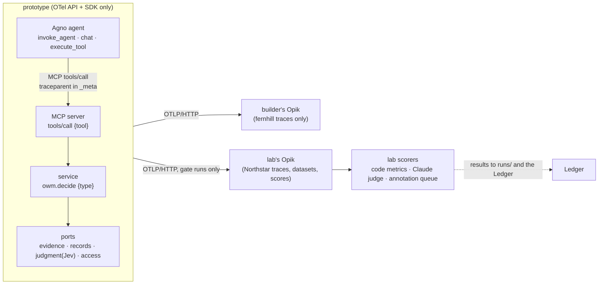

# Evaluation and observability for the prototype (2026-10-23)

**Question.** Which evaluation framework should the prototype and the lab use: deepeval, lighteval,
Opik or Ragas, with MLflow (reviewed 2026-09-28, `docs/tracking-mlflow-review.md`) as a reference
point? And does plain OpenTelemetry cover observability?

**Verdict.**
- **Observability: yes, plain OpenTelemetry.** The prototype emits OTel traces over OTLP and carries
  no vendor SDK. Its GenAI support is a set of semantic conventions plus instrumentation packages,
  and both are still at Development (experimental) status, so we pin versions.
- **Evaluation: Opik, self-hosted, as the trace store and evaluation workbench.** It reads the
  prototype's OTel traces directly and keeps data local. Its open-source build is the most complete
  for agent work: trajectory and multi-turn judges, annotation queues, and online rules on
  production traces. Its security record is also far cleaner than MLflow's this year.
- **MLflow is the fallback.** Because the prototype emits only OTel, switching backends means
  changing an endpoint, not the code.
- **Before we commit, a short spike (E0) must prove two things.** The docs of neither Opik nor
  MLflow confirm either one:
  1. that OTLP-ingested traces can be scored;
  2. that today's `gen_ai.*` attributes map cleanly.

The September review said MLflow was "the right tool at the wrong time", and named the trigger for
revisiting: "the OWM gets a regression eval". The prototype's gates are that trigger.

---

## 1. What "evaluation" means here

The prototype meets three kinds of evaluation. Only the second and third need a framework.

| Kind | Examples | What a framework adds |
|---|---|---|
| **Gate checks** (lab, exact) | Parity, field for field, on 32/22/10 scenarios; 24 register attacks with 0 admitted; static checks | Storage and history only. These stay pytest + stdlib |
| **Model-behaviour evals** (lab now, platform later) | Jev typed judgments: stability across repeats, rate of out-of-type answers. The agent's trajectory: right tools in the right order, never approving its own request, asking for clearance when it should. The agent's explanation staying faithful to the decision record (Claude as judge). Multi-turn | Trajectory metrics over traces, LLM judges, datasets, experiments compared across runs |
| **Platform evals** (OWM team, production) | Online scoring of production traces; annotation queues; datasets curated from traces; regression in CI | A server and UI, which we shouldn't build ourselves |

**The record's trace is not the OTel trace.** The kernel's `trace` records what a decision relied
on (G-06). It is domain data, part of the record, used for audit and admission. OTel spans are
operational and carry record ids, never the basis itself.

## 2. The constraints that pick the tool

- **C1 OTLP in.** The tool reads the prototype's OTel traces without its SDK inside the service.
- **C2 Local and private.** Expected outcomes come from `truth/`, so nothing leaves the machine.
  Telemetry is off by default, or there is a documented opt-out.
- **C3 Never-load holds.** The system under test never reads the eval store, and no optimizer is
  ever pointed at it.
- **C4 Claude as judge,** through the Anthropic API.
- **C5 Lab dependency closure.** The eval library stays lab-side, never in the prototype.
- **C6 Health.** A permissive license, active maintenance, low lock-in, and a clean security record.

## 3. Comparison

Researched 2026-10-23 from each project's repo, docs and PyPI. Security advisories were checked on
GitHub directly.

| | **Opik** | **MLflow 3** | **deepeval** | **Ragas** | **lighteval** |
|---|---|---|---|---|---|
| What it is | Platform (server + UI) + SDK, built for LLM and agent evaluation | ML lifecycle platform with a GenAI side | Library; its platform (Confident AI) is commercial cloud | Library | Model benchmark runner |
| License | Apache-2.0 | Apache-2.0 | Apache-2.0 (platform closed) | Apache-2.0 | MIT |
| Latest | 2.2.119, 10-23 (about 28 releases since 10-06) | 3.17.2, 10-21 (every 2–4 weeks) | 4.3.1 (2–4 a month) | 0.4.3, **2026-01-13; no release in 9 months** | 0.13.0, 2025-11-24 |
| **C1** OTLP in | **Yes.** HTTP at `/api/v1/private/otel/v1/traces`; maps `gen_ai.*`, OpenInference, Logfire and others | **Yes.** HTTP at `/v1/traces` (since 3.6); maps `gen_ai.*`, OpenInference, Traceloop | **Cloud only** (`otel.confident-ai.com`), with `confident.*` or OpenInference attributes; no `gen_ai.*` | No | No |
| Scoring traces it ingested over OTLP | Not stated in the docs → **spike** | Not stated in the docs → **spike** | n/a | n/a | n/a |
| **C2** Phone-home default | Server usage stats on; `OPIK_USAGE_REPORT_ENABLED=false` | On since 3.2; `MLFLOW_DISABLE_TELEMETRY=true` or `DO_NOT_TRACK=true` | PostHog on; `DEEPEVAL_TELEMETRY_OPT_OUT=1` | On; `RAGAS_DO_NOT_TRACK=true` | None found |
| **C4** Claude as judge | Yes, through LiteLLM | Yes, `anthropic:/<model>` | Yes, through a wrapper class | Yes | Inferred only |
| Agent and trajectory metrics | Task Completion, Tool Correctness, Trajectory Accuracy | Code or `make_judge` scorers over the trace (no built-in tool-call scorers confirmed) | Strong: task completion, tool correctness, MCP-use metrics | ToolCallAccuracy and F1, AgentGoalAccuracy | None |
| Multi-turn | Thread judges (coherence, completeness, knowledge retention) | Experimental since 3.10 | Yes | Yes | No |
| Human annotation | Feedback scores + **annotation queues** (open source) | "Add feedback" on a trace; labeling sessions and the review app look Databricks-only | Platform only | No | No |
| Online rules on production traces | Yes (LLM-judge or Python rules) | Yes | Platform only | No | No |
| Self-host footprint | **Heavy:** MySQL, ClickHouse, Redis, ZooKeeper, MinIO, backend and frontend (Compose "not for production"; Helm for k8s) | **Light:** one process on SQLite, runs through `uvx` | n/a (library) | n/a | torch + transformers |
| Auth in open source | **None** (SSO, LDAP and passwords are Enterprise) | Basic auth, RBAC since 3.13 | n/a | n/a | n/a |
| Security, 2026 | One moderate advisory (webhook SSRF, fixed 2.2.68) | **A run of critical and high advisories, clustered on the GenAI and auth endpoints** (below) | None found | 2 CVEs reported by aggregators | n/a |
| Agno | Documented, through OpenInference | `mlflow.agno.autolog()` (needs the SDK in-process) | None | None | None |

**MLflow's 2026 security record** (GitHub advisories, checked 2026-10-23):
- **October alone brought four advisories:**
  - a critical unauthenticated remote code execution through third-party scorer deserialization
    (10-09);
  - a high-severity arbitrary file read (10-13);
  - CrewAI autologging writing provider API keys into spans (10-13);
  - an SSRF through scorer arguments on the evaluate endpoints (10-22).
- **August:** a high-severity unauthenticated SSRF in webhooks (CVE-2026-64849, fixed 3.15.0).
- **CVE-2026-2652 (fixed 3.10.0):** a basic-auth bypass that left the FastAPI routes unprotected,
  including the **OTLP trace ingestion route**. One vendor (CrowdSec) reports it exploited in the
  wild.

The flaws concentrate on exactly the features we would use: scorers, evaluate and OTLP ingest.

### Per tool

- **lighteval is out.** It benchmarks models (MMLU-style tasks on transformers, vLLM or endpoints).
  It doesn't evaluate an application or an agent, and has no tracing. For agent work it defers to
  Inspect AI.
- **Ragas is out.** It has had no release in nine months and no push since February, after an
  org rebrand. Its API churned across 0.2, 0.3 and 0.4. It pulls in LangChain, the OpenAI SDK and
  `datasets`. It can't read traces. Its useful agent metric (tool-call accuracy against reference
  calls) is about 50 lines of our own code.
- **deepeval is the best library and the wrong shape.**
  - Its pytest-native metrics are good, including MCP-use and trajectory metrics.
  - But everything beyond the library (trace UI, datasets, comparison, annotation, OTLP ingest)
    is Confident AI's cloud. Its OTLP path is that cloud, with its own attributes rather than
    `gen_ai.*`.
  - It phones home by default and puts pytest and grpcio in its runtime dependencies.
  - It's worth reconsidering only as a metrics library inside the lab, if Opik's judges prove
    weak.
- **MLflow is close behind.**
  - It's light (SQLite, `uvx`), and its OTLP mapping is the broadest. It has OSS judge alignment.
    Our tracker was designed in its shape.
  - Against it: the security record above, multi-turn still experimental, and a human-review
    workflow that leans on Databricks.
  - For a lab instance bound to loopback, the risk is manageable. For the eval capability the OWM
    team would adopt into a platform, it's the deciding weakness.
- **Opik is recommended.**
  - It's built for exactly the second and third kinds of evaluation. In open source, it has:
    trajectory and thread judges, annotation queues for human grades, and online rules on
    production traces.
  - It reads OTel GenAI traces directly. Its security record is clean.
  - Its costs:
    - a heavy Docker stack (this machine has Docker 29 and 24 GB of RAM);
    - **no authentication in open source**, so it binds to loopback, and a platform deployment
      needs Enterprise or the platform's own gateway in front;
    - near-daily releases, so we pin a version.
  - Its Agent Optimizer and prompt optimizer must never be pointed at the system under test (C3).

## 4. Observability: OpenTelemetry, with the details that matter

**What exists today:**
- **The GenAI and MCP conventions are Development, not stable.** In June 2026 (semconv v1.42.0)
  they moved out of the core repo to `open-telemetry/semantic-conventions-genai`, which has no
  tagged release yet. **Pin by commit.**
  - Spans: `chat {model}`, `invoke_agent {name}`, `execute_tool {tool}`.
  - Attributes: `gen_ai.provider.name` (formerly `gen_ai.system`), `gen_ai.usage.*`.
  - An evaluation event: `gen_ai.evaluation.result`.
  - MCP spans: `tools/call {tool}`, with `mcp.method.name` and `mcp.session.id`, and trace
    context carried in `params._meta`.
- **The Python GenAI instrumentations also moved, to `open-telemetry/opentelemetry-python-genai`.**
  - All are at 1.3b0, including **Anthropic** and **Agno**. The Agno package,
    `opentelemetry-instrumentation-genai-agno`, was first published today.
  - `opentelemetry-util-genai` (`TelemetryHandler`) instruments a custom model client, which fits
    the Jev adapter.
- **Message content is off by default** (`OTEL_INSTRUMENTATION_GENAI_CAPTURE_MESSAGE_CONTENT=NO_CONTENT`).
- **Two gaps for MCP and Agno:**
  - There is no official MCP instrumentation for the Python SDK, so the MCP server writes its own
    spans to the convention.
  - Agno has its own usage telemetry, separate from OTel: `AGNO_TELEMETRY=false`.

**Proposed shape for the prototype.** This is a spec amendment, not yet applied.

1. **OTel API and SDK only, exporting OTLP/HTTP** to an endpoint taken from config. There is no
   vendor SDK anywhere in the prototype.
2. **`core` and `contract` never import OpenTelemetry.** Spans start at the edges: the service,
   the adapters, MCP and the agent. `tests/boundaries/test_imports.py` enforces this.
3. **A telemetry contract, `contract/telemetry.yaml`, frozen with the rest of the contract.** It
   lists the span names, required attributes and forbidden attributes. The lab's scorers read
   these spans, so this is a cross-team interface (PL-5).
   - `owm.decide {type}`: decision id, type, outcome, procedure, pack and profile versions. For
     no decision, `error.type` is the typed error code, plus `owm.error.who_can_fix`.
   - One span per port call, with port errors in `error.type`.
   - The Jev judgment call as a GenAI inference span, carrying the question id, the answer type,
     and an out-of-type flag.
   - MCP `tools/call {tool}` server spans that continue the agent's trace, so one trace runs from
     the agent's turn to the ports.
   - The agent's spans from the Agno instrumentation (the OTel GenAI package; OpenInference is the
     fallback, never both at once).
4. **Never in a span:** bearer tokens, the `Authorization` header (sanitized), key-file contents,
   or message content by default. The lab may turn content on for its own runs. A test exports a
   full journey to an in-memory exporter and scans every attribute for the token and the key.
5. **Three metrics:** decisions by type and outcome, errors by code, and GenAI token usage. No OTel
   logs in v1, because the Python logs signal is still maturing; stdlib logging carries the trace
   id.
6. **Pin exact versions** of the SDK, the instrumentations and `util-genai`. Record the
   semconv-genai commit. Keep attribute names in one constants module.

**Where it lands in the builder's plan:**
- P1 adds `telemetry.yaml` to the contract.
- P3 wires the service and port spans and adds the token-scan test.
- P5 adds the MCP and agent spans, and the journey test asserts one connected trace.
- Review Focus gains "a token or key in an exported span".

## 5. Keeping the never-load rule

- **There are two Opik instances, with separate Compose projects, volumes and ports.**
  - The builder's instance holds fernhill traces only.
  - The lab's instance holds Northstar traces, datasets with expected outcomes, and scores. It runs
    only during gate runs.
  - The builder is never given the lab's address, and its read limits forbid it.
  - Opik's open-source build has no auth, so the separation is by instance, not by project.
- **The lab's scorers, judge prompts and datasets stay lab-side,** as the never-load rule already
  says.
- **No optimizer (Opik's Agent Optimizer, prompt optimization, MLflow's `optimize_prompts`) is ever
  run against the system under test's prompts.**
- **The Ledger stays the record of human decisions and grades.** An annotation queue is where
  grading happens. Grades are copied to the Ledger, never the other way.

## 6. Spike E0, before we commit

E0 is lab-side. It takes about two hours plus a few cents of Claude judge calls. It needs the
user's OK to download the Opik Compose images and the OTel Python packages. MLflow runs through
`uvx` for the fallback comparison.

1. Emit a hand-built trace in today's conventions to each backend: `invoke_agent` → `tools/call`
   → `owm.decide` → `chat` (judgment) → a port span.
2. Check that each backend shows **one connected trace** and maps the `gen_ai.*` attributes, and
   tool spans, correctly.
3. On an **OTLP-ingested** trace, check that each backend can:
   - score it with a code metric;
   - score it with a Claude judge;
   - add it to a dataset;
   - fire an online rule.
4. Confirm that telemetry is off: no outbound traffic except to the judge.

**Pass:** Opik does steps 2–4, and the choice stands. **If Opik fails and MLflow passes:** MLflow,
bound to loopback and on at least 3.17.2. **If both fail on step 3:** the lab scores its own way
(pytest over traces exported to files) and uses either tool as a viewer only.

## 7. Open questions

- **Production auth for the platform.** Opik Enterprise, or the platform's own gateway (Authorizer)
  in front of open-source Opik? This is for the OWM team, not v1.
- **How far Opik's daily releases break things.** We pin a version and upgrade deliberately.
- **Whether `gen_ai.evaluation.result` events should carry the lab's scores back into OTel.** This
  isn't needed for v1.

## Sources

- **Opik:**
  - repo: <https://github.com/comet-ml/opik>
  - OTel ingest: <https://www.comet.com/docs/opik/integrations/opentelemetry>
  - advisories: <https://github.com/comet-ml/opik/security/advisories>
  - self-hosting and usage stats: <https://www.comet.com/docs/opik/self-host/local_deployment>,
    <https://www.comet.com/docs/opik/self-host/configure/anonymous_usage_statistics>
- **MLflow:**
  - OTLP ingest: <https://mlflow.org/docs/latest/genai/tracing/opentelemetry/ingest/>
  - attribute mapping: <https://mlflow.org/docs/latest/genai/tracing/opentelemetry/attribute-mapping/>
  - advisories: <https://github.com/mlflow/mlflow/security/advisories>
  - CVE-2026-64849: <https://advisories.gitlab.com/pypi/mlflow/CVE-2026-64849/>
  - CVE-2026-2652: <https://www.crowdsec.net/vulntracking-report/cve-2026-2652-mlflow-authentication-bypass>
  - usage tracking: <https://mlflow.org/docs/latest/community/usage-tracking/>
- **deepeval:**
  - repo: <https://github.com/confident-ai/deepeval>
  - data privacy: <https://deepeval.com/docs/data-privacy>
  - OTel: <https://www.confident-ai.com/docs/integrations/third-party/openinference>
- **Ragas:**
  - repo: <https://github.com/vibrantlabsai/ragas>
  - releases: <https://api.github.com/repos/vibrantlabsai/ragas/releases>
  - advisories: <https://osv.dev/list?q=ragas>
- **lighteval:** <https://github.com/huggingface/lighteval>
- **OTel:**
  - GenAI conventions: <https://github.com/open-telemetry/semantic-conventions-genai>
  - Python GenAI instrumentations: <https://github.com/open-telemetry/opentelemetry-python-genai>
  - Agno instrumentation: <https://pypi.org/project/opentelemetry-instrumentation-genai-agno/>
  - FastAPI header capture: <https://opentelemetry-python-contrib.readthedocs.io/en/latest/instrumentation/fastapi/fastapi.html>
  - Agno telemetry: <https://docs.agno.com/basics/telemetry>
