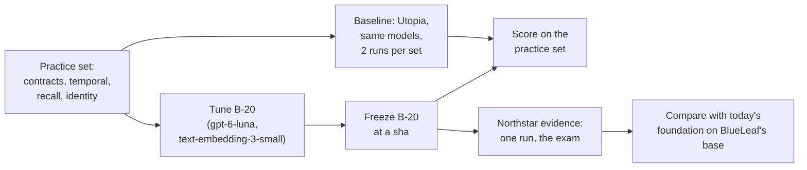

# B-20 and today's foundation's own bench (assessment, 2026-10-16)

**The question (the user, 2026-10-16):** should B-20, BlueLeaf's own knowledge foundation, use
Utopia's `scripts/bench/` as its baseline and corpus?

**Short answer:** yes, but beside Northstar, not instead of it. Four of the bench's sets should
become B-20's **practice set**, the corpus it is tuned on, and Northstar's evidence stays the
**sealed exam**. For the baseline, run Utopia on those four sets again with B-20's models. Don't
borrow the numbers in the bench's README.

The bench's README and much of its code are in Chinese. The English guide is
`docs/foundation-bench-guide-2026-10-16.md`. Every number below comes from it, with file and line
references there.

## 1. What the bench is

Utopia's team built it to develop their foundation. It has 13 sub-benches. Four of them fit an
English B2B foundation:

| Set | What it asks | Corpus | Truth | Utopia's recorded score |
|---|---|---|---|---|
| **Contracts** (`corpora/contracts/`) | A lease's terms on a given date, after a chain of amendments | Real SEC filings: Blackbaud's lease chain and others, 62 in the manifest. Fetched at run time, not committed | 18 questions, read by hand from the filings | 5 to 12 of 18 (2026-09-13, DeepSeek-V3.2); about ±3 per run |
| **Temporal** (`temporal/`) | "As of date X", on the world axis (what was true) and the record axis (what we knew) | A made-up English company, ingested in 3 waves, with a deletion, a correction and a merge | 37 questions (23 world, 14 record), by hand. 3 have an empty answer | 35/35 with uniqueness declared; 28/35 out of the box (2026-09-05, DeepSeek-V3) |
| **Recall** (`recall.mjs`) | Did the figures, parties, titles and table cells in a filing reach the graph? | 4 real NVIDIA SEC filings, tables included. Fetched at run time | 52 items, read by hand | 33/52, rising to 49/52 over six rounds of code changes (2026-09-09, DeepSeek-V3.2); SD ≈ 2.7 |
| **Identity** (`identity.mjs`) | Namesakes kept apart, and aliases (renames, abbreviations, Chinese and English names) joined | 12 tiny made-up documents, mostly Chinese | 21 anchors for 8 entities; pairwise precision and recall; a reversed-order run | None recorded |

The others don't fit. Re-DocRED is general Wikipedia relations. Type resolution is bound to
schema.org. Mappings and ask are SQL over structured data. Competency and the ontology agent
measure Utopia's own mechanisms. Time words is mostly Chinese, and the duplicate labels cover AI
companies.

## 2. Why it helps

1. **It fixes B-20's held-out problem.** Guard 3 in garbanzo's plan says B-20 must never be tuned
   on Northstar, because Northstar has no held-out half. Without another corpus, nothing can be
   tuned at all. With the bench, B-20 is tuned on the practice set, frozen at a sha, and then sits
   Northstar once.
2. **Its truth is independent of us.** Utopia's team wrote it, not the lab. Our knowledge of
   the traps can't shape it, which answers the "whoever writes them has seen the traps" risk.
3. **Real documents.** The SEC filings have tables, exhibits and amendment chains, so they
   exercise Docling well beyond the lab's 78 KB of text. They're HTML filings rather than PDFs,
   though, so Q3 (the PDF path) is only partly answered.
4. **The commercial claim.** "Same models, on the incumbent's own bench" is a claim a VC or a design
   partner can check. It holds only if Utopia is run again on our models.
5. **The contracts and temporal sets are our domain:** clauses overridden by amendments, a change of
   landlord, an adjusted price, retraction, and "as of" on both axes.

## 3. What it can't do

- **The recorded numbers aren't a baseline for us.** They come from other models (DeepSeek-V3 and
  V3.2, gemini-3.5-flash, claude-haiku-4-5, deepseek-flash), other embeddings (bge-m3) and many
  commits. It is also Utopia's development bench: they changed code against it (recall went from
  33 to 49 of 52), so their scores are tuned scores.
- **It's noisy.** Contracts move about ±3 of 18 per run, and recall has an SD of 2.7 of 52. Each arm
  needs at least two runs, and a difference of a few questions means nothing.
- **Every scorer reads Utopia's Postgres.** Each set needs a small adapter that reads B-20's
  contract API instead. The scoring rules carry over unchanged.
- **It doesn't test decisions.** It has no authority bands, no hearsay, no product-scoped
  exceptions and no requests to check. That stays Northstar's job, and the OWM's.
- **Identity is small and Chinese.** An English translation would be a new, labelled variant, not
  the bench's own set. It does contain the namesake pattern behind G-49 (two Zhang Weis).

## 4. How it fits together

## 5. The baseline run

- **What:** Utopia on the four sets, with gpt-6-luna and text-embedding-3-small, two runs per set,
  and a fresh base per run (the bench's own rule).
- **Where:** the bench's scripts write to Utopia's database directly. They create bases, change
  flags, delete facts and promote their account to admin. Our rule is that the live instance's
  Postgres stays read-only. So the baseline needs **a throwaway Utopia instance with its own
  database**, or the user's explicit OK to write to the live one. A throwaway instance is the
  recommendation.
- **Spend:** OpenAI, on the user's Utopia key. The sets are small (12 tiny documents, 3 waves, 4
  filings, and the lease amendments without the 2-hour base lease). Estimate and pre-register
  before the run.
- **SEC fetches:** need a user-agent with a contact. Use a project contact, not a personal address.

## 6. Rules that carry over

- **Northstar stays the exam:** run once on B-20's frozen sha. Guard 3 becomes "tune only on the
  practice set".
- **Dependency direction:** copy the bench's files into B-20's evaluation folder, with Apache-2.0
  attribution. The foundation's product code never imports them. Wikipedia-based sets are
  CC BY-SA, but none of the four is one.
- **Never name Utopia in a demo or UI.** If results reach a client, describe it as "another
  foundation's public bench".
- **Pre-register each run:** sets, models, the number of runs and the spend guard.

## 7. What changes in garbanzo's B-20 plan (if adopted)

- **§2 corpus:** the four sets become the practice corpus, and Northstar's evidence becomes the exam.
- **§3 guard 3:** "tune only on the practice set; Northstar once, at a frozen sha".
- **Q3:** partly covered by the SEC filings. The PDF path still needs its own answer.
- **A new question:** where the baseline runs (a throwaway Utopia instance), and its spend.
- **F3 and F4's proofs** gain the practice-set scores beside the span and identity probes.
