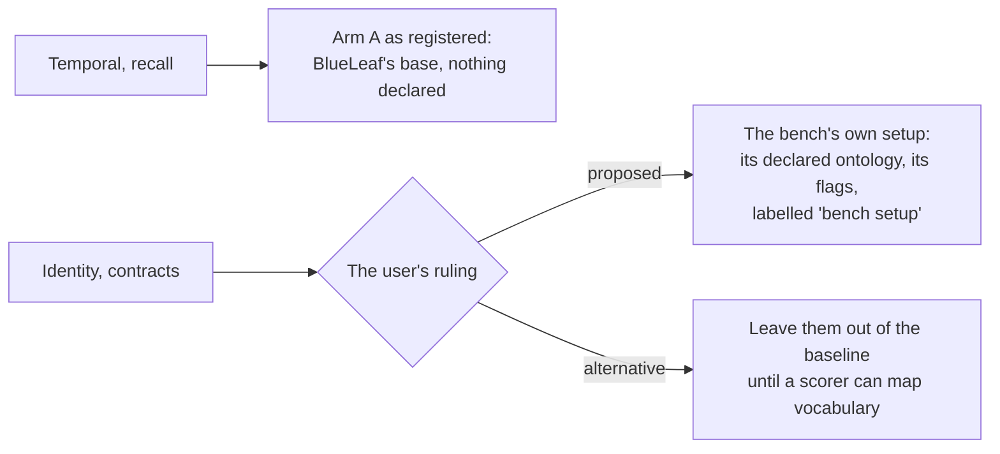

# Today's foundation on the practice set: baseline pre-registration (2026-10-16)

**Status: pre-registered, amended before the run (§8), run on 2026-10-16.** The bench's own
scorers are done; the contract path is still to come. Results are in
`runs/2026-10-16-utopia-aad5b06-bench-baseline/notes.md`. The user ruled on §8.2 on 2026-10-16
(bench setup, labelled).

**Decided:** the user, 2026-10-16 (`docs/foundation-bench-assessment-2026-10-16.md`): practice set
plus a re-run baseline.

**Scoring plan this registers against:** glowing-garbanzo d06740c,
`owm/docs/b20-practice-set-scoring.md`.

## 1. What runs

| | |
|---|---|
| **System** | Utopia at **aad5b06**: the binary the live instance runs. It's a **second server process** on 127.0.0.1:1526, against an **ephemeral database `utopia_bench`** on the same Postgres server (the user's choice, 2026-10-16). It has its own data directory and its own workspace keys. The live database is never written. `utopia_bench` is dropped once both scorers have read it |
| **Models** | Chat `gpt-6-luna`, embeddings `text-embedding-3-small`, as for BlueLeaf's base |
| **Base settings** | **BlueLeaf's base's own settings**, read on 2026-10-16: `auto_extend_ontology` on, `ontology_lang` en, `materialize_inferences` on, `auto_type_resolution` on, **`governance` off**. A new base's default turns governance on; that is a labelled variant (§3) |
| **Declarations** | **None** (condition 1): no declared types, no uniqueness, no functional relations. B-20 declares nothing either |
| **Bases** | A fresh base for every run (the bench's own rule). Each base is kept until both scorers have read it, then the instance is deleted |
| **Judge** | None in the four scores. If recall's `judge_open` runs, its judge isn't `gpt-6-luna` |

## 2. The sets

| Set | Files | Loaded as | Questions |
|---|---|---|---|
| **Identity** | `corpora/identity/d00..d11` (12 files, mostly Chinese), as they are | In the bench's order with each file's `doc_time`, then a second base in reverse order | 21 anchors, 8 entities |
| **Temporal** | `temporal/corpus.json`, three waves | Wave by wave with `doc_time`. The queue drains before each wave's record time is taken. The bench's post-ingest operations run through Utopia's REST API, labelled as hooks (G3, G4) | 37 (23 world axis, 14 record axis), as the bench scores them; its known-gap questions are reported apart |
| **Recall** | The 4 NVIDIA filings `fetch-sec-filings.mjs` names, fetched at run time | Once | 52 items |
| **Contracts** | The Blackbaud HQ lease chain as `lease_bench.py setup` loads it, **without the 2016 base lease** (the bench's default) | Once, with the file dates the bench assigns | 18 |

The SEC files are fetched once, kept outside git, and their sha256 values are recorded in the run's notes,
so both foundations read the same bytes.

## 3. Runs

| Arm | Sets | Runs | Bases |
|---|---|---|---|
| **A. Like-for-like** (§1) | All four | 2 each | identity 4 (two orders × 2), temporal 2, recall 2, contracts 2 |
| **B. Declared** (labelled) | Temporal, contracts: the types and uniqueness the bench declares | 2 each | 4 |
| **C. Governance on** (labelled) | Identity | 2 | 4 |

Arm A is the baseline. Arms B and C are reported beside it and never replace it. If the spend guard
stops the run, B and C are dropped first.

## 4. Scoring

- **Through the contract** (recall, temporal, identity): garbanzo's scorers in B-20's `evaluation/`
  read web-next's adapter over the throwaway instance, with a read token scoped to it. The adapter's
  three fixes (qualifiers, the K15 list without a name, the open statements) land first.
- **The bench's own scorer, on the same bases, for every set.** This is the reference for today's
  foundation. For recall, identity and temporal, the contract-path score must equal it. A gap
  means the adapter loses something, and it's fixed before any comparison with B-20. An
  adapter that loses facts would under-count the baseline and flatter B-20.
- **Recall items the contract can't see** (added 2026-10-16, glowing-garbanzo f5164ee). At aad5b06,
  today's foundation serves no read route for the role words (`statement_qualifiers`) and time
  words (`time_mentions`) on open statements. So an item found only there is invisible through the
  contract.
  - These items are listed by item id once the recall bases exist.
  - Recall is then reported two ways for today's foundation:
    - **what it extracted:** the bench's scorer, the primary figure, compared with B-20's;
    - **what it serves through the contract:** the contract path, without those items.
  - The listed items are a finding about today's foundation, not an adapter bug. Any other gap
    between the two paths is an adapter bug, fixed before comparison.
- **Contracts:** the bench's own scorer only, until contract G1 lands. B-20 gets a port with the same
  rules, and both results are labelled.
- **Noise:** report every run, never only the best. A gap smaller than the bench's noise (recall
  SD 2.7 of 52, contracts ±3 of 18, temporal chat ±2) is reported as no difference.

## 5. Spend guard

- **Measured from the instance's own server log** (`llm usage` lines, as the bench's
  `llmUsageByCall` reads them), per set and per run. Dollars come from OpenAI's usage page afterwards.
- **Calibration first.** Run identity and temporal (small) first. Then project recall and contracts
  from their measured text sizes, and the cost per KB from those first runs.
- **Stop line: a projected total above $30** stops the run before recall and contracts, and I report.
  This is a rough guess: today's foundation can spend far more tokens than the text it reads (the
  bench measured 31k tokens per 270-token Re-DocRED document with alignment on), and `gpt-6-luna`'s
  price per token isn't in the lab's notes. My earlier "a few dollars" was too confident.
- Spend is on the user's Utopia OpenAI key, under the standing approval, and reported after the
  run.

## 6. Records

- **Results:** `runs/<run date>-utopia-aad5b06-bench-baseline/`, with `notes.md` first, this
  pre-registration copied in, the SEC files' hashes, the server log's usage lines, and both scorers'
  outputs. Runs are results: added to, never rewritten.
- **Never in a demo or UI:** today's foundation is not named. If results reach a client, it's
  "another foundation, on its own public bench".

## 7. Waiting on the user

1. ~~The instance~~: answered 2026-10-16. A second server on the same Postgres server, with an
   ephemeral database. It's up (no spend yet).
2. ~~The SEC contact~~: answered 2026-10-16. A project address, kept in the run's environment only,
   never committed.
3. **The OpenAI key for the bench instance's workspace.** Workspace keys are sealed per instance, so
   the live one's can't be reused. The user saves the key to a local file under `_owm-local/`, and
   the lab sets it through the instance's API without printing it. *Answered 2026-10-16: set on
   :1526's workspace from a local-only file, never printed.*
4. ~~The ruling in §8.2~~: answered 2026-10-16. Bench setup, labelled.
5. **Models (asked 2026-10-16):** OpenAI as registered. A Claude arm may be added later, labelled,
   with B-20 on the same model.

## 8. Amendment 1, before any spend (2026-10-16)

These were found while preparing the run, before anything was spent.

### 8.1 What BlueLeaf's base is (a correction)

This is a correction within the user's choice of "BlueLeaf's base's own settings". It was read from
the live database, read-only:

- **Ontology packs.** The base was built from `schema-org` and `w3c-org`. On 2026-10-13 it was born
  with 915 schema.org classes, 8 W3C Org classes and 1,589 relation types. One relation has been
  grown since.
- **Models.** Chat is `gpt-6-luna` at reasoning effort **`low`**. Embeddings are
  `text-embedding-3-small`.

§1 named only the flags. Arm A's bases now get the packs and the reasoning effort as well. A new base
on :1526 would otherwise get no pack and the server's default flags, including governance on.

### 8.2 Two scorers read the declared vocabulary (ruled: bench setup, labelled)

| Set | What the bench's scorer reads | With nothing declared |
|---|---|---|
| Temporal | Entity names and fact values | Scores as registered |
| Recall | The text of facts and statements | Scores as registered |
| Identity | An entity counts for an anchor only if its type key equals the declared one: `person`, `organization` or `equipment` (`identity.mjs:189`) | The 7 probe anchors match only if a grown type happens to be called `equipment`. The score would fall for a reason of vocabulary, not identity |
| Contracts | Entities of the declared classes `lease` and `purchase_agreement`, and values of declared predicates such as `expansion_option_deadline` (`lease_bench.py score`) | Close to zero by construction. `setup` has no undeclared mode |

**Decided (the user, 2026-10-16), as proposed:**
- Identity and contracts run as the bench sets them up, with their declared ontology and the bench's
  flags, labelled "bench setup".
- For these two sets, the declared ontology is the question's vocabulary, not a tuning aid. Their
  scorers can't ask in any other words.
- B-20's ports then need a fixed mapping from B-20's classes and predicates to the same vocabulary.
  It's written before B-20 sees any practice result, which is garbanzo's call.
- **Arms:**
  - B becomes temporal only, since contracts is already declared.
  - C stays: identity with governance on, on the bench's setup.

### 8.3 How the run is fenced (no ruling needed)

- **The database.** Every bench script's SQL goes through a wrapper that connects only to
  `utopia_bench`, whatever database the script names. Tested: given `-d utopia`, it still lands on
  `utopia_bench`.
- **The scripts.**
  - The scripts are copied out of the Utopia repo at aad5b06, and their hashes are kept with the run.
  - They're changed only where arm A needs it:
    - temporal behind `BENCH_ARM=A` (packs, flags, and a wait for the pack's vectors before ingest);
    - recall through a wrapper. It builds a fresh arm A base, uploads the four filings once, waits for
      extraction, and calls `recall.mjs --kb <id> --score` unchanged. The bench's own loop would
      clear the facts and extract a second time.
- **The SEC filings** were fetched on 2026-10-16: the 4 NVIDIA filings and the 15 files of the
  Blackbaud HQ lease chain. None is an SEC block page, and their sha256 values go in the run's notes.
- **The sizes the guard projects from:**

  | Set | Text read per base |
  |---|---|
  | Identity | 850 characters |
  | Temporal | 1,254 characters |
  | Recall | 47,203 characters |
  | Contracts | 72,572 characters (13 files) |

  Cost is driven by chunks and the size of the prompt around them, not by text. So calibration on
  identity and temporal measures tokens per chunk, and recall and contracts are projected from their
  chunk counts.
