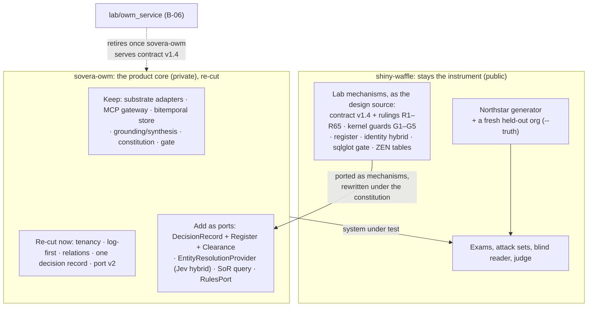

# OWM core: rebuild from the lab, or extend sovera-owm? (2026-10-20)

**The question (the user, 2026-10-20):** archive `kloudtaxi/sovera-owm` and rebuild the OWM core
from shiny-waffle, or extend sovera-owm to parity with shiny-waffle? Nothing depends on either yet,
so breaking changes are free now and won't be later.

**Sources:**
- `docs/sovera-owm-analysis-2026-10-19.md` (4363f1f) and its working notes;
- a read of the lab's OWM code today (`lab/owm_service`, `lab/owm_kernel`, `lab/owm_register`,
  `lab/spec_admission`, `lab/sor_reads`);
- sovera-owm's constitution (`docs/spec-kit-constitution.md`, v1.1.1).

The canon isn't weighed here, except where a step needs an amendment.

## Recommendation

**Neither as stated. Keep sovera-owm as the product repo, and use the free window for a deliberate
re-cut of its core, not a bolt-on.**
- **Port the lab's decision path in as mechanisms, rewritten under sovera-owm's constitution,** not
  as copied code.
- **Make now the breaking changes that get expensive once anything depends on the core** (listed
  below).
- **Keep shiny-waffle as the instrument that measures the result,** with a fresh held-out org.

The window you describe is real. But it argues for making the breaking changes now, not for
choosing which repo makes them: sovera-owm has no users either, so it can break as freely as a
new repo.

## What each repo actually is

| | sovera-owm | shiny-waffle's OWM code |
|---|---|---|
| **Built as** | The product core, under a constitution: hexagonal, port → fake → contract test, human judgment gates | Lab code. The kernel's README: "lab code, not BlueLeaf's OWM. It exists to measure what a general core would need" |
| **Size** | 26.6k source lines, 69.5k test lines, 3,958 tests, 100% branch coverage, mypy strict on 369 files | About 12.8k lines: service 8.2k, kernel 2.6k, register 1.1k, admission 0.3k, sor_reads 0.5k. 1,067 tests across the whole repo |
| **Substrates** | 11 real adapters: Neo4j (graph and vectors), Postgres, OpenAI, Anthropic, OpenMetadata, Kratos/Hydra, OpenFGA, Opik, clock | SQLite event log, files, Jev by replay of recorded runs |
| **Agent surface** | 14 MCP tools over stdio, with authentication | HTTP (FastAPI). `/lab/*` routes let anyone sign in as anyone |
| **Strong at** | Grounded answers with citations, the bitemporal store, an idempotent write path that fails closed, ops discipline | The decision path: register, procedures, conditioned decision records, clearance, separation of duties, evidence guards, identity adjudication, declared reads, business tables |
| **Evidence** | Thin: one corpus, one model, 4–5 graded questions. A raw LLM beat it 3 of 3 and was never re-run | Strong: adversarial sets C–F, the reader plus register at 0/42 unsafe on C and D, G-18 identity at 0 errors, the three-arm test |
| **Weak at** | The decision path is absent. Entity resolution is fake in production. Tenancy is nominal. #94. Adapters are tested only against fakes | Hard-wired to one company: the kernel reads Northstar's folder layout (`documents/*.md`, `structured/*.csv`), and its specs are discount, credit and SLA. The kernel and register sit outside mypy, with no tests of their own, loaded by `sys.path` insert |

Each repo is strong where the other is weak. That's why neither "archive" nor "extend to parity"
fits as stated.

## Why not archive sovera-owm and rebuild from the lab

1. **The lab's code isn't a product core, and its own rules say so.**
   - CLAUDE.md says the oracle isn't the OWM: "do not evolve it into OWM logic".
   - Its dependency rule: "The OWM contract must not depend on this lab".
   - The kernel is wired to Northstar's files and three hand-written specs. A rebuild would rewrite
     it anyway, so the code itself carries over less than it seems.
2. **You'd rebuild the larger half from scratch.** The lab has none of the substrate, identity,
   authorization, MCP or ops work: about 26.6k lines and 11 adapters, written under a discipline
   you'd want to keep. The lab's decision path is the smaller part, about 12.8k lines.
3. **You'd lose the independent instrument.** The lab's value is that it measures an OWM built
   somewhere else. Grow the OWM inside the lab and every scenario, scorer and fixture becomes
   tuning data. That's the never-load rule broken structurally, not by accident.
4. **shiny-waffle is public.** The product core belongs in the private repo.

## Why not "extend sovera-owm to parity" incrementally

1. **Bolting the decision path on beside `PromotionReceipt` leaves two decision models.** One is
   the review queue's approve/reject. The other is the lab's conditioned decision record, with
   approver, register version, conditions and expiry. The core would keep its centre of gravity as
   "Q&A over a graph with a review queue". The lab's evidence says the value sits in governed
   decisions.
2. **The changes that matter most are breaking ones.** An additive-only extension would leave
   exactly those for later, when they're expensive.

## The re-cut: breaking changes to make now

These are the changes that get much harder once data, agents or clients depend on the core.

| # | Change | Why now | Where (sovera-owm) |
|---|---|---|---|
| 1 | **Tenancy as a real key:** the tenant in every node key, and the review queue scoped by tenant | Re-keying a live graph is a migration. Today two tenants using `ACC-1001` share observations | `neo4j_graph.py:166-168` (MERGE by raw key), `review_queue.py:52-54` (no tenant filter), `tools.py` (tenant = subject id) |
| 2 | **The log as the source of truth, with the graph as a projection** | The canon says so. The lab's service already works this way (one event log, projections rebuilt from it). Today the episode log is write-only and "never rehydrated" | `core/ports/episode_log.py:26`, `adp/persistence/episode_log.py:16` |
| 3 | **Relations stored as relations (#94), and one identity read path** (`query_state` follows `RESOLVES_TO`, as `neighborhood` does) | A storage-model fix; every stored edge changes shape | `promotion.py:231-236`, `neo4j_graph.py:182-185, 563-571` |
| 4 | **One decision record** replaces `ReviewDecision` and `PromotionReceipt`. It's the lab's contract v1.4 shape: conditions, rationale, evidence, approver, register version, expiry | Everything downstream (audit, clearance, the UI, the demo contract) binds to this schema | `core/domain/review_decision.py`, `promotion_receipt.py:48-54` |
| 5 | **Proposal port v2: unfreeze v1.0.** Approval is authorized, proposer ≠ approver is enforced, every tool is authorized, and `resolve_entity` goes through review | Producers bind to the port contract; v1.0 is "additive-only" by its own terms | `docs/canon/sovera-owm-proposal-port-contract-v1.md`, `gw/mcp/pipeline.py:284-343`, `core/services/entity_resolution.py:172-194` |

**Item 5 is a Write-contract amendment.** Under the constitution it goes through the amendment
chain, not a direct edit. The others are build decisions, with ADRs.

## What to bring from the lab

Rewrite each one under sovera-owm's constitution: port → fake → contract test, `owm-core`
stdlib-only, vendor code in adapters. Don't copy files.

| Lab asset | Becomes |
|---|---|
| **Contract v1.4 and rulings R1–R65** (`docs/superpowers/specs/2026-10-10-owm-service-design.md`) | The spec for the decision record, clearance, the ratchet and approvals. garbanzo's web-next already speaks it, so a working client exists on day one |
| **Kernel guards G1–G5:** provenance, validity windows and conflict, tamper signs, consistency across documents, authority bands | Domain services in `owm-core`, reading the bitemporal store instead of a folder |
| **Register and procedures** (`owm_register`, `spec_admission`) | A register port with a Postgres adapter. Procedures run behind `DeciderKind.POLICY`, which sovera-owm already reserves |
| **Identity hybrid** (G-18: under 1% of pairs to a person, 0 errors) | The real `EntityResolutionProvider`, which is fake in production today |
| **sqlglot gate and Toolbox wiring** (`sor_reads`) | A system-of-record query port, with query receipts in `Evidence` |
| **ZEN business tables** (G-52) | A `RulesPort`, deferred as G-52 decided |

What carries over is the design and the evidence, not the files. The Northstar-specific specs
(discount, credit, SLA) become example procedures, not core code.

## How to know it worked: parity, measured

- **Parity means sovera-owm, as the system under test, passes the lab's decision exams** (sets C–F,
  the register attacks, the identity checks) at least as well as the lab's own engine did.
- **Northstar's decision scenarios are no longer held out for this.** B-06 and the kernel were built
  against them, so porting them carries that tuning across. The lab's generator takes `--truth DIR`,
  so the clean test is a **second, fresh synthetic org** that neither codebase has seen, scored
  once.
- **Live substrates, not fakes:** the re-cut's acceptance includes the live suite green as a whole,
  which it has never been.

## What would change this recommendation

- **The spike below shows `owm-core`'s domain can't host the decision record without rewriting most
  of it.** Then the honest move is a new core package inside sovera-owm, keeping the adapters,
  gateway and gate. That's still not a rebuild from the lab.
- **The substrate choice itself has to change,** for example if Neo4j as graph, vector store and
  projection is wrong for a log-first core. That's a bigger re-cut, but the same repo and
  discipline.
- **The constitution's hexagonal rule blocks a mechanism the decision path needs.** Then amend the
  constitution; it says itself that it's amendable.

## First steps (no-regret)

1. **Hygiene first:** rotate the secrets and remove the tracked lines, as reported on 10-19.
2. **Draft the Write-contract amendment** for proposal port v2 (item 5).
3. **A fit spike in sovera-owm:**
   - add `DecisionRecord`, `Register` and `Clearance` as port → fake → contract test;
   - run contract v1.4's acceptance against the fake;
   - this settles the first "what would change" question cheaply.
4. **Then items 1–4 of the re-cut, in that order.** Tenancy and log-first change the storage
   model; the decision record and port v2 sit on top.
5. **Build the fresh held-out org in the lab** in parallel. It's the lab's own work, and it doesn't
   touch sovera-owm.
