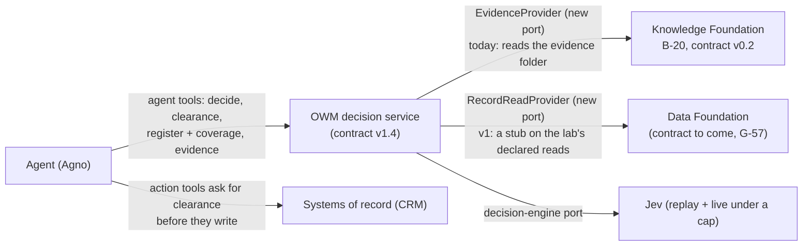

# A free-standing BlueLeaf prototype: what's outstanding before its spec

2026-10-21. The user asked, with a product manager's view:

1. What are the minimum outstanding items before we can cut a spec for a free-standing prototype,
   built without Utopia, that we then hand to the OWM team to implement?
2. We stopped work on our MCP server. Does it need to be ready for the prototype?

**Short answers:**

1. Six items: four decisions that are yours, and two facts the lab can establish at $0 (a fit check of
   about a day, and a sizing).
   None of the Ledger's open gaps blocks the spec. They become scope lines or known limits inside
   it.
2. An MCP server, yes; the stopped one, no. The prototype's agents reach the kernel only over MCP,
   so its MCP server is the prototype's front door and gets its own contract in the spec. It grows
   from `deal_desk` (`lab/rounds/tools_server.py`), the MCP server the proof round already runs
   against the OWM service. The stopped skunkworks server is a lab bench for blind experiments
   from Claude Desktop; finishing it first wouldn't move the prototype forward. (Revised
   2026-10-22: the first version said "No" and called the tool layer a thin adapter, which
   undersold it.)

## Your decisions (2026-10-22)

| # | Decision | Note |
|---|---|---|
| D1 | **Approved:** the prototype is the OWM team's reference | Screens in v1 wait for garbanzo. You've been removing Utopia from web-next in favour of blueleaf-knowledge-foundation; the question went to garbanzo on 10-22 |
| D2 | **Approved:** discount on DR-9001 first, credit second, SLA later | In your words: "we are building a platform not an SaaS product. we need to generalize the solution so it can be applied to various use cases" |
| D3 | **Approved:** C, keep sovera-owm and re-cut its core | Ledger G-54, decided (v4) |
| D4 | **Approved:** a stub behind `RecordReadProvider` in v1 | Ledger G-57's log (v3) |

**What D2's platform rule asks of the spec.** Discount is the first use case, not the product. So
the spec has to:

- say how a new use case is added: its procedure, its register terms, its actions, and the
  systems it reads and writes. Where that still takes code in the kernel or the MCP server, the
  spec names the place;
- decide whether the MCP server's action tools are generic and clearance-gated, or generated
  from each registered action. `deal_desk`'s `apply_discount` is one instance of that;
- prove it in the acceptance suite: credit is added the documented way, as the second use case,
  and both run on the held-out org (F2).

F2 now includes an audit of what is Northstar-specific and discount-specific in the decision path.

### Garbanzo's answer on screens (2026-10-22)

Garbanzo read the code at glowing-garbanzo edc584b; nothing was built or run. **Yes: web-next can
be v1's screens for the approvals slice, with about one to two days of small fixes in web-next and
no contract change.**

- **Already off Utopia:** sign-in (web-next signs its own cookie), and every governance path:
  the register, procedures, `/me`, approvals, decisions and clearances go only to the OWM service.
  Knowledge comes from B-20 through its contract (F5, 10-19).
- **The approvals surface works by the code.** Sarah's confirm is the condition-resolve route,
  Michael's approval is approve or decline, and then comes the clearance. All are OWM routes the lab
  service serves. No run has had Utopia switched off yet, so a journey run against the prototype is
  the proof.
- **Still on Utopia, and out of the approvals slice:** Ask (B-20 serves no K11 or K12) and the
  platform screens (documents and upload, People, Trust rules, Configuration, activity).
- **The fixes:**
  - load the bases without a Utopia workspace (hours);
  - a "no platform" setting that hides those screens (about a day);
  - stop linking register sources the foundation doesn't hold (hours; F5's finding 1);
  - a journey run with Utopia off (hours).
- **Outside the fork:** web-next has its own package and lockfile, and no import leaves it. Moving
  it is your call; the code doesn't force it either way.

**What it asks of the prototype's contracts.** These are spec items:

1. **Sessions.** Name a session route in the contract, even if it's for demos only, bound to
   loopback or behind a service key. Today it is `POST /lab/sessions`, outside the contract, and
   it has no auth. That's G-56: you ruled "leave auth open for now", but for the OWM team's
   reference, anything that reaches the service can open a session as anyone.
2. **v1.4's routes and shapes stay as they are.**
3. **Register entries.** An entry's sha256 is that of the canonical text. When the foundation
   doesn't hold the document, `source_id` is null rather than a lab path. This is a fix in the
   OWM service.
4. **The MCP server acts through the same decision and clearance routes,** as an actor of kind
   `agent` with `on_behalf_of`. Then what an agent did shows in the record Sarah and Michael see.
5. **Person ids are the HR export's employee ids.**
6. **No change to B-20's contract for the screens.** web-next's reads (K1, K2, K5, K9, K10, K13,
   K15 and spans) were all served in F5.

## What a free-standing prototype is made of today

| Part | What exists | Free of Utopia? | What's missing |
|---|---|---|---|
| Knowledge Foundation | B-20, `kloudtaxi/blueleaf-knowledge-foundation`, frozen at 02e9cc9; serves contract v0.2 natively (Docling + langextract, byte spans) | Yes | Text formats only; PDF and Word are "later" (F2b). No screens or sign-in, by design |
| OWM decision service | `lab/owm_service` (B-06, `owm-decisions` contract v1.4): register, procedures, decision records, clearance, the approval ratchet | Yes: no Utopia calls | It reads Northstar's evidence **folder** directly (`_lab.py`: `dataset/evidence`), not through a foundation. It's lab code on Northstar's layout, with three hand-written specs |
| Judgment model | Jev (`jev-1.13.0`) behind the decision-engine port; replays every recorded call under `runs/`, live only under a cap | Yes | Replay covers recorded inputs only: a new org or a new request needs Jev live |
| Data Foundation | G-57 decided (own repo, contract first, a fresh session builds it); the lab's declared reads (`lab/sor_reads`, G-51) | Yes | No contract yet; it waits for your docs |
| Agent runtime and tools | Agno (decided 10-07). The B-15 proof rounds drive an agent through decide → clearance → adapter | **No**: `lab/rounds/foundation.py` reads the BlueLeaf base through Utopia | Agent tools that point at B-20 and the OWM service |
| Screens | web-next (Use / Manage / Operate, governance v1.1) | **No**: it lives in garbanzo's fork of Utopia | A decision on whether v1 needs screens at all |

What makes it free-standing is two ports the OWM service doesn't have yet: evidence through the
Knowledge Foundation's contract, and records through the Data Foundation's. Both were proposed as
G-54's sixth re-cut item. Everything else exists.

## Question 1: the minimum outstanding items

### Decisions only you can make (spec blockers)

| # | Decision | My recommendation | Why it blocks |
|---|---|---|---|
| D1 | **What the prototype is for, and when it's done.** A reference for the OWM team (contracts, acceptance tests, a running system), a client demo, or both | **A reference first.** Done when the OWM team can implement against its contracts and a fixed acceptance suite passes on the prototype | It sets fidelity, and it decides whether screens are in scope |
| D2 | **The slice: which procedures, and which journey** | **Discount first**, on B-15's journey: an agent is asked to put DR-9001 through → decide → approval → clearance → the CRM write. Credit second; SLA later (G-48 is open on SLA, and in the exam's Part 2 no arm decided SLA) | It sets what the acceptance suite tests |
| D3 | **G-54, unparked: what the OWM team implements into** | **C: keep sovera-owm and re-cut its core.** Your framing already rules out A: if the OWM team implements, the lab doesn't become the product. What's left is whether they re-cut first (tenancy, the log first, #94, one decision record, proposal port v2, the foundation ports) | The prototype's contracts should be the shapes sovera-owm is re-cut to; otherwise the handover is a translation |
| D4 | **The Data Foundation in v1** | **A stub behind `RecordReadProvider`**, on the lab's declared reads, until your docs and the contract arrive. The port is fixed in the spec; what serves it can change | The decision path needs system-of-record reads, and the real contract doesn't exist yet |

Two smaller defaults I'd write in unless you object:

- **Screens:** none in v1. The journey runs through agents, which is the agents-first claim. web-next
  stays where it is, because re-pointing it means working in the Utopia fork. *(2026-10-22: open
  again. It waits for garbanzo's word on how far web-next has moved off Utopia; see D1 above.)*
- **Jev:** live under a cap, as today. A replay-only prototype can't take a new org.

### Facts the lab must establish ($0)

| # | Check | Why |
|---|---|---|
| F1 | **The fit check:** can B-20's contract v0.2 serve everything the kernel reads today (documents and versions, canonical text, spans, structured tables)? List the gaps | It decides whether `EvidenceProvider` is an adapter or a contract amendment (v0.3). This is the fit spike G-54 and G-57 both point to |
| F2 | **Size the held-out org:** what writing a second `truth/` costs (`northstar build --truth DIR` builds it), and what the kernel needs to run on it unchanged (today it reads Northstar's layout and holds three hand-written specs). Writing it is separate work, ideally by someone other than the lab (G-39) | B-06 and the kernel were built on Northstar's scenarios, so a suite on Northstar alone measures what they were tuned on. The OWM team needs a held-out org to accept against |

### Open gaps that don't block the spec

These become scope lines, build items or known limits inside it.

| Gap | In the spec as |
|---|---|
| G-45 (nothing enforces blocking conditions), G-46 (the requester re-runs into her own authority) | **Already built in the OWM service** (clearance, the ratchet); the Ledger keeps them open for the executor half. The prototype closes that half if its action tools ask for clearance before they write. That's worth showing: "what stops the agent applying the discount?" |
| G-47 (RR-14 accepts a child under a revoked agreement), G-48 (a second SLA payment) | Small kernel fixes in the build. G-48 only if SLA is in scope |
| G-01, G-02, G-31, G-33 (the register and its serving) | Ship the fixed serving (coverage and explicit absences; full terms). Set G, the fresh test, stays open evidence; it waits for your attack set |
| G-39 (one designer wrote the truth, the key and the engines) | The handover gate runs on the second org (F2). An outside red team stays on the roadmap |
| G-18, G-19, G-20, G-22, G-23, G-38, G-43, G-44, G-49 | Out of scope for v1; listed as known limits |
| G-55, G-56 (web-next) | Out of scope if there are no screens (D1) |
| The exam's S02/S03 hand review, Ledger grades | Unrelated to the prototype |

## Question 2: does the MCP server need to be ready?

*Revised 2026-10-22, after the user challenged the first answer.* The first version said "No" and
called the agent tools "a thin adapter". That was imprecise. **The prototype needs an MCP server.
It doesn't need the stopped one**, and finishing that one first wouldn't move the prototype forward.

### Three MCP servers, three jobs

| | Skunkworks `blueleaf-mcp` (stopped) | `deal_desk` (`lab/rounds/tools_server.py`) | The prototype's MCP server |
|---|---|---|---|
| State | Spec, buildability review, plan kickoff; never built | Built; ran the 10-14 proof round | New |
| Who connects | A person in Claude Desktop, as experimenter or as a blind subject | The proof round's Deal Desk Agent (`claude -p`) | Business agents on Agno, and any MCP client, Claude Desktop included |
| Unit of work | A graded question, labelled Q1…Qn | One request: DR-9001, S22 only (a scenario lock) | Any request in the org |
| Tools | Experimenter: 28 (sandboxes, planting documents, engines, scoring, `promote`). Subject: read documents, get procedure, get register, `decide`, `submit_decision` (an answer, for grading) | `get_request`, `decide`, `apply_discount` (decide → clearance → adapter) | `decide`, clearance, `report`, the register with coverage, evidence; action tools that ask for clearance before they write |
| What it calls | The kernel modules directly (`lab/owm_kernel`, `lab/owm_register`, Jev), on sandbox copies of the corpus, around the service | `lab/owm_service`, contract v1.4 | `lab/owm_service` v1.4, which sits on those same modules, through the two new ports |
| Evidence | Files in a sandbox's corpus folder | None of its own; the service reads the evidence folder | The Knowledge Foundation, through `EvidenceProvider` |
| Writes and approvals | None: nothing is written to any system | The CRM, only on a clearance | The CRM, only on a clearance; people approve outside the agent tools |
| Most of it is | The walls that keep a subject blind (imports, files, the seal), sandboxes, scoring | Lab routes (`/lab/sor`, `/lab/adapter`, `/lab/clock`) and the scenario lock | The product's front door |

### Why the stopped server doesn't come first

- **It does a different job.** It lets a person run blind experiments. Its subject side answers
  graded questions. It never acts on a request, asks for a clearance or writes to a system, and
  that journey is what the prototype exists to show.
- **Most of its spec is experiment machinery:** the seal, sandboxes, scoring and `promote`. None of
  it ships in the prototype, and none of it is for the OWM team to implement.
- **It goes around the service.** It calls the kernel modules directly on sandbox copies, so it
  has none of what `owm_service` v1.4 adds on top of them: sessions, versioned decision records,
  clearance, the ratchet, the systems-of-record overlay. The prototype and the handover are built
  on that contract.
- **Its trigger is gone.** It was built for set G, and on 2026-10-18 you ruled that set G runs
  without it.

### What the prototype's MCP server is

- **The front door.** It is the only way an agent reaches the kernel, so it gets its own section
  in the spec: a fixed tool list, schemas, error shapes, and the agent's identity (whom it acts
  for; agents never take a person's step).
- **It starts from `deal_desk`:** lift the S22 lock, drop the lab routes and the `direct` arm, and
  add the register, evidence and `report`.
- **It is part of the handover.** sovera-owm already speaks MCP (14 tools), and the prototype's
  tool list is what the OWM team adds.
- **It is small in code, not in importance.** The proof round's BlueLeaf result was partly
  structural: the agent had no tool that writes without a clearance. That structure lives in this
  server.
- **The lab can test through it.** The B-15 harness drives an agent through these same tools.
  Today its reads go through Utopia (`lab/rounds/foundation.py`); pointed at the prototype, the
  round becomes the prototype's agent-level acceptance test.

### When the stopped server would earn its place

- **To attack the prototype** the way sets C–F attacked the engines: planted documents, blind
  subjects in Desktop, scoring. That is lab work after the prototype runs. Its subject mode would
  be re-pointed at the prototype's MCP server rather than at the experiment engines.
- **Not to try or demo the prototype from Claude Desktop.** Add the prototype's own MCP server to
  Desktop's config for that.

## One risk to name in the spec

A prototype assembled from lab code can become the product by accident. The OWM team should take
the **contracts and the acceptance suite** from it, not its files. That's G-54's rule: port the
decision path as mechanisms under sovera-owm's constitution. The lab stays the independent
instrument, and parity is measured on the held-out org.

## Next step

Give me your answers to D1–D4 (or "use your defaults"). I'll run F1 and F2, then start the
prototype's design with you section by section, as with G-50.
