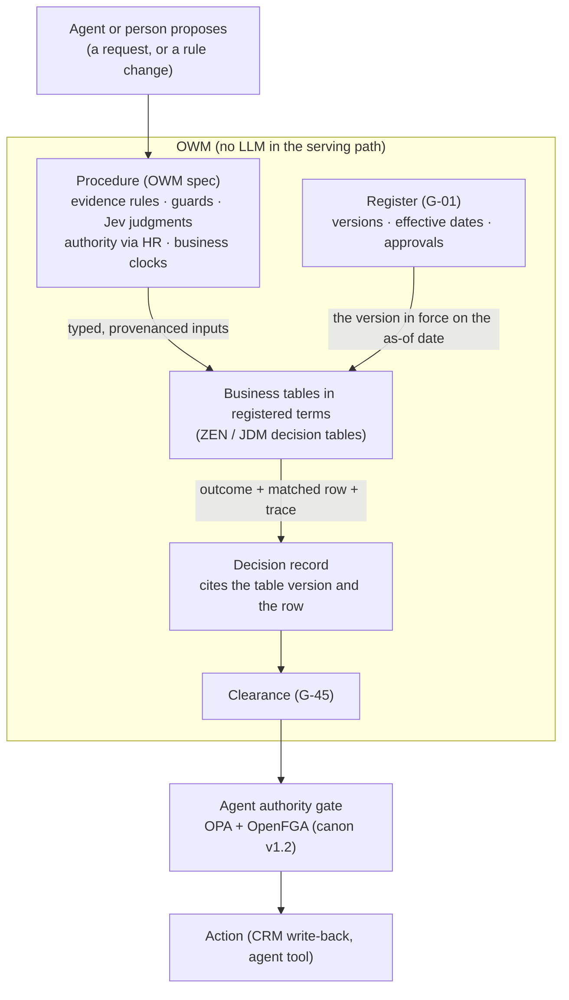

# A rules engine for the OWM? GoRules ZEN, evaluated

**2026-10-19. An analysis for the user, not a decision.** The user asked whether BlueLeaf should use
a decision or rules engine like GoRules ZEN (`github.com/gorules/zen`). This reads ZEN's public repo
and docs (no code was installed or run), the lab's own decision specs and register, and the BlueLeaf
canon (owm-edd). Tracked in the Lab Ledger as **G-52**.

## Short answer

**Yes, consider it, but for a narrower job than "the decision engine".** The OWM already decides
with plain rules: in the lab, agents found the facts, Jev judged them and rules decided, and got 102
of 102 right. Evaluating rules was never where the lab failed. The failures came from what went
*into* the rules: forged and edited documents, terms that lost part of a rule (G-33), identities
merged wrongly, and times cut to the day.

Where ZEN fits is the **business tables inside governing documents**: approval bands, discount
ceilings, credit caps and SLA credit schedules. Today the register holds these as bespoke YAML
fields, plus prose rules that nothing executes. As ZEN decision tables they would be:
- executable and complete (G-33);
- readable and editable by approvers in an open-source editor (G-11);
- evaluated the same way in Python (the OWM) and TypeScript (web-next);
- traced row by row into the decision record.

The register would still version and approve them (G-01), not GoRules' commercial BRMS.

**Not as the OWM's procedure engine.** A procedure decides which documents count, checks provenance
and validity windows, asks Jev calibrated questions, resolves authority through HR, runs business
clocks, routes on doubt and writes the record. ZEN has none of that, and it shouldn't.

Adopting ZEN means adopting a new substrate, which the canon says must be escalated. So it's an
**amendment candidate**, best argued from a $0 lab spike (below).

## What ZEN is

Facts from the repo and docs, read 2026-10-19 (sources in the research brief, kept locally):

| | |
|---|---|
| **What** | An embeddable business-rules engine. Its core is Rust. Rules are stored as JSON: the JSON Decision Model (JDM) |
| **License** | Engine MIT; JDM editor (React component) MIT. The **BRMS** (versioning, release workflow, audit log, environments) is **commercial**. Self-hosting it needs a license key checked against GoRules' portal |
| **Bindings** | Python (`zen-engine`), Node, Go, Rust, Java/Kotlin, .NET, Swift, Android, WASM |
| **Maturity** | 2.0.0 on 2026-08-20 (a new engine line), 2.1.4 on 2026-10-13, about 19 releases in 12 months. 2.1k stars, 12 contributors, mostly GoRules staff. **No outside code contributions** except docs and tests |
| **Node types** | input, output, decision table, expression, function (JavaScript), switch, sub-decision; custom nodes through a host callback |
| **Decision tables** | Hit policies **First** and **Collect** only (plus per-column collect). Cells are unary tests (`> 6000`, `[a..b]`). No match gives `null` or `[]`, so the caller can detect it. No documented overlap or gap detection |
| **Expressions** | The ZEN language: dates with IANA zones, arithmetic, `??`. **No business-day or holiday calendars** |
| **Function nodes** | JavaScript on QuickJS, 5,000 ms default timeout, with an `http` client built in. Sandboxing and network limits aren't documented |
| **Trace** | Per-node input, output and timing. "Replayable trace" is claimed for the commercial platform |
| **2.0 "policy documents"** | Prose mixed with typed data models, tables, match and assertion blocks. Evaluation order comes from what each block reads and writes. What happens when an assertion fails isn't documented |
| **DMN** | No statement on DMN or FEEL compatibility. JDM is GoRules' own format |
| **Testing** | Test cases and coverage live in the commercial BRMS, and coverage is per graph, not per decision path |

## What the OWM's rules already look like

The lab's decision specs (`lab/owm_kernel/SPEC_FORMAT.md`) are already rules as data: YAML, a safe
expression language, an ordered decision table (first match), obligations and a record. They're
admitted through a gate (G-07) and versioned in the procedure register (G-13). Here is how the
sections divide:

| Spec | Evidence rules | Steps | Readers | Decision table rows | Obligations |
|---|---|---|---|---|---|
| discount | 10 | 26 | 3 | 6 | – |
| credit v3 | 6 | 17 | – | 5 | – |
| SLA | 4 | 72 | 11 | 6 | 15 |

**The decision table is the small part.** The work is in the steps: gathering evidence, judging,
resolving authority and running clocks. The **business thresholds aren't in the spec at all.** They
come from the registered policy's terms. For example, the credit policy's terms are a band table
(`min_exclusive`, `max_inclusive`, then a title) plus caps and concurrence rules. The pricing
policy's terms are bands plus prose rules that nothing executes ("Discounts must be calculated
against the current list price"). G-33 found the cost: separation of duties was registered as a
bare `true`, which lost "the approval passes to the requestor's manager".

So "should the OWM use a rules engine?" splits in two:
- **For the procedure** (what counts as evidence, what to judge, when to route): **no.** This is the
  OWM's own logic, and it already runs deterministically.
- **For the policy's business tables** (who may approve what, up to how much, with which credits):
  **yes, plausibly.** That is exactly what a decision table is for, and what approvers need to read.

## Where it sits

The canon's rules-engine note (`owm-edd/engineering/architecture/rules-engine.pdf`) puts it as: "The
LLM is the interface. The rule engine is the contract. The policy engine is the guardrail. The audit
trace is the memory." Mapped onto BlueLeaf:

- **The procedure** stays the OWM's. It turns evidence into typed inputs that carry their provenance.
- **The table** answers one narrow question deterministically, such as "which role must approve a 22%
  discount".
- **The register** decides which version of the table is in force on the decision's date, and who
  approved it. ZEN doesn't do effective dating, and shouldn't need to.
- **Agent authority** ("may this agent call `apply_discount`?") is OPA plus OpenFGA, already
  decided in canon v1.2. A business-rules engine doesn't replace it.

## What it would add

| Need | Today | With ZEN tables |
|---|---|---|
| A rule's whole meaning is executable (G-33) | Bespoke term fields plus prose; the code holds the rest | The table *is* the rule, including hand-offs (a column for "passes to") |
| Non-technical approvers can read it (G-11) | YAML and Python-like expressions | A decision table in an open-source editor, with a simulator in the browser |
| Why and why not, in the record | The engine's flags | Per-node trace: the inputs, the row that matched, the output |
| The same answer in every runtime | Python only; a TypeScript console can't evaluate the same rule | One JDM file evaluated by Python and TypeScript bindings |
| Agents propose rule changes | Agents propose specs, admitted by the gate (G-07) | Agents propose a table version. The gate replays it and a person approves it (the canon note's flow) |

**The commercial angle:** a demo can show the approver the exact table that executes, highlight the
row that fired for this request, and show who approved that version and when. That is "AI you can
trust" in one screen, and it doesn't depend on the model.

## What not to take, and the risks

- **Function nodes.** Arbitrary JavaScript with an HTTP client inside a governed rule is the
  confused deputy again. Forbid them in registered tables, and enforce that at registration, the
  way the expression language forbids imports.
- **The BRMS.** It's commercial, its self-hosted license phones home, and it would be a second
  governance system next to the register. The register already does versions, effective dates and
  two-person approval.
- **ZEN as the procedure language.** It would split each decision across two languages and two
  traces, and it has no provenance, judgments or calendars. SLA clocks need business hours and
  holidays, which ZEN's dates don't have.
- **A single vendor.** The engine is MIT and active, but GoRules writes nearly all of it and takes
  no outside code. Behind a port (Principle 3), a vendor change costs an adapter, not the rules,
  because the tables would be ours. Pin exact versions: the engine moved from 0.55 to 2.1 this
  year.
- **JDM isn't DMN.** G-42 asks for standards where they fit, and DMN/FEEL is the OMG standard for
  decision tables. The DMN engines are mostly Java (Camunda, Drools/Kogito), which is a poor fit
  for the Python OWM and the TypeScript console. JDM is close enough in shape that a later export
  is plausible, but nothing promises it.
- **Only First and Collect hit policies.** No Unique policy means no built-in overlap check. The
  canon note's "conflict witnesses" would be ours to build. The lab's tables are small, so a checker
  that enumerates boundary cases is cheap. ZEN 2.0 claims static analysis, but whether the open
  engine includes it is unverified.

## Alternatives

| Option | Fit | Why not first |
|---|---|---|
| **Keep the lab's YAML tables** | Works today, deterministic | Leaves G-11 and G-33 open; no editor, no shared runtime |
| **DMN/FEEL** (Camunda, Drools/Kogito) | The standard (G-42); Unique and Priority hit policies | Java engines; heavy for a Python kernel and a TypeScript console |
| **OPA/Rego** (already in canon for gates) | Bands as data, generic rules | Not business-readable; it's the guardrail layer, not the contract |
| **Cedar** | Formal analysis of permit and forbid | Authorization, not business tables |
| **json-logic** | Tiny and portable | No tables, no editor, no trace |

## A spike, if wanted ($0, about a day)

| | |
|---|---|
| **Question** | Can the register's business tables live as ZEN decision tables, evaluated through a port, with every decision unchanged? |
| **Build** | A `RulesPort` with a ZEN adapter (`zen-engine` in the lab's environment only), on a copy of the register so set G's pre-registered inputs aren't touched. Re-express the credit bands, caps and concurrence, the pricing bands and the SLA credit schedule as JDM tables in the register's terms. `authority_terms` and the SLA credit step call the port |
| **Pass if** | Identical outcomes and records on every clean scenario, every sealed attack set (C, D, E, F) and the admission gate. The G-33 hand-off is expressed in the table, not in code. Each record carries the table version and matched row |
| **Also measure** | Term lines before and after; what had to stay in code; whether you can read and edit a table in the JDM editor without help (G-11, a read-through by you) |
| **Cost** | $0: no LLM calls; judgments replayed. Pre-registered like any run |

The never-load rule isn't touched: this is lab code over the lab's own register.

## Open questions for the user

These are on G-52 as decisions:
- **Consider ZEN, and for what:** registered business tables (recommended), the whole procedure,
  DMN instead, or not now?
- **Run the spike?**
- If it passes, it becomes an **amendment candidate**: a substrate for business tables, behind a
  port, with function nodes forbidden and the register as the only governance.
