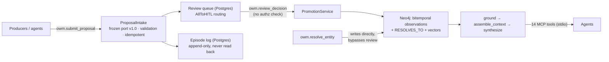
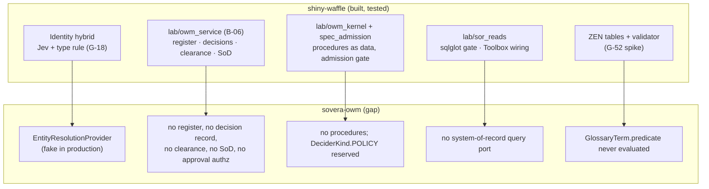

# sovera-owm: the code, the tests, the evidence, and where the lab's work fits (2026-10-19)

**What this is:** a deep, read-only analysis of `kloudtaxi/sovera-owm`, at local `main` `10d7ff7`;
origin `1f403d2` is one docs-only commit ahead, and the last work landed on 2026-09-22. It covers
the architecture, a fresh test run, every recorded evidence folder, and the user's demo runs. It
then maps the lab's results onto the code. It's not about glowing-garbanzo or the canon.

**Method:** three parallel read-only passes. CodeGraph and code reading for the architecture; an
offline gate run plus test inventory and CI history; and the 22 `docs/evidence/` folders plus the
user's demo material in `2026-dev/owm-demo/`. The most consequential claims were spot-checked
against the code, and every claim has a file reference in the working notes.

## Bottom line

- **The core is well built and the gate is green.**
  - 3,958 tests pass, 0 fail, at **100.00% branch coverage**; mypy strict is clean on 369 files.
  - The proposal port, the review gate and the bitemporal store fail closed, and every write is
    idempotent.
- **But it's tested against fakes, not substrates.** 148 live tests are deselected by default, and
  every backend adapter is tested offline only. The live suite has never been green as a whole.
- **"Entity resolution across sources works well" is half true.**
  - Resolved identity **propagates correctly** and is used in live answers: sales joined to finance
    across 16 accounts, and 0 misresolutions on 23 questions.
  - But **nothing discovers the links.** Production runs a *fake* resolver with an empty alias
    table. The demo's 224 cross-source links come from the data generator's own truth table, and
    the seed approves them itself. No false-merge rate or entity-resolution F1 has ever been
    measured.
- **Governance stops at the review queue.**
  - There are no policies, procedures, register, conditioned decision records, clearance, approver
    roles or separation of duties.
  - Approval has no authorization check.
  - `resolve_entity` writes merges straight to the graph, bypassing review.
- **The demo's headline question never answered,** and wasn't diagnosed. The recorded hypothesis
  doesn't match the logs. A better-fitting cause, cheap to test, is that the demo script authorizes
  only Accounts, so Person-level facts are dropped silently.
- **Much of the lab's work fills these exact gaps.** It's built and tested in shiny-waffle:
  - the B-06 OWM service: register, clearance, decision records, separation of duties;
  - identity adjudication with Jev and type rules;
  - the declared-read gate;
  - the business tables behind a rules port.
- **There's a security item**, reported to the user directly and not detailed here: generated
  local-stack secrets in a tracked file, and live API keys in a local log.

## 1. The architecture

- **Five packages:** owm-core (stdlib only), owm-adapters, owm-gateway, owm-seed and owm-bootstrap.
- **Twelve ports,** each with a fake. All but one have a real adapter (Neo4j, OpenAI embeddings,
  Anthropic, OpenMetadata glossary, Kratos/Hydra, OpenFGA, Postgres review queue and episode log,
  Opik, clock).
  - **Entity resolution has no real adapter:** production wires `FakeEntityResolutionAdapter(alias_table={})`
    (`owm_gateway/app.py:1221-1227`, verified).
- **Substrates:** Neo4j holds both the graph and the vectors (there's no pgvector). Postgres holds
  only the review queue and the episode log. **No OpenFGA model is committed,** and nothing
  provisions its tuples.
- **14 MCP tools over stdio.** Of the canon's six categories, *definition retrieval* and *provenance*
  have no tools. The pipeline authenticates but **never authorizes per tool**, so `resolve_entity`,
  submit, review and list-pending run unchecked.
- **The temporal model is sound,** with one gap. The bug in open issue **#94** ("every relation reads
  back as functional") is visible in the code:
  - an edge is stored under `attribute = relation type`, and `query_state` keeps one value per
    attribute, so a second relation of the same type hides the first;
  - `query_state` also doesn't follow `RESOLVES_TO`, while `assemble_context` does, so the two
    disagree about a merged entity.
- **Tenancy is nominal:**
  - the tenant is the caller's subject id;
  - the review queue lists pending items across tenants;
  - observation nodes are keyed by raw source key, so two tenants using `ACC-1001` would share
    observations.
- **Governance:** the decision records are `ReviewDecision` and `PromotionReceipt`, with no
  conditions, rationale, evidence or expiry. Definitions are a read-only glossary whose `predicate`
  field "is never parsed or evaluated". Policies, procedures, a register, rules, clearance and
  separation of duties are absent.
- **Health:** 26.6k source lines and 69.5k test lines; 48 ADRs (049, "which consumption level is the
  product", awaits a decision); no TODOs. The largest modules are `mcp/tools.py` (1,606 lines) and
  `app.py` (1,377).

## 2. Entity resolution in depth

| | What the code does |
|---|---|
| **Resolver** | Deterministic rules, in order: a natural key (only `org(name, domain)` and `person(email)`; `Account` has none), then an alias table (**empty in production**), then a suffix guard, then exact or normalized match. The canonical id is `uuid5(tenant, type|key)` |
| **Fuzzy tier** | It embeds the mention and finds similar entities at a threshold of 0.83, "a committed placeholder… pending calibration". It **only suggests**. No LLM, no Jev, no pairwise scoring and no adjudication |
| **Merges** | `resolve_entity` writes `RESOLVES_TO` directly. **Approved merges are never fed back**, so a later "acme-corp" still gets its own id |
| **Across sources** | The seed's four sources (Sales, Finance, Product, Support) spell names differently. **24 of 50 accounts are fuzzy-only by design**; the deterministic tier can't join them |
| **The demo** | It links every source key from the generator's answer key (`method="northwind-seed-truthtable"`, score 1.0, `demo_seed.py:120, 380-404`, verified). The seed approves its own matches |
| **Tests** | About 18 files. They prove the deterministic rules, idempotency and tenant-scoped ids on a hand fixture of 11 cases, which includes one **known false merge** ("falcons" / "FALCONS"). The live GS1 F1 test asserts no threshold, and the live "4 spellings → 1 id" test is logged as an unclassified failure. By reading the code, it can't pass |

**Verdict on "entity resolution across sources works well":**
- **True for propagation.** Once the links exist, every downstream path uses them correctly. The live
  withheld ARR arm joins 16 finance records to 16 sales records and cites all 32. Offline, 274 source
  records collapse to 108 canonicals, with 0 misresolutions across 23 questions.
- **Not shown for discovery.** No component in production finds a cross-source match. Spec 008's
  target, fuzzy entity-resolution F1 of at least 0.85, has never been measured. No false-merge rate
  exists, and no human has reviewed a match.

**The lab has the missing half.**
- **Measured:** G-18's identity hybrid (Jev adjudication plus a type rule) sent 0.79% and 0.94% of
  pairs to a person, with **0 errors**.
- **Its foundation side:** B-20's exam made 0 false merges on every base, with CRM-2048 linked to
  C-1001. ACME-MFG-2025, the agreement's own reference, wasn't linked.
- **Where it fits:** that is exactly the shape of the real `EntityResolutionProvider` adapter
  sovera-owm lacks.

## 3. Tests: run fresh today

| | Result |
|---|---|
| `uv run pytest` (the gate's offline selection) | **3,958 passed**, 148 deselected, 0 failed, 0 skipped, 45.6 s |
| Coverage (branch, `fail_under = 100`) | **100.00%**: 8,106 statements, 1,654 branches |
| mypy strict | clean, 369 files |
| ruff on `packages`, `tests`, `scripts` | clean. A whole-repo `make lint` fails only on someone's untracked `.specify/extensions/` work |
| Versus history | PR #48 (09-19): 3,803 passed. The 10-09 review: 3,958. **The gate is still green** |
| CI | 93 of the last 100 runs succeeded. The newest 20 (09-20 to 09-24) are all green, and the last failure was 09-19. No CI run since 09-24 |

**What the coverage number hides:**
- **The 148 live tests didn't run.** They need Postgres, Neo4j, the auth stack, OpenAI, Anthropic and
  Opik.
- **Every real adapter is tested against fakes only.** 100% coverage says the code paths execute;
  it doesn't say the adapters work against their substrates.
- **The live suite has never been green as a whole.** The L2 p99 is 594 ms against a 500 ms target,
  and the similarity factory wipes the database.
- **The strongest area is grounding, synthesis and assembly** (about 27 test files). **Intake (7),
  the review queue (5) and the temporal model (5) are thinner.**

## 4. The evidence programme (22 folders, 07-28 to 09-19)

- **Governed definitions help, and that's the solid result.**
  - 024: F1 0.33–0.39 without the definitions against 0.50–0.73 with them; n = 3 per arm, and the
    ranges don't overlap.
  - 028: +0.311 across 3 pairs.
  - **But it's thin:** one synthetic corpus, one model, 4–5 graded questions, no run above the 0.8
    threshold, and the arbitration claim was never graded.
- **A raw LLM beat OWM, and the comparison was never re-run.** The 08-03 baseline gave the model the
  unresolved source records to resolve itself. It won all 3 runs: median F1 0.500 against OWM's
  0.417. OWM's recall was steadier, but its precision was lower.
- **Context truncation (071).** The budget binds at 58 accounts. At 100, ARR comes up short by
  **37.1% ($2.23M)**. The 50-account demo sits just under that cliff, so every demo and eval result
  lives where nothing is dropped.
- **Ops readiness (029, 030):**
  - the substrates are pinned and reproducible;
  - the clean-image rehearsal, the stop-each-substrate check and the live seed-equivalence check
    were never met;
  - spec 030's "no generated secret in any tracked file" is violated by a later evidence file.
- **Specs met:** 023, 024 and 028. **Not met:** 029's three checks. **Unmeasured:** 008's
  entity-resolution F1.

## 5. The user's demo runs (09-02, and the terminal log from 09-01 to 09-03)

- **What worked:**
  - **The gateway failed closed** when identity went down (Kratos returned 502), naming the failed
    port.
  - **It refused to answer** from a half-built index during an embedding outage.
  - **The ARR ablation behaved as designed.** With the definitions, it gave $3,317,520 from sales
    `booked_arr`, which matches the generator. With them withheld, it gave $3,263,520 from finance
    `recognized_arr`, still grounded. The script's banner, "Expected: $954,000", is stale.
- **What didn't:**
  - **The runbook steps:** bootstrap `init` hung eight times; there was a bare-`python`
    `ModuleNotFoundError`; and Postgres auth broke for Kratos, Hydra and OpenFGA. Fixed by hand,
    then in PR #48.
  - **The headline question,** "Which sales reps have left the company but still own an open
    renewal?", returned `grounded: False` with 0 of 1,699 facts cited.
- **The headline failure was never diagnosed.**
  - **The README's theory doesn't fit.** It blamed approvals stuck after a graph wipe. But the last
    seed before the question approved all 274 proposals on a fresh Postgres, and no wipe appears in
    the log.
  - **A better-fitting, untested cause:** `scripts/demo_ask.py:157-182` grants `viewer` only on
    Account canonicals. `employment_status` sits on the Person, two hops away, and authorization
    works by absence, so those facts would vanish without an error. The offline fixture that passes
    this question also grants Person canonicals.
  - **The test:** grant the Person canonicals in `demo_ask.py` and ask again.
- **For entity resolution,** the log shows three seeds (274 approved and 224 linked in two of them;
  `deduped=0`) and no merge, candidate, rejection or false-merge counts at all.

## 6. How the lab's work fits into sovera-owm

Nothing flows across today: the lab's code lives in shiny-waffle. But most of what sovera-owm lacks,
the lab has built and tested.

| Lab asset | Where it lands in sovera-owm | What's needed |
|---|---|---|
| **Identity adjudication** (Jev + type rule; G-18: under 1% of pairs to a person, 0 errors) | A real `EntityResolutionProvider` adapter in `owm-adapters` | Feed approved merges back to the resolver; route uncertain pairs to `entity_match` review instead of writing directly; calibrate the 0.83 threshold; and finally measure GS1 F1 |
| **Register, decision records, clearance, separation of duties** (`lab/owm_service`, contract v1.4) | New domain objects beside `PromotionReceipt` in `owm-core`; a register port with a Postgres adapter; a `ClearanceService` | A proposer ≠ approver check in `promotion.py`; authorization on `review_decision`; per-tool authorization in `mcp/pipeline.py` (step 4, not built); an OpenFGA model and tuple writes |
| **Procedures as data plus the admission gate** (`lab/owm_kernel`, `lab/spec_admission`) | Activating `DeciderKind.POLICY` and issue [15], routing through a `RoutingPolicy` that runs procedures | A procedure store and a versioned spec format |
| **Declared reads of the systems of record** (`lab/sor_reads`; the three-arm test: 1 → 4–5 of 10 at least core-right, unsafe down 44–67%) | A new query port plus an MCP Toolbox client adapter (only the MCP *server* SDK is used today); additive `Evidence` fields `{tool, tool_version, params, rows_digest}`, which contract §9 allows | A query-receipt value object, and provenance fields that persist it. Today spans don't even reach the graph |
| **Business tables through a rules port** (the ZEN spike: identical decisions, 1,445 points) | A `RulesProvider` port plus a ZEN adapter; `GlossaryTerm.predicate` as the first consumer | The register (above) for versions and effective dates, and a write path for definitions |

**The order the code suggests:**
1. **Hygiene** (the security item).
2. **The demo's unanswered question,** a one-line test.
3. **#94 and `query_state`'s missing union.** Correctness bugs under every read.
4. **Approval authorization and proposer ≠ approver,** and stopping `resolve_entity` writing past
   review. These are small and make the governance claims true.
5. **A real resolver,** from the lab's identity work.
6. **The register, decision records and clearance,** from B-06.
7. **Declared reads and business tables** on top.

## Working notes

Each pass's full notes, with file:line on every claim, stay in this session's scratchpad: the
architecture, tests and evidence notes, plus the terminal-log line references. They aren't
committed, because the evidence notes point at secret locations.
