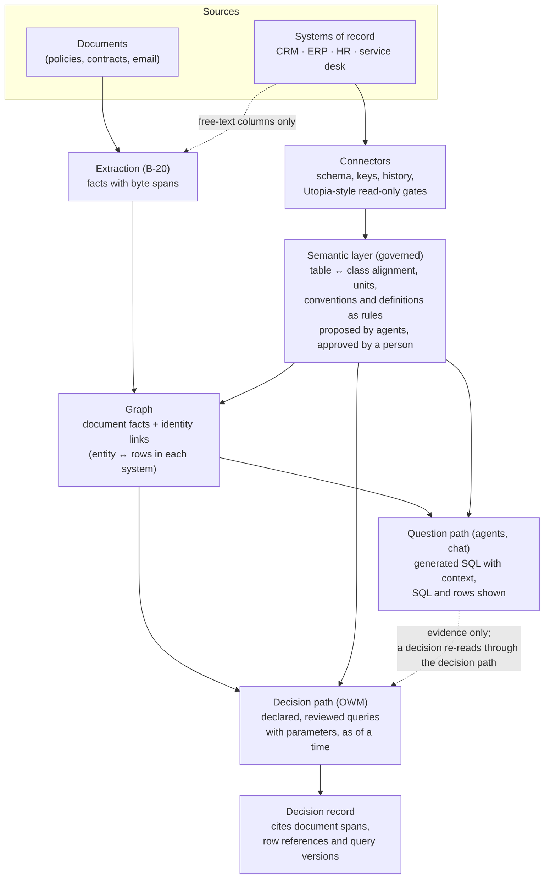

# Reading structured data by query instead of extraction

**2026-10-19. An analysis for the user, not a decision.** The user asked whether querying the systems
of record (CRM, ERP, HR, service desk) directly would improve precision and retrieval, compared with
the knowledge foundation's current approach of treating their exports as unstructured text (Docling
+ langextract). Revised the same day with two sets of prior work:
- the user's own architecture notes, which combine Vanna (text-to-SQL) with R2R (search over
  documents) under Agno (not in this repo);
- Utopia's design for mounted data sources (`deeplethe/utopia` `dev` at aad5b06, read-only).

Tracked in the Lab Ledger as **G-51**, with the open questions below as its five decisions.

## Short answer

**Yes.** Values that live in a database should be read by query, not inferred. The lab's own
evidence points the same way. The OWM side of the lab already reads these records as tables. The
loss of precision is in the knowledge foundation and in agents that read its graph.

**Querying alone isn't the answer, though.** Querying makes field values exact. It doesn't settle
four things:
- which records in different systems are the same customer;
- what a record said on a past date;
- whether the system of record is right;
- what the free-text columns mean.

Those stay the foundation's and the OWM's jobs.

**The question now is how, and three designs are on the table:**
- **Vanna, as in the user's notes:** an LLM writes SQL, given the schema, documentation and example
  queries;
- **Utopia:** mounted databases, a read-only SQL gate, and a semantic layer a person confirms;
- **the lab's OWM:** queries declared in code.

The recommendation takes something from each. A decision runs declared, reviewed queries. Open
questions get generated SQL behind gates. Both read one governed semantic layer, and the graph holds
the links between systems.

## How the lab handles structured data today

| Who reads the exports | How | Where |
|---|---|---|
| The OWM kernel and decision engines | As tables, parsed exactly | `lab/owm_kernel/kernel.py:95` (`Corpus.table`) |
| The OWM service (B-06) | As system-of-record tables, with an event-logged overlay of inserts and edits, and write rules (R60) | `lab/owm_service/sor.py` |
| The OWM service's clearance check | Compares a decision's basis fields with the system of record *now*, and refuses if they differ (`stale`; R17 for SLA) | `lab/owm_service/clearance.py` |
| The knowledge foundation (B-20, Utopia) | As text: the CSVs are parsed and run through LLM extraction into graph facts with byte spans | outside this repo |
| The blind reader (agent) | Through the foundation: text tools over the CSV rows (C1), or the graph only (C2) | `lab/exam/` |

The 13 exports in `dataset/evidence/structured/` are small (234 lines in all), but they're shaped
like real systems: keyed rows, typed columns, ISO timestamps with offsets, and free-text columns.
**In B-20's exam, neither foundation used a database path.** The CSVs were uploaded as files.
Utopia's query tool isn't on its MCP surface (see below), so the reader couldn't have reached it
anyway.

## Why querying helps

| Property | Extraction (today) | Query | The lab's evidence |
|---|---|---|---|
| **Exact values** | An LLM decides what to keep. Timestamps were often cut to the day | The stored value, every time (`2026-06-16T02:14:00-05:00`) | B-20's exam: on the base corpus, B-20 held 32 of 76 support-timing items with their zone and 42 only to the day. Graph-only support decisions got 0–1 of 10 right on every foundation, which fits (the exam didn't test the cause). |
| **Same answer twice** | Varies from run to run | Deterministic | B-20's support-timing score ranged from 15 to 51 of 76 across bases built from nearly the same files. |
| **Types** | Inferred, so an order can become a customer | The schema says what a row is | GPT-4o merged about 160 sales orders into customer records at 200 customers. The fix the lab found was a type rule that a schema gives for free. |
| **Cost at scale** | An LLM call for each chunk, and a re-extraction on every change | One query per question | Building B-20's six exam bases, for a 20-customer company, took 656 OpenAI calls and 2.3M prompt tokens. Graph-only answers needed 27–47 tool calls each. A real CRM has millions of rows that change daily. |
| **Freshness** | A snapshot from the last ingest | Reads now, or as of a stated time | The OWM service already refuses to act when a basis field differs from the system of record now. |
| **Counts and totals** | Approximate, done by the agent | Exact (`COUNT`, `SUM`, filters) | Not measured in the lab. Utopia makes the same point: a table is closed-world, so a sum over it is honest, and a sum over the graph isn't (its 0036). |
| **Traceability** | A byte span in an exported CSV | System, table, key, column and as-of version | Stronger than a span: it points at the record of truth, not a copy of it. |

## What querying doesn't fix

1. **Identity across systems.** Each system keys the same customer differently: CRM-2048 in the CRM,
   C-1001 in the ERP, and ACME-MFG-2025 in the agreement (CLAUDE.md's invariant). A query returns
   one system's rows exactly, but linking them is still resolution. That's where the lab's Jev
   plus a type rule made no wrong merges. The foundation's job moves from holding the rows to
   holding the **links**.
2. **Time.** Most databases hold the current state. A question about a date ("on 23 September")
   needs history: audit or field-history tables, change data capture, or temporal tables. Without
   it, a query is exact about the wrong moment. `sor.py`'s event-logged overlay is the right model,
   and Utopia's record 0013 ("a source should hand over its history") makes the same argument for
   connectors.
3. **Precise isn't true.** A system of record can be stale, or can disagree with a request or a
   contract. A query returns its value exactly, whether right or wrong. The OWM still has to
   compare the sources and record any conflict as a field (design choice 3 in the CxO write-up).
4. **Free text inside rows.** Ticket descriptions, event details and request justifications are
   unstructured, even in a database. Extraction stays, but only for those columns.
5. **Turning questions into queries.** Generated SQL is a new error source: wrong joins, filters,
   units or time zones. The Vanna paper and Utopia's benches agree that the schema isn't enough;
   the conventions are (next section).
6. **The decision step.** Even when handed every document, the exam's reader reached at most 9 of 10
   on credit and 8 of 10 (strict) on support cases. Better retrieval raises the floor; the OWM's
   rules make the decision.

## What already exists

### The user's notes: Vanna and R2R under Agno

- **The Vanna paper (2023-08-17):**
  - SQL accuracy went from **about 3%** with the schema alone (2 of 60 attempts) to **about 80%**
    when the 10 most relevant example queries, schema and documentation were retrieved into the
    prompt;
  - the context strategy mattered more than the model;
  - it tested 20 questions, 3 models and 3 strategies.
- **The architecture:**
  - a Vanna MCP server for structured data (`query_business_data`, `explore_database_schema`,
    `validate_business_query`, `learn_from_query`);
  - an R2R MCP server for documents;
  - an Agno hub that classifies each question as structured, unstructured or hybrid, plans, and
    combines the answers;
  - ports and adapters inside each server, and "integration over invention".
- **Its four patterns:** sequential (numbers, then reasons), parallel, iterative (learn a
  definition from documents, then query by it), and validation (check a policy against the data).
- **Also in the notes:** an entity linker (document entities to database rows), and a sync step that
  extracts business terms from new documents into Vanna's training data.

### Utopia: mounted data sources and a semantic layer

What Utopia has built (`docs/design/lakehouse-and-actions.md`, records 0011, 0013, 0018, 0036):
- **Data sources** are registered for the whole deployment, granted to workspaces, and mounted by a
  base. The engines are chosen by connection-string scheme: Postgres, the MySQL wire family, Trino,
  Databricks and Snowflake.
- **Four gates on every query:**
  1. parse it with the engine's own SQL dialect and admit a single SELECT only;
  2. wrap it in a LIMIT;
  3. run it in a read-only session with a timeout;
  4. return JSON Lines, with numbers and booleans restored from the column types.
- **The schema is indexed for search and never extracted.** Extracting it had turned column names
  into entities, 93 of them on one bench base, which dropped to 12 (0036 decision 7).
- **The semantic layer (`concept_mappings`) is configuration, not facts.** Exploration proposes, a
  person confirms, revisions are kept, a rejection survives a rerun, and chat reads up to 30
  confirmed mappings.
- **Measured on a wide order table (#520):**
  - exploration proposed 0 of 18 usable definitions on its own;
  - with a one-page conventions document, chat went from 2 to 14 of 18 right answers;
  - with the definitions seeded, it got 17 of 18.

  The conventions were things like "amounts are in cents, test orders don't count". Two of the
  remaining misses came from the conventions page contradicting itself.
- **The SQL is shown.** Each query step in chat carries its SQL, its rows and any failure (#936,
  and #957 at the head of `dev`).
- **The query tool is not on Utopia's MCP surface.** An MCP client is someone else's agent reading
  untrusted content. A document saying "run this SQL" could be obeyed with the person's full reach
  over every mounted production database. Utopia hasn't settled how to audit those runs, so
  `query_data` works only in its own chat (record 0014, the confused deputy; `api/mcp.rs`).
- **Proposed, not built** (0036): aligning each table to the ontology. Each table becomes a class,
  its columns attributes, its foreign keys relations, and each column gets a conversion tree. A
  definition such as GMV becomes a rule over those attributes, written by a person, and a shared
  convention becomes one rule the others read. This is the seam between the graph and the database.

### Where the three agree

| Idea | The user's notes | Utopia | The lab |
|---|---|---|---|
| Structured data has its own path, not extraction | Vanna server | mounted sources | the OWM reads tables |
| Context beats the model: the schema alone isn't enough | 3% → 80% | 2 → 14 → 17 of 18 | the decision slice; a cheaper model wasn't a safe decider |
| A replaceable interface for each part | ports and adapters, MCP | engines by protocol | design choice 1 |
| Documents and data checked against each other | the validation pattern | (not built) | design choice 3: check inputs against the system of record |
| Linking document entities to rows | entity linker | alignment (proposed) | identity resolution: Jev plus a type rule |

### The BlueLeaf canon already has the question path

Added after the first write-up: the canon (owm-edd) already gives structured data to **DataIQ**.
- **DataIQ** is the structured-data component. Its ingestion is mostly substrate: OpenMetadata,
  Spice for federation, OpenLineage. Both of its seats are empty.
- **Its SQL generation is Vanna-based.** v1.7 splits Vanna's three kinds of training data: schema and
  business documentation go to OpenMetadata, SQL examples to pgvector. v1.3 has Vanna read each
  team's metric definitions from OpenMetadata.
- **Timing:** the decisions register puts the Vanna semantic layer (F2) post-beta, and the Spice
  evaluation (A8) at GA-v1, months 1–2.
- **The layer rule (v1.11):** IQ components sit above the OWM, so the OWM can't read the systems of
  record through DataIQ.

So the user's notes became DataIQ. **What the canon lacks is the decision path:** declared,
reviewed queries for decisions; governance of `learn_from_query`; and how the OWM reads systems of
record on its own port. The points below are about that.

## Where the lab's evidence says to differ

1. **80% is good enough for analytics, not for decisions.** At 80% correct SQL, one decision in five
   is made on a wrong number. The lab's split design got 102 of 102 because the decision moved out
   of the LLM. The same holds for SQL: **a decision procedure runs queries that were declared and
   reviewed**, with parameters for the request's ids and dates. No LLM writes them. Generated SQL is
   for open questions ("why did revenue drop"), with the SQL shown.
2. **Learned queries and synced terms let anyone in.** Two steps in the notes add to the context
   automatically: `learn_from_query` adds a query a user rated well, and the sync step copies terms
   from any new document. The lab's attack rounds showed what that allows: convincing forged
   documents fooled agents almost every time, and only the register closed the hole. **So govern
   them like procedures.** An agent proposes, a person approves, every version is kept, and only
   registered documents supply conventions (design choices 7 and 9). Utopia's confirmed mappings
   work the same way.
3. **Matching names makes the merges the lab measured.** The linker's
   `name ILIKE '%{name}%'` is what makes two different customers called "Acme" one customer.
   Building SQL from a string also invites injection. **Instead:** parameterised queries, and links
   from identity resolution.
4. **An LLM's own confidence isn't calibrated.** The notes' synthesis returns a confidence (0.87).
   The lab routes only on confidence that was shown to match reality (Jev's, across 1,289
   questions), and otherwise sends the case to a person.
5. **A semantic tool must still return its evidence.** `query_business_data(question)` is the right
   ergonomics for an agent, but the result should carry the SQL, the rows, the source and the
   as-of time, and the decision record should cite them. Utopia's query step does this.
6. **Scope the query tool over MCP.** Utopia's confused-deputy reasoning applies to BlueLeaf's
   agents too: a forged document can steer an agent's SQL. For agents, start with declared queries
   on MCP, read-only, scoped to the mandate, and logged. Generated SQL comes later, once its runs are
   audited.
7. **R2R's place is taken.** In the notes, R2R handles the documents. BlueLeaf's own foundation
   (B-20) now does that job, with 99% of its evidence traced to the exact words. What carries over is
   the Vanna side, and the hub pattern on Agno.

## The recommended shape

- **Connectors** reach the systems of record where they live, behind Utopia's four gates, and say
  where each one keeps its history.
- **The semantic layer** is the governed part. It aligns each table to the ontology, puts units on
  columns, and holds conventions ("test orders don't count") and definitions as rules. Agents and
  exploration propose, a person approves, and every version is kept.
- **The graph** holds facts from documents and the links between systems. It doesn't copy values a
  query can read.
- **The decision path** runs the queries a procedure declares, with the request's ids and dates as
  parameters, as of the decision's time. The OWM already does this with its tables, which is why
  its rules decide for under $0.001 with a complete record.
- **The question path** is the Vanna pattern for open questions, with the SQL and rows shown. An
  answer from it is evidence, never a decision: a decision re-reads what it needs through the
  decision path.

## What it means for the lab

- **The dataset doesn't change.** Loading the 13 exports into SQLite or Postgres, read-only, gives
  every arm the same systems of record. The evidence stays byte-identical, and `sor.py` already
  models them as tables.
- **Watch the held-out rule.** B-20's Northstar exam was one-shot, and its results say where B-20
  fell short. If B-20 gains a query path, build and tune it on the bench sets, not on Northstar.
  A later Northstar measurement of it is *visible*, not held-out (per *The visible set is a
  training set*). The firm test is a second company. The argument for querying stands on how real
  systems work, not on the exam's numbers.
- **The measures change.** Part 1's support-timing measure scores what extraction held. With a query
  path, that becomes "did the agent get the right row, as of the right time". New measures need
  pre-registration.
- **Utopia's query path can't be the "today" arm through MCP.** Its query tool runs only in its own
  chat, and its repo is read-only for the lab. A comparison would go through Utopia's chat
  endpoint, a different harness.

## A test, if wanted (a sketch, not pre-registered)

| | |
|---|---|
| **Question** | Can an agent decide support-deadline cases without the documents if it reads the systems of record by query? And which way of querying is safe? |
| **Arms** | (1) graph only, as the exam's C2; (2) graph plus declared, typed queries (the decision path); (3) graph plus generated SQL with schema, conventions and example queries (the question path, Vanna-style), behind the four gates |
| **Attack** | One forged document per target that changes a convention ("credits count from the customer's local time"), to see whether generated SQL takes it in |
| **Where** | A bench set or a second company, for a held-out result. On Northstar, reported as visible |
| **Measures** | Decision correct and unsafe; SQL correct (arm 3); rows cited; whether the forged convention was used; tool calls and cost. The reader and scorers stay frozen |
| **Size and cost** | 10 support cases × 3 runs × 3 arms is about 90 answers. At C2's price of about $0.90 an answer, that's about $80, plus a $0 dry pass |

## Open questions for the user

These are on G-51 as decisions (reframed around DataIQ after the canon check):
- **Scope:** a platform decision (an amendment candidate for the BlueLeaf canon), a lab experiment,
  or both?
- **How do decisions read the systems of record?** Through the OWM's own port onto the substrate,
  with declared queries (recommended, alongside DataIQ's ratified push into the OWM for history),
  through DataIQ, or only from what DataIQ pushes?
- **DataIQ's SQL engine:** Vanna now, governed; revisit the engine; or declared queries first and
  Vanna post-beta, on the canon's schedule (recommended)?
- **Which real systems come first for design partners** (Salesforce, NetSuite, Workday,
  ServiceNow)? That decides how history is read: field history, audit tables or change data
  capture.
- **Run the three-arm test?**
