# B-06: the Lab's OWM Service Implementation Plan

> **For agentic workers:** REQUIRED SUB-SKILL: Use superpowers:subagent-driven-development (recommended) or superpowers:executing-plans to implement this plan task-by-task. Steps use checkbox (`- [ ]`) syntax for tracking.

**Goal:** a service in shiny-waffle that serves contract v1.2 (`owm-decisions`) over the lab's
kernel, with the §12.2 acceptance passing, the regression gate green, and a Docker image that runs
S22 end to end.

**Architecture:** a plain-Python core (`lab/owm_service/`) over an append-only SQLite event log.
Only `_lab.py` touches lab code. The kernel and registrar gain new functions and attributes only,
so no record the lab's harnesses produce changes. FastAPI sits in its own dependency group. The
acceptance harness (`tests/owm_service/`) is the only code that reads `truth/`.

**Tech Stack:** Python ≥3.11, pydantic v2 (already a dependency), SQLite (stdlib), FastAPI,
uvicorn and httpx (new `owm-service` group), pytest, ruff, mypy strict, Docker; Node ≥23.6 used
once, to vendor the contract's S22 example as JSON.

**Spec:** `docs/superpowers/specs/2026-10-10-owm-service-design.md` (7067ce6). Contract: garbanzo
`owm/docs/contract-v1.2.md` and `web-next/lib/contract/owm-decisions.ts` at **30977cd**. Section
numbers like "spec §6.5" refer to the spec, and "§5.7" alone to the contract.

**Three refinements to the spec, found while planning.** Each is stricter than the spec, and none
changes the contract:
1. **The kernel's new keys** (`judgment_about`, `flag_items`, `approval_roles`) come from new kernel
   functions (`lab/owm_kernel/additions.py`) that `_lab.decide` calls. They are **not** added to
   the record `governed.decide` returns. `run_governed.py` P2 compares governed records with
   `flow.run` records dict for dict, so adding keys inside `governed.decide` would break it. This
   way every record the harnesses produce stays byte-identical.
2. **The contract is vendored at 30977cd for both slices,** not 9d05398 then 30977cd.
   `s22.example.ts` is the same at both commits.
3. **The gate replays the attack set's registrar steps** (Task 4), rather than running
   `run_attacks.py run`. That script builds a live engine and appends to the committed
   `runs/2026-10-08-register-attacks/jev-calls.jsonl`.

```mermaid
flowchart LR
  subgraph S1["slice 1"]
    T1[1 about, trace, flag codes] --> T2[2 approval roles] --> T3[3 registrar hints] --> T4{4 gate}
    T4 --> T5[5 scaffold, models, drift] --> T6[6 events, clock] --> T7[7 _lab boundary]
    T7 --> T8[8 sor, org] --> T9[9 sessions] --> T10[10 ask] --> T11[11 ratchet]
    T11 --> T12[12 lifecycle] --> T13[13 clearance] --> T14[14 HTTP, adapter] --> T15[15 acceptance]
  end
  subgraph S2["slice 2"]
    T16[16 queue] --> T17[17 register reads] --> T18[18 procedures] --> T19[19 register HTTP]
    T19 --> T20[20 attacks via queue] --> T21[21 Docker, final gate]
  end
  T15 --> T16
```



## Global Constraints

- Python ≥3.11. Line length 100. `ruff check`, `ruff format --check` and `mypy` (strict, pydantic
  plugin) must pass, **including on tests**.
- The package is `lab/owm_service/`, importable as `owm_service` (`pythonpath = ["lab"]` for pytest,
  `mypy_path` adds `lab`, `PYTHONPATH=lab` at runtime). Tests live in `tests/owm_service/`.
- **Only `lab/owm_service/_lab.py` imports lab code** (`lab/owm_kernel`, `lab/owm_register`,
  `lab/decision_engine`). It loads them with `importlib` after a `sys.path` insert, and it never
  imports `lab/spec_admission/admit.py`, which pulls in `northstar.model` and the truth.
- **Nothing in `lab/owm_service/` reads or imports** `truth/`, `dataset/answer-key/`,
  `dataset/evaluation/`, `site/` or `northstar.model`. Only `tests/owm_service/` may.
- **Kernel and registrar changes are additive only.** No existing record key, nested shape, flag
  string or refusal message changes. Spec files under `lab/owm_kernel/specs/` are never edited,
  because their sha256 is what the procedure register approves.
- **Never write under `runs/`** and never rewrite committed results. Gate runs write to a temp dir.
- **Jev is replay-only unless a live run is pre-registered.** The default is `OWM_JEV=replay`. The
  key is reached only through `TYPESAFE_API_KEY_FILE` (a path), never printed, logged or committed.
  Nothing is ever copied from `_owm-local/`.
- **No code, comment, README or API text names Utopia.** Talk about documents, the copy on file,
  systems of record and the register.
- **Contract values:** clock default `2026-09-23T09:00:00-05:00`; clearance TTL `300` s; session
  expiry 12 h; `OWM_JEV_CAP` default `100`; mandate `per_day` `200`; route_to: discount and credit
  `REQUEST_EVIDENCE`, SLA `CANNOT_DECIDE`.
- **Ids:** `DEC-%04d`, `CLR-%05d`, `CHG-%04d`, `INC-%04d`, each counted per org from 1. Condition
  ids are `c1`, `c2` … and unique within a decision across versions.
- **Status codes (§3.4):** 401 unauthenticated; 403 RR-1; 404 unknown id; 409 RR-13, DC-5, DC-6,
  or a write whose precondition moved; 422 any other rule, an extra body field, or a body id that
  differs from the path; 503 the kernel can't decide (Jev unavailable or a kernel error), with
  nothing written; 200 for a clearance refusal.
- **Every commit:** scan the staged diff with the session's commit-hygiene pattern (credential
  prefixes and the owner's identifiers; the controller supplies it, and it's never written into a
  tracked file). It must print nothing before `git commit` runs. End the message with
  `Co-Authored-By: Claude Opus 5.5 <noreply@anthropic.com>` and
  `Claude-Session: https://claude.ai/code/session_014ZHFHNg4Jom3WGPirpghjY`.

## Review Focus

1. **An unknown subject id with no submitted figures** (`DR-0000`, `submitted` absent) → 404
   naming the subject, nothing written, never a 500. Pinned in Task 10.
2. **A CRM edit with a malformed value** (`requested_discount_pct: "abc"`, `request_date:
   "23/09/2026"`) → 422 at `PATCH /lab/sor`, so the kernel never sees it. Pinned in Task 8.
3. **A row the kernel can't decide** (its `requested_by` email isn't in the HR export) → 503
   `{error: "cannot_decide", detail}`, nothing versioned, and a `decision.failed` event for the
   audit. Pinned in Task 10.
4. **A subject id that doesn't fit the decision type** (`decision_type: "sla"` with a
   `request_id`, or `discount` with a `CR-` id) → 422 naming `subject`. Pinned in Task 10.
5. **A missing, unknown or expired bearer token** → 401, never 403 or a demo default user. Pinned
   in Task 9 (core) and Task 14 (HTTP).

---

## Slice 1

### Task 1: Kernel additions: judgment `about`, the decision's trace, flag codes

**Files:**
- Create: `lab/owm_kernel/additions.py`
- Modify: `lab/owm_kernel/kernel.py` (`judge`, add two context variables)
- Modify: `lab/owm_kernel/flow.py` (`run`: the `reader` helper records the last rendered document)
- Modify: `lab/owm_kernel/governed.py` (`decide`: new keyword `trace: dict[str, Any] | None = None`, passed to `flow.run`)
- Test: `tests/owm_service/test_kernel_additions.py`

**Interfaces:**
- Produces, in `additions.py`:
  - `capture() -> ContextManager[Capture]`, where `Capture` has `about: dict[int, str | None]`. It
    sets `kernel.JUDGED` (a `ContextVar[dict[int, str | None] | None]`, default `None`) for the
    duration. `kernel.judge` records `JUDGED[id(result)] = about_of(state)` when it's set, and does
    nothing otherwise.
  - `judgment_about(record: dict[str, Any], cap: Capture) -> list[str | None]`: one entry per
    `record["judgments"]` item, in order.
  - `flag_items(flags: list[str], *, route_mode: bool, routed: bool) -> list[dict[str, Any]]`, each
    item `{"code": str, "text": str, "routes": bool}`, with `text` the flag string unchanged.
- **The `about_of(state)` rule:**
  - If the state has `"document"` and its value equals the text the last spec reader returned
    (`kernel.LAST_READ: ContextVar[tuple[str, str] | None]`, holding the doc_id and the text),
    `about` is that doc_id.
  - If the state has `"role"`, `about` is `state["role"]`.
  - Otherwise it's `kernel.SUBJECT.get()`, which `capture(subject=...)` sets to the request id or
    ticket.
- **The flag code table** is the contract's §5.5 table, in order, first match wins:

| Pattern | Code | Routes |
|---|---|---|
| `routed:` | `routed` | always |
| `withheld:` | `withheld` | if routed |
| `incident` | `incident` | never |
| `conflict: policies`, `conflict: registered [A-Z]` (two doc ids), `conflict: exceptions` | `conflict` | never |
| `conflict:` (anything else), `; terms not confirmed` | `conflict` | always |
| `tamper signs in` | `tamper` | always |
| `document on file is (mismatch\|missing) against registered version` | `mismatch` | if route_mode |
| `; set aside` | `set_aside` | never |
| `not on file` | `not_on_file` | if routed |
| `cannot decide:`, `out of scope:`, `no claim yet:` | `cannot_decide`, `out_of_scope`, `note` | if routed |
| anything else | `note` | never |

- [ ] **Step 1: Write the failing tests**

```python
def test_judge_records_nothing_without_capture(): ...
    # call kernel.judge with a stub engine; kernel.JUDGED.get() is None and the result dict has
    # exactly the keys it had before ("q", "choice", "probabilities", "confidence", "uncertain")

def test_s01_judgment_about_names_documents_and_roles():
    rec, about = decide_with_capture("S01")   # helper: governed.decide on the harness inputs
    assert len(about) == len(rec["judgments"]) == 14 and all(about)
    docs = harness.doc_ids("base")                      # doc_ids of dataset/evidence/documents/*.md
    for j, a in zip(rec["judgments"], about, strict=True):
        if j["q"] in ("party", "covers_product"): assert a in docs
        if j["q"] == "basis": assert a == "DR-9001"

def test_flag_items_keep_text_and_order(): ...
    # flag_items(["routed: X set aside (on_mismatch: route)", "EXC-1: not registered; set aside until it is"],
    #   route_mode=True, routed=True) == [{"code":"routed","text":...,"routes":True},
    #                                     {"code":"set_aside","text":...,"routes":False}]

def test_every_routed_decision_has_a_routing_flag_item():
    # over the 42 scenarios plus the committed set F register-fix records: if gated_outcome is the
    # route_to and differs from outcome, some item has routes=True, unless the route came from an
    # uncertain judgment (record["uncertain"] non-empty); if not routed, no item has routes=True

def test_governed_trace_is_optional():
    # governed.decide(..., trace=t) fills t["relied"] with (filename, doc_id) pairs; without trace
    # the record is identical, dict for dict, to one made with it
```

The helper `decide_with_capture(sid)` lives in `tests/owm_service/harness.py`, which is created
here and grown later, alongside `doc_ids(corpus) -> set[str]` (the `doc_id` of every
`documents/*.md` in the corpus, parsed with `kernel.parse_doc`). It loads `admit.py` with importlib (test side only), and calls
`governed.decide(kind, gate.eng, admit.Evidence(root), gate.inputs(kind, sid), at, admit.ra.REG[c],
governed.procedures())` inside `additions.capture(subject=...)`. Its engine is
`admit.Layered(<tmp>/none.jsonl, live=False, cap=0)`.

- [ ] **Step 2: Run them to verify they fail**

Run: `uv run pytest tests/owm_service/test_kernel_additions.py -v`
Expected: FAIL, `ModuleNotFoundError: additions` (and `JUDGED` missing)

- [ ] **Step 3: Implement**

- `kernel.py` gets `JUDGED`, `LAST_READ` and `SUBJECT`.
- `judge` computes its result exactly as now, then records `about_of(state)` if `JUDGED` is set.
  `judge` must not change what it passes to `eng.ask`, or every replay hash moves.
- `flow.run`'s `reader(src)` sets `LAST_READ` to `(doc.doc_id, value)` when the value is a `str`.
- `governed.decide` passes `trace` to `flow.run(..., trace=trace)`, which already accepts it.
- `additions.py` holds `capture`, `judgment_about` and `flag_items`, with the table above as a
  module-level tuple of `(regex, code, rule)`.

- [ ] **Step 4: Run the tests to verify they pass**

Run: `uv run pytest tests/owm_service/test_kernel_additions.py -v`
Expected: PASS

- [ ] **Step 5: Commit**

```bash
git add lab/owm_kernel/additions.py lab/owm_kernel/kernel.py lab/owm_kernel/flow.py \
        lab/owm_kernel/governed.py tests/owm_service/
git commit -m "kernel: additive judgment about, trace passthrough, flag codes (B-06 prep, §12.1 items 4-5)"
```

### Task 2: Kernel additions: approval roles and the pass-up helper

**Files:**
- Modify: `lab/owm_kernel/additions.py`
- Test: `tests/owm_service/test_kernel_additions.py` (append)

**Interfaces:**
- Consumes: `kernel.resolve_approver(staff, me, need, sod)`, `kernel.holder(staff, title)`.
- Produces:
  - `approval_roles(decision_type: str, record: dict[str, Any], staff: list[dict[str, str]],
    requested_by: str | None, policy_terms: dict[str, Any] | None) -> list[dict[str, Any]]`. Each
    item is `{"kind": "approval" | "concurrence" | "claim_decision" | "expected_actor", "role":
    <HR title>, "person_id": str, "passed_from": {"person_id": str, "reason":
    "separation_of_duties"} | None}`. It raises `ApprovalConflict(ValueError)` if one person would
    hold two of `approval`/`concurrence`.
  - `pass_up(staff: list[dict[str, str]], requester_id: str, title: str) -> dict[str, str] | None`:
    `resolve_approver(staff, <requester row>, title, sod=True)`. This is the single code path for
    `passed_from` and for the ratchet's confirmer (spec §6.5).
- **The rules:**
  - **Discount and credit `approval`:** the role is `authority.required_role`. The person is
    `pass_up(staff, requester, role)`; it must equal the row whose `full_name` is
    `authority.approver`, or raise `ApprovalConflict`. `passed_from` is `holder(staff, role)` when
    that holder isn't the person.
  - **Credit `concurrence`:** for each `record["approvers"]` item with kind `concurrence`, the role
    is the `policy_terms["concurrence"]` title whose `pass_up` gives that person. `passed_from` is
    as above.
  - **SLA:** the obligation with duty `decide_claim` gives `claim_decision` (its `holder` is already
    an employee id). The one with duty `issue_memo` gives `expected_actor`. The role is the
    holder's HR title.

- [ ] **Step 1: Write the failing tests**

```python
def test_s01_approval_is_michael():
    assert roles("S01") == [{"kind": "approval", "role": "VP Sales", "person_id": "EMP-200", "passed_from": None}]

def test_s27_approval_and_concurrence():
    assert [(r["kind"], r["person_id"]) for r in roles("S27")] == [("approval", "EMP-402"), ("concurrence", "EMP-200")]

def test_s34_concurrence_passes_from_michael_to_david():
    c = next(r for r in roles("S34") if r["kind"] == "concurrence")
    assert c["person_id"] == "EMP-300" and c["passed_from"] == {"person_id": "EMP-200", "reason": "separation_of_duties"}

def test_s36_claim_decision_and_expected_actor():
    assert {(r["kind"], r["person_id"]) for r in roles("S36")} == {("claim_decision", "EMP-602"), ("expected_actor", "EMP-604")}

def test_no_approver_is_a_concurrer_on_any_credit_scenario():
    for sid in [f"S{n}" for n in range(26, 36)]:
        roles(sid)  # raises ApprovalConflict otherwise

def test_pass_up_for_a_requester_holding_the_role():
    assert pass_up(staff, "EMP-200", "VP Sales")["employee_id"] == "EMP-300"
    assert pass_up(staff, "EMP-101", "Chief Revenue Officer")["employee_id"] == "EMP-300"
```

`roles(sid)` (harness) runs the scenario and calls `approval_roles` with the policy terms named
in `authority.policy`, read from `lab/owm_register/<corpus>.yaml`.

- [ ] **Step 2: Run them to verify they fail**

Run: `uv run pytest tests/owm_service/test_kernel_additions.py -k "roles or pass_up or approver" -v`
Expected: FAIL, `AttributeError: approval_roles`

- [ ] **Step 3: Implement `approval_roles`, `pass_up` and `ApprovalConflict` in `additions.py`**

- [ ] **Step 4: Run the tests to verify they pass**

Run: `uv run pytest tests/owm_service/test_kernel_additions.py -v`
Expected: PASS

- [ ] **Step 5: Commit**

```bash
git add lab/owm_kernel/additions.py tests/owm_service/test_kernel_additions.py
git commit -m "kernel: approval roles by id with passed_from; one pass-up path (B-06 prep, §12.1 item 6)"
```

### Task 3: Registrar hints for G-44 (`unmatched`, `fix`)

**Files:**
- Modify: `lab/owm_register/registrar.py` (`RefusedError`, `stated`, `co_located`, `grants_check`, `window_check`, the RR-10 overlap check)
- Test: `tests/owm_service/test_registrar_hints.py`

**Interfaces:**
- Produces: `RefusedError(rule, message, *, unmatched: str | None = None, fix: dict[str, Any] |
  None = None)`.
  - `str(e)` and `e.rule` are unchanged.
  - `e.unmatched` is set by the RR-6 and RR-7 checks to the term or phrase the text doesn't state.
  - `e.fix` is set by RR-10 to `{"relations": [{"type": "supersedes", "target": <the overlapping
    live entry's doc_id>}]}`.

- [ ] **Step 1: Write the failing tests**

```python
def test_c08_style_paraphrase_names_the_unmatched_phrase():
    # an exception whose text says "grants no approval authority" (not in NO_GRANT)
    e = refuse(...)  # apply → RefusedError
    assert e.rule == "RR-6" and e.unmatched == "does not grant approval authority"

def test_rr10_offers_the_supersession():
    # a second open-ended pricing policy overlapping PRICING-POLICY-2026, no relations
    e = refuse(...)
    assert e.rule == "RR-10" and e.fix == {"relations": [{"type": "supersedes", "target": "PRICING-POLICY-2026"}]}

def test_messages_unchanged_for_the_attack_set():
    # re-apply every runs/2026-10-08-register-attacks/sealed/cases/*.yaml change; each refusal's
    # (rule, str(e)) equals the committed results.json step's (rule, why)
```

The cases for the first two tests are built from `check_registrar.py`'s helpers, imported by path.

- [ ] **Step 2: Run them to verify they fail**

Run: `uv run pytest tests/owm_service/test_registrar_hints.py -v`
Expected: FAIL, `AttributeError: 'RefusedError' object has no attribute 'unmatched'`

- [ ] **Step 3: Implement the keyword attributes and set them at the RR-6, RR-7 and RR-10 raise sites, leaving messages unchanged**

- [ ] **Step 4: Run the tests to verify they pass**

Run: `uv run pytest tests/owm_service/test_registrar_hints.py -v`
Expected: PASS

- [ ] **Step 5: Commit**

```bash
git add lab/owm_register/registrar.py tests/owm_service/test_registrar_hints.py
git commit -m "registrar: unmatched (RR-6/RR-7) and fix (RR-10) on refusals, messages unchanged (G-44)"
```

### Task 4: The regression gate

**Files:**
- Create: `scripts/owm-gate.sh`
- Create: `tests/owm_service/test_gate_registrar_steps.py`

**Interfaces:**
- Produces: `scripts/owm-gate.sh`, run as `bash scripts/owm-gate.sh`. It exits 0 only if every
  command passes, and runs replay-only with `TYPESAFE_API_KEY_FILE` unset:

```bash
set -euo pipefail
unset TYPESAFE_API_KEY_FILE
uv run python runs/2026-10-06-register-fixes/check_withhold.py
uv run python runs/2026-10-04-specs-as-data/check_equivalence.py
uv run python runs/2026-10-06-procedures-governed/run_governed.py | tee /dev/stderr | grep -c HOLDS | grep -qx 5
uv run python lab/owm_register/build_register.py --check
uv run python lab/owm_register/build_procedures.py --check
uv run python runs/2026-10-08-register-attacks/check_registrar.py
uv run pytest tests/owm_service/test_gate_registrar_steps.py -q
uv run pytest -q && uv run ruff check && uv run ruff format --check && uv run mypy
git status --porcelain runs/ | (! grep .)   # nothing under runs/ changed
```

- **Why not `run_attacks.py run`:** it builds a live engine and appends to the committed
  `jev-calls.jsonl`. `test_gate_registrar_steps.py` instead replays every case's changes through
  `registrar.apply` and compares each step's `(result, rule, why)` with the committed
  `results.json`. Decision moves are covered by the kernel checks above.

- [ ] **Step 1: Write `test_gate_registrar_steps.py`** (parametrized over the 24 cases; it asserts step-for-step equality with `results.json`)

- [ ] **Step 2: Run it**

Run: `uv run pytest tests/owm_service/test_gate_registrar_steps.py -v`
Expected: PASS, 24 passed (Task 3 kept the messages)

- [ ] **Step 3: Write `scripts/owm-gate.sh` and run the gate**

Run: `bash scripts/owm-gate.sh`
Expected: exit 0. Each check prints its own pass line, and `run_governed.py` prints `HOLDS` for P1 to P5.

- [ ] **Step 4: Commit**

```bash
git add scripts/owm-gate.sh tests/owm_service/test_gate_registrar_steps.py
git commit -m "test: B-06 regression gate (replay-only), green after kernel prep"
```

**If the gate isn't green, stop. Nothing after this task may start until it is.**

### Task 5: Package scaffold, settings, contract models and the drift test

**Files:**
- Modify: `pyproject.toml` (group `owm-service`; `[tool.pytest.ini_options] pythonpath = ["lab"]`; mypy `files += ["lab/owm_service"]`, `mypy_path = ["src", "lab"]`, an override with `ignore_missing_imports = true` and `follow_imports = "skip"` for `kernel`, `flow`, `governed`, `additions`, `registrar`, `build_procedures`, `serve` and `engine`; ruff `src += ["lab"]`, isort `known-first-party += ["owm_service"]`)
- Modify: `.gitignore` (add `.owm-service/`)
- Create: `lab/owm_service/__init__.py`, `config.py`, `models.py`, `errors.py`
- Create: `lab/owm_service/contract/README.md`, `owm-decisions.ts`, `s22.example.ts`, `s22.example.json`
- Test: `tests/owm_service/test_config.py`, `tests/owm_service/test_contract_drift.py`

**Interfaces:**
- Produces, in `config.py`: a frozen dataclass `Settings` (`state_dir: Path`, `corpus: str`, `jev:
  Literal["replay", "live"]`, `jev_cap: int`, `key_file: Path | None`, `clock: str`,
  `clearance_ttl: int`, `suspended: frozenset[str]`, `lab_routes: bool`), and `load_settings(env:
  Mapping[str, str] = os.environ) -> Settings`. The defaults are spec §12's table.
- Produces, in `models.py`: pydantic models mirroring `owm-decisions.ts` at 30977cd, field for
  field, every one with `model_config = ConfigDict(extra="forbid")`.
  - Names match the TS: `PersonRef`, `Actor` (a discriminated union on `kind`), `Refusal`,
    `Refusals`, `Judgment`, `Flag`, `Condition`, `ApprovalRequirement`, `DecidedAction`,
    `Execution`, `Basis`, `DecisionRecord`, `DecisionRequest`, `ResolveRequest`, `StepRequest`,
    `RerunRequest`, `ClearanceRequest`, `ClearanceResponse`, `ClearanceReason`, `RedeemRequest`,
    `RedeemResponse`, `ReportRequest`, `ReportResponse`, `ClearanceAttempt`, `WorkItem`,
    `ApprovalsView`, `RegisterEntry`, `RegisterSeries`, `RegisterChange`, `RegisterView`,
    `MeResponse`.
  - `DecisionRequest` has exactly `decision_type`, `subject` and `submitted`.
- Produces, in `errors.py`:
  - `Refused(status: int, refusals: list[Refusal])`;
  - `NotFound(what: str)`;
  - `Unauthenticated()`;
  - `CannotDecide(detail: str)` (503).
- **Vendoring** (`contract/README.md` records the commit and the commands):

```bash
G=<a glowing-garbanzo clone>   # https://github.com/kloudtaxi/glowing-garbanzo
git -C $G show 30977cd:web-next/lib/contract/owm-decisions.ts > lab/owm_service/contract/owm-decisions.ts
git -C $G show 30977cd:web-next/lib/contract/s22.example.ts   > lab/owm_service/contract/s22.example.ts
(cd lab/owm_service/contract && node -e "import('./s22.example.ts').then(m=>process.stdout.write(JSON.stringify(m,null,1)+'\n'))" > s22.example.json)
```

This vendors 30977cd rather than 9d05398, so slice 2 doesn't re-vendor. `s22.example.ts` didn't
change between the two.

- [ ] **Step 1: Write the failing tests**

```python
def test_defaults():
    s = load_settings({})
    assert (s.jev, s.jev_cap, s.clock, s.clearance_ttl, s.lab_routes) == ("replay", 100, "2026-09-23T09:00:00-05:00", 300, True)

def test_key_file_is_a_path_only():
    assert load_settings({"TYPESAFE_API_KEY_FILE": "/x/k"}).key_file == Path("/x/k")

EXAMPLES = {"ask": DecisionRequest, "ask8": ClearanceRequest, "v1": DecisionRecord, "refused8": ClearanceResponse,
            "v2AfterApproval": DecisionRecord, "cleared15": ClearanceResponse, "replay": RedeemResponse,
            "afterSpent": ClearanceResponse, "laterDecision": DecisionRecord, "laterDecisionRefused": ClearanceResponse,
            "secondDecision": Refusals, "v2Ratchet": DecisionRecord}

@pytest.mark.parametrize("name", EXAMPLES)
def test_s22_example_parses(name):
    EXAMPLES[name].model_validate(json.loads(CONTRACT.joinpath("s22.example.json").read_text())[name])

def test_decision_request_forbids_as_of():
    with pytest.raises(ValidationError):
        DecisionRequest.model_validate({"decision_type": "discount", "subject": {"request_id": "DR-9001"}, "as_of": "2025-09-23"})
```

- [ ] **Step 2: Run them to verify they fail**

Run: `uv sync --group owm-service && uv run pytest tests/owm_service/test_config.py tests/owm_service/test_contract_drift.py -v`
Expected: FAIL, `ModuleNotFoundError: owm_service`

- [ ] **Step 3: Implement** the config, the models (the TS file is the source; a value that's `"…"` in the example must still validate, as a `str`) and the errors; vendor the contract files; add `uv add --group owm-service fastapi uvicorn httpx` (uv writes the lock)

- [ ] **Step 4: Run the tests, then the full suite**

Run: `uv run pytest tests/owm_service -v && uv run mypy && uv run ruff check`
Expected: PASS

- [ ] **Step 5: Commit**

```bash
git add pyproject.toml uv.lock .gitignore lab/owm_service tests/owm_service
git commit -m "feat(owm-service): scaffold, settings, contract v1.2 models with drift test (30977cd)"
```

### Task 6: The event log and the clock

**Files:**
- Create: `lab/owm_service/events.py`, `lab/owm_service/clock.py`
- Test: `tests/owm_service/test_events.py`, `tests/owm_service/test_clock.py`

**Interfaces:**
- Produces, in `events.py`:
  - a frozen dataclass `Event` (`seq: int`, `at: datetime`, `wall: datetime`, `org: str`,
    `stream: str`, `kind: str`, `actor: dict[str, Any] | None`, `payload: dict[str, Any]`).
  - `class EventLog(path: Path)` with these methods:
    - `transaction() -> ContextManager[sqlite3.Connection]`: `BEGIN IMMEDIATE`; commit on exit,
      roll back on error;
    - `append(tx, *, at, org, stream, kind, actor, payload) -> Event`;
    - `read(org, *, stream: str | None = None, kinds: Collection[str] | None = None) -> list[Event]`;
    - `last_seq(org, stream) -> int`;
    - `next_id(tx, org, prefix: str, width: int) -> str`, a counter kept in a `counters` table;
    - `mark_used(tx, clearance_id, at) -> bool`: `UPDATE clearances SET used_at=? WHERE id=? AND
      used_at IS NULL`, true when a row changed;
    - `put_clearance(tx, row: ClearanceRow) -> None`;
    - `insert_execution(tx, row: ExecutionRow) -> bool`: false on the UNIQUE (org, subject,
      action) violation;
    - `rebuild_projections() -> None`: drops and refills `clearances` and `executions` from
      `clearance.attempted`, `clearance.redeemed` and `execution.reported` events.
  - `ExecutionRow` and `ClearanceRow` are frozen dataclasses with the columns in spec §5.
- Produces, in `clock.py`: `class Clock(log: EventLog, org: str, start: str)`.
  - `now() -> datetime`: the start (or the last `clock.set`) plus wall time since then. `start ==
    "real"` means `datetime.now(UTC)` shown in `America/Chicago`.
  - `set(to: datetime, actor) -> None`, forward only; an earlier time raises `ValueError`, which
    the lab route answers with 422.
  - `today() -> date`.
  - The first `now()` on an empty log appends `clock.started`.

- [ ] **Step 1: Write the failing tests**

```python
def test_append_and_read_round_trip(tmp_path): ...
def test_counters_are_per_org_and_prefix(tmp_path):
    assert [log.next_id(tx, "northstar", "DEC", 4) for _ in range(2)] == ["DEC-0001", "DEC-0002"]
def test_execution_unique_on_subject_and_action(tmp_path):
    assert log.insert_execution(tx, row("DR-9001", "apply_discount", "CLR-00001")) is True
    assert log.insert_execution(tx, row("DR-9001", "apply_discount", "CLR-00002")) is False
def test_mark_used_once(tmp_path):
    assert (log.mark_used(tx, "CLR-00001", t), log.mark_used(tx, "CLR-00001", t)) == (True, False)
def test_rebuild_projections_equals_live(tmp_path): ...
def test_clock_starts_at_the_demo_time_and_survives_restart(tmp_path):
    assert Clock(log, "northstar", "2026-09-23T09:00:00-05:00").now().isoformat().startswith("2026-09-23T09:00")
    # a second Clock over the same log keeps clock.started; now() is monotonic
def test_clock_moves_forward_only(tmp_path): ...
```

- [ ] **Step 2: Run them to verify they fail**

Run: `uv run pytest tests/owm_service/test_events.py tests/owm_service/test_clock.py -v`
Expected: FAIL, import errors

- [ ] **Step 3: Implement both modules** (WAL mode; one connection per transaction; JSON as text columns)

- [ ] **Step 4: Run the tests to verify they pass**

Run: `uv run pytest tests/owm_service/test_events.py tests/owm_service/test_clock.py -v`
Expected: PASS

- [ ] **Step 5: Commit**

```bash
git add lab/owm_service/events.py lab/owm_service/clock.py tests/owm_service/test_events.py tests/owm_service/test_clock.py
git commit -m "feat(owm-service): append-only event log, projections with the spent key, demo clock"
```

### Task 7: The lab boundary (`_lab.py`) and the isolation test

**Files:**
- Create: `lab/owm_service/_lab.py`
- Test: `tests/owm_service/test_lab_boundary.py`, `tests/owm_service/test_isolation.py`

**Interfaces:**
- Consumes: Tasks 1 and 2 (`additions`), the kernel (`governed.decide`, `kernel.Evidence`,
  `kernel.linked`, `kernel.Register`), the registrar (`State`, `Staff`, `apply`, `people`,
  `RefusedError`), `build_procedures.register`, `serve.COVERAGE`, and `engine` (`request_hash`,
  `Recorder`, `TypeSafe`).
- Produces:
  - `DecisionType = Literal["discount", "credit", "sla"]`.
  - `class JevUnavailable(Exception)`.
  - `class ReplayEngine(files: list[Path], calls: Path, *, live: bool, cap: int)`, with `model =
    "jev-1.13.0"` and `ask(state, questions) -> Any`.
    - It indexes `runs/**/*engine-calls*.jsonl`, `runs/**/*jev-calls*.jsonl` and `calls` by
      `hash`.
    - A miss raises `JevUnavailable`, unless `live` is on and the count of lines in `calls` is
      under `cap`. Then it goes to `Recorder(TypeSafe(model), calls)`.
  - `replay_files(lab_root: Path) -> list[Path]`.
  - `make_evidence(root: Path, overlay: Callable[[str, list[dict[str, str]]], list[dict[str, str]]]) -> Any`:
    an `OverlayEvidence` subclass of `kernel.Evidence` whose `table(name)` returns
    `overlay(name, super().table(name))`.
  - a frozen dataclass `KernelResult` (`record: dict[str, Any]`, `judgment_about: list[str |
    None]`, `flag_items: list[dict[str, Any]]`, `approval_roles: list[dict[str, Any]]`, `relied:
    list[tuple[str, str]]`).
  - `decide(kind, *, evidence, inputs: dict[str, Any], at: date | datetime, register: Any,
    entries: list[dict[str, Any]], store: Path, engine: ReplayEngine, staff: list[dict[str, str]],
    requested_by: str | None, policy_terms: Callable[[str], dict[str, Any] | None], route_mode:
    bool) -> KernelResult`.
    - It runs `governed.decide` inside `additions.capture(subject=...)` with `trace`.
    - `routed` is `record["gated_outcome"] == ROUTE_TO[kind] and record["outcome"] !=
      record["gated_outcome"]`.
    - `JevUnavailable` propagates. Any other exception becomes `CannotDecide(str(e))`.
  - `register_bootstrap(corpus: str) -> Any` (a registrar `State`) and `kernel_register(state:
    Any, into: Path) -> Any`, which is `state.register(into=into)`.
  - `staff(root: Path) -> list[dict[str, str]]` (the `employees` table).
  - `pass_up(...)` re-exported from `additions`.
  - `credit_tier(evidence, row) -> str | None`: the ERP customer, `linked(…, crm_accounts,
    ("duns_number",))`, then `tier`.
  - `procedures_bootstrap() -> tuple[list[dict[str, Any]], Path]`: `governed.procedures()` and its
    `STORE`.
  - `corpus_root(corpus: str) -> Path`: `dataset/evidence` or `dataset/evidence-variants/<name>`.
  - `ROUTE_TO`.
  - All of this sits behind typed signatures, and `Any` stays inside this module.

- [ ] **Step 1: Write the failing tests**

```python
def test_decide_s01_equals_direct_governed(lab_org_root):
    r = _lab.decide("discount", evidence=_lab.make_evidence(root, lambda n, rows: rows), inputs=harness.inputs("S01"), ...)
    assert strip(r.record) == strip(harness.reference("S01"))   # strip drops "scenario"
    assert len(r.judgment_about) == 14 and r.approval_roles[0]["person_id"] == "EMP-200"

def test_overlay_is_what_the_kernel_reads():
    # overlay that drops SR-39385's ticket_events → the SLA decision differs from the reference

def test_replay_miss_raises_jev_unavailable(tmp_path):
    eng = _lab.ReplayEngine([], tmp_path / "calls.jsonl", live=False, cap=0)
    with pytest.raises(_lab.JevUnavailable): eng.ask({"x": 1}, {"q": {}})

def test_live_at_cap_never_calls_out(tmp_path, monkeypatch):
    # live=True, cap=0: a miss raises JevUnavailable, and TypeSafe is never constructed (monkeypatched to fail)
```

`test_isolation.py`:

```python
def test_no_forbidden_imports_or_paths():
    # AST-scan every lab/owm_service/*.py: no import of northstar.model or admit; no string
    # constant containing "truth/", "answer-key", "dataset/evaluation" or "site/"

def test_runtime_never_opens_truth(tmp_path):
    # subprocess: install sys.addaudithook recording "open" paths, import owm_service, build an Org
    # (Task 8) and ask S01; assert no opened path is under truth/, dataset/answer-key/,
    # dataset/evaluation/ or site/, and "northstar.model" not in sys.modules
```

`test_runtime_never_opens_truth` is marked `xfail(strict=True, reason="needs Task 8")` until Task 8
removes the mark.

- [ ] **Step 2: Run them to verify they fail**

Run: `uv run pytest tests/owm_service/test_lab_boundary.py tests/owm_service/test_isolation.py -v`
Expected: FAIL, `ModuleNotFoundError: owm_service._lab`

- [ ] **Step 3: Implement `_lab.py`** (the one `# type: ignore[misc]` allowed is the `OverlayEvidence` subclass of an `Any` base)

- [ ] **Step 4: Run the tests to verify they pass**

Run: `uv run pytest tests/owm_service/test_lab_boundary.py tests/owm_service/test_isolation.py -v`
Expected: PASS (one strict xfail)

- [ ] **Step 5: Commit**

```bash
git add lab/owm_service/_lab.py tests/owm_service/test_lab_boundary.py tests/owm_service/test_isolation.py tests/owm_service/harness.py
git commit -m "feat(owm-service): the lab boundary, replay engine, overlay evidence; isolation tests"
```

### Task 8: Systems of record and the organisation

**Files:**
- Create: `lab/owm_service/sor.py`, `lab/owm_service/org.py`, `lab/owm_service/people.py`
- Test: `tests/owm_service/test_sor.py`, `tests/owm_service/test_org.py`

**Interfaces:**
- Produces, in `sor.py`:
  - `KEYS = {"discount_requests": "request_id", "credit_requests": "request_id",
    "service_tickets": "ticket_id", "crm_accounts": "account_id", "customers": "erp_customer_id"}`.
    Other tables take inserts only.
  - `COLUMN_TYPES`. Numeric: `requested_discount_pct`, `list_value_usd`, `discount_value_usd`,
    `net_value_usd`, `current_limit_usd`, `requested_limit_usd`, `amount_usd`. ISO date:
    `request_date`, `approved_on`. Anything else is a string.
  - `class SystemsOfRecord(log: EventLog, org: str, root: Path)`, with these methods:
    - `table(name) -> list[dict[str, str]]`: the base CSV plus inserts and edits, in event order;
    - `row(table, key) -> dict[str, str] | None`;
    - `insert(tx, table, row, *, actor, at)`, which validates and refuses a duplicate key with 409;
    - `edit(tx, table, key, fields, *, actor, at)`, which validates each value against
      `COLUMN_TYPES` (422 on a bad one), refuses an unknown table, key or column (404 or 422), and
      appends one `sor.edited` per field with `was` and `now`;
    - `edits(table, key, *, after: datetime | None = None) -> list[Event]`.
  - `contract_view(kind, row, people) -> dict[str, Any]`: the §3.5 names from the row's columns.
    `requested_discount` is the fraction (`"15.0"` → `0.15`), `requested_limit_usd` and
    `current_limit_usd` are floats, `request_date` is the ISO string, `status` is the raw string,
    `customer` is `account_id` or `erp_customer_id`, `product` is `product_sku`, and `requestor` is
    an employee id.
  - `BASIS_FIELDS`:
    - discount: `account_id`, `product_sku`, `requested_discount_pct`, `request_date`,
      `requested_by`;
    - credit: `erp_customer_id`, `current_limit_usd`, `requested_limit_usd`, `request_date`,
      `requested_by`;
    - SLA: every column of the ticket row, plus `events` (the ticket's event ids, in order).
- Produces, in `people.py`: `class People(staff: list[dict[str, str]])`, with `ref(emp_id) ->
  PersonRef`, `by_email(email) -> PersonRef | None`, `by_name(name) -> PersonRef | None` (it fails
  if the name isn't unique), and `function_of(emp_id) -> str`.
- Produces, in `org.py`: `class Org(settings: Settings, *, org_id: str = "northstar", corpus: str |
  None = None)`.
  - Attributes: `log`, `clock`, `sor`, `people`, `engine: ReplayEngine`, `evidence` (an
    `OverlayEvidence` over `sor`), `settings`.
  - `register_state() -> Any` (the bootstrap in slice 1; Task 16 adds approved changes).
  - `kernel_register() -> Any`, cached per register version and written under
    `state_dir/<org>/store`.
  - `procedures() -> tuple[list[dict[str, Any]], Path]` (the bootstrap in slice 1).
  - `on_mismatch() -> Literal["use_registered", "route"]`, default `use_registered`.
  - `policy_terms(doc_id) -> dict[str, Any] | None`.
  - The state lives in `settings.state_dir / org_id / "events.sqlite"`.

- [ ] **Step 1: Write the failing tests**

```python
def test_dr9001_reads_from_the_csv(org):
    assert org.sor.row("discount_requests", "DR-9001")["requested_discount_pct"] == "15.0"
def test_edit_is_logged_with_was_and_now(org, sarah):
    ...edit(..."DR-9001", {"requested_discount_pct": "8.0"}, actor=sarah...)
    e = org.sor.edits("discount_requests", "DR-9001")[-1]
    assert (e.payload["field"], e.payload["was"], e.payload["now"]) == ("requested_discount_pct", "15.0", "8.0")
def test_kernel_sees_the_edit(org): ...   # org.evidence.table("discount_requests") shows 8.0
def test_malformed_values_are_refused(org, sarah):           # Review Focus 2
    for fields in ({"requested_discount_pct": "abc"}, {"request_date": "23/09/2026"}):
        with pytest.raises(Refused) as e: ...
        assert e.value.status == 422
def test_insert_seeds_a_scenario_row(org): ...   # DR-9102 absent, then present
def test_contract_view_converts_units(org):
    assert contract_view("discount", org.sor.row("discount_requests", "DR-9001"), org.people)["requested_discount"] == 0.15
def test_policy_terms(org):
    assert [b["title"] for b in org.policy_terms("PRICING-POLICY-2026")["bands"]] == ["Enterprise Account Executive", "VP Sales", "Chief Revenue Officer"]
```

Remove the `xfail` mark from `test_runtime_never_opens_truth`.

- [ ] **Step 2: Run them to verify they fail**

Run: `uv run pytest tests/owm_service/test_sor.py tests/owm_service/test_org.py tests/owm_service/test_isolation.py -v`
Expected: FAIL, import errors

- [ ] **Step 3: Implement `sor.py`, `people.py` and `org.py`**

- [ ] **Step 4: Run the tests to verify they pass**

Run: same command
Expected: PASS, including the isolation test now that it can build an `Org`

- [ ] **Step 5: Commit**

```bash
git add lab/owm_service/sor.py lab/owm_service/people.py lab/owm_service/org.py tests/owm_service
git commit -m "feat(owm-service): systems-of-record overlay, people, organisation"
```

### Task 9: Sessions, the mandate fixture, suspension and `me`

**Files:**
- Create: `lab/owm_service/sessions.py`, `lab/owm_service/fixtures/mandate-dealdesk-2026.md`, `lab/owm_service/fixtures/mandates.yaml`
- Test: `tests/owm_service/test_sessions.py`

**Interfaces:**
- Produces:
  - `class Sessions(org: Org)`, with these methods:
    - `open_person(person_id) -> tuple[str, Actor]`;
    - `open_agent(agent_id, on_behalf_of: str, version: str | None = None) -> tuple[str, Actor]`;
      the version defaults to the mandate's first allowed version;
    - `resolve(token: str | None) -> Actor`, which raises `Unauthenticated` when the token is
      missing, unknown or older than 12 h;
    - `close(token)`;
    - `acting_as(actor) -> frozenset[str]`: the person's id, or empty for an agent;
    - `me(actor) -> MeResponse`.
  - Tokens are `secrets.token_urlsafe(32)`, and only their sha256 is stored, in `session.opened`.
  - `class Mandates(org: Org)`, with `entry(doc_id) -> RegisterEntry` (kind `agent_mandate`,
    status `in_force`, `registered_by` / `approved_by` `{kind: "function", function: "Sales"}`)
    and `for_agent(agent_id) -> MandateTerms | None`.
  - `suspended(actor: Actor, settings: Settings) -> bool`, which matches `AGT-X` or `AGT-X@<sha>`.
- **The fixture terms** (`mandates.yaml`):
  - `agent`: `{id: AGT-DEALDESK, name: Deal Desk Agent, purpose: "apply cleared discounts for Sales", runtime: agno}`;
  - `owner`: `{function: Sales, accountable: EMP-200}`;
  - `principal: delegated`, `team: Sales`, `versions: ["sha256:demo-dealdesk-v1"]`;
  - `may_ask`: `[{decision_type: discount, scope: company}]`;
  - `may_do`: `[{action: apply_discount, decision_types: [discount], match: {}, limits: {per_day: 200}}]`;
  - `may_propose: [register_change]`.

- [ ] **Step 1: Write the failing tests**

```python
def test_person_session(org):
    tok, a = Sessions(org).open_person("EMP-101")
    assert Sessions(org).resolve(tok) == a and a.person.function == "Sales"
def test_agent_session_carries_mandate_and_principal(org): ...   # on_behalf_of EMP-101, mandate MANDATE-DEALDESK-2026
def test_agents_act_as_nobody(org): ...                          # acting_as(agent) == frozenset()
@pytest.mark.parametrize("tok", [None, "nope"])
def test_missing_or_unknown_token_is_unauthenticated(org, tok):   # Review Focus 5
    with pytest.raises(Unauthenticated): Sessions(org).resolve(tok)
def test_expired_token(org): ...                                  # clock moved 12 h + 1 s
def test_tokens_survive_a_restart(org): ...                       # a new Sessions over the same log resolves
def test_suspension_by_agent_or_version(): ...
def test_me_returns_function(org): ...
```

- [ ] **Step 2: Run them to verify they fail**

Run: `uv run pytest tests/owm_service/test_sessions.py -v`
Expected: FAIL

- [ ] **Step 3: Implement `sessions.py` and the fixtures**

- [ ] **Step 4: Run the tests to verify they pass**

Run: `uv run pytest tests/owm_service/test_sessions.py -v`
Expected: PASS

- [ ] **Step 5: Commit**

```bash
git add lab/owm_service/sessions.py lab/owm_service/fixtures tests/owm_service/test_sessions.py
git commit -m "feat(owm-service): demo sessions, Deal Desk mandate fixture, suspension, me"
```

### Task 10: Asking: version 1

**Files:**
- Create: `lab/owm_service/decisions.py` (asking only, in this task), `assemble.py`, `conditions.py`, `state.py`
- Test: `tests/owm_service/test_decisions_ask.py`

**Interfaces:**
- Consumes: `Org`, `Sessions`, `_lab.decide`, `contract_view`, `BASIS_FIELDS`, `People`.
- Produces:
  - `class Decisions(org: Org)`, with these methods:
    - `ask(actor: Actor, req: DecisionRequest) -> DecisionRecord`;
    - `get(decision_id, version: int | None = None) -> DecisionRecord`;
    - `list(**filters) -> list[DecisionRecord]`;
    - `events(decision_id) -> list[Event]`.
  - In `assemble.py`: `build_version(kind, kr: KernelResult, ctx: VersionContext) -> dict[str,
    Any]`. This is the fixed part of a version; derived fields are added on read. `findings` maps
    the kernel record by `owm-decisions.ts`:
    - discount: `commercial_eligibility`, plus `authority` with `approver` as a `PersonRef`;
    - credit: `eligibility` (`maximum_limit` becomes `maximum_limit_usd`), `authority` and
      `registered`;
    - SLA: `scope`, `severity`, `breach`, `credit_usd`, `obligations`, and `account_owner` as a
      `PersonRef`.
    - If a kernel value doesn't fit the TS union, the mapping test fails: fix the mapping, never
      the kernel.
  - In `conditions.py`:
    - `input_conflicts(kind, submitted: dict[str, Any] | None, on_record: dict[str, Any]) ->
      list[tuple[str, Any, Any]]`, compared by §3.5 names, numbers within 1e-9;
    - `conflict_condition(cid, kind, subject_id, field, submitted, on_record, requester: PersonRef,
      version) -> Condition`.
    - The `what` template is: `Confirm {label} on {id}: submitted {s}, {system} says {r}. The
      decision is on {system}'s {r}.`
      - labels: `requested_discount` "the discount", `request_date` "the request date", `status`
        "the status", `requested_limit_usd` "the requested limit";
      - system: discount "the CRM", credit "the ERP";
      - formats: a fraction as `8%` / `15%`, USD as `$300,000`, anything else raw.
      - For S22 that gives exactly `Confirm the discount on DR-9001: submitted 8%, the CRM says
        15%. The decision is on the CRM's 15%.`
  - In `state.py`: `derive_state(version, events, executions) -> DecisionState`, in spec §6.3's
    order, and `is_live(state) -> bool`.
  - **`decision.versioned`'s payload is `{"version": <the fixed contract fields>, "kernel": <the
    raw kernel record, plain>, "kernel_extra": {judgment_about, flag_items, approval_roles,
    relied}}`.** `Decisions.kernel_record(decision_id, version) -> dict[str, Any]` returns
    `kernel`, for the acceptance comparison and the audit. It's never served over the contract.
- **The ask flow** is spec §6.1, in this order:
  1. a body principal that differs → 403;
  2. the subject id fits the type (`request_id` `DR-`/`CR-` for discount/credit, `ticket` for SLA),
     else 422;
  3. DC-6 → 409 `{rule: "DC-6", existing}`;
  4. read the row; if it's missing and `submitted` lacks `customer`, `product`/`requested_*`, the
     result is 404 (Review Focus 1);
  5. `as_of`;
  6. `_lab.decide` outside the write lock;
  7. `JevUnavailable` → 503; `CannotDecide` → 503, with a `decision.failed` event (Review Focus 3);
  8. assemble;
  9. the write transaction re-checks DC-6 and the subject's `last_seq`, else 409;
  10. append `decision.versioned` with the whole version.
- In slice 1 the floor and level are computed in Task 11; this task writes `floor: None` for every
  type, and Task 11 replaces that.

- [ ] **Step 1: Write the failing tests**

```python
def test_s22_v1_matches_the_contract_example(org, dealdesk):
    v1 = Decisions(org).ask(dealdesk, DecisionRequest(decision_type="discount", subject={"request_id": "DR-9001"}, submitted={"requested_discount": 0.08}))
    ex = example("v1")
    for k in ("decision_type", "subject", "submitted", "requested_by", "as_of", "outcome", "gated_outcome",
              "routed", "findings", "conditions", "approvals", "actions", "state"):
        assert dump(v1)[k] == ex[k], k
    assert [strip_about(j) for j in dump(v1)["judgments"]] == [strip_about(j) for j in ex["judgments"]]
    assert v1.decided_by.procedure.sha256 == ex["decided_by"]["procedure"]["sha256"] and v1.decided_by.judgments == 14
    assert v1.flags == []

def test_s25_has_no_condition(org, sarah): ...            # submitted {} → conditions == []
def test_s23_decides_on_the_crm_date(org, sarah):
    v1 = ask(org, sarah, "DR-9001", {"request_date": "2025-09-23"})
    assert v1.as_of == "2026-09-23" and v1.findings.authority.policy == "PRICING-POLICY-2026"
    assert [c.field for c in v1.conditions] == ["request_date"]
def test_body_as_of_is_refused(): ...                     # DecisionRequest validation → 422 (model level)
def test_dc6_second_decision(org, sarah):
    first = ask(org, sarah, "DR-9001", None)
    with pytest.raises(Refused) as e: ask(org, sarah, "DR-9001", None)
    assert e.value.status == 409 and e.value.refusals[0].rule == "DC-6" and e.value.refusals[0].existing == first.decision_id
def test_unknown_subject_without_figures_is_404(org, sarah): ...        # Review Focus 1
def test_subject_type_mismatch_is_422(org, sarah): ...                  # Review Focus 4
def test_kernel_failure_is_503_and_nothing_versioned(org, sarah):       # Review Focus 3
    # seed DR-9199 with requested_by nobody@northstar.example → CannotDecide; no decision.versioned; one decision.failed
def test_jev_miss_is_503(org_live_off, sarah): ...        # a seeded row whose justification differs → JevUnavailable
def test_s36_sla_has_claim_decision_and_no_conditions(org, marcus): ...
def test_s35_credit_conflict(org, sarah): ...             # field requested_limit_usd, who Sarah, what names "the ERP"
```

- [ ] **Step 2: Run them to verify they fail**

Run: `uv run pytest tests/owm_service/test_decisions_ask.py -v`
Expected: FAIL

- [ ] **Step 3: Implement `decisions.ask`, `get`, `list` and `events`, plus `assemble.py`, `conditions.py` (input conflicts and missing record) and `state.py`**

- [ ] **Step 4: Run the tests to verify they pass**

Run: `uv run pytest tests/owm_service/test_decisions_ask.py -v`
Expected: PASS

- [ ] **Step 5: Commit**

```bash
git add lab/owm_service/decisions.py lab/owm_service/assemble.py lab/owm_service/conditions.py lab/owm_service/state.py tests/owm_service/test_decisions_ask.py
git commit -m "feat(owm-service): ask → version 1 with input conflicts, approvals, actions, basis (S22 matches the contract)"
```

### Task 11: Levels, the subject's floor, the ratchet and self-sourced basis

**Files:**
- Create: `lab/owm_service/ratchet.py`
- Modify: `lab/owm_service/decisions.py` (floor on ask), `conditions.py` (the ratchet condition), `assemble.py` (the `ratchet`, `self_sourced_basis` and `revoked` flags)
- Test: `tests/owm_service/test_ratchet.py`

**Interfaces:**
- Produces, in `ratchet.py`:
  - a frozen dataclass `Level` (`band: int`, `concurrences: frozenset[str]`, `title: str`).
  - `level_for(kind, figure: float, terms: dict[str, Any], tier: str | None) -> Level | None`:
    - the index of the first band with `min_exclusive < figure ≤ max_inclusive`, where `None` is
      open;
    - credit adds the titles of the `concurrence` entries with `figure > min_exclusive` and a
      `tiers` list that contains `tier` (or is empty);
    - `title` is the band's title;
    - SLA returns `None`.
  - `below(level, floor) -> bool`: the band is lower, or a concurrence the floor required is
    missing.
  - `raised(floor, level) -> Level`: the higher band, and the union of the concurrences.
  - `floor_of(org, subject) -> FloorState | None`, rebuilt from `decision.versioned` and
    `condition.resolved` (`confirmed_lower_level`) events across **every** decision on the subject.
  - `confirmer(org, requester_id, floor: Level) -> PersonRef`: `_lab.pass_up(staff, requester_id,
    floor.title)`.
- **Where the figure comes from:** the row's `requested_discount` (fraction) or
  `requested_limit_usd`; the submitted figure when the record is missing.
- **The policy:** from the registered policy in force on `as_of` (`org.policy_terms` of the
  `authority.policy`, or of the in-force entry of kind `pricing_policy`/`credit_policy` when the
  authority is withheld).
- **The ratchet condition** has `source: "ratchet"`, `who: [confirmer]`, `blocking: true` and
  `what: "Confirm the lower approval level: version {fv} needed the {floor.title}; version {n} is
  {desc}."`. `desc` is `within {requester}'s own authority` when the requester is authorized, else
  `at the {level.title}`.
- **The ratchet flag:** `text: "Below {subject}'s floor: version {fv} needed the {floor.title}."`,
  `routes: false`, `about: [subject]`.
- **The self-sourced flag:** for each `sor.edited` on a `BASIS_FIELDS` column after `requested_at`,
  by the requester or an agent whose `on_behalf_of` is the requester, with `text: "{subject}
  {contract_field} changed from {was} to {now} by {name} at {HH:MM}, after the request."`. Values
  use the contract unit (0.15 → 0.08).
- **The revoked flag:** for each kernel `set_aside` flag whose doc_id the register shows revoked on
  or before `as_of`: `{code: "revoked", text: "{doc_id} was revoked on {date}; decided without
  it.", routes: false, about: [doc_id]}`.

- [ ] **Step 1: Write the failing tests**

```python
def test_levels_from_pricing_bands(org):
    t = org.policy_terms("PRICING-POLICY-2026")
    assert [level_for("discount", x, t, None).band for x in (0.08, 0.10, 0.15, 0.25)] == [0, 0, 1, 2]
def test_credit_concurrence_counts(org): ...   # 650,000 Strategic → band 2 + {"VP Sales"}; Standard → band 2, no concurrence
def test_s22_v1_floor(org, dealdesk):
    v1 = ask_s22(org, dealdesk)
    assert v1.floor.model_dump() == {"subject": "DR-9001", "level": 1, "set_by": {"decision_id": v1.decision_id, "version": 1}, "confirmed_by": None}
def test_new_decision_inherits_the_subjects_floor(org, sarah):
    # ask DR-9001 (floor 1), withdraw, edit CRM to 8%, ask again → v1 of the new decision has a ratchet condition (Michael)
def test_confirmer_passes_up(org):
    assert confirmer(org, "EMP-200", Level(1, frozenset(), "VP Sales")).id == "EMP-300"
def test_sla_has_no_floor(org, marcus): ...
```

- [ ] **Step 2: Run them to verify they fail**

Run: `uv run pytest tests/owm_service/test_ratchet.py -v`
Expected: FAIL

- [ ] **Step 3: Implement `ratchet.py` and wire the floor, the ratchet condition and the three flags into asking**

- [ ] **Step 4: Run the tests, plus Task 10's**

Run: `uv run pytest tests/owm_service/test_ratchet.py tests/owm_service/test_decisions_ask.py -v`
Expected: PASS (S22 v1 still equals the example, with the floor now set)

- [ ] **Step 5: Commit**

```bash
git add lab/owm_service/ratchet.py lab/owm_service/decisions.py lab/owm_service/conditions.py lab/owm_service/assemble.py tests/owm_service/test_ratchet.py
git commit -m "feat(owm-service): levels from registered terms, the subject's floor, ratchet, self-sourced and revoked flags (G-46, G-43 flag)"
```

### Task 12: Resolving, re-running, approving, declining, withdrawing

**Files:**
- Modify: `lab/owm_service/decisions.py`, `conditions.py`
- Test: `tests/owm_service/test_decisions_lifecycle.py`

**Interfaces:**
- Produces, on `Decisions`, each taking `(actor, decision_id, body)` and returning
  `DecisionRecord`:
  - `resolve(…, cid, ResolveRequest)`;
  - `rerun(…, RerunRequest)`;
  - `approve(…, StepRequest)`;
  - `decline(…, StepRequest)`, where the note is required;
  - `withdraw(…, StepRequest)`.
- **The rules, checked first, each returning 422 with the rule unless noted:**
  - DC-1: an agent actor;
  - DC-2: the condition's `who`, the approval's person, or the requester for a withdraw; `rerun` is
    open to the requester or any approval's person;
  - DC-3: the requester never approves, concurs or confirms a ratchet;
  - DC-4: approving while a blocking condition is open on the version;
  - DC-5: `decision_version` isn't current → 409.
- **A re-run** is spec §6.4: re-read the row now, keep `as_of`, run the kernel outside the lock,
  rebuild the conditions, apply the ratchet and the self-sourced check, and write version n+1 with
  `previous.what_changed`.
- **Carrying conditions forward:**
  - a resolved `input_conflict` stays resolved (copied with its `resolved`) while the row still
    holds the `on_record` value that was confirmed;
  - otherwise a new condition opens with the next id;
  - `corrected_record` that still differs from `submitted` opens a new condition;
  - `confirmed_lower_level` lowers the floor to the version's level and sets `confirmed_by`.
- **Approvals bind to a version.** A new version starts with nothing given.

- [ ] **Step 1: Write the failing tests**

```python
def test_s22_main_branch(org, dealdesk, sarah, michael):
    v1 = ask_s22(org, dealdesk)
    with pytest.raises(Refused) as e: d.approve(michael, v1.decision_id, StepRequest(decision_version=1))
    assert e.value.refusals[0].rule == "DC-4"
    v2 = d.resolve(sarah, v1.decision_id, "c1", ResolveRequest(decision_version=1, resolution="confirmed_record"))
    assert (v2.version, v2.state, v2.conditions[0].resolved.rerun_version) == (2, "awaiting_approval", 2)
    assert d.approve(michael, v1.decision_id, StepRequest(decision_version=2)).state == "ready"

def test_s22_ratchet_branch(org, dealdesk, sarah, michael):
    v1 = ask_s22(org, dealdesk)
    edit(org, sarah, "DR-9001", {"requested_discount_pct": "8.0"})
    v2 = d.resolve(sarah, v1.decision_id, "c1", ResolveRequest(decision_version=1, resolution="corrected_record"))
    assert v2.outcome == "APPROVE" and v2.state == "not_ready"
    assert {f.code for f in v2.flags} >= {"ratchet", "self_sourced_basis"}
    c2 = next(c for c in v2.conditions if c.source == "ratchet")
    assert [p.id for p in c2.who] == ["EMP-200"]
    with pytest.raises(Refused) as e: d.resolve(sarah, v1.decision_id, c2.id, ResolveRequest(decision_version=2, resolution="confirmed_lower_level"))
    assert e.value.refusals[0].rule in {"DC-2", "DC-3"}
    v3 = d.resolve(michael, v1.decision_id, c2.id, ResolveRequest(decision_version=2, resolution="confirmed_lower_level"))
    assert v3.state == "ready" and v3.floor.confirmed_by.id == "EMP-200"

def test_agent_cannot_resolve(org, dealdesk): ...            # DC-1
def test_stale_version_is_409(org, sarah, michael): ...      # DC-5
def test_concurrent_approve_and_rerun_one_wins(org, ...): ...  # threads; exactly one succeeds, the other 409
def test_decline_keeps_the_floor(org, ...): ...              # declined; a new ask on DR-9001 is allowed and inherits floor 1
def test_withdraw_only_by_requester(org, ...): ...           # DC-2 for Michael; Sarah → withdrawn
def test_s34_concurrence_passed_from(org, michael): ...      # approvals[1].person EMP-300, passed_from EMP-200
```

- [ ] **Step 2: Run them to verify they fail**

Run: `uv run pytest tests/owm_service/test_decisions_lifecycle.py -v`
Expected: FAIL

- [ ] **Step 3: Implement the five commands and the carry-forward rule**

- [ ] **Step 4: Run the tests to verify they pass**

Run: `uv run pytest tests/owm_service -v`
Expected: PASS

- [ ] **Step 5: Commit**

```bash
git add lab/owm_service/decisions.py lab/owm_service/conditions.py tests/owm_service/test_decisions_lifecycle.py
git commit -m "feat(owm-service): resolve, rerun, approve, decline, withdraw with DC-1..DC-5 and carry-forward"
```

### Task 13: Clearance, redemption and reporting

**Files:**
- Create: `lab/owm_service/clearance.py`
- Test: `tests/owm_service/test_clearance.py`

**Interfaces:**
- Consumes: `Decisions.get`, `EventLog.put_clearance`, `mark_used`, `insert_execution`,
  `Mandates.for_agent`, `suspended`.
- Produces: `class Clearances(org: Org, decisions: Decisions)`, with these methods:
  - `ask(actor, decision_id, req: ClearanceRequest) -> ClearanceResponse`. A path/body id mismatch
    is 422 and a different actor is 403. Otherwise it runs every check in spec §6.7's order and
    returns every failure. It logs `clearance.attempted`, dry runs included.
  - `attempts(decision_id) -> list[ClearanceAttempt]`.
  - `redeem(clearance_id, req: RedeemRequest) -> RedeemResponse`, in one transaction:
    1. `used` (`mark_used` false);
    2. `expired` (`now > expires_at`);
    3. `mismatch` (params differ from bound);
    4. re-check `stale`, `spent`, `condition_open` and `suspended`;
    5. `insert_execution` (false → `spent`);
    6. log `clearance.redeemed`.
  - `report(clearance_id, req: ReportRequest) -> ReportResponse`. `failed` opens an `INC-` incident
    (`incident.opened`, function Sales / Finance / Customer Support by type) and returns its id.
    The action stays spent.
- **The checks:**
  - `stale`: the version isn't current, or a `basis.records` field differs from the overlay now, or
    a `basis.documents` sha differs from the register now, or a `register_used` doc is revoked on
    or before the clock's date.
  - `spent`: an `executions` row for (subject, action), with a detail naming the decision and the
    clearance: `"{action} on {subject} was executed by {DEC} under {CLR} at {HH:MM}."`.
  - `outside_mandate`: agents only. No mandate; an action not in `may_do`; the version not in
    `versions`; or more `per_day` clearances issued to the agent on the clock's date than allowed.
    **`may_ask` is never checked.**
  - `differs`: an exact match per param, unless the mandate's `match[param] == "at_most"` and `0 ≤
    asked ≤ decided`, in which case the clearance binds the asked value.
  - `condition_open`: one reason per open blocking condition, with `waiting_on` and
    `condition_id`.
  - `awaiting_approval`: one reason per approval not yet given.
  - `declined`.
- **An issued clearance** gets `expires_at = now + clearance_ttl` and `single_use: true`, with
  `bound.actor` the session's.

- [ ] **Step 1: Write the failing tests**

```python
def test_refused8_matches_the_contract(org, dealdesk):
    v1 = ask_s22(org, dealdesk)
    r = c.ask(dealdesk, v1.decision_id, ClearanceRequest(decision_id=v1.decision_id, decision_version=1, action="apply_discount",
              params={"request_id": "DR-9001", "account_id": "CRM-2048", "product": "NS-500", "discount": 0.08}))
    assert [x.code for x in r.reasons] == ["differs", "condition_open", "awaiting_approval"]

def test_cleared_then_used_then_spent(org, ...):
    ok = clear15(...)                         # after the S22 main branch
    assert ok.cleared and ok.single_use and ok.bound.params["discount"] == 0.15
    assert c.redeem(ok.clearance_id, RedeemRequest(params=ok.bound.params, executor=EXEC)).redeemed
    assert c.redeem(ok.clearance_id, ...).reasons[0].code == "used"
    assert [x.code for x in c.ask(dealdesk, v1.decision_id, ...).reasons] == ["spent"]

def test_expired(org, ...): ...                # clock +301 s → expired
def test_mismatch_on_other_params(org, ...): ...
def test_race_second_redemption_is_spent(org, ...):
    a, b = clear15(...), clear15(...)          # two clearances on one subject and action
    results = run_in_threads(lambda x: c.redeem(x.clearance_id, ...), [a, b])
    assert sorted(r.redeemed for r in results) == [False, True]
    assert next(r for r in results if not r.redeemed).reasons[0].code == "spent"
def test_failed_report_stays_spent_and_opens_incident(org, ...): ...
def test_outside_mandate_for_external_agent(org, ...): ...   # agent without mandate → outside_mandate
def test_may_ask_unenforced(org, ...): ...                   # mandate-less agent may ask; decision v1 is written
def test_per_day_limit(org, ...): ...                        # 201st clearance that day → outside_mandate
def test_dry_run_issues_nothing_and_is_logged(org, ...): ...
def test_stale_after_basis_edit(org, ...): ...               # edit request_date after ready → stale
```

- [ ] **Step 2: Run them to verify they fail**

Run: `uv run pytest tests/owm_service/test_clearance.py -v`
Expected: FAIL

- [ ] **Step 3: Implement `clearance.py`; add `executed` and the `spent` state to decision reads (from `executions`)**

- [ ] **Step 4: Run the tests to verify they pass**

Run: `uv run pytest tests/owm_service -v`
Expected: PASS

- [ ] **Step 5: Commit**

```bash
git add lab/owm_service/clearance.py lab/owm_service/decisions.py lab/owm_service/state.py tests/owm_service/test_clearance.py
git commit -m "feat(owm-service): clearance in the contract's order, atomic redeem with the spent key, reports and incidents"
```

### Task 14: HTTP for slice 1, the decision approvals view, the lab routes and the adapter

**Files:**
- Create: `lab/owm_service/app.py`, `approvals.py`, `lab_adapter.py`, `__main__.py`
- Test: `tests/owm_service/test_http.py` (starts with `pytest.importorskip("fastapi")`)

**Interfaces:**
- Produces:
  - `create_app(settings: Settings | None = None) -> FastAPI`.
  - **Routes** (spec §11), under `/api/v1`:
    - `GET /me`;
    - every decision and clearance route;
    - `GET /approvals`, which returns the `decision_approval` and `condition` items here; Task 19
      adds the register items.
  - **Lab routes**, mounted only when `settings.lab_routes`: `POST /lab/sessions`, `DELETE
    /lab/sessions/current`, `PATCH /lab/sor/{table}/{id}`, `POST /lab/sor/{table}`, `POST
    /lab/adapter/execute`, `POST /lab/clock`, `POST /lab/reset`. `GET /healthz` is always there.
  - **The error mapping:**
    - `Refused` → its status with `{refusals}`;
    - `NotFound` → 404;
    - `Unauthenticated` → 401;
    - `CannotDecide` and `JevUnavailable` → 503 `{"error": "cannot_decide", "detail"}`;
    - request validation errors, such as an extra `as_of` → 422 with FastAPI's default body.
  - `approvals.view(org, actor) -> ApprovalsView`: `decision_approval` items are held by any open
    blocking condition (`held_by`), and `condition` items cover ratchet confirmations.
  - `lab_adapter.execute(org, clearances, clearance_id, *, fail: bool) -> dict[str, Any]`:
    1. redeem with the bound params;
    2. write the effect to the overlay as actor `{"kind": "system", "id": "adapter"}`:
       - `apply_discount` sets `status: "Approved"`, `approved_by` and `approved_on`, and
         `justification` gets a ` [CLR-…]` suffix;
       - `set_credit_limit` sets `status: "Approved"`, `approved_by` and `approved_on`;
       - `issue_service_credit` inserts a `service_credits` row with `amount_usd` and the CLR id;
    3. report `failed` if `fail`, else `applied`.
  - `python -m owm_service` runs uvicorn on `0.0.0.0:8000` with `load_settings()`.

- [ ] **Step 1: Write the failing tests**

```python
def test_healthz(client): assert client.get("/healthz").status_code == 200
@pytest.mark.parametrize("hdr", [{}, {"Authorization": "Bearer nope"}])
def test_401_without_a_valid_token(client, hdr):            # Review Focus 5
    assert client.get("/api/v1/me", headers=hdr).status_code == 401
def test_rr1_body_actor_differs_is_403(client, sarah_tok): ...
def test_s22_over_http_end_to_end(client):
    # sign in Deal Desk Agent and Sarah and Michael via /lab/sessions; POST /api/v1/decisions with submitted 8%;
    # clearance 8% → 200 cleared false; resolve c1 confirmed_record; approve v2; clearance 15% → cleared;
    # POST /lab/adapter/execute → redeemed; GET decision → state "spent"; GET /api/v1/approvals for Michael was non-empty before approve
def test_as_of_in_body_is_422(client, sarah_tok): ...
def test_lab_routes_absent_when_disabled(): ...             # OWM_LAB_ROUTES=0 → /lab/sessions 404
def test_503_body(client, ...): ...                          # {"error": "cannot_decide", ...}
```

- [ ] **Step 2: Run them to verify they fail**

Run: `uv run --group owm-service pytest tests/owm_service/test_http.py -v`
Expected: FAIL

- [ ] **Step 3: Implement `app.py`, `approvals.py`, `lab_adapter.py` and `__main__.py`**

- [ ] **Step 4: Run the tests to verify they pass, then check that the default group skips them**

Run: `uv run --group owm-service pytest tests/owm_service/test_http.py -v && uv run --no-group owm-service pytest tests/owm_service/test_http.py -q`
Expected: PASS, then `1 skipped`

- [ ] **Step 5: Commit**

```bash
git add lab/owm_service/app.py lab/owm_service/approvals.py lab/owm_service/lab_adapter.py lab/owm_service/__main__.py tests/owm_service/test_http.py
git commit -m "feat(owm-service): HTTP for decisions, clearance, approvals, me; lab routes and demo adapter"
```

### Task 15: Acceptance (§12.2), the rebuild check, the gate, and the note to garbanzo

**Files:**
- Create: `tests/owm_service/acceptance/__init__.py`, `conftest.py`, `test_scenarios.py`, `test_additions.py`, `test_must_fixes.py`, `test_spent.py`
- Modify: `tests/owm_service/harness.py` (seeding, clocks, references)
- Create: `docs/owm-service-slice1-2026-10-XX.md` (dated on the day it's run)

**Interfaces:**
- Produces, in the harness, all on the test side:
  - `DISCOUNT = ["S01", "S02", "S03", "S04", "S05"] + [f"S{n:02d}" for n in range(9, 26)]` (22),
    `CREDIT = [f"S{n}" for n in range(26, 36)]`, `SLA = [f"S{n}" for n in range(36, 46)]`;
  - `seed(org, sid)`: inserts the discount row from `rh.record(heldout, sid)` (the S03 fix
    included) or the credit row from `x5.record(truth, sid)` when the key isn't already in the
    CSV;
  - `scenario_settings(sid, tmp) -> Settings`: corpus from the scenario (SLA `base`); the clock is
    `decided_at` if set, else the default;
  - `reference(sid)`: the direct `governed.decide` on `gate.inputs`;
  - `committed(sid)`: the exp5 or exp6 JSON record, or the hybrid-a-v3 clean row (S22 to S25 use
    S01's row);
  - `committed_fields(sid)`:
    - credit: `outcome`, `gated_outcome`, `uncertain`, `eligibility`, `authority`, `approvers`,
      `flags`;
    - SLA: `outcome`, `gated_outcome`, `uncertain`, `scope`, `severity`, `breach`, `credit_usd`,
      `obligations`, `account_owner`, `flags` (`check_equivalence`'s lists);
    - discount: `gated_outcome` against the row's `outcome`, `authority.approver` against
      `approver`, and `flags`;
  - `kernel_part(org, v1)`: `Decisions(org).kernel_record(v1.decision_id, 1)`;
  - `asker(org, sid)`: the requester's session for discount and credit (from the row's
    `requested_by`), and EMP-602 for SLA.
- **An autouse fixture** asserts, after every acceptance test, that a fresh `Org` over the same
  state dir, after `rebuild_projections()`, returns the same `Decisions.list()` and `executions`.

- [ ] **Step 1: Write the acceptance tests**

```python
@pytest.mark.parametrize("sid", DISCOUNT + CREDIT + SLA)
def test_kernel_part_reproduces(sid, tmp_path):                         # item 1
    org = Org(scenario_settings(sid, tmp_path)); seed(org, sid)
    v1 = Decisions(org).ask(asker(org, sid), request_for(sid))
    assert strip(kernel_part(org, v1)) == strip(reference(sid))        # every key but "scenario"
    for k in committed_fields(sid): assert plain(kernel_part(org, v1))[k] == committed(sid)[k], k
    if sid in SLA and not scen(sid).decided_at:
        assert all(o["due"] < v1.decided_at for o in reference(sid)["obligations"] if "due" in o)

def test_input_conflicts_match_the_oracle_on_14(tmp_path):            # item 2
    sids = [s for s in ALL if "input_conflicts" in expected(s)]
    assert len(sids) == 14
    for s in sids: assert {c.field for c in v1(s).conditions if c.source == "input_conflict"} == set(expected(s)["input_conflicts"])

@pytest.mark.parametrize("sid", ALL)
def test_approvals_and_actions_match_truth(sid, tmp_path):             # item 2
    # only where v1.gated_outcome == expected outcome: discount approver id, credit approvers [(id, kind)],
    # S36 claim_decision EMP-602 and issue_service_credit expected_actor EMP-604; actions non-empty iff the outcome clears

def test_body_as_of_refused_and_s23_on_crm_date(...): ...              # item 3a
def test_second_decision_dc6(...): ...                                 # item 3b
def test_dr9102_25_to_8_is_ratcheted_to_the_cro(tmp_path):             # item 3c
    # seed S10 (DR-9102, 25%) → v1 APPROVE_WITH_AUTHORIZATION, floor 2 (David Morgan);
    # Sarah edits to 8.0, reruns → v2 APPROVE, ratchet condition who == ["EMP-300"], clearance condition_open
def test_dr9001_crm_8_is_ratcheted_to_michael(tmp_path): ...           # item 3d

def test_s36_spent_across_decisions(tmp_path):                         # item 4a
    # Marcus asks SR-39385, approves the claim; Paul clears issue_service_credit; adapter executes;
    # a new ask on SR-39385 → state "spent" at v1, executed names DEC/CLR; its clearance → ["spent"]
def test_race(tmp_path): ...                                           # item 4b
def test_failed_report(tmp_path): ...                                  # item 4c
```

- [ ] **Step 2: Run the acceptance**

Run: `uv run --group owm-service pytest tests/owm_service/acceptance -v`
Expected: PASS, with 42 parametrized scenario cases. Any failure is fixed in the owning task's
module, never by changing the expected values.

- [ ] **Step 3: Run the gate**

Run: `bash scripts/owm-gate.sh`
Expected: exit 0

- [ ] **Step 4: Write `docs/owm-service-slice1-<date>.md`**

It records:
- what passed, with counts;
- what's proven, bounded and roadmap (spec §1);
- the replay-only cost ($0);
- the paste-ready note for the garbanzo session. That note names the base URL, `/lab/sessions`,
  the `OWM_API_URL` route, a 503 message and `file.source_id` as a corpus path.

Show the note to the user. Don't send it anywhere.

- [ ] **Step 5: Commit**

```bash
git add tests/owm_service docs/owm-service-slice1-*.md
git commit -m "test(owm-service): §12.2 acceptance passes (42 scenarios, additions, must-fixes, spent); slice 1 note"
```

---

## Slice 2

### Task 16: The register queue

**Files:**
- Create: `lab/owm_service/register_queue.py`
- Modify: `lab/owm_service/org.py` (`register_state()` = bootstrap + the stored results of approved changes)
- Test: `tests/owm_service/test_register_queue.py`

**Interfaces:**
- Consumes: `_lab.register_bootstrap`, `_lab` registrar access (`apply`, `RefusedError`, `Staff`,
  `OWNER`, `EXECUTIVE`).
- Produces: `class RegisterQueue(org: Org)`, with these methods:
  - `draft(actor, body: ChangeBody) -> RegisterChange` (state `draft`, `proposed_by`,
    `proposed_at`, `checks`);
  - `submit_new(actor, body: ChangeBody) -> RegisterChange` (a direct submit);
  - `submit(actor, change_id, base_version: int) -> RegisterChange`;
  - `approve(actor, change_id) -> RegisterChange`;
  - `decline(actor, change_id, note) -> RegisterChange`;
  - `withdraw(actor, change_id) -> RegisterChange`;
  - `remind(actor, change_id) -> RegisterChange`;
  - `get(change_id) -> RegisterChange`;
  - `list(state=None, waiting_on=None) -> list[RegisterChange]`.
  - `ChangeBody` holds the `RegisterChange` input fields plus `text: str | None` and `submit:
    bool`.
- **The algorithm**, as spec §7.1:
  - **Draft:** a dry `apply` on a copy, with `submit_by` = the owning function's head
    (`Staff.head(OWNER[kind])`) and `approve_by` = the Executive (`EMP-300` on Northstar, found by
    department), with `acting_as` both. A `RefusedError` becomes `checks = [refusal]`; otherwise
    `checks = []`.
  - **Submit** (a person in the owning function, else RR-3): RR-13 strict on `base_version`, else
    409. Then a dry `apply` with the real submitter and a stand-in approver: the first of head and
    Executives who isn't the submitter. A refusal is 422, or 403 for RR-1, and nothing is queued.
    On a pass the change is `pending`, with `approvers` = head plus Executives minus the submitter.
  - **Approve** (session in `approvers`, else RR-4):
    - scoped RR-13: any change approved since `submitted_at` with the same kind and `scope`, or a
      `target` or `supersedes` overlapping this change's → `refused`, RR-13, 409;
    - otherwise the real `apply(state_now, change | {base_version: state_now.version}, text,
      acting_as={submitter, approver})`;
    - a `RefusedError` → `refused` with the rule (422; 403 for RR-1);
    - on a pass → `approved`, and `change.approved` stores the entry or revocation the registrar
      wrote, plus `proposed_by`.
  - **Withdraw:** a draft can be withdrawn by anyone in the owning function, else RR-3; a pending
    change only by its submitter, else DC-2-style 422 with rule `RR-3`.
  - **Remind:** the submitter only, at most once per clock day.
  - **Revoke:** the same flow with `action: "revoke"`.
  - **An agent** may draft, never submit or approve (RR-2).
  - **Every `apply`, dry or real, passes `clock=org.clock.today()`** (RR-9, spec §7.4).

- [ ] **Step 1: Write the failing tests**

```python
def test_agent_draft_is_stored_with_checks(org, dealdesk): ...                # state draft, proposed_at set, checks list
def test_draft_submitted_by_a_person_with_their_base_version(org, dealdesk, michael, priya):
    # agent drafts at version v; an unrelated change approved (version v+1); Michael submits with base_version v+1 → pending
def test_submit_with_stale_base_is_409(org, ...): ...
def test_dismiss_draft_rules(org, ...): ...      # Sales member withdraws → withdrawn; Finance member → RR-3
def test_approve_happy_path_bumps_version(org, ...): ...
def test_rr13_at_approval_leaves_refused(org, ...):
    # two pending changes on the same kind and scope; approve the first; approving the second → 409 and state refused, rule RR-13
def test_submitter_cannot_approve(org, ...): ...  # RR-4
def test_c08_refusal_carries_unmatched(org, ...): ...
def test_rr10_refusal_offers_fix(org, ...): ...
def test_revoke_flow(org, ...): ...
def test_agent_mandate_kind_is_rr5(org, michael): ...   # a change of kind agent_mandate → 422 RR-5
def test_no_backdating_against_the_clock(org, ...): ... # effective_from before org.clock.today() → RR-9
def test_rebuild_does_not_rerun_rules(org, ...):   # monkeypatch registrar.apply to raise after an approval; rebuild still shows it approved
```

- [ ] **Step 2: Run them to verify they fail**

Run: `uv run pytest tests/owm_service/test_register_queue.py -v`
Expected: FAIL

- [ ] **Step 3: Implement `register_queue.py` and the stateful `register_state()`**

- [ ] **Step 4: Run the tests to verify they pass**

Run: `uv run pytest tests/owm_service -v`
Expected: PASS

- [ ] **Step 5: Commit**

```bash
git add lab/owm_service/register_queue.py lab/owm_service/org.py tests/owm_service/test_register_queue.py
git commit -m "feat(owm-service): two-step register queue over the frozen registrar, stored drafts (B-11)"
```

### Task 17: Register reads and settings

**Files:**
- Create: `lab/owm_service/register_view.py`
- Test: `tests/owm_service/test_register_view.py`

**Interfaces:**
- Produces:
  - `view(org, as_of: date | None) -> RegisterView`, with `version`, `clock`, `entries`, `series`,
    `coverage` and `settings`:
    - `coverage` from `serve.COVERAGE`;
    - `series` by `supersedes` chains, oldest first, with `in_force`;
    - `status` computed for `as_of` (scheduled, in_force, superseded, expired or revoked);
    - `file` is `{sha256, matches, detail, source_id: "documents/<file>"}`;
    - the mandate fixture is appended as an entry.
  - `entry(org, doc_id) -> RegisterEntry` and `text(org, doc_id) -> str` (from the store).
  - `settings(org) -> dict` and `put_settings(org, actor, body) -> dict`. The PUT is Executives
    only, else 422 RR-4, and is logged as `settings.changed`. `on_mismatch` feeds
    `org.on_mismatch()`.

- [ ] **Step 1: Write the failing tests**

```python
def test_bootstrap_view(org):
    v = view(org, None)
    assert v.version == 17 and any(e.doc_id == "MANDATE-DEALDESK-2026" for e in v.entries)
    pp = next(s for s in v.series if s.kind == "pricing_policy")
    assert pp.entries == ["PRICING-POLICY-2025", "PRICING-POLICY-2026", "PRICING-POLICY-2027"]
    assert pp.in_force == "PRICING-POLICY-2026"           # at the default clock, 2026-09-23
def test_status_as_of_2025(org): ...                 # PRICING-POLICY-2025 in_force on 2025-09-23
def test_source_id_is_a_corpus_path(org): ...
def test_settings_put_executive_only(org, david, michael): ...
def test_route_mode_changes_decisions(org, david, ...): ...   # put on_mismatch=route; a mismatch scenario routes
```

- [ ] **Step 2: Run them to verify they fail**

Run: `uv run pytest tests/owm_service/test_register_view.py -v`
Expected: FAIL

- [ ] **Step 3: Implement `register_view.py`**

- [ ] **Step 4: Run the tests to verify they pass**

Run: `uv run pytest tests/owm_service/test_register_view.py -v`
Expected: PASS

- [ ] **Step 5: Commit**

```bash
git add lab/owm_service/register_view.py tests/owm_service/test_register_view.py
git commit -m "feat(owm-service): register reads (entries, series, coverage, status, file), settings for Executives"
```

### Task 18: Procedures

**Files:**
- Create: `lab/owm_service/procedures.py`
- Modify: `lab/owm_service/register_queue.py` (kind `procedure`), `org.py` (`procedures()` = bootstrap + approved versions; store under `state_dir/<org>/procedure-store`; a test-only keyword `procedure_filter: Callable[[dict[str, Any]], bool] | None = None` on `Org`)
- Test: `tests/owm_service/test_procedures.py`

**Interfaces:**
- Produces:
  - `list_procedures(org) -> list[dict[str, Any]]` and `get_procedure(org, proc_id) -> dict[str,
    Any]`, in v1.1's #18 shape: the versions with `sha256`, author, `registered_by`,
    `approved_by` and `admission`.
  - A procedure change carries `proc_id`, `decision_type`, `version`, `text` and `report` (the
    admission report as JSON).
  - **The people rules** use `registrar.people` with the representative kind for the decision
    type's owner: discount → `pricing_policy` (Sales), credit → `credit_policy` (Finance), SLA →
    `sla_schedule` (Customer Support).
  - **ADM** uses `build_procedures.register(v, staff, spec_text, report_path)`, with the report
    written to a temp file. A refusal becomes rule `ADM`.

- [ ] **Step 1: Write the failing tests**

```python
def test_bootstrap_procedures(org): assert {p["id"] for p in list_procedures(org)} == {"PROC-DISCOUNT", "PROC-CREDIT", "PROC-SLA"}
def test_sla_version_by_date(org_at): ...          # clock 2026-09-23 → PROC-SLA v1; clock 2026-10-07 → v2 (bootstrap, P3's case)
def test_not_admitted_is_adm(org, ...): ...        # credit_agent.yaml with admission/credit_agent.json → ADM
def test_approver_is_registrar_is_rr4(org, ...): ...
def test_agent_cannot_approve(org, ...): ...
def test_registering_an_admitted_version(tmp_path, ...):
    # an Org whose procedure bootstrap omits PROC-SLA v2 (Org(..., procedure_filter=lambda e: not (e["proc_id"] == "PROC-SLA" and e["version"] == 2)));
    # a Customer Support person submits sla_agent.yaml as PROC-SLA v2 effective 2026-10-06 with admission/sla_agent.json;
    # Marcus approves; an SLA ask at clock 2026-10-07 is stamped PROC-SLA v2
```

- [ ] **Step 2: Run them to verify they fail**

Run: `uv run pytest tests/owm_service/test_procedures.py -v`
Expected: FAIL

- [ ] **Step 3: Implement `procedures.py` and the queue's procedure kind**

- [ ] **Step 4: Run the tests to verify they pass**

Run: `uv run pytest tests/owm_service -v`
Expected: PASS

- [ ] **Step 5: Commit**

```bash
git add lab/owm_service/procedures.py lab/owm_service/register_queue.py lab/owm_service/org.py tests/owm_service/test_procedures.py
git commit -m "feat(owm-service): procedure versions as register changes with ADM; decisions run approved versions"
```

### Task 19: Register items in approvals, and HTTP for slice 2

**Files:**
- Modify: `lab/owm_service/approvals.py`, `lab/owm_service/app.py`
- Test: `tests/owm_service/test_http_register.py`

**Interfaces:**
- Produces:
  - **Work items:**
    - `register_change`: a pending change where you're among `approvers`;
    - `register_draft`: an agent's draft whose kind your function owns. `waiting_on` is everyone
      in that function, and `raised_by` is the agent. A person's own draft lists only them.
  - **Routes:** `GET /api/v1/register`, `/register/entries/{doc_id}`,
    `/register/entries/{doc_id}/text`, `GET`/`PUT /register/settings`, `POST
    /register/changes`, `/register/changes/{id}/submit` (`{base_version}`), `/approve`,
    `/decline`, `/withdraw`, `/remind`, `GET /register/changes`, `GET /register/changes/{id}`, `GET
    /procedures`, `GET /procedures/{id}`.

- [ ] **Step 1: Write the failing tests**

```python
def test_agent_draft_appears_for_all_of_sales(client, ...):
    # Deal Desk Agent POSTs a draft (submit:false); GET /api/v1/approvals as Michael and as Sarah both show kind register_draft, raised_by.kind == "agent"
def test_get_one_change_includes_drafts(client, ...): ...
def test_submit_takes_base_version(client, ...): ...
def test_rr13_refused_over_http(client, ...): ...        # 409 and GET shows state refused
```

- [ ] **Step 2: Run them to verify they fail**

Run: `uv run --group owm-service pytest tests/owm_service/test_http_register.py -v`
Expected: FAIL

- [ ] **Step 3: Implement the work items and the routes**

- [ ] **Step 4: Run the tests to verify they pass**

Run: `uv run --group owm-service pytest tests/owm_service -v`
Expected: PASS

- [ ] **Step 5: Commit**

```bash
git add lab/owm_service/approvals.py lab/owm_service/app.py tests/owm_service/test_http_register.py
git commit -m "feat(owm-service): register and procedure routes, register_change and register_draft work items"
```

### Task 20: The attack set through the queue

**Files:**
- Create: `tests/owm_service/test_attacks_through_queue.py`
- Create: `tests/owm_service/fixtures/attack_rule_differences.json`

**Interfaces:**
- Consumes: `RegisterQueue`, `Sessions`, `runs/2026-10-08-register-attacks/sealed/cases/*.yaml`
  and `results.json` (read-only; the results are committed and scored, so reading the cases is
  allowed).
- **Mapping each case change to the queue:**
  - The org's clock is `2026-09-01T09:00:00-05:00` and the corpus is the case's.
  - **Submit:** the session is `submit_by` if it's in `acting_as`. Otherwise the session is the
    first employee id in `acting_as` (or an agent session, if `acting_as` holds no employee), and
    the body carries `submitted_by = submit_by`, which RR-1 refuses with 403.
  - **Approve:** the same rule with `approve_by`.
  - A change with a missing `approve_by` is submitted and never approved, so the result is
    "refused, RR-4" (it can't reach approval).
- **The result per step** is admitted when it ends `approved`, and refused otherwise, with the
  first rule met.

- [ ] **Step 1: Write the test**

```python
@pytest.mark.parametrize("case", CASES)        # C01..C24
def test_same_admitted_or_refused(case, tmp_path):
    got = run_case_through_queue(case, tmp_path)
    want = committed_steps(case)
    assert [s["result"] for s in got] == [s["result"] for s in want]

def test_rule_differences_are_listed():
    diffs = {c: [(w.get("rule"), g.get("rule")) for g, w in zip(run(c), committed_steps(c), strict=True) if g.get("rule") != w.get("rule")] for c in CASES}
    assert {c: d for c, d in diffs.items() if d} == json.loads(FIXTURE.read_text())
```

- [ ] **Step 2: Run the first test, and on its first run write the fixture from the computed differences**

Run: `uv run pytest tests/owm_service/test_attacks_through_queue.py -k same_admitted -v`
Expected: PASS, 24 cases. Then write the fixture with `uv run python tests/owm_service/test_attacks_through_queue.py --write-fixture` (the module's `__main__`).

- [ ] **Step 3: Review the fixture by hand**

Each listed case must break more than one rule (spec §10). Explain each one in a line in
`docs/owm-service-slice1-<date>.md`'s slice 2 addendum. If a listed case breaks only one rule, it's
a queue bug: fix `register_queue.py`.

- [ ] **Step 4: Run both tests**

Run: `uv run pytest tests/owm_service/test_attacks_through_queue.py -v`
Expected: PASS

- [ ] **Step 5: Commit**

```bash
git add tests/owm_service/test_attacks_through_queue.py tests/owm_service/fixtures/attack_rule_differences.json docs/owm-service-slice1-*.md
git commit -m "test(owm-service): register attack set through the two-step queue; same admitted/refused for C01-C24"
```

### Task 21: Docker, README, the container smoke test, the final gate

**Files:**
- Create: `lab/owm_service/Dockerfile`, `.dockerignore` (repo root), `lab/owm_service/README.md`, `lab/owm_service/smoke.py`
- Modify: `scripts/owm-gate.sh` (add the slice 2 tests; they're already in `pytest`)

**Interfaces:**
- **The Dockerfile** (build context: the repo root):
  - `FROM python:3.12-slim`; uv from `ghcr.io/astral-sh/uv` pinned by tag;
  - `WORKDIR /app`; copy `pyproject.toml` and `uv.lock`; `uv sync --frozen --group owm-service
    --no-dev`;
  - **copies:** `lab/`, `src/`, `dataset/evidence/`, `dataset/evidence-variants/`,
    `runs/2026-10-06-procedures-governed/admission/`, and every
    `runs/**/*engine-calls*.jsonl` / `*jev-calls*.jsonl` at its own path (the 14 files);
  - `ENV PYTHONPATH=/app/lab OWM_STATE_DIR=/data OWM_LAB_ROUTES=0 OWM_JEV=replay`;
  - `VOLUME /data`; a non-root `USER`; `EXPOSE 8000`; `HEALTHCHECK` on `/healthz`;
  - `CMD ["uv", "run", "--no-sync", "python", "-m", "owm_service"]`.
- **`.dockerignore`** excludes `truth/`, `dataset/answer-key/`, `dataset/evaluation/`, `site/`,
  `_owm-local/`, `.vault/`, `.owm-service/`, `.git/`, and every `runs/**` except the copied
  files.
- **`smoke.py`** (`python lab/owm_service/smoke.py --base http://localhost:8000`) runs the S22 main
  branch over HTTP and exits 0 when the decision ends `spent`.
- **The README** covers running locally, every environment variable, the lab routes warning, live
  Jev pre-registration, and what the service is not (spec §3). It never names Utopia.

- [ ] **Step 1: Write a failing image test**

```bash
docker build -f lab/owm_service/Dockerfile -t owm-service:dev . && \
docker run --rm owm-service:dev sh -c 'test ! -e /app/truth && test ! -e /app/dataset/answer-key && test ! -e /app/site'
```
Expected: FAIL (no Dockerfile yet)

- [ ] **Step 2: Write the Dockerfile, `.dockerignore`, `smoke.py` and the README**

- [ ] **Step 3: Build, check the isolation, and run the smoke test**

```bash
docker build -f lab/owm_service/Dockerfile -t owm-service:dev .
docker run --rm owm-service:dev sh -c 'test ! -e /app/truth && test ! -e /app/dataset/answer-key && test ! -e /app/dataset/evaluation && test ! -e /app/site && echo isolated'
docker run -d --name owm-smoke -p 8000:8000 -e OWM_LAB_ROUTES=1 owm-service:dev
uv run --group owm-service python lab/owm_service/smoke.py --base http://localhost:8000
docker rm -f owm-smoke
```
Expected: `isolated`, then the smoke test exits 0 with `S22: spent`

- [ ] **Step 4: Run the final gate**

Run: `bash scripts/owm-gate.sh`
Expected: exit 0

- [ ] **Step 5: Commit, and update the Ledger**

```bash
git add lab/owm_service/Dockerfile .dockerignore lab/owm_service/README.md lab/owm_service/smoke.py scripts/owm-gate.sh
git commit -m "feat(owm-service): deploy-ready image (lab routes off by default), container smoke, final gate green"
```

Then update the Ledger gaps G-45 and G-46 with **pinned `ArtifactData` updates that append to
`log` only**, never touching status, grades or decisions. Each entry says the service
implementation landed and names the commit. Report the slice 2 result to the user.
