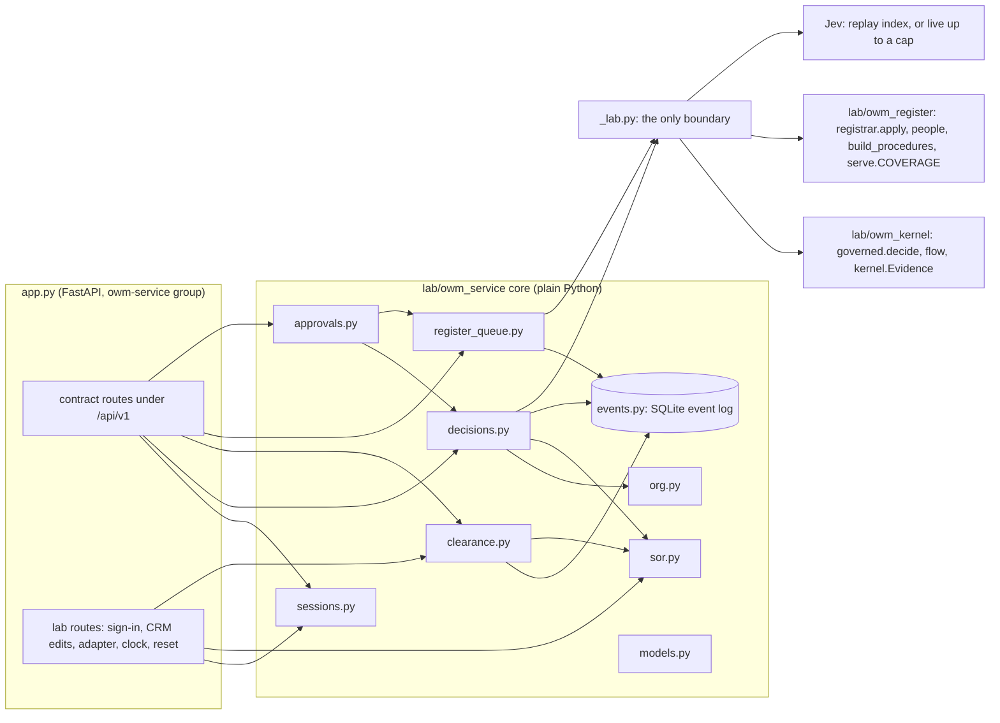
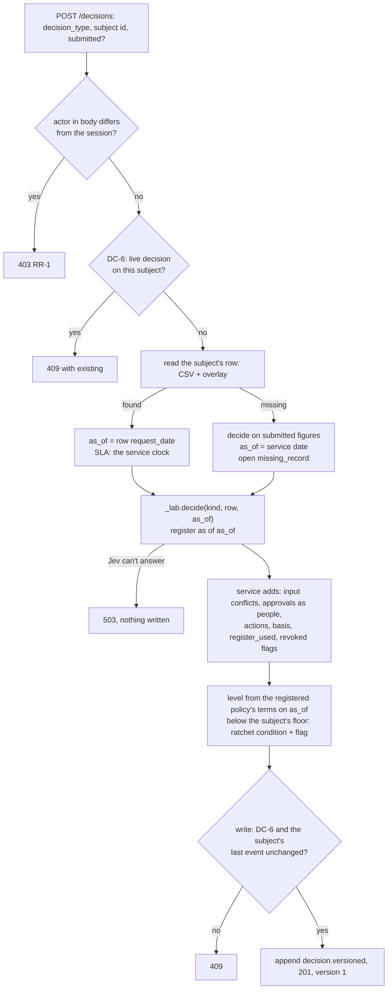
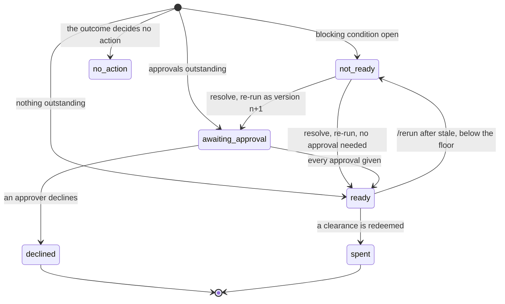
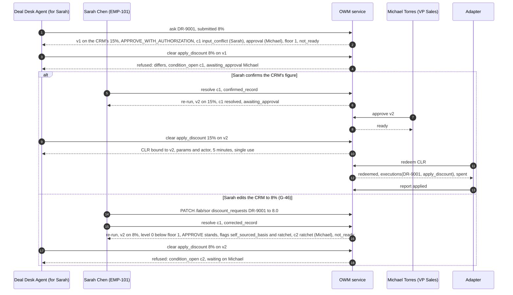
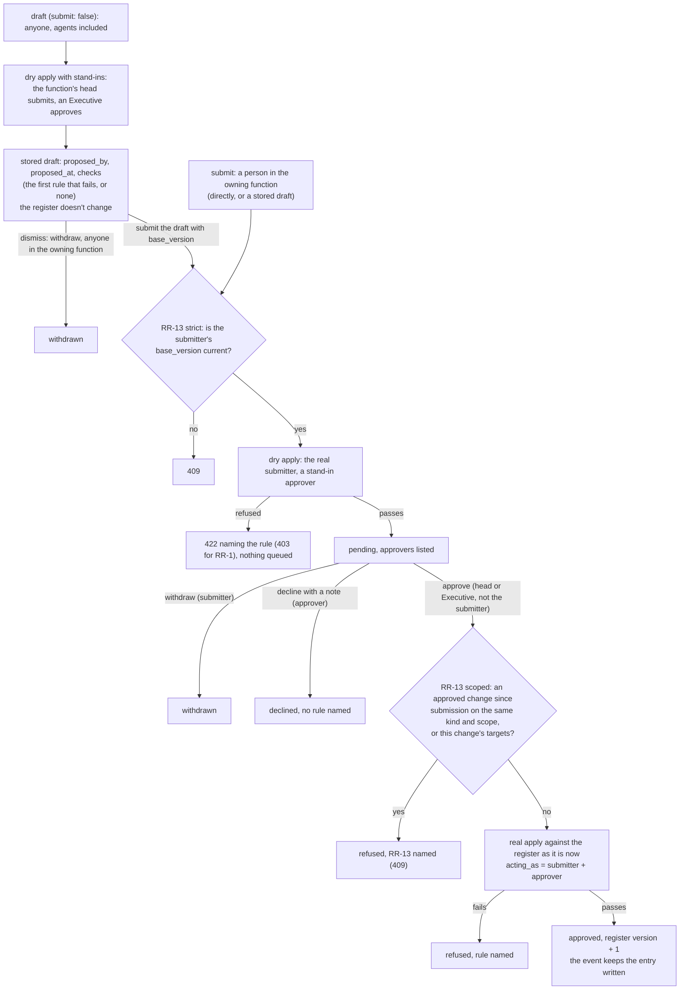
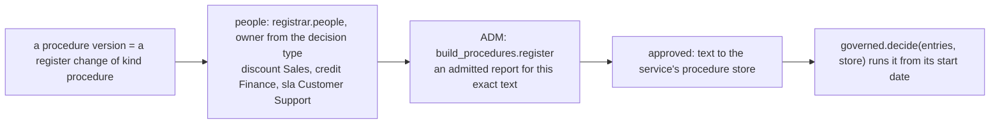
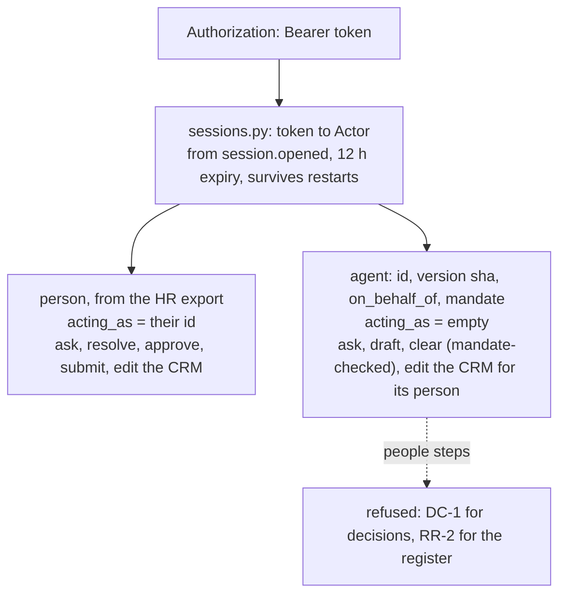
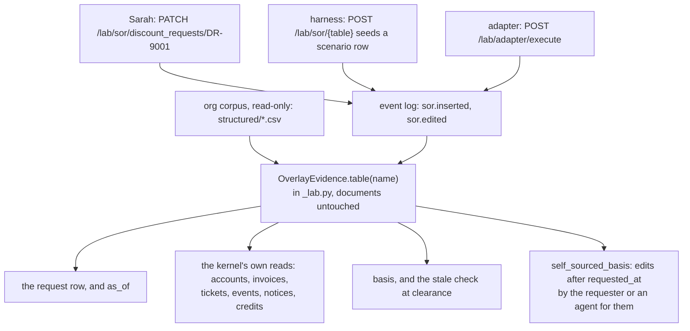
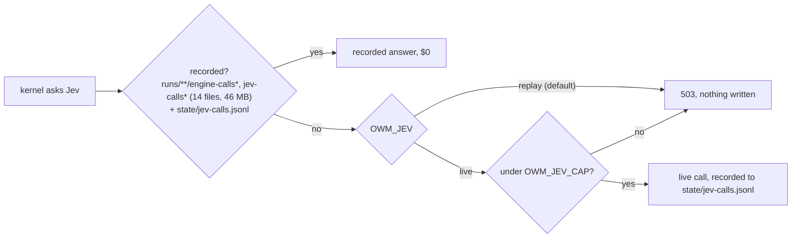
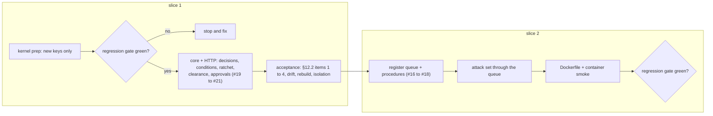

# B-06: the lab's OWM service (design)

**Status:** **approved** by the user (2026-10-11), and approved for build sequencing by garbanzo
(`owm/docs/owm-service-design-review-2026-10-11.md`, 30977cd). Next comes the implementation plan
(writing-plans). No code is written before the plan is approved and an execution method is chosen.

**Revised 2026-10-11 after garbanzo's review.** The contract moved after the 9d05398 pin (U-18 at
53ce7b5, B-11 at 16ae5c4, a listing fix at 30977cd). The additions are folded in below, and none
changes an agreed field:
- `GET /me` (§8.1, §11);
- stored drafts, `proposed_at`, `/{id}/submit` taking the submitter's `base_version`, dismissing a
  draft through `/withdraw`, the `register_draft` work item, `GET /register/changes/{id}`, and
  RR-13 at approval leaving the change `refused` (§7.1, §7.2);
- the ratchet's confirmer uses the approvals' pass-up (§6.5, no longer an assumption);
- `may_ask` stays unenforced (§8.2);
- the Docker image defaults `OWM_LAB_ROUTES=0` (§11, §12);
- the replay check on the edited-row re-runs is done (§10).

**What it is:** a service in shiny-waffle that serves glowing-garbanzo's contract v1.2
(`owm-decisions`) over the lab's kernel. web-next and agents can then use the lab's OWM for real.
It retires when sovera-owm's `owm-decisions` context serves the same contract (the user's decision,
2026-10-09).

**Sources:**

| What | Where |
|---|---|
| The contract | garbanzo `owm/docs/contract-v1.2.md` at 30977cd (first pinned at 9d05398); types in `web-next/lib/contract/owm-decisions.ts`; S22 typed in `s22.example.ts` |
| garbanzo's review of this design | `owm/docs/owm-service-design-review-2026-10-11.md` (30977cd) |
| The lab's reviews of it | `docs/contract-v1.2-review-2026-10-09.md` (c196b31, re-review 74aef92) |
| Agents, clearance and the ratchet | `docs/agents-sketch-review-2026-10-09.md` (deebdd8); G-45, G-46 |
| The kernel, registrar and procedure register | `lab/owm_kernel/`, `lab/owm_register/` |

Section numbers like §5.7 refer to the contract.

---

## 1. Intent

- **Outcome:** the contract's endpoints #16 to #21 (register, procedures, approvals, decisions,
  clearance) served by a real service whose decisions come from the lab's kernel. Everything it adds
  is tested against the lab's truth.
- **Who it's for:**
  - the BlueLeaf technical demo (web-next, through its server-side API route);
  - agents, through BlueLeaf's action tools;
  - the lab, which gets a live OWM to run experiments against.
- **Success:**
  - §12.2 passes in full (§10 below);
  - the regression gate is green (§9);
  - the Docker image runs S22 end to end.

**What it lets us say,** labelled as the commercial lens asks:

| Claim | Label |
|---|---|
| The OWM refuses clearance for actions taken through BlueLeaf's own tools: `differs`, `condition_open`, `awaiting_approval`, `spent` and the rest | **Proven** once §12.2 passes |
| The 42 decision scenarios give the kernel's results through an API, with conditions, approvals and actions matching the truth | **Proven** once §12.2 passes |
| A requester who edits the CRM to land in her own band is stopped by the ratchet (G-46) | **Proven** once §12.2 passes |
| `self_sourced_basis` sees only changes made through the service, not edits made in a real CRM | **Bounded** |
| Demo sign-in only. Jev is replay-only by default | **Bounded** |
| Executors outside BlueLeaf honour clearance; deciding without a revoked document (G-43); protection against meaning flips (G-44); linking re-entered requests (DR-9002) | **Roadmap** |

## 2. Decisions taken

| Decision | By | When |
|---|---|---|
| Refactor by extension, not a rebuild. The demo API uses `owm-decisions` from day one | The user | 2026-10-09 |
| B-06 is the next build (recommended option) | The user | 2026-10-10 |
| Deployment: **both**. Local now, deploy-ready (Dockerfile and config); nothing hosted yet | The user (brainstorm Q1) | 2026-10-10 |
| Approach **A**: a plain-Python core over an append-only SQLite event log, with FastAPI in its own dependency group | The user | 2026-10-10 |
| Built separately from the MCP branch (`skunkworks/blueleaf-mcp`); merged later | Working assumption, not objected to | 2026-10-10 |
| The mandate fixture is kept outside the registrar's `State` | Section 4, approved | 2026-10-11 |
| The demo clock starts at 2026-09-23 09:00 CT, not today | Section 4, approved | 2026-10-11 |
| `PUT /register/settings` is for Executives only, and logged | Section 3, approved | 2026-10-11 |
| **G-43's outcome fix is out of B-06.** The service emits the `revoked` flag; the outcome change gets its own run | Section 5, approved | 2026-10-11 |
| The kernel's level comes from the register's structured terms, not from a new kernel output | Section 2, approved | 2026-10-11 |
| The spec as a whole | The user | 2026-10-11 |
| Fold in the contract's U-18 and B-11 additions during the build | garbanzo's review, the user | 2026-10-11 |
| A ratchet's confirmer passes up the same way an approval does (DC-3, as `passed_from`) | garbanzo's review | 2026-10-11 |
| `may_ask` is recorded, never enforced, in v1.2 | garbanzo's review (contract §9) | 2026-10-11 |
| The Docker image defaults `OWM_LAB_ROUTES=0`; anything hosted stays reachable only from web-next's server | garbanzo's review §3.3 | 2026-10-11 |

## 3. Not in scope

- Real authentication or an identity provider, and hosting.
- Mandate changes, Manage › Agents and trust records (phases 2 and 3, held). Suspend endpoints
  (#23): suspension is configuration.
- **G-43's outcome change.** Emitting `possible_duplicate`. Meaning-flip protection (G-44, pinned).
  Linking re-entered requests (DR-9002).
- Running the admission gate inside the service. It accepts a report the lab's `admit.py` produced.
- Reversals and adjustments. External agents acting. A "what if" endpoint. `as_known_at` (G-38).
- web-next changes: the `OWM_API_URL` route and a Northstar demo org. Those are garbanzo's.
- Reporting every finding on a draft register change at once (§7.5).

---

## 4. Architecture



| Module | Job |
|---|---|
| `_lab.py` | **The only boundary to lab code:** the governed runner, flow, `Evidence`, the registrar, the procedure register, the served register's coverage and the Jev engines. It gives them typed interfaces and is the one place `Any` is allowed. It also holds `OverlayEvidence` (§8.3) |
| `models.py` | Pydantic models mirroring `owm-decisions.ts`. Request models forbid extra fields, which is how a body `as_of` is refused (§10) |
| `events.py` | The append-only event log and its projection tables (§5) |
| `sor.py` | **Systems of record:** the org's structured exports, read-only, plus the logged overlay (§8.3) |
| `org.py` | **One organisation:** its corpus, HR staff, systems of record, register state, procedures, settings and clock. The demo serves Northstar on `base`; tests can open any corpus |
| `decisions.py` | The decision lifecycle (§6) |
| `clearance.py` | Clearance, redemption and reporting (§6.7) |
| `register_queue.py` | Two-step register changes over the frozen registrar, plus procedures (§7) |
| `approvals.py` | `GET /approvals` (#19, §8 of the contract): `register_change`, `register_draft` (B-11), `decision_approval` and `condition` work items |
| `sessions.py` | Demo sessions, the mandate fixture and suspension (§8.1, §8.2) |
| `app.py` | The FastAPI routes, with the contract's status codes. The lab-only `/lab/*` routes sit visibly outside the contract |
| `config.py` | Every setting comes from the environment (§12) |

**Dependency rules (tested):**
- Only `_lab.py` imports lab code.
- Nothing in the package imports `truth/`, `dataset/answer-key/`, `dataset/evaluation/`, `site/` or
  `northstar.model`.
- The core never imports FastAPI.
- Only the acceptance harness (`tests/owm_service/`) reads `truth/`. It's the experimenter's side.

## 5. The event log

**One SQLite table is the record of everything:** `events(seq, at, wall, org, stream, kind, actor, payload)`.
- `at` is demo time from the service clock, and `wall` is real time.
- `stream` is a decision id, change id, subject or session.
- `actor` and `payload` are JSON.

The contract's ground rule 4 ("nothing is edited in place") then holds by construction.

| Event kinds | |
|---|---|
| Sessions and clock | `session.opened`, `session.closed`, `clock.started`, `clock.set` |
| Systems of record | `sor.inserted`, `sor.edited` (`table, key, field, was, now`) |
| Decisions | `decision.versioned` (**the whole computed version**), `condition.resolved`, `decision.approved`, `decision.declined`, `decision.withdrawn`, `decision.rerun_requested` |
| Clearance | `clearance.attempted` (issued or refused, dry runs included), `clearance.redeemed`, `redeem.refused`, `execution.reported`, `incident.opened` |
| Register | `change.drafted`, `change.submitted`, `change.approved` (with the entry or revocation the registrar wrote), `change.refused`, `change.declined`, `change.withdrawn`, `change.reminded`, `settings.changed` |

**Rules:**
- **A version is stored whole.** Rebuilding state replays the events and never re-runs the kernel
  or calls Jev. `state`, `resolved`, `given`, `declined` and `executed` are derived from later
  events.
- **An approved register change stores what the registrar wrote,** and its text goes to the content
  store. Rebuilding never re-runs the rules, so a rule that tightens later doesn't silently
  un-approve the past.
- **Projection tables** are written in the same transaction as their event, and rebuilt from the
  events:
  - `executions(org, subject, action, decision_id, version, clearance_id, redeemed_at)`, with
    **UNIQUE (org, subject, action)**: the `spent` race guard;
  - `clearances(id, bound, expires_at, used_at)`: redeeming is
    `UPDATE … SET used_at = ? WHERE id = ? AND used_at IS NULL`.
- **Concurrency:**
  - The kernel and Jev run **outside** the write lock.
  - Each write is `BEGIN IMMEDIATE`. It re-checks its preconditions (DC-6, DC-5 and the subject's
    last `seq`), and returns 409 if any of them moved.
  - Redemption is one short transaction.
- **A test proves the rebuild:** after every acceptance test, state rebuilt from the log equals the
  live state.

---

## 6. Decisions

### 6.1 Asking: `POST /api/v1/decisions`



- **Only the subject's id is named:** `request_id` for discount and credit, `ticket` for SLA.
  Customer, product, figures, requester and date are read from the row. `submitted` is compared and
  never used (contract ground rule 5).
- **The kernel's `sid` input gets the decision id.** It only fills the record's `scenario` field,
  which the service drops and the acceptance comparison ignores.
- **For SLA, `decided_at` is the service clock** (§5.2 of the contract: SLA `as_of` is the
  decision's own time).

### 6.2 What the service adds to the kernel's record

| Field | How |
|---|---|
| `decision_id`, `version`, `requested_at`, `decided_at`, `actor`, `requested_by` | `DEC-…` ids. Times from the service clock. `actor` from the session. `requested_by` from the row's `requested_by` email, resolved through the HR export (null for SLA) |
| `as_of` | §6.1. Fixed at version 1 and never moved |
| `submitted` | Kept as sent, by §3.5's names. Compared after converting the row's columns (`requested_discount_pct` "15.0" becomes 0.15, and so on) |
| `conditions` | §6.4 and §6.5. Three sources: `input_conflict`, `missing_record`, `ratchet`. None for SLA |
| `judgments` | The kernel's, with `about` from `judgment_about` and `form` from the judgment's shape |
| `flags` | The kernel's `flag_items` with `about`, plus the service's own codes: `revoked` (a document the kernel set aside as not registered that the register shows revoked on or before `as_of`), `self_sourced_basis` and `ratchet`. `possible_duplicate` is never emitted |
| `approvals` | From the kernel's `approval_roles`, as `PersonRef`s (§5.8). A discount `APPROVE_WITH_AUTHORIZATION` needs one approval. Credit needs an approval plus concurrences, with `passed_from`. An SLA `BREACH_CREDIT_OWED` needs a `claim_decision` from the `decide_claim` holder |
| `actions` | From the outcome (§5.9): `apply_discount {request_id, account_id, product, discount}`; `set_credit_limit {request_id, customer_id, limit_usd}`; `issue_service_credit {ticket, account_id, amount_usd}`, with `expected_actor` the `issue_memo` holder |
| `basis` | **Records:** the row's §3.5 fields the decision relied on, read through the overlay. **Documents:** from the kernel's trace |
| `register_used` | The registered documents in the trace, with status and `file_matches` |
| `floor` | §6.5 |
| `state`, `executed`, `previous` | Derived (§6.3). `previous.what_changed` is one line written at the re-run |

### 6.3 State



`state` is derived, first match wins (§5.2):

| | State | When | Live? |
|---|---|---|---|
| 1 | `withdrawn` | The requester withdrew it | No |
| 1 | `spent` | Every action it decided has been executed on the subject, by any decision | No |
| 2 | `no_action` | `actions` is empty | Yes |
| 3 | `not_ready` | A blocking condition is open | Yes |
| 4 | `declined` | An approver declined this version | No |
| 5 | `awaiting_approval` | An approval, concurrence or claim decision isn't given yet | Yes |
| 6 | `ready` | Otherwise: clearance can be issued | Yes |

**A subject has at most one live decision** (DC-6). A decision that stops being live leaves its
floor with the subject. A withdraw is possible from any live state.

### 6.4 Resolving, re-running, approving, declining, withdrawing

- **Every step checks DC-1 to DC-5 first:**
  - DC-1: agents never take a people step;
  - DC-2: the step must name you;
  - DC-3: separation of duties;
  - DC-4: approving is held while a blocking condition is open;
  - DC-5: the `decision_version` must be current.
- **Resolving a condition, or `POST /rerun`, re-runs the decision** (§6.1 of the contract):
  1. re-read the row as it is now, keeping `as_of`;
  2. run `_lab.decide`;
  3. rebuild the conditions;
  4. apply the ratchet and the self-sourced-basis check;
  5. write version n+1.
- **A resolved input conflict stays resolved** as long as the row still holds the value that was
  confirmed. If the row changes again, a new condition opens with a new id. Ids are unique across
  versions.
- **`corrected_record`** means the requester changed the system of record. The re-run reads it
  again. If it still differs from `submitted`, a new condition opens.
- **Approvals bind to a version** (§5.8). A re-run's new version starts with nothing given.

### 6.5 The ratchet and the floor (G-46)

- **The level** comes from the registered policy in force on `as_of`, applied to the row's figure.
  The policies' structured `terms` are already in `base.yaml`:
  - **discount:** the index of the `terms.bands` entry the row's `requested_discount` falls in. For
    PRICING-POLICY-2026 that's ≤10% → 0, 10–20% → 1, >20% → 2;
  - **credit:** the band of `requested_limit_usd`, plus the set of `terms.concurrence` entries
    that apply (for example the VP Sales over $500,000 for Strategic). A version is lower if its
    band is lower, or if it drops a concurrence the floor required. `floor.level` reports the
    band;
  - **with a `missing_record` condition,** the level comes from the submitted figure;
  - **SLA:** no level, so no ratchet.
- **Every outcome has a level,** withheld ones included, without asking the kernel.
- **The floor belongs to the subject:**
  - it starts at the first decision's level;
  - it rises to the highest level any later version or decision needs;
  - only a `confirmed_lower_level` resolution lowers it.
- **Below the floor:**
  - the outcome stands;
  - the version gets a blocking `ratchet` condition and a `ratchet` flag;
  - the condition's `who` is whoever holds the floor level's role for this request, never the
    requester.
- **When the requester holds the floor level's role,** the confirmer passes up exactly as an
  approval does: DC-3, the same rule and **the same code path as `passed_from`**. A ratchet and an
  approval can then never name different people. For discount that's the CRO, David Morgan
  (confirmed in garbanzo's review).

### 6.6 Self-sourced basis (§6.3)

On every re-run, and on a new decision for a subject that already has decisions:
- the service looks for `sor.edited` events on the decision's basis fields after `requested_at`;
- they must be made by the requester, or by an agent whose `on_behalf_of` is the requester;
- each match becomes a `self_sourced_basis` flag naming the field, the old and new values, who
  changed it and when.

The flag stops nothing; the ratchet does. It sees only edits made through the service, and the UI
says so.

### 6.7 Clearance, redemption, reporting (§7)

- **`POST /decisions/{id}/clearance` runs every check and returns every failure,** in this order:
  1. `stale`: the version isn't current; a basis field or document changed since the decision; or
     a document in `register_used` was revoked on or before the action date;
  2. `spent`;
  3. `suspended`;
  4. `outside_mandate`: an agent with no mandate, an action not listed, a version not allowed, or a
     `limits` breach such as `per_day`;
  5. `differs`: an exact match is the default. A mandate's `at_most` allows a lower value, and the
     clearance then binds that lower value;
  6. `condition_open`, one reason per open blocking condition;
  7. `awaiting_approval`, one per outstanding approval;
  8. `declined`.
- **People aren't mandate-checked.** A body `decision_id` that differs from the path's is 422.
- **A clearance** binds the decision, version, action, params and the session's actor. It's single
  use, and expires in `OWM_CLEARANCE_TTL_SECONDS` (default 300). `dry_run: true` checks and logs
  but issues nothing. Every attempt is logged, and `GET /decisions/{id}/clearances` lists them.
- **`POST /clearances/{id}/redeem` runs in one transaction:**
  - `used` and `expired`;
  - `mismatch`: params differ from the bound ones;
  - the re-checks: `stale`, `spent`, `condition_open` and `suspended`;
  - then it marks the clearance used and inserts into `executions`.
  - If two clearances race on one subject and action, the second insert hits the unique key and
    gets `spent`.
- **`POST /clearances/{id}/report`** takes `applied` or `failed`.
  - A `failed` report leaves the action spent and opens an incident for the decision type's owning
    function: discount, Sales; credit, Finance; SLA, Customer Support.
  - With no report, the action is still spent.

### 6.8 Failures and status codes

| Case | Answer |
|---|---|
| A body principal that differs from the session | 403 RR-1 |
| DC-5 (version not current), DC-6 (live decision), a write whose precondition moved | 409 |
| Any other DC rule; extra body fields such as `as_of`; a body id that differs from the path | 422 `{refusals}` |
| Jev can't answer: a replay miss with live off, or the live cap reached | 503, nothing written. Asking grants nothing, so failing closed is safe |
| A clearance refusal | 200 `{cleared: false, reasons}` (it's an answer, §3.4) |

### 6.9 S22 end to end, with the branch the ratchet closes



---

## 7. The register queue and procedures

### 7.1 Two steps over the one-shot registrar

`registrar.apply(state, change, text, acting_as, clock, staff)` takes a submitter and an approver
together, checks every rule, and raises the first that fails. The service splits that into the
contract's two steps **without changing any rule**:



- **Why stand-ins:** the registrar checks people first. Stand-ins let the content rules (RR-5 to
  RR-14) speak early.
- **Why they're safe:**
  - their dry runs are always thrown away;
  - approval runs every rule again with the real people;
  - the submitter's identity comes from the submit session, so `acting_as` at approval is the
    service vouching for something it saw.
- **Drafts are stored** (B-11). `change.drafted` keeps the draft with `proposed_by`, `proposed_at`
  and its `checks`, in state `draft`.
  - An agent's draft lands as a `register_draft` work item for everyone in the owning function,
    with `raised_by` the agent. A person's own draft stays with them.
  - **Submitting a draft** (`/{id}/submit` with `{base_version}`) makes it the submitter's change.
    `submitted_by` is the session's person. `proposed_by` stays on the change, and the service adds
    it to the entry the registrar writes.
  - **RR-13 checks the `base_version` the submitter sends,** the version they reviewed the draft
    against. Otherwise an agent's draft made before the register moved could never be submitted.
  - **Dismissing a draft** is `/{id}/withdraw` by anyone in the owning function; anyone else is
    refused with RR-3. A pending change is withdrawn by its submitter only.
- **Any rule failing at approval, RR-13 included, leaves the change `refused`** with the rule
  named. RR-13 answers 409; the others answer 422 (403 for RR-1).
- **A revoke** is the same flow with `action: revoke`, `target` and `revoked_on` (RR-9, RR-12).
- **Refusals map to the contract's shape** (§3.4): `RefusedError(rule, message)` becomes
  `{rule, detail, unmatched?, fix?}`. The codes are 403 for RR-1, 409 for RR-13 and 422 otherwise.

### 7.2 Reads

- `GET /api/v1/register?as_of=` returns `version`, `clock`, `entries`, `series`, `coverage` and
  `settings`.
  - `coverage` comes from `serve.COVERAGE`.
  - `series` follows `supersedes` chains.
  - `status` is computed for the `as_of` read. That read decides nothing.
  - `file.matches` compares the copy on file with the registered sha256.
  - `file.source_id` is the copy's path in the corpus (`documents/<file>`). The lab has no
    knowledge-foundation id.
- `/register/entries/{doc_id}`, `/register/entries/{doc_id}/text`, `GET` and `PUT /register/settings`.
  `PUT` is for Executives only, and logged as `settings.changed`.
- `GET /api/v1/register/changes?state=&waiting_on=me`, and `GET /api/v1/register/changes/{id}`
  for one change, drafts included (web-next's review drawer reads it).
- Decisions read a kernel `Register` built from the current state, cached per register version.

### 7.3 Procedures (#18)



- The service never runs the admission gate. The lab's `admit.py` makes the report.
- `GET /api/v1/procedures` and `/procedures/{id}` serve v1.1's shape: the versions with their
  sha256, author, registrar, approver and admission report.

### 7.4 The register's clock

RR-9 (no backdating) reads the register clock, which is the service clock's date (§8.5). The
acceptance harness sets it to the registrar's 2026-09-01 when it replays the attack set.

### 7.5 Known limits

- **A draft returns one finding at a time,** because the registrar stops at the first failure.
  Collecting them all would change the registrar's control flow and put the attack reproduction at
  risk.
- **RR-6 binds terms by phrase** (C08). The refusal carries `unmatched`, so the submitter sees what
  to change (G-44).
- **Meaning flips are untested** (G-44, pinned). Nothing may claim registration can't be tampered
  with.
- **Draft checks can act as an oracle** for tuning a meaning flip. The contract accepts this for
  v1.2, because a person submits and another person approves.

---

## 8. Sessions, systems of record, Jev and the clock

### 8.1 Sessions



- **`POST /lab/sessions`** takes `{person_id}` or `{agent_id, on_behalf_of, version?}` and returns
  a token. It's demo-only. The token is stored hashed.
- **`PersonRef`** comes from `employees.csv`: id, full name, title, and the department as
  `function`.
- **A body principal that differs from the session** is refused with RR-1 (403), wherever it
  appears.
- **`GET /api/v1/me`** returns `{ actor }`, the session's actor as the OWM knows it, whose person
  carries their function (U-18). web-next uses it to offer only what the rules allow, such as
  *Submit a new version* for the owning function. The offer is a convenience; the service still
  checks every request.

### 8.2 The mandate fixture and suspension

- **`MANDATE-DEALDESK-2026` is a service fixture,** with terms as in §9 of the contract:
  - agent `AGT-DEALDESK`, the Deal Desk Agent;
  - owner Sales, accountable Michael Torres;
  - principal `delegated`;
  - `may_ask` discount;
  - `may_do` `apply_discount` on discount, exact match, `per_day` 200;
  - `may_propose` `register_change`.
- **It appears in `GET /register`** as a bootstrap entry of kind `agent_mandate`, registered by the
  Sales function.
- **It's held outside the registrar's `State`,** so no lab code sees it, `base.yaml` doesn't
  change, and `build_register.py --check` stays green.
- **`may_ask` is recorded and shown, never enforced, in v1.2** (contract §9). Asking is never
  refused for want of a mandate: web-next's Ask assistant asks as an agent with no mandate fixture.
  Mandates bite at clearance.
- **A change of kind `agent_mandate`** is refused RR-5 (unknown kind), as the contract requires.
- **Suspension:** `OWM_SUSPENDED=AGT-DEALDESK`, or `AGT-DEALDESK@<sha>` for one version.

### 8.3 The systems-of-record overlay



- **Why a subclass rather than a copied folder:**
  - the kernel reads nine tables itself through `Evidence.table` (employees, products,
    crm_accounts, customers, erp_invoices, service_tickets, ticket_events, maintenance_notices,
    service_credits), not only the request row;
  - a subclass gives the kernel, `basis` and the G-46 check the same rows, and writes no files.
- **Edits are by key column:** `request_id` for the request tables and `ticket_id` for tickets.
  Tables without a single key (`ticket_events`) take inserts only.
- **The overlay is the lab's stand-in for "the CRM",** and it sits outside OWM governance on
  purpose: that's G-46's threat.
- **The demo adapter closes the loop.** `POST /lab/adapter/execute {clearance_id, fail?}` does
  three things:
  1. redeems;
  2. writes the effect as `{system: adapter}`;
     - `apply_discount` sets the request's `status`, `approved_by` and `approved_on`, and notes the
       CLR id;
     - `set_credit_limit` updates the credit request;
     - `issue_service_credit` inserts a `service_credits` row, so the SLA cap counts it next time;
  3. reports `applied`, or `failed` when `fail` is set.

### 8.4 Jev



- **The index works like `admit.Layered`:** keyed by `request_hash(model, state, questions)`. It
  reads only the call files.
- **The cap counts the calls recorded in the state directory,** so a restart doesn't reset it.
  Default 100.
- **Live mode reads the key only through `TYPESAFE_API_KEY_FILE`.** The key is never logged or
  baked into an image; Docker mounts it as a secret.
- **The spend is pre-registered in the plan** before any live run, and costs are reported after
  each one.

### 8.5 The clock

- **`OWM_CLOCK=2026-09-23T09:00:00-05:00`** (the default) starts demo time there. Demo time is then
  the start plus the wall time since `clock.started`, so it stays monotonic across restarts.
- **`OWM_CLOCK=real`** is for a real deployment.
- **The harness moves the clock with `POST /lab/clock {to}`,** forward only.
- **The clock is used for:**
  - the SLA `as_of` and `decided_at`;
  - `requested_at` and `decided_at`;
  - RR-9's clock;
  - clearance expiry;
  - `per_day` limits.
- **Why 2026-09-23:** the Northstar world is dated September 2026. On today's date, RR-9 and the
  SLA claim windows would behave differently from the truth the demo tells.

---

## 9. Kernel prep and the regression gate

**The constraint: no existing key changes shape.** The regression scripts compare named fields, so
everything new goes into new top-level keys, or new attributes on the refusal:
- `check_equivalence` compares credit's `authority`, `approvers` and `flags`, and SLA's
  `obligations` and `flags`;
- `check_withhold` and the attack scoring compare `flags` strings and keys.

| New | Carries | Unchanged | Source |
|---|---|---|---|
| `flag_items` | `[{code, text, routes}]` in `flags`' order, where `text` is the string | `flags` | §12.1 item 5; the code table in §5.5 |
| `judgment_about` | `[doc or entity id \| null]`, parallel to `judgments` | `judgments` | §12.1 item 4 |
| `approval_roles` | `[{kind, role, person_id, passed_from}]`. For SLA, the `decide_claim` holder (claim decision) and the `issue_memo` holder (expected actor). The approver is never the concurrer (DC-3) | `authority`, `approvers`, `obligations` | §12.1 items 6 and 13 |
| `RefusedError.unmatched` | The RR-6 or RR-7 phrase the text doesn't state | Rules and messages | G-44 |
| `RefusedError.fix` | RR-10's offered `supersedes` target | Rules and messages | G-44 |

- **`judge` must not change what it sends Jev.** `about` is recorded beside the answer, not in the
  question. Otherwise every replay hash moves.
- **G-43's outcome change is not here** (§2).

**The regression gate.** It must be green after kernel prep, before any service code relies on it,
and again at the end:

```
uv run python runs/2026-10-06-register-fixes/check_withhold.py
uv run python runs/2026-10-04-specs-as-data/check_equivalence.py
uv run python runs/2026-10-06-procedures-governed/run_governed.py         # P1–P5 HOLDS
uv run python lab/owm_register/build_register.py --check
uv run python lab/owm_register/build_procedures.py --check
uv run python runs/2026-10-08-register-attacks/check_registrar.py
uv run python runs/2026-10-08-register-attacks/run_attacks.py run --out <tmp>
    # rules and outcomes equal the committed results.json
uv run pytest · uv run ruff check · uv run ruff format --check · uv run mypy
```

All of it is replay-only and costs $0.

---

## 10. Acceptance and tests

The acceptance harness is the experimenter's side, and the only code that reads `truth/`.

| §12.2 | Test | Checked against |
|---|---|---|
| 1 | **All 42 scenarios** (22 discount, 10 credit, 10 SLA): seed the row, set the clock, ask as the requester with the scenario's `submitted`, and compare the kernel's fields | The committed records and fields that `check_equivalence` uses: experiment 4 v3 for discount, `exp5-credit/hybrid-decisions.json`, `exp6-sla/hybrid-decisions.json`. The plan pins the file and fields for each scenario |
| 2 | **The additions:** input conflicts equal the oracle's on 14 scenarios (S22 `requested_discount`, S23 `request_date`, S24 `status`, S35 `requested_limit_usd`, and 10 with none); approvals by person id and role; actions from the outcome | `src/northstar/oracle.py` and each scenario's `expected:` |
| 3 | **The must-fixes:** a body `as_of` gets 422 and S23 decides on the CRM's date; a second decision on DR-9001 gets 409 DC-6; DR-9102 at 25% re-run at 8% is ratcheted, naming the CRO; the CRM edited to 8% on DR-9001 is ratcheted, naming Michael | G-46, the reviews. **Replay coverage checked 2026-10-11** (below) |
| 4 | **`spent`:** after S36's credit is redeemed on SR-39385, a new decision on SR-39385 is `spent` and its clearance is refused `spent`; two clearances race and the second redemption gets `spent` (threads); a `failed` report stays spent and raises an incident | §5.9, §7.2 |
| + | **Contract drift:** the models parse §10's JSON examples, vendored into `lab/owm_service/contract/`. Slice 1 vendors them from 9d05398. Slice 2 re-vendors them from 30977cd or later, when it adds the register queue | The contract |
| + | **The U-18 and B-11 additions:** `GET /me`; a stored agent draft shows as `register_draft` work for the whole owning function; it's submitted with the submitter's `base_version` after the register moved; dismissing it by someone outside the function gets RR-3; RR-13 at approval leaves the change `refused`; `GET /register/changes/{id}` returns drafts | Contract §3.3, §4.2, §8 at 30977cd |
| + | **Rebuild:** state rebuilt from the log equals the live state after every test | §5 |
| + | **Isolation:** no service import reaches `truth/` or the answer key, and the Docker image has neither | §4 |
| + | **The register queue:** the 24 attack cases (C01 to C24) through draft, submit and approve get the same admitted or refused result as `results.json`. The named rule may differ only where a case breaks more than one rule, because submit runs the content rules before approval runs RR-4; each such difference is listed | `runs/2026-10-08-register-attacks/` |

- **Replay coverage for the edited-row re-runs: checked, $0.** Garbanzo asked whether the 8%
  re-runs hit recorded Jev calls. A replay-only probe (live off, cap 0) ran the governed discount
  decision on DR-9001 and DR-9102 as recorded, and with the row edited to 8%. All four replayed
  with 0 live calls, because the discount judgments ask about the justification, the customer, the
  product and the documents, never the figure.

  | Row | Recorded | Edited to 8%, with no ratchet |
  |---|---|---|
  | DR-9001 (S22) | 15%: `APPROVE_WITH_AUTHORIZATION`, Michael Torres, 14 judgments | `APPROVE`, Sarah Chen approves herself |
  | DR-9102 (S10) | 25%: `APPROVE_WITH_AUTHORIZATION`, David Morgan, 6 judgments | `APPROVE`, Sarah Chen approves herself |

  The right-hand column is exactly what the ratchet must stop. No live spend is needed for item 3.
- **Seeding:**
  - Only DR-9001 and CR-9201 are in the CSVs. The other discount and credit requests are inserted
    through the overlay: discount rows with `heldout.record`, including the S03 list-price fix;
    credit rows with `x5.record`.
  - All ten SLA tickets are already in `service_tickets.csv`.
- **The SLA clock:**
  - S45 uses its `decided_at`.
  - The nine with none use a time after every deadline on that ticket. The SLA spec uses
    `decided_at` only in deadline comparisons (`sla.yaml` lines 144 and 150), so that equals
    "after all events". The test proves it.
- **Where the tests live:** `tests/owm_service/`.
  - The core tests run in the default `uv run pytest`.
  - The HTTP tests use `pytest.importorskip("fastapi")`, so they run only with the `owm-service`
    group installed.
  - `lab/owm_service` is added to mypy's `files` (strict) and ruff's `src`.

---

## 11. HTTP surface

| Routes | |
|---|---|
| **Contract, under `/api/v1`** | `GET /me`; `GET /register`, `/register/entries/{doc_id}`, `/register/entries/{doc_id}/text`, `GET`/`PUT /register/settings`; `POST /register/changes`, `/register/changes/{id}/submit`, `/approve`, `/decline`, `/withdraw`, `/remind`; `GET /register/changes`, `/register/changes/{id}`; `GET /procedures`, `/procedures/{id}`; `POST /decisions`, `GET /decisions`, `/decisions/{id}`, `/decisions/{id}/versions/{v}`, `/decisions/{id}/events`; `POST /decisions/{id}/conditions/{cid}/resolve`, `/approve`, `/decline`, `/withdraw`, `/rerun`; `POST /decisions/{id}/clearance`, `GET /decisions/{id}/clearances`; `POST /clearances/{id}/redeem`, `/clearances/{id}/report`; `GET /approvals` |
| **Lab-only, outside the contract** | `POST /lab/sessions`, `DELETE /lab/sessions/current`; `PATCH /lab/sor/{table}/{id}`, `POST /lab/sor/{table}`; `POST /lab/adapter/execute`; `POST /lab/clock`; `POST /lab/reset` (archives the log, starts afresh) |
| **Health** | `GET /healthz` |

- web-next calls the service server-side through its API route, so there's no CORS.
- `OWM_LAB_ROUTES=0` removes the `/lab/*` routes. They're on by default locally, because the demo
  has no other sign-in. **The Docker image defaults to `0`.** The container smoke test, and any
  demo deployment, set it to `1` explicitly and keep the service reachable only from web-next's
  server. The lab routes let anyone open a session as anyone and edit the CRM.

## 12. Packaging and configuration

- **Dependencies:** a new `owm-service` dependency group in `pyproject.toml` (FastAPI and uvicorn,
  pinned). The default install is unchanged.
- **Run locally:** `uv run --group owm-service python -m owm_service` (the exact entry point is fixed
  in the plan).
- **Dockerfile:**
  - built on python slim; `uv sync --group owm-service`; runs as non-root on port 8000, with
    `HEALTHCHECK /healthz` and `ENV OWM_LAB_ROUTES=0`;
  - **copies:** the lab code, the register and its stores, `dataset/evidence/` and
    `dataset/evidence-variants/`, the procedure admission reports, and the 14 Jev call files;
  - **never copies:** `truth/`, `dataset/answer-key/`, `dataset/evaluation/`, `site/` or
    `_owm-local/`. So the image itself enforces isolation: if anything reaches for `truth/` at
    runtime, the container smoke test fails.
- **Smoke test:** `docker build`, then S22 end to end against the container, run with
  `OWM_LAB_ROUTES=1` set explicitly. Docker is installed here.

| Variable | Default | Meaning |
|---|---|---|
| `OWM_STATE_DIR` | `.owm-service/` (gitignored); `/data` in Docker | The event log, stores and recorded Jev calls |
| `OWM_CORPUS` | `base` | The org's corpus |
| `OWM_JEV` | `replay` | `replay` or `live` |
| `OWM_JEV_CAP` | `100` | Live calls allowed per state directory |
| `TYPESAFE_API_KEY_FILE` | unset | A path to the key file, never the key itself |
| `OWM_CLOCK` | `2026-09-23T09:00:00-05:00` | The demo start, or `real` |
| `OWM_CLEARANCE_TTL_SECONDS` | `300` | Clearance lifetime |
| `OWM_SUSPENDED` | empty | Agents, or `agent@sha` versions, that are suspended |
| `OWM_LAB_ROUTES` | `1` locally; `0` in the Docker image | `0` removes `/lab/*` |

## 13. Build order



## 14. Risks and known limits

| Risk | Mitigation |
|---|---|
| Kernel prep changes what's sent to Jev, so replay misses | `about` is recorded beside the answer. The gate runs replay-only, so a miss fails loudly |
| A seeded row differs from the harness's row, so the replay hash misses | Seed with the same builders (`heldout.record`, `x5.record`). A miss is 503, never a silent live call. The edited-row re-runs were checked: they replay (§10) |
| `self_sourced_basis` only sees service writes | Labelled bounded. The UI says so |
| Demo sign-in has no real security | `/lab/*` is clearly separate. A real deployment replaces `sessions.py` and sets `OWM_LAB_ROUTES=0` |
| A single SQLite writer | Fine for a demo. Kernel calls run outside the lock |
| Loading the 46 MB replay index takes a few seconds at startup | Accepted. Trimming to the calls the demo needs is a later optimisation |
| A re-entered request (DR-9002) is a new subject | A known limit, not claimed (§12.3) |

## 15. Open items, after B-06

- **G-43's outcome change**, as its own run with a before/after record on C02 and C01x.
- `possible_duplicate`: a truth scenario, a window, a test.
- G-46 follow-up: linking requests by deal (DR-9002).
- `agent_mandate` as a real kind, with its owner from the entry (phases 2 and 3).
- **garbanzo:** an `OWM_API_URL` route in web-next, and a Northstar demo org (it's Bluefin today).
  A paste-ready note goes to the garbanzo session when slice 1 passes.
- **U-23: scope on a register change.** A change carries `kind` but not `scope`, so nobody can
  submit a first exception for a new customer. Whenever it suits; it doesn't affect B-06's
  acceptance.
- **garbanzo's side when it connects (B-08, B-09),** from its review §4:
  - map `file.source_id` (a corpus path) to its own document ids;
  - make `on_mismatch` read-only for anyone but Executives;
  - default *Effective from* to the register's `clock`;
  - a plain message for a 503 on `POST /decisions`;
  - a session bridge to `/lab/sessions`.
- Production: who may edit a system of record is the real CRM's own access control, not the OWM's.
