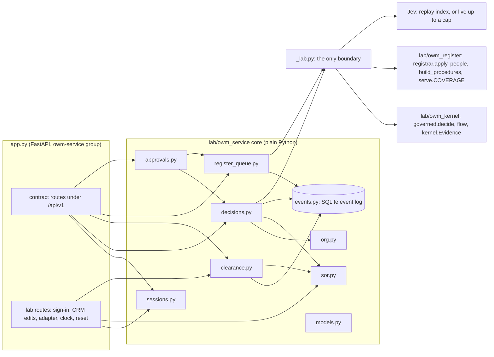
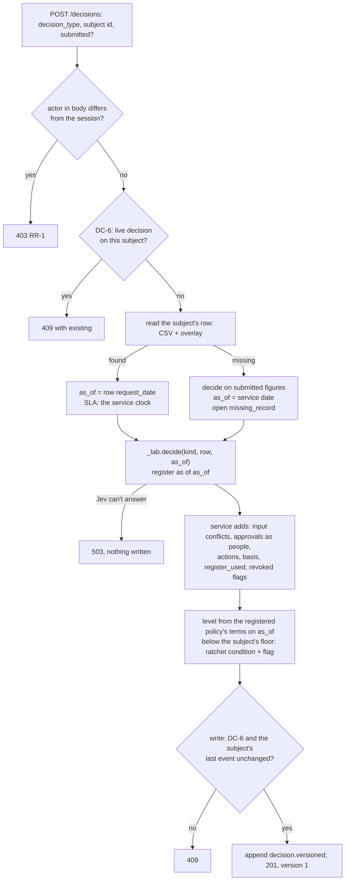
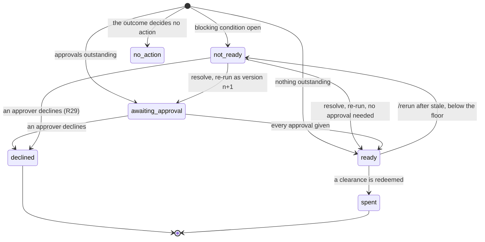
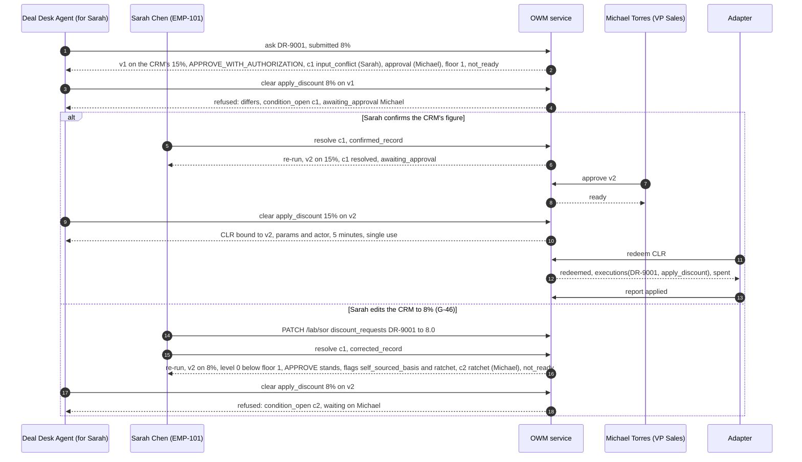
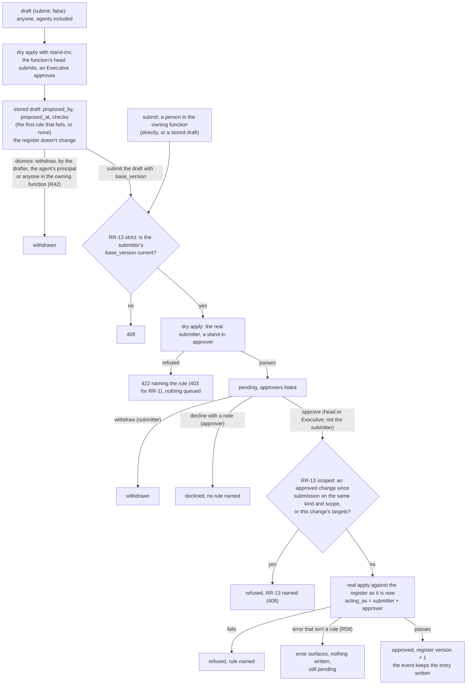
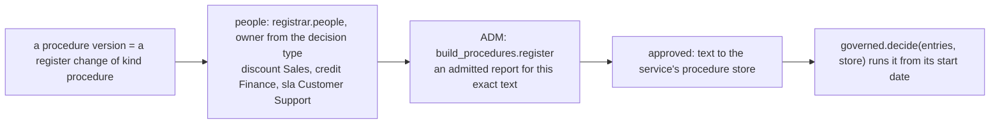
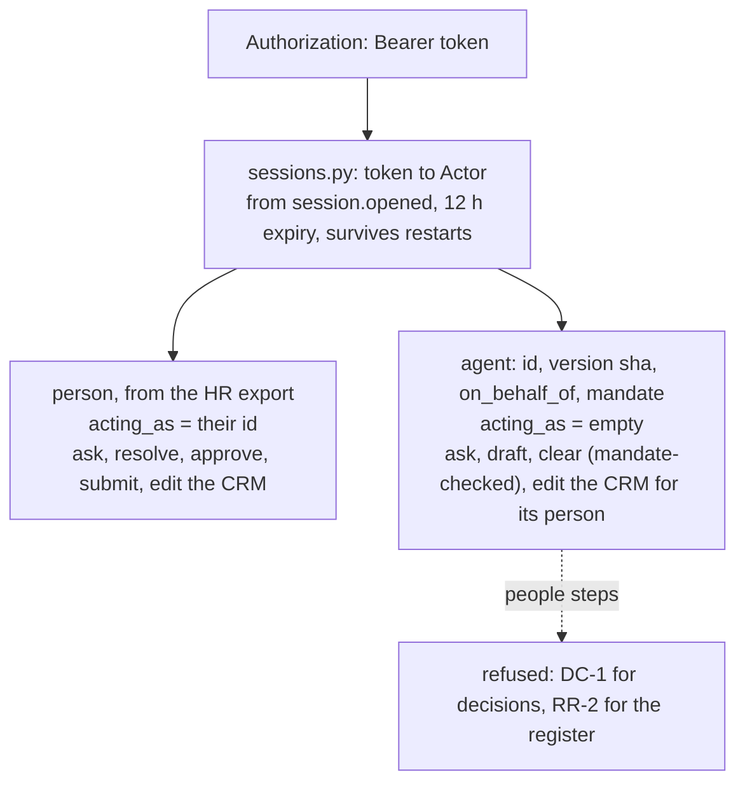
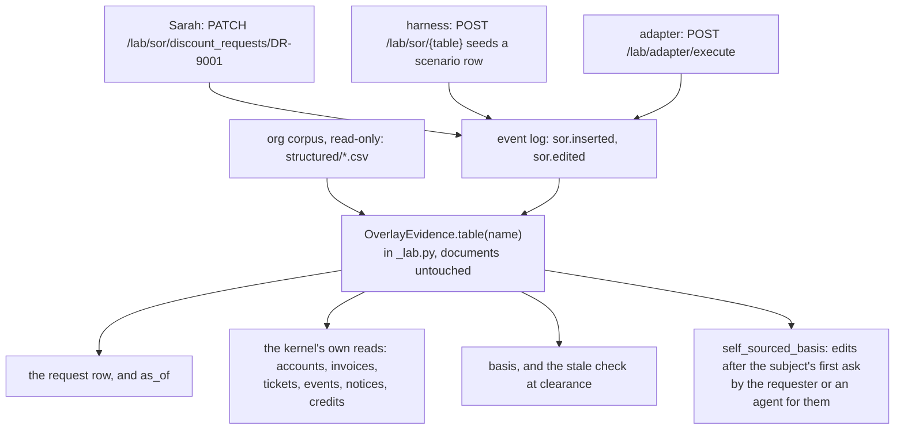
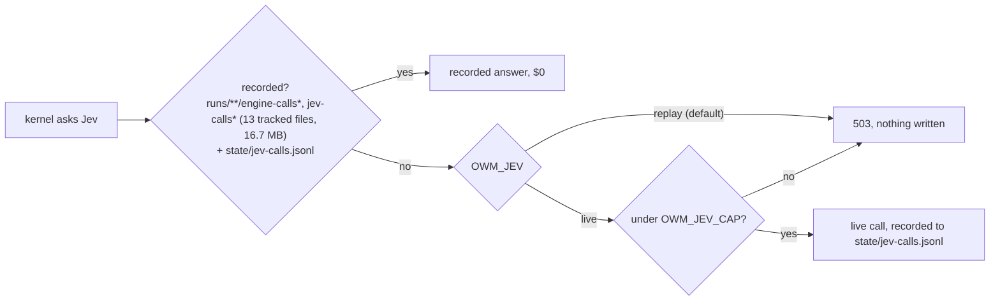
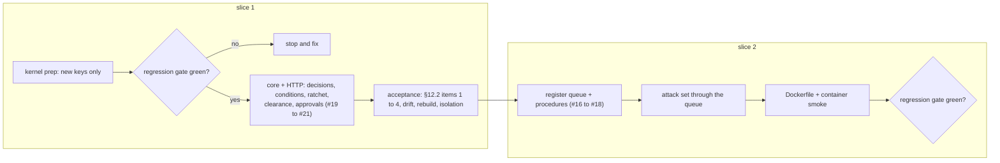

# B-06: the lab's OWM service (design)

**Status:** **approved** by the user (2026-10-11), and approved for build sequencing by garbanzo
(`owm/docs/owm-service-design-review-2026-10-11.md`, 30977cd). Built to the plan
(`docs/superpowers/plans/2026-10-11-owm-service.md`) and merged to `main` at f59d710.

**Amended 2026-10-12 for contract v1.3** (garbanzo 589e0c7, §6.2 wording at 7732488). The user
ruled on the three points this build left open, and the service follows:
- **R26 → R61, R62:** a dropped credit concurrence's holder confirms the lower level too, with
  one ratchet condition per confirmer (§6.5);
- **R34 → R64:** a dry run answers with its own shape, `{dry_run: true, would_clear, reasons}`
  (§6.7);
- **R58:** adopted as built. It binds the actor who redeemed, not the token (§6.7);
- **`href`:** the OWM resource path, as built; clients map it to their pages.

**Amended 2026-10-12 after the build.** B-06 is built: 21 tasks, a final review ("with fixes")
and its fix wave. The sections below now say what was built, each change naming its ruling.
Appendix A records every ruling, R1 to R60.

**Revised 2026-10-11 after garbanzo's review.** The contract moved after the 9d05398 pin (U-18 at
53ce7b5, B-11 at 16ae5c4, a listing fix at 30977cd). The additions are folded in below, and none
changes an agreed field:
- `GET /me` (§8.1, §11);
- stored drafts, `proposed_at`, `/{id}/submit` taking the submitter's `base_version`, dismissing a
  draft through `/withdraw`, the `register_draft` work item, `GET /register/changes/{id}`, and
  RR-13 at approval leaving the change `refused` (§7.1, §7.2);
- the ratchet's confirmer uses the approvals' pass-up (§6.5, no longer an assumption);
- `may_ask` stays unenforced (§8.2);
- the Docker image defaults `OWM_LAB_ROUTES=0` (§11, §12);
- the replay check on the edited-row re-runs is done (§10).

**What it is:** a service in shiny-waffle that serves glowing-garbanzo's contract v1.2, now v1.3
(`owm-decisions`) over the lab's kernel. web-next and agents can then use the lab's OWM for real.
It retires when sovera-owm's `owm-decisions` context serves the same contract (the user's decision,
2026-10-09).

**Sources:**

| What | Where |
|---|---|
| The contract | garbanzo `owm/docs/contract-v1.2.md`, v1.3 at 589e0c7 (built to v1.2 at 30977cd; first pinned at 9d05398); types in `web-next/lib/contract/owm-decisions.ts`; S22 typed in `s22.example.ts` |
| garbanzo's review of this design | `owm/docs/owm-service-design-review-2026-10-11.md` (30977cd) |
| The lab's reviews of it | `docs/contract-v1.2-review-2026-10-09.md` (c196b31, re-review 74aef92) |
| Agents, clearance and the ratchet | `docs/agents-sketch-review-2026-10-09.md` (deebdd8); G-45, G-46 |
| The kernel, registrar and procedure register | `lab/owm_kernel/`, `lab/owm_register/` |

Section numbers like §5.7 refer to the contract.

---

## 1. Intent

- **Outcome:** the contract's endpoints #16 to #21 (register, procedures, approvals, decisions,
  clearance) served by a real service whose decisions come from the lab's kernel. Everything it adds
  is tested against the lab's truth.
- **Who it's for:**
  - the BlueLeaf technical demo (web-next, through its server-side API route);
  - agents, through BlueLeaf's action tools;
  - the lab, which gets a live OWM to run experiments against.
- **Success:**
  - §12.2 passes in full (§10 below);
  - the regression gate is green (§9);
  - the Docker image runs S22 end to end.

**What it lets us say,** labelled as the commercial lens asks:

| Claim | Label |
|---|---|
| The OWM refuses clearance for actions taken through BlueLeaf's own tools: `differs`, `condition_open`, `awaiting_approval`, `spent` and the rest | **Proven** once §12.2 passes |
| The 42 decision scenarios give the kernel's results through an API, with conditions, approvals and actions matching the truth | **Proven** once §12.2 passes |
| A requester who edits the CRM to land in her own band is stopped by the ratchet (G-46) | **Proven** once §12.2 passes |
| `self_sourced_basis` sees only changes made through the service, not edits made in a real CRM | **Bounded** |
| Demo sign-in only. Jev is replay-only by default | **Bounded** |
| Executors outside BlueLeaf honour clearance; deciding without a revoked document (G-43); protection against meaning flips (G-44); linking re-entered requests (DR-9002) | **Roadmap** |

## 2. Decisions taken

| Decision | By | When |
|---|---|---|
| Refactor by extension, not a rebuild. The demo API uses `owm-decisions` from day one | The user | 2026-10-09 |
| B-06 is the next build (recommended option) | The user | 2026-10-10 |
| Deployment: **both**. Local now, deploy-ready (Dockerfile and config); nothing hosted yet | The user (brainstorm Q1) | 2026-10-10 |
| Approach **A**: a plain-Python core over an append-only SQLite event log, with FastAPI in its own dependency group | The user | 2026-10-10 |
| Built separately from the MCP branch (`skunkworks/blueleaf-mcp`); merged later | Working assumption, not objected to | 2026-10-10 |
| The mandate fixture is kept outside the registrar's `State` | Section 4, approved | 2026-10-11 |
| The demo clock starts at 2026-09-23 09:00 CT, not today | Section 4, approved | 2026-10-11 |
| `PUT /register/settings` is for Executives only, and logged | Section 3, approved | 2026-10-11 |
| **G-43's outcome fix is out of B-06.** The service emits the `revoked` flag; the outcome change gets its own run | Section 5, approved | 2026-10-11 |
| The kernel's level comes from the register's structured terms, not from a new kernel output | Section 2, approved | 2026-10-11 |
| The spec as a whole | The user | 2026-10-11 |
| Fold in the contract's U-18 and B-11 additions during the build | garbanzo's review, the user | 2026-10-11 |
| A ratchet's confirmer passes up the same way an approval does (DC-3, as `passed_from`) | garbanzo's review | 2026-10-11 |
| `may_ask` is recorded, never enforced, in v1.2 | garbanzo's review (contract §9) | 2026-10-11 |
| The Docker image defaults `OWM_LAB_ROUTES=0`; anything hosted stays reachable only from web-next's server | garbanzo's review §3.3 | 2026-10-11 |

## 3. Not in scope

- Real authentication or an identity provider, and hosting.
- Mandate changes, Manage › Agents and trust records (phases 2 and 3, held). Suspend endpoints
  (#23): suspension is configuration.
- **G-43's outcome change.** Emitting `possible_duplicate`. Meaning-flip protection (G-44, pinned).
  Linking re-entered requests (DR-9002).
- Running the admission gate inside the service. It accepts a report the lab's `admit.py` produced.
- Reversals and adjustments. External agents acting. A "what if" endpoint. `as_known_at` (G-38).
- web-next changes: the `OWM_API_URL` route and a Northstar demo org. Those are garbanzo's.
- Reporting every finding on a draft register change at once (§7.5).

---

## 4. Architecture



| Module | Job |
|---|---|
| `_lab.py` | **The only boundary to lab code:** the governed runner, flow, `Evidence`, the registrar, the procedure register, the served register's coverage and the Jev engines. It gives them typed interfaces and is the one place `Any` is allowed. It also holds `OverlayEvidence` (§8.3) |
| `models.py` | Pydantic models mirroring `owm-decisions.ts`. Request models forbid extra fields, which is how a body `as_of` is refused (§10) |
| `events.py` | The append-only event log and its projection tables (§5) |
| `sor.py` | **Systems of record:** the org's structured exports, read-only, plus the logged overlay (§8.3) |
| `org.py` | **One organisation:** its corpus, HR staff, systems of record, register state, procedures, settings and clock. The demo serves Northstar on `base`; tests can open any corpus |
| `decisions.py` | The decision lifecycle (§6) |
| `clearance.py` | Clearance, redemption and reporting (§6.7) |
| `register_queue.py` | Two-step register changes over the frozen registrar, plus procedures (§7) |
| `approvals.py` | `GET /approvals` (#19, §8 of the contract): `register_change`, `register_draft` (B-11), `decision_approval` and `condition` work items |
| `sessions.py` | Demo sessions, the mandate fixture and suspension (§8.1, §8.2) |
| `app.py` | The FastAPI routes, with the contract's status codes. The lab-only `/lab/*` routes sit visibly outside the contract |
| `config.py` | Every setting comes from the environment (§12) |

**Dependency rules (tested):**
- Only `_lab.py` imports lab code.
- Nothing in the package imports `truth/`, `dataset/answer-key/`, `dataset/evaluation/`, `site/` or
  `northstar.model`.
- The core never imports FastAPI.
- Only the acceptance harness (`tests/owm_service/`) reads `truth/`. It's the experimenter's side.

## 5. The event log

**One SQLite table is the record of everything:** `events(seq, at, wall, org, stream, kind, actor, payload)`.
- `at` is demo time from the service clock, and `wall` is real time.
- `actor` and `payload` are JSON.
- `stream`, as built (R33):
  - **the subject** (`DR-…`, `CR-…`, `SR-…`): every event that changes a decision's derived
    state, so a write's re-check of the subject's last `seq` sees it: versions, steps,
    `decision.failed`, redemptions, reports and incidents;
  - **the decision id**: clearance attempts and refused redemptions, which decide nothing, so an
    agent polling for clearance never makes an approver's write 409;
  - `change:<id>`, `session:<sha12>`, `sor`, `clock` and `register:settings`.

The contract's ground rule 4 ("nothing is edited in place") then holds by construction.

| Event kinds | |
|---|---|
| Sessions and clock | `session.opened`, `session.closed`, `clock.started`, `clock.set` |
| Systems of record | `sor.inserted`, `sor.edited` (`table, key, field, was, now`) |
| Decisions | `decision.versioned` (**the whole computed version**, with its level), `condition.resolved`, `decision.approved`, `decision.declined`, `decision.withdrawn`, `decision.rerun_requested`, `decision.failed` (the kernel couldn't decide: 503, nothing else written; R19) |
| Clearance | `clearance.attempted` (issued or refused, dry runs included), `clearance.redeemed`, `redeem.refused`, `execution.reported`, `incident.opened` |
| Register | `change.drafted`, `change.submitted`, `change.approved` (with the entry or revocation the registrar wrote), `change.refused`, `change.declined`, `change.withdrawn`, `change.reminded`, `settings.changed`, `procedure.approved` (a procedure version's entry; the register's replay and scoped RR-13 never read it, R50) |

**Rules:**
- **A version is stored whole.** Rebuilding state replays the events and never re-runs the kernel
  or calls Jev. `state`, `resolved`, `given`, `declined` and `executed` are derived from later
  events.
- **An approved register change stores what the registrar wrote,** and its text goes to the content
  store. Rebuilding never re-runs the rules, so a rule that tightens later doesn't silently
  un-approve the past.
- **Projection tables** are written in the same transaction as their event, and rebuilt from the
  events:
  - `executions(org, subject, action, decision_id, version, clearance_id, redeemed_at)`, with
    **UNIQUE (org, subject, action)**: the `spent` race guard;
  - `clearances(id, bound, expires_at, used_at)`: redeeming is
    `UPDATE … SET used_at = ? WHERE id = ? AND used_at IS NULL`.
- **Concurrency:**
  - The kernel and Jev run **outside** the write lock.
  - Each write is `BEGIN IMMEDIATE`. It re-checks its preconditions (DC-6, DC-5 and the subject's
    last `seq`), and returns 409 if any of them moved.
  - Redemption is one short transaction.
- **A test proves the rebuild:** after every acceptance test that builds an org, state rebuilt from
  the log equals the live state.

---

## 6. Decisions

### 6.1 Asking: `POST /api/v1/decisions`



- **Only the subject's id is named:** `request_id` for discount and credit, `ticket` for SLA.
  Customer, product, figures, requester and date are read from the row. `submitted` is compared and
  never used (contract ground rule 5).
- **On the missing-row path** the figures come from `submitted`, but the requester never does: it
  is the session's person, or an agent's `on_behalf_of`. A submitted requestor is kept in
  `submitted` only, and an agent with no principal and no row gets 404 (R22).
- **The kernel's `sid` input is `pending` on an ask** (the id is taken only at the write) **and
  the decision id on a re-run.** It only fills the record's `scenario` field, which the service
  drops and the acceptance comparison ignores.
- **Any error building the row view or the kernel's inputs** (a blank inserted value, say) is a
  503 with `decision.failed`, never a 500 (R19).
- **For SLA, `decided_at` is the service clock** (§5.2 of the contract: SLA `as_of` is the
  decision's own time).

### 6.2 What the service adds to the kernel's record

| Field | How |
|---|---|
| `decision_id`, `version`, `requested_at`, `decided_at`, `actor`, `requested_by` | `DEC-…` ids. Times from the service clock. `actor` from the session. `requested_by` from the row's `requested_by` email, resolved through the HR export (null for SLA); on the missing-row path, the session's person or the agent's principal (R22) |
| `as_of` | §6.1. Fixed at version 1 and never moved |
| `submitted` | Kept as sent, by §3.5's names. Compared after converting the row's columns (`requested_discount_pct` "15.0" becomes 0.15, and so on) |
| `conditions` | §6.4 and §6.5. Three sources: `input_conflict`, `missing_record`, `ratchet`. None for SLA |
| `judgments` | The kernel's, with `about` from `judgment_about` and `form` from the judgment's shape |
| `flags` | The kernel's `flag_items` with `about`, plus the service's own codes: `revoked` (a document the kernel set aside as not registered that the register shows revoked on or before `as_of`), `self_sourced_basis` and `ratchet`. `possible_duplicate` is never emitted |
| `approvals` | From the kernel's `approval_roles`, as `PersonRef`s (§5.8). A discount `APPROVE_WITH_AUTHORIZATION` needs one approval. Credit needs an approval plus concurrences, with `passed_from`. An SLA `BREACH_CREDIT_OWED` needs a `claim_decision` from the `decide_claim` holder |
| `actions` | From the outcome (§5.9): `apply_discount {request_id, account_id, product, discount}`; `set_credit_limit {request_id, customer_id, limit_usd}`; `issue_service_credit {ticket, account_id, amount_usd}`, with `expected_actor` the `issue_memo` holder |
| `basis` | **Records:** the row's raw columns the decision relied on, read through the overlay: `account_id`, `product_sku`, `requested_discount_pct`, `request_date`, `requested_by` for discount; `erp_customer_id`, `current_limit_usd`, `requested_limit_usd`, `request_date`, `requested_by` for credit; for SLA every ticket column plus `events`, the sha256 of the ticket's `ticket_events` rows (R17). **Documents:** from the kernel's trace, including register entries the procedure read through `use_entry` (R21) |
| `register_used` | Every registered document the decision relied on, `use_entry` reads included (R20, R21: three for S22, where the contract example shows two), with status and `file_matches` |
| `floor` | §6.5 |
| `state`, `executed`, `previous` | Derived (§6.3). `previous.what_changed` is one line written at the re-run |

### 6.3 State



`state` is derived, first match wins (§5.2). **As built, `declined` comes before `not_ready`**
(R29): a decline closes the decision even while a blocking condition is open. In the contract's
order such a decision would derive `not_ready`, stay live, and lose the decline at the next
re-run.

| | State | When | Live? |
|---|---|---|---|
| 1 | `withdrawn` | The requester withdrew it | No |
| 1 | `spent` | Every action it decided has been executed on the subject, by any decision | No |
| 2 | `no_action` | `actions` is empty | Yes |
| 3 | `declined` | An approver declined this version | No |
| 4 | `not_ready` | A blocking condition is open | Yes |
| 5 | `awaiting_approval` | An approval, concurrence or claim decision isn't given yet | Yes |
| 6 | `ready` | Otherwise: clearance can be issued | Yes |

**A subject has at most one live decision** (DC-6). A decision that stops being live leaves its
floor with the subject. A withdraw is possible from any live state. **For SLA,** whose tickets
name no requester, the asker (the session's person or the agent's principal) counts as the
requester for withdraw and re-run, and DC-3 doesn't bar the claim decider (R30).

### 6.4 Resolving, re-running, approving, declining, withdrawing

- **Every step checks DC-1 to DC-5 first:**
  - DC-1: agents never take a people step;
  - DC-2: the step must name you;
  - DC-3: separation of duties;
  - DC-4: approving is held while a blocking condition is open. Declining isn't held: a decline
    closes the decision (R29);
  - DC-5: the `decision_version` must be current.
- **A resolution must fit its condition's source** (R28): `input_conflict` takes
  `confirmed_record` or `corrected_record`; `missing_record` takes `corrected_record`; `ratchet`
  takes `confirmed_lower_level`. Anything else is 422 DC-2.
- **Resolving a condition, or `POST /rerun`, re-runs the decision** (§6.1 of the contract):
  1. re-read the row as it is now, keeping `as_of`;
  2. run `_lab.decide`;
  3. rebuild the conditions;
  4. apply the ratchet and the self-sourced-basis check;
  5. write version n+1.
- **A re-run fails closed (503, `decision.failed`) when the row now names a different
  requester** (R31). That blocks reassigning a request to oneself and then approving it.
- **A resolved input conflict stays resolved** as long as the row still holds the value that was
  confirmed. If the row changes again, a new condition opens with a new id. Ids are unique across
  versions. If the row returns to the exact value that was confirmed, the resolution covers it
  again (R32).
- **`corrected_record`** means the requester changed the system of record. The re-run reads it
  again. If it still differs from `submitted`, a new condition opens.
- **Approvals bind to a version** (§5.8). A re-run's new version starts with nothing given.

### 6.5 The ratchet and the floor (G-46)

- **The level** comes from the registered policy in force on `as_of`, applied to the row's figure.
  The policies' structured `terms` are already in `base.yaml`:
  - **discount:** the index of the `terms.bands` entry the row's `requested_discount` falls in. For
    PRICING-POLICY-2026 that's ≤10% → 0, 10–20% → 1, >20% → 2;
  - **credit:** the band of `requested_limit_usd`, plus the set of `terms.concurrence` entries
    that apply (for example the VP Sales over $500,000 for Strategic). A version is lower if its
    band is lower, or if it drops a concurrence the floor required. `floor.level` reports the
    band;
  - **with a `missing_record` condition,** the level comes from the submitted figure;
  - **SLA:** no level, so no ratchet.
- **Every outcome has a level,** withheld ones included, without asking the kernel.
- **The floor belongs to the subject:**
  - it starts at the first decision's level;
  - it rises to the highest level any later version or decision needs;
  - only a `confirmed_lower_level` resolution lowers it.
- **Below the floor:**
  - the outcome stands;
  - the version gets a `ratchet` flag and a round of blocking `ratchet` conditions, one per
    confirmer, each with one person in `who` (R61, contract v1.3 §6.2);
  - the confirmers are whoever holds the floor level's role for this request and, for credit,
    whoever holds each concurrence the floor required that the version drops. Never the
    requester, and never one person twice: that fails closed, 503, nothing written (R62);
  - each confirmer resolves only their own condition, and each resolution re-runs the decision.
    The round keeps its ids while the re-run is still below the floor at the same level for the
    same confirmers, so nobody confirms twice. The floor drops to the opening version's level
    only when every condition in the round is confirmed. A new level opens a new round (R61).
- **When the requester holds the floor level's role,** the confirmer passes up exactly as an
  approval does: DC-3, the same rule and **the same code path as `passed_from`**. A ratchet and an
  approval can then never name different people. For discount that's the CRO, David Morgan
  (confirmed in garbanzo's review).
- **A pass-up that would land on the requester** (the top of the chain, say an Executive asking
  below a CRO floor) fails closed: 503, nothing written (R25).
- **A dropped credit concurrence** is confirmed by its holder too, beside the floor band's holder
  (R61, the user's ruling in contract v1.3, superseding R26). For example, $650,000 for a
  Strategic customer re-run at $450,000 opens c1 for the Director of Finance and c2 for the VP
  Sales.
- **A floor set by another decision** is named in the ratchet condition and flag
  (`DEC-0001 version 1 needed the VP Sales; …`), so two "version 1"s don't read as a
  contradiction (R24).

### 6.6 Self-sourced basis (§6.3)

On every re-run, and on a new decision for a subject that already has decisions:
- the service looks for `sor.edited` events on the decision's basis fields after the subject's
  first ask, the earliest `requested_at` among its decisions (R23), so a fresh ask never resets
  the window;
- they must be made by the requester, or by an agent whose `on_behalf_of` is the requester;
- each match becomes a `self_sourced_basis` flag naming the field, the old and new values, who
  changed it and when.

The flag stops nothing; the ratchet does. It sees only edits made through the service, and the UI
says so.

### 6.7 Clearance, redemption, reporting (§7)

- **`POST /decisions/{id}/clearance` runs every check and returns every failure,** in this order:
  1. `stale`: the version isn't current; a basis field or document changed since the decision; or
     a document in `register_used` was revoked on or before the action date;
  2. `spent`;
  3. `suspended`;
  4. `outside_mandate`: an agent with no mandate, an action not listed, a version not allowed, or a
     `limits` breach such as `per_day`;
  5. `differs`: an exact match is the default. A mandate's `at_most` allows a lower value, and the
     clearance then binds that lower value;
  6. `condition_open`, one reason per open blocking condition;
  7. `awaiting_approval`, one per outstanding approval;
  8. `declined`.

  Items 6 and 7 apply only while the decision is live: once it's closed, nothing waits on anyone.
  **A decision that isn't `ready` never clears,** even if no check names why: it is refused
  `stale` (fail closed). The same `ready` check guards redemption.
- **People aren't mandate-checked.** A body `decision_id` that differs from the path's is 422.
- **A clearance** binds the decision, version, action, params and the session's actor. It's single
  use, and expires in `OWM_CLEARANCE_TTL_SECONDS` (default 300). `dry_run: true` checks and logs
  but issues nothing. Every attempt is logged, and `GET /decisions/{id}/clearances` lists them.
- **A dry run answers with its own shape,** `{dry_run: true, would_clear, reasons}`, whether it
  would clear or not (R64, contract v1.3 §7.1, superseding R34). `reasons` is empty exactly
  when `would_clear`. It never says `cleared` and never carries a clearance id.
- **`POST /clearances/{id}/redeem` runs in one transaction:**
  - mark the clearance used (`used` if it already was, and nothing else is checked);
  - `expired`;
  - `mismatch`: params differ from the bound ones;
  - the re-checks: `stale`, `spent`, `condition_open` and `suspended` (of the bound actor);
  - then it inserts into `executions`.
  - Any refusal rolls back to before the mark, so a refused clearance stays unused.
  - If two clearances race on one subject and action, the second insert hits the unique key and
    gets `spent`.
- **`POST /clearances/{id}/report`** takes `applied` or `failed`, once per redeemed clearance.
  - A `failed` report leaves the action spent and opens an incident for the decision type's owning
    function: discount, Sales; credit, Finance; SLA, Customer Support.
  - With no report, the action is still spent.
- **Redeeming and reporting need an authenticated session** (R35). The session's actor is recorded
  as `by` beside the executor on `clearance.redeemed`, `redeem.refused`, `execution.reported` and
  `incident.opened`; the event's own actor stays the executor's system (R40).
  - **Any actor may redeem, but only the actor who redeemed a clearance may report on it**
    (R58, revising R35 and R40; contract v1.3 §7.2). That's the same person, or the same agent
    acting for the same principal. It binds the actor, not the token, so a session bridge that
    signs in again between the two steps can still report. Another actor's report is 422 DC-2
    and writes nothing. CLR ids are sequential, so holding one proves nothing, and a hostile
    `failed` report would open a false incident and block the real one.

### 6.8 Failures and status codes

| Case | Answer |
|---|---|
| A body principal that differs from the session | 403 RR-1 |
| DC-5 (version not current), DC-6 (live decision), a write whose precondition moved | 409 |
| Any other DC rule; extra body fields such as `as_of`; a body id that differs from the path | 422 `{refusals}` |
| Jev can't answer: a replay miss with live off, or the live cap reached | 503, nothing written. Asking grants nothing, so failing closed is safe |
| A clearance refusal | 200 `{cleared: false, reasons}` (it's an answer, §3.4) |

### 6.9 S22 end to end, with the branch the ratchet closes



---

## 7. The register queue and procedures

### 7.1 Two steps over the one-shot registrar

`registrar.apply(state, change, text, acting_as, clock, staff)` takes a submitter and an approver
together, checks every rule, and raises the first that fails. The service splits that into the
contract's two steps **without changing any rule**:



- **Why stand-ins:** the registrar checks people first. Stand-ins let the content rules (RR-5 to
  RR-14) speak early.
- **Why they're safe:**
  - their dry runs are always thrown away;
  - approval runs every rule again with the real people;
  - the submitter's identity comes from the submit session, so `acting_as` at approval is the
    service vouching for something it saw.
- **Drafts are stored** (B-11). `change.drafted` keeps the draft with `proposed_by`, `proposed_at`
  and its `checks`, in state `draft`.
  - An agent's draft lands as a `register_draft` work item for everyone in the owning function
    **and the agent's principal** (R42), with `raised_by` the agent. A person's own draft stays
    with them.
  - An agent mandate's `may_propose` is recorded, not enforced, at draft (R43): drafting grants
    nothing, and a person still submits.
  - **Submitting a draft** (`/{id}/submit` with `{base_version}`) makes it the submitter's change.
    `submitted_by` is the session's person. `proposed_by` stays on the change, and the service adds
    it to the entry the registrar writes.
  - **RR-13 checks the `base_version` the submitter sends,** the version they reviewed the draft
    against. Otherwise an agent's draft made before the register moved could never be submitted.
  - **Dismissing a draft** is `/{id}/withdraw` by anyone in the owning function, by the person who
    drafted it, or, for an agent's draft, by the agent's principal (R42); anyone else is refused
    with RR-3. Without the drafter's right, a draft of a kind the drafter's function doesn't own
    could never be cleared. A pending change is withdrawn by its submitter only.
- **Scoped RR-13 also covers `under` dependencies** (R45): a change's `under` targets clash with
  another change's targets, either way round (never `under` against `under`). Otherwise a child
  could be approved under an agreement revoked since it was submitted, because RR-14 checks the
  agreement exists, not that it's live.
- **Any rule failing at approval, RR-13 included, leaves the change `refused`** with the rule
  named. RR-13 answers 409; the others answer 422 (403 for RR-1).
- **An error that isn't a rule** (a change the registrar can't read) is RR-5 at draft and submit,
  never a 500 (R44). **At approval it propagates instead, and the change stays `pending`** (R59,
  narrowing R44): the same rules already passed at submit, so the error is environmental and must
  not refuse the change for good.
- Smaller calls (R44): a remind by anyone but the submitter is RR-3; a step on a change in the
  wrong state is DC-2, checked before RR-4; a directly submitted change has null `proposed_by`
  and `proposed_at`.
- **A revoke** is the same flow with `action: revoke`, `target` and `revoked_on` (RR-9, RR-12).
- **Refusals map to the contract's shape** (§3.4): `RefusedError(rule, message)` becomes
  `{rule, detail, unmatched?, fix?}`. The codes are 403 for RR-1, 409 for RR-13 and 422 otherwise.

### 7.2 Reads

- `GET /api/v1/register?as_of=` returns `version`, `clock`, `entries`, `series`, `coverage` and
  `settings`.
  - `coverage` comes from `serve.COVERAGE`.
  - `series` follows `supersedes` chains. Every entry is in exactly one series; a document that
    supersedes nothing and has no successor is a series of one (R48).
  - `status` is computed for the `as_of` read. That read decides nothing. An entry past its window
    whose successor is in force reads `superseded`; `expired` only when nothing live follows (R47).
  - `file.matches` compares the copy on file with the registered sha256. A missing copy reads
    `{sha256: '', matches: false, detail: 'missing', source_id: null}` (R49).
  - `file.source_id` is the copy's path in the corpus (`documents/<file>`). The lab has no
    knowledge-foundation id.
- `/register/entries/{doc_id}`, `/register/entries/{doc_id}/text`, `GET` and `PUT /register/settings`.
  `PUT` is for Executives only, and logged as `settings.changed`.
- `GET /api/v1/register/changes?state=&waiting_on=me`, and `GET /api/v1/register/changes/{id}`
  for one change, drafts included (web-next's review drawer reads it). For an agent session
  `waiting_on=me` is empty, as `/approvals` is: an agent takes no register step (R56).
- Decisions read a kernel `Register` built from the current state, cached per register version.

### 7.3 Procedures (#18)



- The service never runs the admission gate. The lab's `admit.py` makes the report.
- **The request shape** (the contract's `RegisterChange` has no procedure fields, so the lab
  defines one, noted for garbanzo): `{action: register, kind: procedure, base_version, submit,
  proc_id, decision_type, version, effective_from, effective_to, text, report}`, the admission
  report as JSON. Extra fields are refused.
- **The rules, in the registrar's order** (R52, R53):
  - RR-5: a known decision type, and a `proc_id` of the form `PROC-` then capitals, digits and
    hyphens;
  - the people rules (RR-1 to RR-4), the owner taken from the decision type;
  - RR-5: a text; **one procedure per decision type**; and the next version number, which is
    also a procedure's stale check, since its approval never moves the register's version;
  - RR-7 on the window, and **RR-9: no backdating** against the register clock (R52);
  - ADM: `build_procedures.register` refuses no report, a report for another text, or one not
    admitted. The service then also refuses a report whose `type` is another decision type, and
    a text that declares no `registered_kinds` (R53).
- **An approved version** is written as `procedure.approved` (R50), named `<proc_id>-v<n>.yaml`,
  and its text goes to the org's procedure store. Decisions check each version's file against
  the service's own mirror of approved texts (`<state>/<org>/procedure-specs`), not
  `lab/owm_kernel/specs/` (R54); a stored text whose sha256 differs fails closed.
- `GET /api/v1/procedures` and `/procedures/{id}` serve v1.1's shape: the versions with their
  sha256, author, registrar, approver and admission report, with `id` beside `proc_id` and the
  statuses `scheduled` and `expired` beyond v1.1's union.

### 7.4 The register's clock

RR-9 (no backdating) reads the register clock, which is the service clock's date (§8.5). The
acceptance harness sets it to the registrar's 2026-09-01 when it replays the attack set.

### 7.5 Known limits

- **A draft returns one finding at a time,** because the registrar stops at the first failure.
  Collecting them all would change the registrar's control flow and put the attack reproduction at
  risk.
- **RR-6 binds terms by phrase** (C08). The refusal carries `unmatched`, so the submitter sees what
  to change (G-44).
- **Meaning flips are untested** (G-44, pinned). Nothing may claim registration can't be tampered
  with.
- **Draft checks can act as an oracle** for tuning a meaning flip. The contract accepts this for
  v1.2, because a person submits and another person approves.
- **The admission report is self-attested** (R55): JSON supplied with the change. The service
  checks that it is for this exact text, for this decision type, and admitted, but it can't tell
  a report the gate wrote from one written by hand. Only the two-person rule stands behind it, and
  the procedure reads serve its verdict and gates as supplied. A gate-signed report is roadmap.

---

## 8. Sessions, systems of record, Jev and the clock

### 8.1 Sessions



- **`POST /lab/sessions`** takes `{person_id}` or `{agent_id, on_behalf_of, version?}` and returns
  a token. It's demo-only. The token is stored hashed.
- **`PersonRef`** comes from `employees.csv`: id, full name, title, and the department as
  `function`.
- **A body principal that differs from the session** is refused with RR-1 (403), wherever it
  appears.
- **`GET /api/v1/me`** returns `{ actor }`, the session's actor as the OWM knows it, whose person
  carries their function (U-18). web-next uses it to offer only what the rules allow, such as
  *Submit a new version* for the owning function. The offer is a convenience; the service still
  checks every request.

### 8.2 The mandate fixture and suspension

- **`MANDATE-DEALDESK-2026` is a service fixture,** with terms as in §9 of the contract:
  - agent `AGT-DEALDESK`, the Deal Desk Agent;
  - owner Sales, accountable Michael Torres;
  - principal `delegated`;
  - `may_ask` discount;
  - `may_do` `apply_discount` on discount, exact match, `per_day` 200;
  - `may_propose` `register_change`.
- **It appears in `GET /register`** as a bootstrap entry of kind `agent_mandate`, registered by the
  Sales function.
- **It's held outside the registrar's `State`,** so no lab code sees it, `base.yaml` doesn't
  change, and `build_register.py --check` stays green.
- **`may_ask` is recorded and shown, never enforced, in v1.2** (contract §9). Asking is never
  refused for want of a mandate: web-next's Ask assistant asks as an agent with no mandate fixture.
  Mandates bite at clearance.
- **A change of kind `agent_mandate`** is refused RR-5 (unknown kind), as the contract requires.
- **Suspension:** `OWM_SUSPENDED=AGT-DEALDESK`, or `AGT-DEALDESK@<sha>` for one version.

### 8.3 The systems-of-record overlay



- **Why a subclass rather than a copied folder:**
  - the kernel reads nine tables itself through `Evidence.table` (employees, products,
    crm_accounts, customers, erp_invoices, service_tickets, ticket_events, maintenance_notices,
    service_credits), not only the request row;
  - a subclass gives the kernel, `basis` and the G-46 check the same rows, and writes no files.
- **Only the request tables and tickets are writable** (R60), in the core and over `/lab/sor`:
  - edits on `discount_requests`, `credit_requests` and `service_tickets`, by key column:
    `request_id` for the request tables and `ticket_id` for tickets;
  - inserts on those three plus `ticket_events` and `service_credits`;
  - a write to any other table (HR, accounts, customers, products, invoices) is 422 RR-5. Those
    tables decide who approves and at what tier: a requester who could insert HR rows could
    reroute her own approval, and no ratchet, flag or `stale` check would see it. A table the org
    doesn't have is 404 (R16).
  - A malformed value is 422 RR-5 with the column and value, and a duplicate key on insert is
    409 RR-5 (R16).
- **The overlay is the lab's stand-in for "the CRM",** and it sits outside OWM governance on
  purpose: that's G-46's threat.
- **The demo adapter closes the loop.** `POST /lab/adapter/execute {clearance_id, fail?}` does
  three things:
  1. redeems;
  2. writes the effect as `{system: adapter}`;
     - `apply_discount` sets the request's `status`, `approved_by` and `approved_on`;
     - `set_credit_limit` sets the same three on the credit request;
     - `issue_service_credit` inserts a `service_credits` row whose `credit_id` is the CLR id, so
       the SLA cap counts it next time;
  3. reports `applied`, or `failed` when `fail` is set. With `fail` it writes no effect. A write
     the overlay refuses after redeeming is reported `failed`; any other error is reported
     `failed` and then raised, so redeemed always means reported.

  **The effect never writes a column a kernel judgment reads.** The discount and credit
  procedures ask Jev about the request's `justification`, so changing it would move the request
  hash: a later ask on the subject would miss the replay and answer 503 instead of `spent`. The
  adapter doesn't note the CLR id in the row; `clearance.redeemed` and `execution.reported`
  already carry it.

### 8.4 Jev



- **The index works like `admit.Layered`:** keyed by `request_hash(model, state, questions)`. It
  reads only the call files: the 13 tracked under `runs/` (16.7 MB; the planned 14 files and
  46 MB counted a 32 MB untracked file that exists only in the main checkout) and the state
  directory's own.
- **The cap counts the calls recorded in the state directory,** so a restart doesn't reset it.
  Default 100. Live calls that fail don't count toward it.
- **The service's settings never read the key.** In live mode, on the first call that misses the
  replay, the lab engine reads it itself (`engine._key_from_env`): `TYPESAFE_API_KEY` if set,
  else the file `TYPESAFE_API_KEY_FILE` names. Neither belongs in an image: a key file is
  mounted at run time and its path set when the container starts. The key is never logged or
  recorded, and the regression gate unsets both variables.
- **The spend is pre-registered in the plan** before any live run, and costs are reported after
  each one.

### 8.5 The clock

- **`OWM_CLOCK=2026-09-23T09:00:00-05:00`** (the default) starts demo time there. Demo time is then
  the start plus the wall time since `clock.started`, so it stays monotonic across restarts.
- **`OWM_CLOCK=real`** is for a real deployment.
- **The harness moves the clock with `POST /lab/clock {to}`,** forward only.
- **The clock is used for:**
  - the SLA `as_of` and `decided_at`;
  - `requested_at` and `decided_at`;
  - RR-9's clock;
  - clearance expiry;
  - `per_day` limits.
- **Why 2026-09-23:** the Northstar world is dated September 2026. On today's date, RR-9 and the
  SLA claim windows would behave differently from the truth the demo tells.

---

## 9. Kernel prep and the regression gate

**The constraint: no existing key changes shape.** The regression scripts compare named fields, so
everything new goes into new top-level keys, or new attributes on the refusal:
- `check_equivalence` compares credit's `authority`, `approvers` and `flags`, and SLA's
  `obligations` and `flags`;
- `check_withhold` and the attack scoring compare `flags` strings and keys.

| New | Carries | Unchanged | Source |
|---|---|---|---|
| `flag_items` | `[{code, text, routes}]` in `flags`' order, where `text` is the string | `flags` | §12.1 item 5; the code table in §5.5 |
| `judgment_about` | `[doc or entity id \| null]`, parallel to `judgments` | `judgments` | §12.1 item 4 |
| `approval_roles` | `[{kind, role, person_id, passed_from}]`. For SLA, the `decide_claim` holder (claim decision) and the `issue_memo` holder (expected actor). The approver is never the concurrer (DC-3) | `authority`, `approvers`, `obligations` | §12.1 items 6 and 13 |
| `RefusedError.unmatched` | The RR-6 or RR-7 phrase the text doesn't state | Rules and messages | G-44 |
| `RefusedError.fix` | RR-10's offered `supersedes` target | Rules and messages | G-44 |

- **`judge` must not change what it sends Jev.** `about` is recorded beside the answer, not in the
  question. Otherwise every replay hash moves.
- **G-43's outcome change is not here** (§2).

**The regression gate.** It must be green after kernel prep, before any service code relies on it,
and again at the end:

```
uv run python runs/2026-10-06-register-fixes/check_withhold.py
uv run python runs/2026-10-04-specs-as-data/check_equivalence.py
uv run python runs/2026-10-06-procedures-governed/run_governed.py         # P1–P5 HOLDS
uv run python lab/owm_register/build_register.py --check
uv run python lab/owm_register/build_procedures.py --check
uv run python runs/2026-10-08-register-attacks/check_registrar.py
uv run python runs/2026-10-08-register-attacks/run_attacks.py run --out <tmp>
    # rules and outcomes equal the committed results.json
uv run pytest · uv run ruff check · uv run ruff format --check · uv run mypy
```

All of it is replay-only and costs $0.

**As built,** the gate is `scripts/owm-gate.sh`:
- the registrar comparison is one test, `test_gate_registrar_steps.py`, run in place of
  `run_attacks.py` (R3);
- `check_withhold.py` and `run_governed.py` rewrite committed files under `runs/`, so the gate
  then requires `runs/` byte-identical, and restores it and fails on any difference (R7);
- pytest and mypy run with the `owm-service` group, because the HTTP layer type-checks against
  FastAPI (R38);
- ruff runs on `src tests lab scripts`, not repo-wide (R5).

---

## 10. Acceptance and tests

The acceptance harness is the experimenter's side, and the only code that reads `truth/`.

| §12.2 | Test | Checked against |
|---|---|---|
| 1 | **All 42 scenarios** (22 discount, 10 credit, 10 SLA): seed the row, set the clock, ask as the requester with the scenario's `submitted`, and compare the kernel's fields | The committed records and fields that `check_equivalence` uses: experiment 4 v3 for discount, `exp5-credit/hybrid-decisions.json`, `exp6-sla/hybrid-decisions.json`. The plan pins the file and fields for each scenario |
| 2 | **The additions:** input conflicts equal the oracle's on 14 scenarios (S22 `requested_discount`, S23 `request_date`, S24 `status`, S35 `requested_limit_usd`, and 10 with none); approvals by person id and role; actions from the outcome | `src/northstar/oracle.py` and each scenario's `expected:` |
| 3 | **The must-fixes:** a body `as_of` gets 422 and S23 decides on the CRM's date; a second decision on DR-9001 gets 409 DC-6; DR-9102 at 25% re-run at 8% is ratcheted, naming the CRO; the CRM edited to 8% on DR-9001 is ratcheted, naming Michael | G-46, the reviews. **Replay coverage checked 2026-10-11** (below) |
| 4 | **`spent`:** after S36's credit is redeemed on SR-39385, a new decision on SR-39385 is `spent` and its clearance is refused `spent`; two clearances race and the second redemption gets `spent` (threads); a `failed` report stays spent and raises an incident | §5.9, §7.2 |
| + | **Contract drift:** the models parse §10's JSON examples, vendored into `lab/owm_service/contract/`. Slice 1 vendors them from 9d05398. Slice 2 re-vendors them from 30977cd or later, when it adds the register queue | The contract |
| + | **The U-18 and B-11 additions:** `GET /me`; a stored agent draft shows as `register_draft` work for the whole owning function; it's submitted with the submitter's `base_version` after the register moved; dismissing it by someone outside the function gets RR-3; RR-13 at approval leaves the change `refused`; `GET /register/changes/{id}` returns drafts | Contract §3.3, §4.2, §8 at 30977cd |
| + | **Rebuild:** state rebuilt from the log equals the live state after every acceptance test that builds an org (as built: the acceptance suite's autouse check, not every test) | §5 |
| + | **Isolation:** no service import reaches `truth/` or the answer key (a static scan and a runtime audit hook), and the Docker image has neither, nor any `lab/` directory but the four the service runs, nor `src/` or the repo README (§12) | §4 |
| + | **The register queue:** the 24 attack cases (C01 to C24) through submit and approve get the same admitted or refused result as `results.json`. As built the test submits directly, without drafts; a probe of draft, submit and approve over all 24 gave identical results (R57). The named rule differs in four cases, each breaking more than one rule: C11 (RR-1 → RR-2: the agent session is refused before any registrar run), C13 and C14 (RR-4 → RR-6: submit runs the content rules before approval runs RR-4), C19 (RR-6 → malformed: the body model refuses the relation type). The slice note lists them | `runs/2026-10-08-register-attacks/` |

- **Replay coverage for the edited-row re-runs: checked, $0.** Garbanzo asked whether the 8%
  re-runs hit recorded Jev calls. A replay-only probe (live off, cap 0) ran the governed discount
  decision on DR-9001 and DR-9102 as recorded, and with the row edited to 8%. All four replayed
  with 0 live calls, because the discount judgments ask about the justification, the customer, the
  product and the documents, never the figure.

  | Row | Recorded | Edited to 8%, with no ratchet |
  |---|---|---|
  | DR-9001 (S22) | 15%: `APPROVE_WITH_AUTHORIZATION`, Michael Torres, 14 judgments | `APPROVE`, Sarah Chen approves herself |
  | DR-9102 (S10) | 25%: `APPROVE_WITH_AUTHORIZATION`, David Morgan, 6 judgments | `APPROVE`, Sarah Chen approves herself |

  The right-hand column is exactly what the ratchet must stop. No live spend is needed for item 3.
- **Seeding:**
  - Only DR-9001 and CR-9201 are in the CSVs. The other discount and credit requests are inserted
    through the overlay: discount rows with `heldout.record`, including the S03 list-price fix;
    credit rows with `x5.record`.
  - All ten SLA tickets are already in `service_tickets.csv`.
- **The SLA clock:**
  - S45 uses its `decided_at`.
  - The nine with none use a time after every deadline on that ticket. The SLA spec uses
    `decided_at` only in deadline comparisons (`sla.yaml` lines 144 and 150), so that equals
    "after all events". The test proves it. S40 and S44 needed a clock after their latest
    obligation (2026-10-01 09:00 CT), past the default (R41).
- **Where the tests live:** `tests/owm_service/`, a package (R1).
  - The core tests run in the default `uv run pytest`.
  - The HTTP tests use `pytest.importorskip("fastapi")`, so they run only with the `owm-service`
    group installed. The gate always installs it (R38).
  - `lab/owm_service` is added to mypy's `files` (strict) and ruff's `src`. mypy needs the
    `owm-service` group (R38).
- **Contract drift:** as built, the contract's examples and types were vendored once, from
  30977cd (R11).

---

## 11. HTTP surface

| Routes | |
|---|---|
| **Contract, under `/api/v1`** | `GET /me`; `GET /register`, `/register/entries/{doc_id}`, `/register/entries/{doc_id}/text`, `GET`/`PUT /register/settings`; `POST /register/changes`, `/register/changes/{id}/submit`, `/approve`, `/decline`, `/withdraw`, `/remind`; `GET /register/changes`, `/register/changes/{id}`; `GET /procedures`, `/procedures/{id}`; `POST /decisions`, `GET /decisions`, `/decisions/{id}`, `/decisions/{id}/versions/{v}`, `/decisions/{id}/events`; `POST /decisions/{id}/conditions/{cid}/resolve`, `/approve`, `/decline`, `/withdraw`, `/rerun`; `POST /decisions/{id}/clearance`, `GET /decisions/{id}/clearances`; `POST /clearances/{id}/redeem`, `/clearances/{id}/report`; `GET /approvals` |
| **Lab-only, outside the contract** | `POST /lab/sessions`, `DELETE /lab/sessions/current`; `PATCH /lab/sor/{table}/{id}`, `POST /lab/sor/{table}`; `POST /lab/adapter/execute`; `POST /lab/clock`; `POST /lab/reset` (archives the log, starts afresh) |
| **Health** | `GET /healthz` |

- web-next calls the service server-side through its API route, so there's no CORS.
- **Sessions, as built** (R39): every `/api/v1` route needs a session, reads included (401
  without). `/lab/clock` and `/lab/reset` need none; the lab routes already let anyone sign in as
  anyone, and the image turns them off.
- `OWM_LAB_ROUTES=0` removes the `/lab/*` routes. They're on by default locally, because the demo
  has no other sign-in. **The Docker image defaults to `0`.** The container smoke test, and any
  demo deployment, set it to `1` explicitly and keep the service reachable only from web-next's
  server. The lab routes let anyone open a session as anyone and edit the request tables and
  tickets (§8.3, R60). The value is read case-insensitively; anything but `1/true/yes/on` or
  `0/false/no/off` is refused at startup (R37).

## 12. Packaging and configuration

- **Dependencies:** a new `owm-service` dependency group in `pyproject.toml` (FastAPI and uvicorn,
  pinned). The default install is unchanged.
- **Run locally:** `PYTHONPATH=lab uv run --group owm-service python -m owm_service`. It listens
  on `0.0.0.0:8000`.
- **Dockerfile** (`lab/owm_service/Dockerfile`, build context the repo root):
  - built on `python:3.12.11-slim` with uv 0.12.17; `uv sync --frozen --group owm-service --no-dev
    --no-install-project`, so the `northstar` package is never installed; runs as non-root
    (uid 10001) on port 8000, with `/data` as its volume, `HEALTHCHECK /healthz`,
    `ENV OWM_LAB_ROUTES=0` and `OWM_JEV=replay`;
  - **copies only:** the service and the three lab packages `_lab.py` imports
    (`lab/owm_service`, `lab/owm_kernel`, `lab/owm_register`, `lab/decision_engine`), with the
    register and its stores; `dataset/evidence/` and `dataset/evidence-variants/`; the procedure
    admission reports; and the 13 Jev call files. `.dockerignore` keeps the rest of `runs/` out;
  - **never copies:** `truth/`, `dataset/answer-key/`, `dataset/evaluation/`, `site/`,
    `_owm-local/`, the rest of `lab/` (the admission gate in `lab/spec_admission` and the
    experiment drivers), `src/` or the repo README. So the image itself enforces isolation: if
    anything reaches for `truth/` at runtime, the container smoke test fails. A static test pins
    the copy list, and an in-image check proves those paths are absent and `/app/lab` holds only
    the four packages.
- **Smoke test:** `docker build`, then S22 end to end against the container, run with
  `OWM_LAB_ROUTES=1` set explicitly (`lab/owm_service/smoke.py`, which prints `S22: spent`).
  Docker is installed here.

| Variable | Default | Meaning |
|---|---|---|
| `OWM_STATE_DIR` | `.owm-service/` (gitignored); `/data` in Docker | The event log, stores and recorded Jev calls |
| `OWM_CORPUS` | `base` | The org's corpus |
| `OWM_JEV` | `replay` | `replay` or `live` |
| `OWM_JEV_CAP` | `100` | Live calls allowed per state directory |
| `TYPESAFE_API_KEY` / `TYPESAFE_API_KEY_FILE` | unset | Not service settings: the lab engine reads them in live mode only, the key itself or a path to it (§8.4). Neither belongs in an image |
| `OWM_CLOCK` | `2026-09-23T09:00:00-05:00` | The demo start, or `real` |
| `OWM_CLEARANCE_TTL_SECONDS` | `300` | Clearance lifetime |
| `OWM_SUSPENDED` | empty | Agents, or `agent@sha` versions, that are suspended |
| `OWM_LAB_ROUTES` | `1` locally; `0` in the Docker image | `0` removes `/lab/*` |

## 13. Build order



## 14. Risks and known limits

| Risk | Mitigation |
|---|---|
| Kernel prep changes what's sent to Jev, so replay misses | `about` is recorded beside the answer. The gate runs replay-only, so a miss fails loudly |
| A seeded row differs from the harness's row, so the replay hash misses | Seed with the same builders (`heldout.record`, `x5.record`). A miss is 503, never a silent live call. The edited-row re-runs were checked: they replay (§10) |
| `self_sourced_basis` only sees service writes | Labelled bounded. The UI says so |
| Demo sign-in has no real security | `/lab/*` is clearly separate. A real deployment replaces `sessions.py` and sets `OWM_LAB_ROUTES=0` |
| A single SQLite writer | Fine for a demo. Kernel calls run outside the lock |
| Loading the 16.7 MB replay index (13 files) takes a few seconds at startup | Accepted. Trimming to the calls the demo needs is a later optimisation |
| Approving a new register entry of a kind decisions read can change what the kernel sends Jev, so the next such decision misses the replay | A 503 in replay mode, never a silent live call. A "register a document, then decide" demo needs pre-registered live spend or recorded calls |
| A re-entered request (DR-9002) is a new subject | A known limit, not claimed (§12.3) |

## 15. Open items, after B-06

- **G-43's outcome change**, as its own run with a before/after record on C02 and C01x.
- `possible_duplicate`: a truth scenario, a window, a test.
- G-46 follow-up: linking requests by deal (DR-9002).
- `agent_mandate` as a real kind, with its owner from the entry (phases 2 and 3).
- **garbanzo:** an `OWM_API_URL` route in web-next, and a Northstar demo org (it's Bluefin today).
  A paste-ready note goes to the garbanzo session when slice 1 passes.
- **U-23: scope on a register change.** A change carries `kind` but not `scope`, so nobody can
  submit a first exception for a new customer. Whenever it suits; it doesn't affect B-06's
  acceptance.
- **garbanzo's side when it connects (B-08, B-09),** from its review §4:
  - map `file.source_id` (a corpus path) to its own document ids;
  - make `on_mismatch` read-only for anyone but Executives;
  - default *Effective from* to the register's `clock`;
  - a plain message for a 503 on `POST /decisions`;
  - a session bridge to `/lab/sessions`.
- Production: who may edit a system of record is the real CRM's own access control, not the OWM's.

---

## Appendix A. As-built rulings

The build's controller ruled on every question the plan left open. This is the permanent record of
those rulings, in order: what was decided, why, and the cost if it's wrong. R58 to R60 came from
the final review. R61 to R64 build contract v1.3, after the user's rulings on R26, R34 and R58.

| # | Decided | Why | Cost if wrong |
|---|---|---|---|
| R1 | The tests are a package (`tests/`, `tests/owm_service/`, `acceptance/` each have `__init__.py`); helpers are imported relatively | Nested conftests and mypy collide on duplicate module names, and a tests package named `owm_service` would shadow the real one | Discovery or mypy breaks, caught at once |
| R2 | `additions.capture(subject=None)` is a context manager yielding a `Capture` | The plan used two spellings; the boundary needs the subject | A rename |
| R3 | The registrar's "messages unchanged" check is one test, `test_gate_registrar_steps.py`, which the gate runs | One comparison, one place | None |
| R4 | `approval_roles` lists approval and concurrence items only for `APPROVE_WITH_AUTHORIZATION`, SLA items only for `BREACH_CREDIT_OWED`, and nothing otherwise | Contract §5.8; otherwise an `APPROVE` record's approver (the requester) raises a conflict | Approvals listed for outcomes that need none |
| R5 | The gate runs ruff on `src tests lab scripts`, not repo-wide | The repo-wide failures are a committed run script and the plan's Markdown code blocks | A lint issue in `docs/` goes unflagged |
| R6 | The routing-consistency test runs over the 42 decision scenarios, plus one example string per pattern row | Committed set-F rows don't reliably carry both outcome fields | Weaker coverage of rare flag strings |
| R7 | The gate runs the two scripts that rewrite committed files under `runs/`, then requires `runs/` byte-identical, restoring it and failing on a difference | Committed results are never left rewritten, and a byte-identical rewrite is the strongest regression proof | A script that writes a timestamp fails the gate at baseline |
| R8 | The commit-hygiene scan pattern lives only in prompts, never in a file, and gates every commit | The repo is public | n/a |
| R9 | SLA flag codes match word-bounded prefixes (`^cannot decide\b`, `^out of scope\b`, `^no claim yet\b`) | These are the kernel's real strings, not the contract's shorthand | A code label on SLA flags; routes unchanged |
| R10 | A commit names the model that wrote it, plus the session line; no amends | Truthful attribution; amends add churn | Trailer wording, fixable at merge |
| R11 | The contract was vendored from a staged copy of garbanzo 30977cd, not by running git against that repo | The worktree guard refuses git against other repos | None; the contract README records the commit |
| R12 | `ClearanceResponse` and `RedeemResponse` stay RootModels for validating external JSON; core functions return the concrete variants | Keeps both the drift tests and the call sites simple | An extra `.root` at call sites |
| R13 | Emitted JSON omits absent TS `?:` fields (`exclude_unset`); required-nullable fields always appear | The TS shape tells `?:` from `\| null` | Extra null keys; a drift failure if checked |
| R14 | The logged `clock.started` start is the source of truth for the clock's mode and base; `set()` in real mode raises | A restart must not change the clock's history | None for the demo |
| R15 | The isolation scan flags a bare `northstar` only as an import argument, and dotted `northstar.*` anywhere | `northstar` is the demo org's id | A bare-string import could slip past the static half; the runtime audit still checks |
| R16 | A malformed systems-of-record value is 422 RR-5 with the column and value; a duplicate insert key is 409 RR-5; an unknown table or key is 404 | The contract has no SoR rule; RR-5 (integrity) is nearest, and `/lab/sor` is outside the contract | A rule label on lab-only routes |
| R17 | The SLA basis field `events` is the sha256 of the ticket's `ticket_events` rows as canonical JSON; stale when it differs | `ticket_events` has no id column; a digest detects any added or changed event | A less readable basis field |
| R18 | A mandate's `owner.accountable` is a `PersonRef` resolved from the HR export at load; an unknown id raises | The contract binds over the plan's fixture shorthand | None |
| R19 | Any error building the row view or the kernel's inputs is 503 with `decision.failed`, never a 500 | Blank inserted values crashed the row view | A 503 where a 422 might be friendlier |
| R20 | `register_used` lists every registered document the decision relied on (three for S22), not only those whose terms were read | §6.2: the registered documents in the trace | One extra entry; the stale check watches more, which is stricter |
| R21 | The flow records `trace['relied_entries']` (entries read through `use_entry`), added to the trace out-param only; basis documents and `register_used` include them | Credit reads its policy as a register entry, so R20 needs it | The gate catches any effect on committed results |
| R22 | On the missing-row path the requester is the session's person or the agent's principal; a submitted requestor stays in `submitted`; an agent with no principal and no row is 404 | Nothing that picks people comes from the body | None |
| R23 | For `self_sourced_basis`, the reference time is the subject's first ask | The floor and the threat belong to the subject; a fresh ask must not reset the window | An extra flag on legitimate edits between asks; the flag never blocks |
| R24 | When another decision set the floor, the ratchet condition and flag name it | Two "version 1"s from different decisions read as a contradiction | Wording |
| R25 | A below-floor version whose confirmer would be the requester fails closed: 503, nothing written | The requester never confirms her own lower level | Such an ask isn't recorded |
| R26 | A dropped credit concurrence at the same band is confirmed by the floor band's holder (**superseded by R61**, contract v1.3) | The contract names the person holding the floor level's role | The concurrer isn't asked about their own dropped check; flagged to garbanzo |
| R27 | Basis building and missing-row synthesis moved to `prepare.py` before the lifecycle commands | `decisions.py` was doing several jobs | A refactor commit |
| R28 | A resolution must fit its condition's source (`input_conflict`: confirmed or corrected record; `missing_record`: corrected record; `ratchet`: confirmed lower level); anything else is 422 DC-2 | Contract §5.6; the floor honours a confirmed lower level only on ratchet conditions | None |
| R29 | A decline isn't held by DC-4 and closes the decision even with a condition open; `declined` derives before `not_ready` (amended) | Otherwise the decision stays live as `not_ready` and the next re-run drops the decline | None for safety; the UI shows declined, not not ready |
| R30 | For SLA, the asker counts as the requester for withdraw and re-run; DC-3 doesn't bar the claim decider | Tickets name no requester | The asker could withdraw a decision someone else would have kept |
| R31 | A re-run whose row now names a different requester fails closed (503, `decision.failed`) | Blocks reassigning a request to oneself and then approving it | A legitimate reassignment needs a new decision |
| R32 | A resolved input conflict covers its figure again if the row returns to the exact value confirmed | The requester confirmed that figure; approvals reset per version, and the ratchet catches a lower level | One fewer re-confirmation when a figure goes A, B, A |
| R33 | Every event that changes a decision's derived state goes on the subject's stream, redemptions, reports and incidents included | Writes re-check the subject's last `seq`, so an approval can't land on a spent decision | None |
| R34 | A dry run that would clear answers `{cleared: false, reasons: []}` (**superseded by R64**, contract v1.3) | The contract's union has no "would clear" variant, and `cleared: true` needs a clearance id | A client that tests `cleared` reads success as refusal; noted for garbanzo |
| R35 | Redeeming and reporting need an authenticated session, whose actor is recorded (revised by R58) | The HTTP layer must not leave redemption unauthenticated | Any signed-in user may redeem a clearance whose id they hold |
| R36 | A clearance's `condition_open` detail is the condition's full sentence, not the example's shortened text | The detail is free text, and the full sentence says what's needed | A test name overclaimed; renamed |
| R37 | `OWM_LAB_ROUTES` is read case-insensitively and stripped; an unknown value is refused at startup | `False` must not leave sign-in-as-anyone on | None |
| R38 | The gate runs pytest and mypy with the `owm-service` group | Type-checking the HTTP layer needs FastAPI; the gate must pass from a fresh environment | None |
| R39 | The adapter's `fail` writes no effect; an unknown `OWM_LAB_ROUTES` raises; every `/api/v1` route needs a session; `/lab/clock` and `/lab/reset` need none | Each fails closed or fits the demo's threat model | Anyone reaching an enabled lab instance can reset it |
| R40 | The session behind a redemption or report is recorded as `by` beside the executor; the event's actor stays the executor's system (revised by R58) | Keeps the adapter and the caller both on the record | Field naming |
| R41 | S40 and S44 run with the clock after their latest obligation | §10: the nine SLA scenarios without `decided_at` run after every deadline | None |
| R42 | A draft's drafter, or an agent's principal, may dismiss it, beside the owning function; an agent's draft also waits on its principal | A person's own draft stays with them; otherwise some drafts could never be cleared | None |
| R43 | An agent mandate's `may_propose` is recorded, not enforced, at draft | v1.2 enforces mandates only at clearance; drafting grants nothing | An agent can draft kinds its mandate doesn't list |
| R44 | A remind by a non-submitter is RR-3; a wrong-state step is DC-2 before RR-4; a direct submit has null `proposed_by`; a registrar error that isn't a rule is RR-5 (narrowed by R59) | Each fails closed and fits the contract's shapes | Rule labels |
| R45 | Scoped RR-13 at approval also clashes on `under` dependencies, never `under` against `under` | RR-14 checks an agreement exists, not that it's live | An extra 409 forcing a re-review |
| R46 | The content store reads and writes text as UTF-8 with `newline=''`, and removes a stale `.part` on failure | Register text must be served byte for byte | None |
| R47 | An entry past its window whose successor is in force reads `superseded`; `expired` only when nothing live follows | `superseded` says more | A label |
| R48 | Every register entry is in exactly one series; a lone document is a series of one | The UI names every entry by its series | A few one-entry series |
| R49 | A missing copy on file reads `{sha256: '', matches: false, detail: 'missing', source_id: null}`; coverage labels use the service's wording | The shapes fit the TS; labels are display text | Wording |
| R50 | A procedure approval writes its own kind, `procedure.approved`, which the register's replay and scoped RR-13 never read | A procedure version must not break the register's replay or RR-13 | None |
| R51 | The change model and its helpers moved to `changes.py` before procedures were added | Keep files focused | A refactor commit |
| R52 | RR-9 (no backdating against the register clock) applies to procedure versions at draft, submit and approval | Backdating a procedure into past decisions is the threat RR-9 blocks for documents | None |
| R53 | ADM also refuses a text without `registered_kinds`; RR-5 numbering (next version only, one procedure per decision type) and RR-7 on the window; numbering is a procedure's stale check | Each fails closed; procedures version independently of the register | A stale procedure draft is caught by numbering, not RR-13 |
| R54 | Service decisions check procedure files against the service's own mirror of approved texts, not `lab/owm_kernel/specs/` | In the service the approved text from the store is what runs | Tampering with the lab's spec files is invisible to the service, which never ran them |
| R55 | The admission report is self-attested JSON supplied with the change: a known limit, with the two-person rule behind it | The service never runs the gate; a gate-signed report is roadmap | A forged report and a colluding approver could register an unadmitted procedure |
| R56 | `waiting_on=me` on register changes is empty for an agent session, as `/approvals` is | An agent takes no register step (RR-2) | An agent UI must ask for its principal explicitly |
| R57 | The attack test submits directly, without drafts; a probe with drafts over all 24 cases gave identical results | Identical outcomes | A draft-path regression isn't caught by that test; the queue's own draft tests still run |
| R58 | Any authenticated actor may redeem, but only the actor who redeemed a clearance may report on it; another's report is 422 DC-2 (revises R35, R40). It binds the actor, not the token. Adopted in contract v1.3 §7.2 | CLR ids are sequential, so holding one proves nothing; a hostile report would open a false incident and block the real one | An adapter that redeems as one actor and reports as another is refused |
| R59 | At approval, an error that isn't a rule propagates and the change stays pending; draft and submit keep RR-5 (narrows R44) | The rules already passed at submit, so the error is environmental | A malformed change surfaces as an error at approval, not a refusal |
| R60 | The overlay is writable only for §8.3's tables: edits on the request tables and tickets, inserts on those plus `ticket_events` and `service_credits`; any other table is 422 RR-5 | HR, accounts and customers decide approvers and tiers; the spec never made them editable | A demo that edits a customer tier needs that table re-opened deliberately |
| R61 | The user's R26 ruling (contract v1.3 §6.2), in the shape they chose: one `ratchet` condition per confirmer, each with one person in `who`. A round is the conditions one version opens. It is kept with its ids while the re-run is still below the floor at that version's level for the same confirmers, and the floor drops only when every condition in it is confirmed. A new level opens a new round, and a confirmation in an unfinished round lowers nothing | §5.6's `who` means any one person may resolve, `resolved.by` is one person, and §5.7 says resolving re-runs. One condition each keeps all three true without a new type field | A UI shows two work items for one lower level |
| R62 | One person in two confirmer roles fails closed: 503, nothing written, as R25 | Contract v1.3: the confirmers are never the same person | Such an ask isn't recorded; no Northstar case reaches it |
| R63 | After one of a round's confirmations, `what_changed` names who it still needs ("the lower level still needs Michael Torres to confirm it") | "Still below the floor" alone reads as if the confirmation did nothing | Wording |
| R64 | The user's R34 ruling (contract v1.3 §7.1): every dry run answers `{dry_run: true, would_clear, reasons}`, refused or not; `ClearanceResponse` tells the variants apart by `dry_run`, then `cleared`; the history still calls a dry run that would clear `clearance_cleared` | The contract's new variant is a dry run's only response | Attempts logged before v1.3 keep the old shape, and the attempts list serves them as logged |
