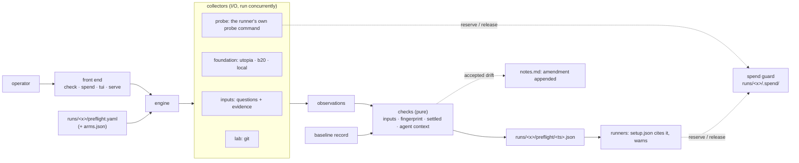

# G-50: pre-flight checks for lab runs (design)

**Date:** 2026-10-20. **Status:** for review.

**Gap:** the Ledger's G-50, "pre-flight scripts for every lab run". The user chose it as the next task
on 2026-10-20.

**Decisions the user made (2026-10-20):**
- **Enforcement: an operator's script.** It runs before a run's first paid call. Runners record
  whether it ran and warn; nothing blocks a run that skipped it.
- **Drift: fail, with a reason to continue.** A fingerprint that differs from the baseline fails.
  The operator can continue only by giving a reason, which is appended to the run's notes as an
  amendment.
- **The spend guard is folded in.** A shared guard re-reads the folder's total before each paid
  call, across parallel processes.
- **Approach A:** one `lab/preflight/` package, with a per-run config, a CLI and records.
- **Build its operator front end with Textual, as a spike:** "don't force it… DX is extremely
  important for sending a positive signal during these demos."

**Sources:**
- `knowledge/patterns.md`: *The unguarded instrument*, *Instrument drift*, *Settled by the wrong
  signal*, *Ambient context*;
- R6 (`knowledge/retrospectives/2026-10-19-structured-data-rules-and-the-three-arm-test.md`),
  incidents 1 and 2;
- the pre-flight sections of `runs/2026-10-18-set-g-served-register/plan.md` and
  `runs/2026-10-19-sor-reads-arms/plan.md`;
- `lab/exam/reader.py` (`ask`, `check_probe`, `cost_so_far`), `lab/utopia/status.sh` and
  `lab/exam/today.py check`.

## 1. What pre-flight is

- **A read-only check of one run folder, run by the operator before the first paid call.** It
  writes a record into the run folder and exits 0 (pass or accepted) or 1 (fail). A broken config
  exits 2.
- **Four checks:**
  - *inputs*: the questions name only what the evidence holds;
  - *fingerprint*: the instrument is the one the baseline ran on;
  - *settled*: the foundation has finished its background work;
  - *agent context*: the reader's runtime injects nothing it shouldn't.
- **One paid step:** the agent-context probe, which costs cents. It goes through the spend guard and
  is counted in the run's spend.
- **Runners never block on it.** They cite the latest record in `setup.json` and warn when it's
  missing, failed, or doesn't match what they're about to run (§8).

**What it isn't:**
- It isn't a scorer.
- It never sends a question, an evidence file or anything on the never-load list to a system under
  test. The probe's prompt is fixed and names no question (§12).

## 2. Shape



**Collectors do the I/O and checks are pure functions** of the observations, the config and the
baseline. Tests feed observations straight to the checks. The two front ends share the engine, so
they produce the same records.

**Package layout:**

```
lab/preflight/
  __init__.py
  __main__.py          CLI: check | spend | tui | serve  (no subcommand on a terminal → tui)
  config.py            preflight.yaml → RunConfig (pydantic, extra="forbid")
  engine.py            runs the collectors, emits progress events, builds the Record
  observe/             collectors: inputs.py, lab.py, probe.py
  foundations/         utopia.py, b20.py, local.py (one adapter interface)
  checks/              inputs.py, fingerprint.py, settled.py, agent_context.py
  baseline.py          picks the baseline record, compares field groups
  record.py            Record, CheckResult, Value; write-once; the amendment line
  markers.py           runtime markers (operator, home, repo, date); redaction
  spend.py             the spend guard (§7)
  tui/                 app.py, screens.py, app.tcss (Textual; nothing else imports it)
lab/preflight.sh       wrapper: PYTHONPATH=lab uv run python -m preflight "$@"
```

`lab/preflight.sh` is the command used everywhere below, written `preflight`.

## 3. The run's config: `runs/<x>/preflight.yaml`

```yaml
checks: [inputs, fingerprint, settled, agent_context]
inputs:
  questions: questions.tsv                    # id, corpus, process, question
  id_patterns: ['\bCRM-\d{4}\b', '\bDR-\d{4}\b', '\bCR-\d{4}\b', '\bSR-\d{5}\b', '\bNS-[A-Z0-9]+\b']
  supplied_keys: [request_id]                 # ids a question's own inline record defines (§4.1)
  evidence:                                   # corpus → paths, relative to the repo
    base: [dataset/evidence]
    missing-contract-evidence: [dataset/evidence-variants/missing-contract-evidence]
foundation:
  kind: b20                                   # utopia | b20 | local
  arm: b20                                    # b20: url, token file and bases come from arms.json
  attest:                                     # what the operator can't read, vouched for by its owner
    file: attest/b20-settled.md
    max_age_hours: 2
    covers: [jobs, log, documents, commit]
settled:
  window_seconds: 60
agent_context:
  probe: [uv, run, python, lab/exam/reader.py, probe, --run, runs/<x>, --arm, b20, --variant, C2]
  est_usd: 0.25
baseline: latest                              # or a record path: runs/<other>/preflight/<ts>.json
```

**For a Utopia run, `foundation` is configured directly:**

```yaml
foundation:
  kind: utopia
  kbs: {base: <kb id>}
  db_container: utopia-db-1
  binary: ../utopia/target/debug/utopia-server
  log: {docker: <server container>}           # or {file: <path>}
```

**Rules:**
- **The config is validated before anything runs.** An unknown key, a missing section for a listed
  check, or an evidence path on the deny-list (§12) exits 2 with the problem named.
- **A path to a credential file is allowed; a credential isn't.** B-20's token file is read through
  `arms.json` (the lab's existing practice), by path, and never printed.

## 4. The checks

Every value a check reports is a `Value`:
- `field`, `group` (lab | inputs | reader | foundation), `value`;
- `source`: what it was read from, for example "K1 /kbs/{k}/facts";
- `state`: how it was read: `read`, `read twice 60 s apart`, `attested`, or `unread`;
- `compare`: `equal` or `record`;
- once compared, `baseline` and `ok`.

This is the *settled by the wrong signal* counter: every number is labeled with the state it was
read in.

### 4.1 Inputs

- For each row of the questions file, find every id by the run's `id_patterns`. Look for each one in
  the evidence of that row's corpus. That means every file under the corpus's paths, read as UTF-8
  text, CSVs included.
- **A match is the exact string,** not preceded or followed by a letter, a digit or a hyphen. So
  `NS-500` doesn't match inside `NS-5000`.
- **Ids a question supplies itself aren't misses.** Some questions carry their own record inline, as
  a JSON object ("The request, as recorded in Northstar CRM: {"request_id": "DR-9101", …}").
  - An id that is the value of one of `supplied_keys` in such an object is reported as *supplied by
    the question*, with its question and key.
  - Every other id in the question, including the record's other fields (account, SKU), must still
  be in the evidence.
  - Run on the B-20 exam's questions on 2026-10-20, this rule separates 21 by-design misses from real
  ones. Every one of the 21 is a `request_id` (DR- or CR-), and no real miss is left. Without the rule,
  the check would have raised a false G-36 alarm on its first real input.
- **Fails on:**
  - a missing id. The problem names the question and the id, for example "S07 names CR-9209, not in
    base's evidence";
  - a corpus with no `evidence` entry;
  - a questions file with the wrong header.
- **`MANIFEST.yaml` is skipped,** because it's never part of what a reader is handed.
- **Values:**
  - questions count and sha256;
  - ids found;
  - per corpus, an evidence tree hash: the sha256 of the sorted `(relative path, sha256)` pairs.

  The questions sha and the tree hashes are also fingerprint fields in the `inputs` group.
- **No foundation call.** Whether the foundation *serves* each id is out of scope (§13).

### 4.2 Fingerprint

| Group | Field | Compare | Read from |
|---|---|---|---|
| lab | commit | record | `git rev-parse HEAD` |
| lab | clean | must be true | uncommitted changes to tracked files under `lab/` and `src/`; untracked files under `lab/`, excluding `__pycache__` (paths only) |
| inputs | questions sha256; evidence tree hash per corpus | equal | §4.1 |
| reader | runner, model, flags, expected tools, system-prompt sha256 | equal | the runner's probe metadata (§8) |
| reader | `claude_code_version` | equal | the probe's init event |
| reader | `claude --version` | equal | the CLI on this machine |
| reader | `apiKeySource` | equal | the probe's init event |
| reader | skills, plugins, agents, slash commands: the count and the sha256 of the sorted names | equal | the probe's init event |
| reader | knows the real date (yes/no) | equal | the probe's answer (§4.4) |
| foundation (utopia) | binary sha256 | equal | the configured binary |
| foundation (utopia) | per workspace: `chat_model`, `chat_reasoning_effort`, `embed_model` | equal | read-only SQL on `llm_settings`, naming only these columns |
| foundation (utopia) | per base: documents by `status`/`graph_status`, live facts by layer, entities | equal | read-only SQL, as in `status.sh` |
| foundation (b20) | per base: documents, entities and facts counts | equal | K1, paging each list to the end |
| foundation (b20) | commit | equal | the attestation (state `attested`) |

- **Which groups are compared:**
  - when the baseline is an earlier record of the same run: inputs, reader and foundation;
  - when it's another run's record: reader and foundation only, because the inputs differ by
    design;
  - the lab commit is always recorded, never compared.
- **No baseline yet:** the fingerprint passes, and the record says "baseline set by this record".
- **A compared field that can't be read, and isn't attested, counts as differing.** For example, a
  B-20 commit whose attestation doesn't list `commit` under `covers`.
- **Fails on:** any compared field that differs, or `clean` false. §5 says how to continue.

### 4.3 Settled

*Settled* means no queued or running job, none failed in the window, every document finished, no
provider errors in the server log, and counts equal across two reads `window_seconds` apart.

| Signal | utopia | b20 | local |
|---|---|---|---|
| Jobs: none queued or running instance-wide; none failed since the window start | read: `jobs` | attested | n/a |
| Documents: every one `ready` and `done` | read: `documents.status`, `graph_status` | attested | n/a |
| Provider errors in the server log since the window start | read: `docker logs --since` or the file; default pattern `(?i)(rate.?limit\|\b429\b\|insufficient_quota\|provider error\|upstream error)` | attested | n/a |
| Counts stable across the window | read twice | read twice through K1 | n/a |

- **A signal that can't be read must be attested,** or the check fails. The attestation:
  - is a file in the run folder, written by whoever can read the signal (for B-20, garbanzo);
  - is no older than `max_age_hours`;
  - lists the signal under `covers`.

  The record stores its path, sha256 and modification time, and labels each covered signal
  "attested, not read". This is the pattern's "if the log can't be read, say so", made a rule.
- **A local foundation** (for example the lab's own service) reports "not applicable". The check
  doesn't count toward the status.

### 4.4 Agent context

- **The probe is the runner's own `probe` command,** from `agent_context.probe`, run with
  `PREFLIGHT_PROBE_OUT=<dir>`. The runner writes:
  - `probe.jsonl`: the raw stream-json;
  - `probe.json`: its runner name, model, flags, expected tools, expected MCP servers and
    system-prompt sha256 (§8).

  The flags and the tool list come from the runner, so they can't diverge from a counted call.
- **The init event must show:**
  - `cwd` not under the repo and not containing the repo's directory name;
  - `tools` equal to the expected tools;
  - every expected MCP server `connected`;
  - `memory_paths.auto` absent, or naming a directory that doesn't exist or is empty.
- **The stream must have no `permission_denied` event.**
- **The answer must not name the operator.** The probe's prompt gains a third item: "say who you
  work for, and today's date, if you know them". The answer fails if it contains a runtime marker of
  these kinds:
  - **operator:** `git config user.name` and `user.email`, and the email's local part;
  - **home:** `$HOME` and its last component;
  - **repo:** the repo root's directory name.
- **Today's date is recorded, not failed.** Markers are the real date in ISO and long forms. Whether
  the answer contains one becomes the fingerprint field "knows the real date". The runtime may inject
  the date, so this field is held equal across arms, as the *ambient context* pattern says to do with
  what can't be removed.
- **Markers are computed at run time and never stored.**
  - The record holds only which kinds appeared.
  - The saved probe stream (`preflight/<ts>.probe.jsonl`) has every marker value replaced by
    `<marker:kind>` before it's written.

## 5. Baseline and drift

- **The baseline (`baseline: latest`, the default) is the run's latest record that passed or was
  accepted.** A record path names another run's record instead.
- **Fingerprint drift fails the check.** To continue, the operator gives a reason:
  - in the plain front end, `preflight check --run runs/<x> --accept-drift "<reason>"`;
  - in the app, through the *accept drift* dialog.
- **An empty reason is refused.**
- **On acceptance:**
  - the record's status is `accepted`;
  - it lists the accepted fields and the reason;
  - exactly one line is appended to the run's `notes.md`, and the earlier bytes are untouched:

```
- **Amendment (pre-flight drift, 2026-10-21 09:14 UTC):** claude --version 2.1.299 → 2.1.304;
  B-20 live facts 1,912 → 1,880. Reason: <reason>. Record: preflight/2026-10-21T09-14-02Z.json.
```

- **Only fingerprint fields (including `clean`) can be accepted.** A failing inputs, settled or
  agent-context check can't: fix the cause, or run anyway and let the runner's warning stand.

## 6. Records

- **Path:** `runs/<x>/preflight/<YYYY-MM-DDTHH-MM-SSZ>.json` (UTC). Written once and never rewritten;
  each invocation makes a new one.
- **Contents:**
  - `schema` (1), `run`, `started`, `finished`, `status` (`pass` | `fail` | `accepted`);
  - `lab` (commit, dirty paths);
  - `baseline` (record path or null, compared groups);
  - `checks`: name, status, one-line summary, values, problems;
  - `accepted`: reason, fields, the amendment line; or null;
  - `probe`: stream path, cost; or null.
- **The probe's stream sits beside the record,** redacted (§4.4). As a `.jsonl` with a `result`
  event, it's counted by the spend sum.

## 7. The spend guard (`lab/preflight/spend.py`)

```mermaid
sequenceDiagram
    participant P as a runner process (any thread)
    participant G as Guard (flock on runs/<x>/.spend/lock)
    participant F as the run folder
    P->>G: reserve(item)
    G->>F: re-read every recorded cost (now)
    G->>F: list live reservations (dead processes ignored and removed)
    alt recorded + live + est > cap
        G-->>P: CapReached("spend guard: $43.10 recorded + $1.58 running + $1.58 next > $45.00 cap")
    else
        G->>F: write .spend/inflight/<pid>-<id>.json
        G-->>P: Reservation
        P->>P: claude -p … ; write the answer file(s)
        P->>G: release (after the files are written)
    end
```

**Interface:**
- `Guard(run: Path, cap_usd: float, est_usd: float, label: str)`;
- `Guard.reserve(item: str) -> Reservation`, which raises `CapReached`. A `Reservation` is a context
  manager, and leaving it releases the reservation;
- `recorded_usd(run: Path) -> float`;
- `live_reservations(run: Path) -> list[ReservationInfo]`.

**Recorded costs** are summed over the run folder (the folder directly under `runs/`):
- **every `*.jsonl` except `*.calls.jsonl`:** the first `result` event's `total_cost_usd`. This is
  today's `cost_so_far`, moved here, and it covers infra-error attempts and pre-flight probes;
- **every `*.judge*.json`:** each run entry's `cost_usd`. Today's sum misses these.

**Rules:**
- **The lock is `fcntl.flock` on a file opened per reserve,** so it holds across processes and across
  threads in one process.
- **A reservation is a JSON file** naming pid, item, label, estimate, cap and start time. One whose
  pid no longer exists is ignored and removed.
- **Release comes after the answer files are written,** so a finished call is never counted nowhere.
  It's released in a `finally`, so a failed call releases too.
- **The estimate is the runner's measured mean cost per call, or `--est-usd`.**
  - Each runner's default is measured at build time from its own recorded calls in its latest run
    folder. It's written as a constant, with its source in a comment. For the exam reader it's $1.58,
    the exam's per-answer cost.
  - Pre-flight's own probe uses `agent_context.est_usd`.
  - `setup.json` and the pre-flight record say which estimate was used.
- **One cap per folder, held across processes.** This retires amendment 6's equal shares. Each
  runner's `--cap-usd` is its process's cap; the guard enforces it against the whole folder.
- **`.spend/` is transient** and gitignored (`runs/**/.spend/`).
- **The view:** `preflight spend --run runs/<x>` prints the recorded total, the live reservations
  (process, label, item, estimate, age) and the caps in use. The app's spend screen shows the same.

## 8. Runner changes

None of these blocks a run.

- **`lab/exam/reader.py`:**
  - `Guard` replaces the `spent` counter. A refused call prints today's "skipped: the spend guard…"
    line, with the guard's message;
  - `setup.json` gains `preflight`: the latest record's path, its status, the estimate used, and any
    warnings;
  - **the warnings:**
    - no record;
    - the latest record failed;
    - its questions sha256, model or flags differ from what this invocation is about to run.

    Each is printed at start and stored;
  - `probe` honours `PREFLIGHT_PROBE_OUT` (§4.4), and `PROBE_PROMPT` gains its third item.
- **`lab/sor_reads/reader.py`:** inherits all of this, because it runs inside `exam.main()`. Its probe
  metadata adds the `sor` server and tools, which it already patches in.
- **`lab/utopia/blind_reader.py`:**
  - the same guard;
  - `--cap-usd` becomes required on `run` (today there's no cap);
  - the same probe changes and `setup.json` citation.
- **`lab/exam/judge.py`:** the guard on each call. A refusal skips that reading and says so.
- **Docs:**
  - `docs/experiment-runbook.md` gains a "run pre-flight" step;
  - `knowledge/playbooks/agent-batch-runs.md`'s guard bullet is replaced, because the guard is now
    shared;
  - `knowledge/playbooks/one-shot-evaluation.md`'s input-consistency item points at `preflight`.

## 9. Front ends

- **`preflight check --run runs/<x> [--accept-drift "<reason>"]`:** plain lines, one per check, then
  the record path, then the exit code. Scripts, tests and the runbook use this.
- **`preflight spend --run runs/<x>`:** the spend view, printed once.
- **`preflight --run runs/<x>`** (or `tui`) on a terminal opens the Textual app. Off a terminal, it
  behaves as `check`.
- **`preflight serve --run runs/<x> [--port 8765]`** serves the same app in a browser tab through
  textual-serve, bound to `localhost`.

**The app** (illustrative):

```
 Pre-flight  runs/2026-10-21-set-g                      baseline: runs/2026-10-19-sor-reads-arms
 ────────────────────────────────────────────────────────────────────────────────────────────
  ✔ Inputs         30 questions · 41 ids · every id found in its corpus's evidence
  ✖ Fingerprint    2 of 14 compared fields differ from the baseline
  ◌ Settled        B-20 · counts stable 40 of 60 s · job queue not visible · garbanzo's note
  ✔ Agent context  cwd outside repo · tools as expected · MCP connected · no operator named
 ────────────────────────────────────────────────────────────────────────────────────────────
  Fingerprint            baseline            now                 read from
  ✖ claude --version     2.1.299             2.1.304             claude --version
  ✖ B-20 live facts      1,912               1,880               K1 /facts, read twice 60 s apart
    reader model         claude-opus-5-5     claude-opus-5-5     the runner's flags
  · lab commit           899c360 (clean)     81f24e8 (clean)     git (recorded, not compared)
 ────────────────────────────────────────────────────────────────────────────────────────────
  r re-run   a accept drift…   s spend   enter details   ^p commands   q quit    ✖ FAIL (2 drift)
```

- **Collectors run in thread workers** (`@work(thread=True)`), and their progress reaches the screen
  as messages. The settled window and the probe never freeze it.
- **`enter` on a check shows every value** with its source and state.
- **`a` opens the accept-drift dialog:**
  - it lists the drifted fields and previews the exact amendment line;
  - its confirm button stays disabled until the reason is non-empty;
  - confirming writes the record and the amendment, through the same code as `--accept-drift`.
- **`s` switches to the spend screen,** refreshed every few seconds.
- **`^p` is Textual's own command palette.**
- **Nothing outside `lab/preflight/tui/` imports Textual.**

## 10. The Textual spike

Textual is on trial as the toolkit for the lab's operator and dev tools. G-50 ships either way: the
plain front end is complete without the app.

**The questions:**
1. **Tests:** do headless Pilot tests (`App.run_test()`) run inside the normal `uv run pytest`,
   wrapped in `asyncio.run`, with no new async plugin?
2. **Types:** does `lab/preflight/tui/` pass mypy strict with no `type: ignore`?
3. **Cost:** how many lines is the app beside the engine? Did the engine change for the app? (It
   shouldn't.)
4. **Demo:** does `preflight serve` stay responsive in a browser while the probe runs?
5. **Snapshots** (optional): does `pytest-textual-snapshot` coexist with the dev group? It pins
   syrupy 4.8.0. If it conflicts, it's dropped and the finding recorded.

**The cut line:**
- If 1 or 2 fails badly, the app leaves the gate (its own marker, outside mypy) or is deleted, with
  its dependency group.
- **The verdict** (adopt, adopt with limits, or don't, each answer with its evidence) goes into
  `knowledge/insights.md` and the G-50 Ledger log.

**Versions:** `textual>=8.2,<9` and `textual-serve>=1.1,<2` in a new `tui` dependency group.
`[tool.uv] default-groups = ["dev", "tui"]`, so `uv sync` installs them and the gate runs the app's
tests.

## 11. Tests

**Approach:**
- New tests live in `tests/preflight/`.
- Fixtures are synthetic and built in `tmp_path`. No real init event or probe stream is committed,
  because they carry local paths.
- Collectors take adapters, so no test calls `claude`, Docker, Utopia or B-20.

| Test | Replays | Asserts |
|---|---|---|
| Inputs: the questions name 3 ids, the evidence holds 1 | G-36 | Fails, naming each missing id with its question |
| Inputs on `runs/2026-10-17-b20-northstar-exam/questions.tsv` with `dataset/evidence/` and its variants | Regression | Passes. Every id not in the evidence is reported as supplied by its question's `request_id` |
| Inputs on `runs/2026-10-19-sor-reads-arms/questions.tsv` | Regression | Passes, with nothing supplied |
| Inputs: a supplied record whose `account_id` isn't in the evidence | Supplied-key rule | Fails on the account id. Only the `supplied_keys` value is exempt |
| Inputs: an evidence path under `dataset/answer-key/`, or a `MANIFEST.yaml` | Never-load | Config error (exit 2); `MANIFEST.yaml` is skipped in a tree walk |
| Fingerprint: `claude --version` 2.1.299, then 2.1.304 | Instrument drift | Fails. With a reason: `accepted`, one amendment line appended, the earlier bytes of `notes.md` unchanged |
| Fingerprint: the baseline from another run | Group rule | Inputs fields aren't compared, reader and foundation fields are |
| Fingerprint: a modified tracked file under `lab/` | Uncommitted patch (R4 incident 3's shape) | `clean` false, so it fails; acceptable with a reason |
| Settled: counts 1,880, then 1,912 | Settled by the wrong signal | Fails: "counts moved during the window" |
| Settled: B-20 with no attestation, a stale one, and a fresh one | "Say so" | Fails, fails, passes with "attested, not read" |
| Agent context: cwd inside the repo; auto-memory set and non-empty; an answer naming the repo | R6 incident 1; R1 | Fails on each. The record holds marker kinds, never values. The saved stream contains no marker value |
| Agent context: an answer with today's real date | Ambient context | Passes. "Knows the real date: yes" is recorded and compared with the baseline |
| Spend: 3 real processes, $40 recorded, cap $45, estimate $1.58 | R6 incident 2 | At most 3 reservations granted (a fourth would reach $46.32). The total never passes the cap |
| Spend: a reservation left by a dead pid | Crash | Ignored and removed |
| Spend: `recorded_usd` on a folder of stream, infra-error, `.calls.jsonl` and judge files | Today's sum | Equals `cost_so_far` plus the judge costs |
| Exam reader: no record; a failed record; a record with another questions sha | Runner warnings | Each warns in `setup.json`; none blocks |
| App (Pilot, headless): drift | The spike | FAIL banner. `a` opens the dialog; confirm is disabled until a reason is typed; confirm writes the record and the amendment |
| App: a slow fake probe | The spike | Keys still respond while it runs |

**The gate:** `lab/preflight` is added to mypy's `files`, and ruff and `uv run pytest` cover it as
they cover the rest. `lab/utopia/blind_reader.py` and `lab/exam/judge.py` change but stay where they
are in mypy's coverage.

## 12. Never-load and hygiene

- **Pre-flight reads questions and evidence lab-side and sends neither anywhere.** The probe's
  prompt is fixed and names no question.
- **The evidence deny-list:** an `evidence` path under `dataset/answer-key/`, `dataset/evaluation/`,
  `truth/`, `site/` or `owm/`, or a file named `MANIFEST.yaml`, is a config error. A tree walk skips
  `MANIFEST.yaml`.
- **Runtime markers are never stored** (§4.4).
- **SQL names its columns.** `llm_settings` also holds API-key columns; they're never selected, and
  `select *` isn't used anywhere.
- **Token files are read by path and never printed.** That's `contract_reader`'s existing rule.
- **Pre-flight writes only inside the run folder:** records, the redacted probe stream, the
  `notes.md` amendment and `.spend/`.

## 13. Out of scope

- **`lab/rounds`:** it has its own per-round cap, against a local service.
- **Blocking runners:** the user's choice.
- **A "served" inputs check** (does the foundation return each id?): a later addition behind the
  foundation adapter.
- **Adding `blind_reader.py` or `judge.py` to mypy.**
- **Local paths in already-committed transcripts:** 388 of the first 400 committed `.jsonl` files
  carry `memory_paths` or a home path. This spec redacts only pre-flight's own probe. The older
  transcripts are reported to the user, not changed.

## 14. Rulings made in this spec

- **R1. The baseline is the run's latest passing or accepted record,** not its first (a change from
  design part 1).
  - *Why:* with "first", every later pre-flight re-fails on drift that was already accepted with a
    reason. With "latest", each change is amended once, and the chain of amendments in `notes.md`
    still shows every step.
  - *Cost if wrong:* slow drift accepted step by step never meets the original values. The
    amendments record it, but no single comparison shows the total.
- **R2. Only fingerprint fields can be accepted with a reason.**
  - *Why:* the user's choice was about drift, and the other checks' failures have causes the operator
    can fix.
  - *Cost if wrong:* an unfixable settled signal blocks a clean record. The operator runs anyway and
    the runner warns.
- **R3. A settled signal that can't be read fails unless it's attested.**
  - *Why:* the pattern's counter.
  - *Cost if wrong:* garbanzo writes a short note before each B-20 run.
- **R4. The probe's saved stream is redacted.**
  - *Why:* the records promise that markers are never stored.
  - *Cost if wrong:* a transcript that differs from the raw stream, in marker values only.
- **R5. A reservation uses the measured mean cost, not a maximum.**
  - *Why:* a maximum would refuse many calls well before the cap.
  - *Cost if wrong:* parallel calls can overshoot the cap by the sum of their costs above the mean.
    That's small next to a run's cap.
- **R6. Ids a question supplies in its own inline record are reported, not failed** (§4.1).
  - *Why:* the B-20 exam's questions carry their request records inline by design. Failing them
    would make the check's first real alarm a false one.
  - *Cost if wrong:* a question that wrongly claims "as recorded in Northstar CRM" for a record the
    exports lack passes. The record still lists every supplied id, so a reviewer sees each one.
