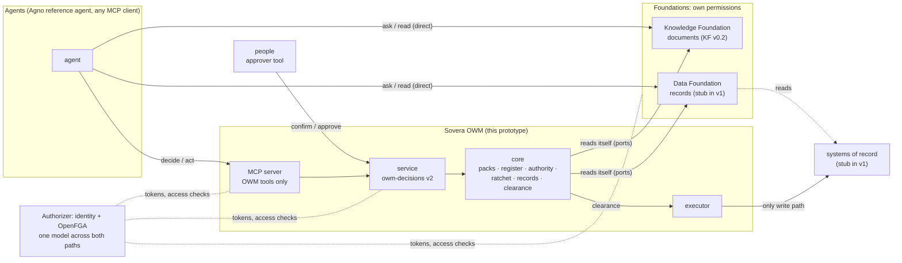
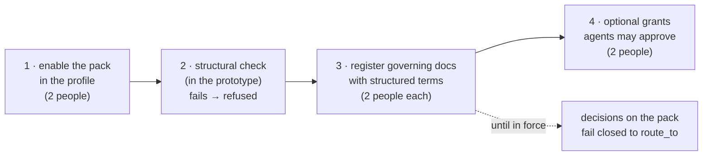
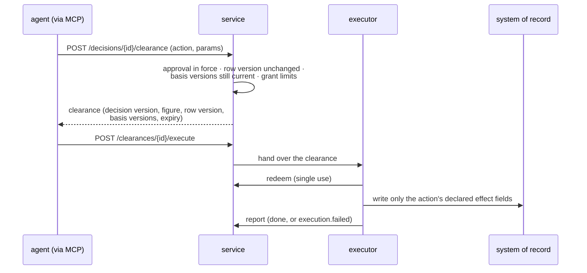
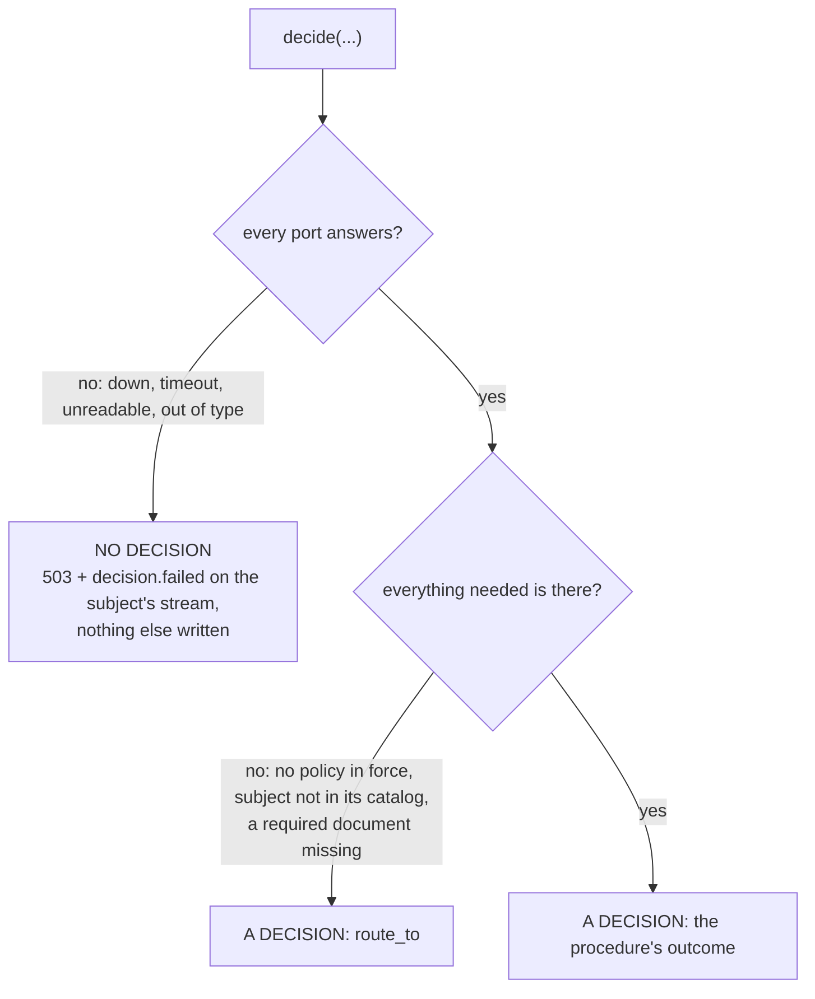
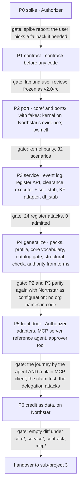

# The free-standing prototype core (sub-project 1): design

**Status:** designed with the user section by section on 2026-10-22 and 2026-10-23. Every section
below was approved in conversation, and the user approved this written spec on 2026-10-23. It was
amended once while planning (see "Amendments" below). Nothing is built yet, and no repository has
been created.

**Amendments:**
- **2026-10-23, while planning** (`docs/superpowers/plans/2026-10-23-prototype-core.md`, PL-2 and
  PL-6):
  - The parity counts are corrected from 42 to 32 at P2 (22 discount, 10 credit). The lab's 42
    include 10 SLA scenarios, which v1 leaves out. The re-run at P4 covers discount's 22, and P6
    covers credit's 10.
  - At P6, Northstar's credit bindings and register entries are the lab's to register. The builder
    delivers the credit pack and its own org's credit configuration.

**What it is:** the core of a free-standing BlueLeaf prototype: an OWM service, its contracts, its
MCP server, a reference agent and an approver's tool, running on real identity, with no Utopia. It is
the **reference the OWM team implements from**: they take its contracts and the lab's acceptance
suite, not its files (G-54, decided C: re-cut sovera-owm).

**Who reads it:**
- **The builder,** a fresh session working in a new private repo. This spec is the builder's main
  document. It is written to be safe for them to read: it holds no scenario ids, trap mechanics,
  expected outcomes or details of the held-out org. The concrete journey, its people and its
  figures live only in the lab's acceptance suite (§8).
- **The lab and the user,** who own this spec, its amendments and the acceptance suite.

**Keeping it safe.** Any amendment to this spec must stay builder-safe. The lab's bundle scan (§11.4)
runs over this file too.

**Sub-projects.** The prototype is split three ways, each with its own spec, plan and build:
1. **The prototype core:** this spec.
2. **A held-out org ("org B"):** the generator fix, then an outsider writes the org. Its own spec,
   later. The builder never sees org B.
3. **Acceptance and handover:** the suite run on Northstar and org B, then handover to the OWM team.

**Sources** (for the lab; the builder reads this spec and the bundle, not these):

| What | Where |
|---|---|
| What was outstanding, and the user's D1–D4 | `docs/prototype-readiness-2026-10-21.md` (12103ec and later) |
| F1: the Knowledge Foundation fit | `docs/prototype-f1-kf-fit-2026-10-22.md` (f9a8e0b) |
| F2: the held-out org and the platform audit | `docs/prototype-f2-heldout-org-2026-10-22.md` (3a6ffe1) |
| AuthZ: Casbin against OpenFGA | `docs/authz-casbin-vs-openfga-2026-10-22.md` (2c65b5d) |
| Netflix's ontology-driven observability | `docs/reading-netflix-ontology-observability-2026-10-22.md` (bb75f93) |
| The one never-load exception | `CLAUDE.md` (785a3a1) |
| The lab's OWM service, contract v1.4, rulings R1–R65 | `docs/superpowers/specs/2026-10-10-owm-service-design.md` |
| sovera-owm's identity and authorization ports | sovera-owm `specs/001-identity-authz-ports/contracts/` (read only) |
| The broad organizational ontology, deferred | Ledger G-58 |

---

## 0. In one page



- **Two paths.** Agents ask and read the foundations directly, under the foundations' own
  permissions. They decide and act only through the OWM's tools. Nothing writes to a system of
  record except the executor, and only on a clearance.
- **What an agent read is a claim.** The OWM reads both foundations itself and decides on what it
  read. An agent's figure is kept and compared, and is never the basis.
- **A platform, not a SaaS product** (the user, D2). A use case is a registered **pack**: a definition
  plus a procedure, independent of any org. An org is a registered **profile** plus register entries
  plus grants. Adding the credit use case changes no code under `core/`, `service/`, `contract/` or
  `mcp/`.
- **Real identity.** Authorizer issues tokens and holds the OpenFGA model. OpenFGA decides access
  only. Business authority (bands, separation of duties, the ratchet, grant limits) stays in the
  OWM, from registered terms.
- **Graded autonomy.** Agents act *for* people under registered delegations, never *as* them. Agents
  may approve only under registered grants, and never on the requester's side.
- **Fail closed.** If the OWM can't know something, it doesn't decide, and nothing fills the gap.
- **Built in seven phases** (P0–P6), port first and then generalize, with a lab gate after each
  phase. Estimate: 24–39 builder days, about 5–8 weeks (§13).

---

## 1. Intent, scope and the decisions behind it

### 1.1 Intent

- **Outcome:** a running system plus contracts plus an acceptance suite (D1). The OWM team can
  implement the contracts in sovera-owm, and the suite tells both implementations apart from a
  wrong one.
- **The slice:** discount first, then credit, both as data (D2). SLA comes later.
- **Done means:**
  - every gate in §11 passes;
  - the reference journey (§8) runs end to end, driven by the reference agent and again by a plain
    MCP client;
  - an agent that read a different figure directly still can't get it applied;
  - credit is added as data with an empty code diff (P6), and later, in sub-project 3, on org B.

### 1.2 Decisions taken

| Decision | Choice | Who, when |
|---|---|---|
| D1, the prototype's job | A reference: contracts, an acceptance suite and a running system | the user, 10-22 |
| D2, the slice | Discount first, generalized: "a platform not an SaaS product" | the user, 10-22 |
| D3, G-54 | C: re-cut sovera-owm; the OWM team implements from this reference | the user, 10-22 |
| D4, the Data Foundation | A stub behind `RecordReadProvider` until the real contract exists (G-57) | the user, 10-22 |
| Screens | None in v1. People act through the API or the approver's tool | the user, 10-22 |
| Platform scope | Generic: discount AND credit as data | the user, 10-22 |
| Home | A new private repo, contract-first. Created only on the user's go; name theirs to pick | the user, 10-22 |
| Builder | A fresh session, under the independence rules of §11.3 | the user, 10-22 |
| Timeline | No hard date; quality first | the user, 10-22 |
| Agents | One reference Agno agent, set up by its mandate. Acceptance also runs a plain MCP client | the user, 10-22 |
| Identity | Real identity; AuthN and AuthZ are external services behind ports | the user, 10-22 |
| AuthZ scope | Access only. Business authority stays in the OWM | the user, 10-22 |
| Engine | Authorizer (embedded OpenFGA, SQLite), not PocketBase; OpenFGA over Casbin | the user, 10-22 |
| Autonomy | Agents may approve under registered grants; agents act for people by delegation, never impersonation | the user, 10-22 |
| Where the OWM sits | Two paths: read directly, decide and act through the OWM; no direct write path | the user, 10-22 |
| Approach | A: port the lab's kernel and service, prove parity, then generalize | the user, 10-22 |
| Packs | Independent of any org; bound per org by a profile | the user, 10-22 |
| Vocabulary | A small core vocabulary in `contract/`; a broad ontology deferred to G-58 | the user, 10-22 |
| Netflix sharpenings | All three: `customer` not `party`; a catalog gate; typed judgments | the user, 10-22 |
| Port bundle | The builder reads a scrubbed, allowlisted bundle only | the user, 10-23 |
| Register entries | The one named never-load exception (`CLAUDE.md`, 785a3a1) | the user, 10-23 |

### 1.3 Not in v1

- **Screens.** web-next can serve the approvals slice later on the same routes (garbanzo, 10-22).
- **SLA.** Its procedure stays in the lab.
- **A real Data Foundation.** The stub serves the port until G-57's contract exists.
- **A broad organizational ontology or a triple store** (G-58).
- **Spans and extracted facts** in decision records (F1 gap 12).
- **Non-Markdown governing documents** (F1 gap 7). See §9.6.
- **Proposing grants from repeated decisions** (the "decision flywheel" in the Netflix notes, §6).
- **Delegating a person's own conditions.** A person resolves their own conditions (§6.4).

---

## 2. Architecture

### 2.1 Components

The stack carries over from the lab's OWM service: Python, FastAPI and pydantic, with an
append-only SQLite event log as the source of truth.

```
 the prototype repo (private, contract-first)
 ├─ contract/   owm-decisions v2 · pack and profile schemas · grants and delegations ·
 │              core vocabulary · authz.fga · error shape · MCP tool rules   (depends on nothing)
 ├─ core/       procedure runner · registers · authority from terms · ratchet ·
 │              decision records · clearance rules                (stdlib only, no I/O)
 ├─ ports/      Evidence · Records · Identity · Access · Judgment · Executor ·
 │              EventStore · Clock                                (protocols only)
 ├─ service/    the HTTP API for owm-decisions v2; checks Access on every route; the bindings
 │              layer that applies an org profile; the SQLite event log
 ├─ adapters/   kf (KF v0.2) · df_stub · sor_stub · authorizer · jev · executor · fakes
 ├─ mcp/        the MCP server: core tools plus a tool generated per registered action
 ├─ agent/      the reference Agno agent, set up by its mandate
 ├─ approver/   the approver's tool: a person signs in, confirms, approves; no model inside
 ├─ org/        loads an org package; holds no truth, answer key or scenarios
 └─ cli/        owmctl: decide and register from the command line (the P2 front end)
```

| Part | Does | Depends on |
|---|---|---|
| `contract/` | The handover: schemas, the OpenFGA model, the API | nothing |
| `core/` | The ported kernel and the decision rules. Takes definitions already parsed; YAML is read at the edge | `contract/` types, `ports/` |
| `ports/` | The seams (§9.5) | `contract/` types |
| `service/` | Serves the contract; asks Access on every route, then lets the core apply business authority | `core/`, `ports/` |
| `adapters/` | Real and fake implementations of the ports | `ports/` and the outside service each one talks to |
| `mcp/`, `agent/`, `approver/` | The front door; they call the service over HTTP and nothing else | the service's HTTP API |
| `cli/` | `owmctl`: the front end the lab's parity runner calls at P2, before the service exists | `core/`, `ports/`, `adapters/` |
| `org/` | Turns an org package into a running org (§5.4) | the service's HTTP API, the foundations' own load routes |

**Dependency rules:**
- `core/` is stdlib only and does no I/O, matching sovera-owm's owm-core rule, so the re-cut can take
  its shapes directly.
- Nothing imports the lab. The lab tests the prototype from outside.
- `mcp/`, `agent/` and `approver/` never import `core/` or `service/`.
- No use-case or org name appears in `contract/`, `core/`, `service/` or `mcp/` after P4 (§3.3).

### 2.2 The two stubs

- **`sor_stub`** stands in for the systems of record (the CRM's request tables). It holds an org's
  exported tables plus a log of edits. People edit it through its own small API with their own
  tokens. Agents have no relation that lets them edit it. The executor writes to it only by
  redeeming a clearance.
- **`df_stub`** stands in for the Data Foundation. It serves the `RecordReadProvider` port by
  declared reads over `sor_stub`'s current rows (§9.5). It refuses any read the org profile doesn't
  declare.

---

## 3. Contracts

### 3.1 Inventory

These are the documents the OWM team takes.

| Contract | What it is | Starts from | What's new or changed |
|---|---|---|---|
| **owm-decisions v2** (HTTP) | The service's API | v1.4 | §3.2 |
| **Pack definition** | Registered data, one per use case | new | §4 |
| **Org profile** | Registered data, one per org | new | §5 |
| **Grants and delegations** | Registered kinds, approved by two people | new | §6.3 |
| **Core vocabulary** | The shared types packs point at | new | §4.4 |
| **OpenFGA model** | `contract/authz.fga` | new | §6.5 |
| **MCP tool contract** | The front door | the lab's tool server | §10.1 |
| **Identity claims** | Token shapes, with the actor chain | sovera-owm's `IdentityProvider` | §6.2, §6.6 |
| **Error shape** | One typed error for every failure | new | §9.4 |
| **Ports** | The internal seams, handed over with the rest | F1 and sovera-owm | §9.5 |

### 3.2 owm-decisions v2: what changes from v1.4

**Everything in v1.4 stays unless something below changes it** (garbanzo's ask). Routes keep their
v1.4 paths under `/api/v1`, so web-next needs no route changes later. The contract's own version is
served by a new `GET /api/v1/about`.

| Change | Why |
|---|---|
| **The decision type is an open string,** checked against registered, enabled packs. Outcomes, findings and actions are typed by the pack's schemas, not by a closed union | Packs as data (§4) |
| **DC-1 is replaced by the grant rule** (§6.4): a people step is taken by the person it names, or by an agent under a registered grant or delegation in force that covers it, and never by the requester or anyone acting for them | Graded autonomy |
| **Every event carries the actor chain:** `{kind, id, on_behalf_of, delegation, grant}` | Audit names whose authority was used |
| **Sessions are Authorizer bearer tokens.** `/lab/sessions` is gone. Every route needs a token, reads included. `GET /me` returns the actor with its chain | Real identity; garbanzo's ask 1 (G-56) |
| **A basis document names its foundation's `doc_id` and `version`,** beside its stated id and text hash | F1 gap 4 |
| **A register entry's `source_id` is null** when the foundation doesn't hold the document, never a lab path | garbanzo's ask 3 |
| **The catalog gate** replaces v1.4's `missing_record` condition. A subject or customer that doesn't resolve in its catalog is decided `route_to` with a `no_record` finding. Nothing proceeds on submitted figures | Netflix sharpening 2 (§7.1) |
| **`POST /api/v1/clearances/{id}/execute`** hands a clearance to the executor, replacing the lab-only adapter route | No direct write path |
| **Failures use one typed error** (§9.4) | Section 5 |
| **Decision records name the pack version and the profile version** they ran under | Packs and profiles are versioned |
| **`/lab/*` routes are gone.** An operator surface (clock, reset) exists only when the service starts in test mode, bound to loopback, behind an operator token | The reference has no open door |

garbanzo's other asks are kept as they are: the MCP server acts through the same decision and
clearance routes as an actor of kind `agent` with `on_behalf_of` (ask 4); person ids are the HR
export's employee ids (ask 5); the Knowledge Foundation's contract doesn't change (ask 6).

### 3.3 Rules

- **No use-case names in code.** `contract/`, `core/`, `service/` and `mcp/` contain no pack or org
  name after P4. A use case is its pack, its procedure and its register entries. P6 and sub-project 3
  check this with an empty diff.
- **An agent sees only the tools it may use.** An action's tool appears only once the action is
  registered and OpenFGA lets that agent (and, when delegated, the person behind it) use it
  (`list_objects`). An agent with no approval grant never sees `approve`.
- **One named tool per action** (`apply_discount`, `set_credit_limit`), not one generic
  `act(action, params)`. Agents choose named tools with clear schemas more reliably. Both would be
  generated from the same definition.

---

## 4. Use-case packs

### 4.1 A pack is a definition plus a procedure

A pack picks out one slice of the organization (its subject, the entities it reads, the document
kinds it relies on) and adds a decision contract: the procedure, the outcomes, the authority rule and
what each action changes. It owns none of the nouns. Packs are **independent of any org**: the same
discount pack serves every org, and each org binds it through its profile (§5). Onboarding a customer
is configuration, not code.

A pack is registered like a procedure: versioned, approved by two people, and named on every
decision it runs.

### 4.2 The definition

Illustrative values; P1 fixes the schema.

```yaml
use_case: discount_approval      # registered, versioned, approved by two people
version: 1
subject: { entity: discount_request, key: request_id }   # abstract; the org profile binds it
inputs:                          # the OWM reads these itself; an agent's values are claims
  requested_discount: { type: number, unit: fraction }
  request_date:       { type: date }
  customer:           { ref: customer }
  requester:          { ref: person }
as_of: request_date              # the decision's as-of: this input, else the clock; never the body
governing:                       # register kinds relied on, each with a terms schema
  pricing_policy:    { terms: pricing_policy.schema.json, owner_role: pricing_owner }
  customer_contract: { terms: contract.schema.json, owner_role: legal_owner, single: true }
authority: { figure: requested_discount, bands_from: pricing_policy }   # terms, never prose
procedure: discount_approval@3   # spec language, abstract names only
outcomes: [APPROVE, APPROVE_WITH_AUTHORIZATION, REJECT_OR_ESCALATE, REVIEW_REQUIRED, REQUEST_EVIDENCE]
route_to: REQUEST_EVIDENCE       # where a decision goes when something it needs is absent
ratchet: { figure: requested_discount, levels_from: pricing_policy }
findings: discount_findings.schema.json
actions:
  apply_discount:                # becomes the MCP tool apply_discount
    allowed_on: [APPROVE, APPROVE_WITH_AUTHORIZATION]
    params: { request_id: subject.key, discount: inputs.requested_discount }
    effect: { entity: discount_request, set: [status, approved_by, approved_on, discount] }
    incident_owner_role: pricing_owner
agent_approval: grant_required   # an agent approves only under a grant or delegation in force;
                                 # never: no grant or delegation lets an agent approve
judgments: []                    # typed questions Jev may be asked (§4.5)
```

- **`agent_approval: never`** lets a customer rule out agent approval for a use case outright,
  whatever grants exist. Credit limits are a likely example.
- **`authority` reads registered terms only.** Authority is never parsed from a document's prose, so
  a document's wording never decides who may approve. The discount procedure moves from prose to
  terms in P4, as the lab's credit procedure already reads them.
- **The procedure** stays in the lab's spec language (`SPEC_FORMAT.md`, in the bundle) and may name
  only the inputs, governing kinds and judgments its definition declares.

### 4.3 What a pack replaces

Today each use case is wired in by hand at about 20 places. P4 moves each to data:

| Hand-wired in the lab today | Moves to |
|---|---|
| The closed decision type, outcome literals and the `ROUTE_TO` map | `outcomes`, `route_to` |
| The registrar's kind→function map and per-kind term checks | `governing`, each role bound to a function by the profile |
| Table keys, column names and field lists in the systems-of-record overlay and the preparation step | the profile's type bindings |
| Findings and actions assembled per type | `findings`, `actions` |
| The hand-written `apply_discount` tool | a tool generated from `actions` |
| Id prefixes and title words in procedure specs | gone: governing documents are found as registered entries, not by wording |
| Request-id prefixes checked per type | the profile's `id_pattern` |
| The as-of rule per type | `as_of` |
| The incident owner by function name | `incident_owner_role`, bound by the profile |

### 4.4 The core vocabulary

Packs point at a small set of shared types in `contract/`, so the org profile binds each one once and
separation of duties sees one `person` type everywhere:

| Type | Meaning (one meaning each) |
|---|---|
| `org` | The tenant |
| `person` | A human, identified by the HR export's employee id |
| `agent` | A non-human principal with an accountable person |
| `function` | An organizational function that owns document kinds and holds roles |
| `customer` | An account the org sells to |
| `document` | A governing or evidential document held by the Knowledge Foundation |

- **`record` is not a type.** It is the contract's reference shape for a row: `(source, key,
  version)`.
- **A pack adds only its subject type** (`discount_request`, `credit_request`).
- **A type joins the core** when the kernel or a second pack needs it. Supplier or partner would
  join that way, never as a vague `party`.
- **Use cases and actions are OpenFGA objects** written as tuples when a pack is registered
  (`use_case:discount_approval`, `action:apply_discount`), not new types in `authz.fga`. Adding a pack
  never edits the model.

### 4.5 Typed judgments

Every judgment question a pack declares carries its answer type: a choice from fixed options with
criteria, a number with a unit, or a boolean. **An answer outside its declared type counts as
unavailable,** which fails closed (§9.1). It is never coerced into a valid answer.

---

## 5. The org profile, and switching a pack on

### 5.1 The profile

The profile is the only place one org's specifics live. It is a versioned register entry approved by
two people, and every decision records the profile version it ran under. Illustrative values:

```yaml
org: example_org
version: 3
time_zone: Europe/Berlin              # day boundaries for per-day limits, and display
calendar: { business_days: Mon-Fri, holidays: de-2026 }
functions:                            # the pack's roles → this org's functions
  pricing_owner: Commercial
  legal_owner:   Legal
people:                               # where to look; who holds what is read live, never stored here
  source: df:hr.employees
  key: employee_id
  identity: { token_claim: email, field: work_email }   # links an Authorizer identity to a person
  function_field: department
  title_field: job_title
types:                                # core and subject types → this org's records
  customer:         { source: df:crm.accounts, key: account_no, id_pattern: "^A-\\d{6}$" }
  discount_request: { source: df:crm.quotes, key: quote_id, id_pattern: "^Q\\d{8}$",
                      fields: { requested_discount: { column: disc_pct, unit: percent },
                                request_date: quote_date,
                                requester: owner_emp_id, customer: account_no } }
documents: { kf_corpus: example_main }
actions:  { apply_discount: { target: sor:crm.quotes } }   # written only by the executor
packs:    [discount_approval@1, credit_limit@1]
```

- **Who holds a role is read live** from the Data Foundation at decision time. A promotion or a
  leaver needs no profile change, and an approver's authority is always checked against current
  records.
- **Units are converted in the binding.** The pack speaks in fractions. If an org stores percent,
  the profile says so, and `service/`'s bindings layer converts at the edge. The procedure never
  sees an org's units.
- **The identity link** maps a token claim to a person's record, so separation of duties is computed
  over humans.

### 5.2 Switching a pack on



Each step is data entered through the register API by named people. Until step 3 is in force,
decisions on the pack fail closed to its `route_to` outcome.

### 5.3 The structural check

The prototype checks structure only:
- the pack's and the profile's schemas validate;
- every binding resolves against the Data Foundation (the source exists, the key and fields exist,
  sample ids match the pattern);
- every governing kind has an owning function in the profile;
- the procedure names only inputs, governing kinds and judgments its definition declares;
- every action's target is bound and its effect fields exist.

**Scenario and attack checks stay outside the prototype,** in the lab's acceptance suite. The lab's
admission gate today loads its own truth and answer keys; moving that out keeps the never-load rule
intact and lets a new org be admitted without any lab files.

### 5.4 The org loader

`org/` turns an org package into a running org:
- documents go into a Knowledge Foundation base that holds documents only (§9.6);
- exported tables go into `sor_stub`;
- people and agents get identities in Authorizer;
- the profile, packs, register entries, grants and delegations are registered through the service's
  own register routes, by named people.

The package holds no truth, answer keys or scenarios. Org B enters the same way.

---

## 6. Identity, access and authority

### 6.1 Who decides what

| Question | Answered by | Example |
|---|---|---|
| May this principal call this operation at all? | **OpenFGA**, through `AuthorizationProvider` | may this agent decide discounts; does it act for this person |
| Does this principal have the authority for this figure, now? | **The OWM**, from registered terms and live records | the band, separation of duties, the ratchet, a grant's limits and window |

Authorizer can't evaluate OpenFGA conditions through its API, so limits couldn't live in OpenFGA
anyway. Keeping them in the OWM also lets the decision record say why.

### 6.2 Tokens and delegation (Authorizer)

- **People** sign in to Authorizer and get a session token.
- **Agents** are service accounts and get tokens by `client_credentials`.
- **Delegation is RFC 8693 token exchange.** The person stays the token's `sub`; the agent goes into
  a nested `act` claim; each hop can only narrow scope; the agent must present its own token as the
  actor token, so a subject-only exchange (impersonation) is refused. A delegated token lasts
  5 minutes and is bound to one resource, the decision's subject.
- **In OS terms it's `sudo`, never logging in with someone's password.** A record never says a person
  did what their agent did.

### 6.3 Grants and delegations

Both are registered kinds, approved by two people, revocable, and owned by an accountable person.

| | A grant | A delegation |
|---|---|---|
| What it says | "This agent (or agent role) may approve this use case, within these limits" | "This person's agent may act for them in this use case" |
| Holds | grantee, use case, limits (a figure, a scope such as a customer tier, a per-day cap, a window), accountable person | delegator, delegate agent, use case, operations (`decide`, `request_clearance`, named actions, and `approve` only if the delegator holds that authority), window, limits, `redelegation: false` |
| In OpenFGA | only the fact that it exists (`may_approve` on the use case) | `acts_for`, plus the delegated operations' relations, written when it starts and deleted when it ends |
| In the OWM | every limit, checked on every step | the window and scope, checked on every call, so a late tuple deletion still gets refused |

Defaults: an agent holds no grants, and delegations can't be passed on.

### 6.4 The approval invariant and separation of duties

**Every approval comes from a principal holding authority in force for it: a person in the right
role, or an agent under a grant, or an agent under a delegation from such a person. The approver is
never the requester or anyone acting for them.** In detail:
- **Separation of duties is computed over the humans behind actors.** The human behind a delegated
  agent is its delegator; behind an agent acting under its own grant, the grant's accountable person.
- **The same agent can't hold both sides of one decision.**
- **`agent_approval: never`** refuses every agent approval on that pack, whatever grants or
  delegations exist.
- **A person resolves their own conditions.** An input-conflict confirmation (§7.2) is taken by the
  requester with their own token. v1's delegations never cover it.
- **The record names whose authority was used:** the agent, the person behind it, and the grant or
  delegation id.

### 6.5 The OpenFGA model

A draft of `contract/authz.fga`. P1 may rename relations; it may not add use-case or org names.

```
model
  schema 1.1

type person
type agent
  relations
    define acts_for: [person]                 # written and deleted with a delegation
type function
  relations
    define member: [person]
type org
  relations
    define member: [person, agent]
type use_case                                 # one object per registered pack
  relations
    define org: [org]
    define may_decide: [person, agent, function#member]
    define may_approve: [person, agent, function#member]
    define may_register: [person, function#member]
type action                                   # one object per registered action
  relations
    define use_case: [use_case]
    define may_request_clearance: [person, agent, function#member]
type decision
  relations
    define use_case: [use_case]
    define requester: [person, agent]
    define viewer: requester or may_approve from use_case
```

**On every route the service checks the actor AND the subject.** For a delegated call it asks: does
the agent `acts_for` the person; may the person do this; may the agent do this. Then the core checks
business authority.

### 6.6 Ports taken from sovera-owm

The two auth ports are taken as the core team wrote them, so the re-cut is a swap of adapters:

| Port | Signature (async, as in sovera-owm) | Prototype adapter | sovera-owm adapter |
|---|---|---|---|
| `IdentityProvider` | `whoami(session_token) -> AuthOutcome`; `verify_token(jwt) -> AuthOutcome`; total, fail closed | Authorizer | Kratos/Hydra |
| `AuthorizationProvider` | `check(user, relation, obj) -> bool`; `list_objects(user, relation, obj_type) -> list[str]`; fail closed, unauthorized = absence | Authorizer (embedded OpenFGA) | OpenFGA |

One addition, offered to the core team as an amendment candidate (A-1, §14): `TokenClaims` gains an
optional `act` field holding the actor chain. Everything else is verbatim.

### 6.7 What the P0 spike must settle

1. **Checking the actor as well as the subject.** Authorizer's permission check takes its subject
   from the caller's token; only a super-admin, or the subject itself, may name another. Under a
   delegated token a plain check tests the person's rights, not the agent's. The spike finds which of
   these Authorizer allows: an org-scoped admin role used only for checks, or passing the actor as a
   contextual tuple.
2. **Whether token exchange is in the open-source build, and under what licence.** The docs file it
   under "enterprise" pages, though it also appears in the core feature list.
3. **That it runs on SQLite** with the model in `contract/authz.fga` loaded.

**Fallbacks, in order:** standalone OpenFGA beside Authorizer for the checks (the core team's
adapter already talks to OpenFGA's own API, which accepts any subject); then a Casbin adapter behind
the same port. If token exchange is enterprise-only, the delegated token needs another issuer; the
user chooses after the spike report.

---

## 7. Deciding

### 7.1 Asking

`POST /api/v1/decisions`, in order:

1. **Identity and access.** The token is verified. OpenFGA is checked for the actor and the subject
   (`may_decide` on the pack's `use_case`, and `acts_for` when delegated). The delegation's window
   and scope are checked by the OWM.
2. **The pack.** The decision type must be a registered pack enabled in the org's profile, else 422
   naming `use_case`. The subject's id must match the profile's `id_pattern`, else 422 naming
   `subject`.
3. **One live decision per subject** (DC-6), else 409 with the live decision as `existing`.
4. **The catalog gate.** The subject and its customer are read through the Records port. If either
   doesn't resolve in its catalog, the decision is recorded with the pack's `route_to` outcome and a
   `no_record` finding, addressed to the requester. Nothing proceeds on submitted figures, and
   there is no row for an action to change. The fix is to create the record through the system of
   record's own process, then ask again.
5. **The requester** is the person in the token's `sub` (or the agent, when it acts under its own
   mandate for no one). It is never a field in the body.
6. **`as_of`** comes from the pack's `as_of` input as read from the record, else the injected clock.
   A body `as_of` is refused with 422.
7. **Claims.** Any figures in the body are kept as `submitted` and compared with what the OWM read.
   A mismatch opens a blocking input-conflict condition for the requester (§7.2).
8. **The procedure runs** outside any write transaction, on one evidence snapshot (§9.6), with
   authority from registered terms and approvers resolved live.
9. **A port that can't answer** ends the call with no decision (§9.1).
10. **The level, the floor and the ratchet** are assessed from the subject's stream.
11. **The write** re-checks DC-6 and the subject's last event (409 if either moved), then appends the
    version, naming the pack version and the profile version.

The people steps (resolve, approve, decline, withdraw, re-run) keep v1.4's order: the rules first
(the grant rule, then DC-2 to DC-5), then the write with its re-checks.

### 7.2 A claim never becomes the basis

- The record keeps the agent's claimed figure next to the figure the OWM read from the record.
- A mismatch opens a confirmation for the requester. Approval waits until it's resolved (DC-4).
- If the record itself is later edited to the claimed figure, the row version changes, so any
  clearance stops matching and a new decision version is needed. The subject's ratchet then asks the
  approver to confirm the lower level.
- So an agent that read a different figure directly still can't get it applied.

### 7.3 Clearance and execution



- **Issuing a clearance re-checks** that the approval still stands, the row is unchanged, and every
  basis document is still the version in force, registered or not (F1 gap 5, by `current()`).
- **The executor writes once per clearance.** The clearance id is the idempotency key. A failed write
  leaves the clearance unspent, so it can be retried until it expires, never with different figures.
- **Agents have no credential for any system of record.**

---

## 8. The reference journey, in symbols

The lab's acceptance suite holds the concrete request, people and figures. The builder builds to
the mechanism, never to the values.

**Symbols:**
- **R**, the requester: a person whose own band doesn't cover the record's figure.
- **G**, R's agent, under delegation **D**: `decide` and the pack's action, on this pack only, inside
  a window, no re-delegation. G holds **no** approval grant.
- **A**, the approver: whoever holds the approval authority for the record's figure today, resolved
  live.
- **s**, the subject, whose record figure is **r**.
- **c**, a figure G read directly from a document, with c ≠ r.

**Registered beforehand** (two people each): the pack and the profile, enabled; the governing policy
in force with its terms; D.

```mermaid
sequenceDiagram
  actor R as R (requester)
  participant G as G (agent)
  participant Au as Authorizer
  participant M as MCP server
  participant S as OWM service
  participant F as KF / DF
  actor A as A (approver)
  participant X as executor
  R->>Au: 1 sign in → T_s
  R->>G: "put s through at c"
  G->>Au: 2 client_credentials → T_a
  G->>Au: exchange(T_s, T_a, scope, s) → T_d
  G->>F: 3 read c directly (a claim)
  G->>M: 4 decide(s, claim c) with T_d
  M->>S: token, binding, tool visible
  S->>F: reads r, the policy in force, A by band
  S-->>G: held: needs A; R must confirm r against c
  G->>M: 5 apply action → refused (not approved)
  Note over G,M: approve is not visible: no grant,<br/>and the human behind G is the requester
  R->>S: 6 approver tool, T_s: confirms r
  A->>S: 7 approver tool, T_p: s is in A's inbox → approves
  G->>M: 8 apply action (fresh T_d)
  M->>S: clearance: this version, r, row version,<br/>basis versions, expiry
  S->>X: 9 execute
  X->>F: system of record: r
```

**The tokens:**

| Token | sub | act | Scope | Life | Bound to |
|---|---|---|---|---|---|
| T_s | R | none | R's own | session | none |
| T_a | G | none | G's client scopes | short | none |
| T_d | R | G | the overlap of R's scope and D | 5 min | s |
| T_p | A | none | A's own | session | none |

**Who checks what:**

| Where | Checks |
|---|---|
| MCP server | the token is valid; it is bound to the subject it's used on; the agent may see the tool (`list_objects`) |
| Service, every route | **Access:** OpenFGA for the actor AND the subject. **Business authority:** the delegation in force and its scope, the band, separation of duties, grants |
| Clearance, when issued | the approval still stands; the row is unchanged; the basis documents are still the versions in force |
| Executor | a valid clearance only; only the fields the action declares |

**Approvers' inboxes belong to the OWM.** Who must act is business authority: the policy's band
plus whoever holds that role today. The OWM computes the inbox from its event log and live records,
then filters it by access, as v1.4's `GET /approvals` does. OpenFGA's reverse lookup decides which
tools an agent sees and which use cases a person may act in.

**Variants the suite also runs:** the row edited to c before clearance (§7.2); D revoked or expired
mid-decision; G trying to re-delegate; an agent approving through two hats; an agent approving over a
grant's cap.

---

## 9. Ports and failure

### 9.1 The three ways a decision call ends

**If the OWM can't know something, it doesn't decide, and nothing fills the gap.**



"Can't decide" and "decided: not yet" stay apart. An agent must never read a 503 as a refusal, or a
routed decision as an error. That's why every error carries `retryable` and `who_can_fix`.

### 9.2 Each port

| Port | How it fails | What happens |
|---|---|---|
| Identity | unreachable; the token is bad or expired; the exchange is refused | 401. Nothing proceeds, and no path skips sign-in |
| Access | unreachable or slow | every route returns 503 before any check runs (below) |
| Evidence | unreachable; a governing document can't be read; a document changes before clearance | no decision when unreachable or unreadable. A document absent or not in force routes the decision. A change refuses the clearance, and the decision runs again |
| Records | unreachable; the subject isn't in its catalog; the row changes before clearance | 503 when unreachable. Not in the catalog routes the decision with `no_record`. A changed row refuses the clearance; a new version is needed |
| Judgment | unavailable; over its spending cap; an answer outside its type | no decision. It never falls back to another model |
| Executor | the write fails; the system of record rejects it; the clearance expired | the clearance stays unspent; `execution.failed` is recorded; an incident goes to the action's incident-owner role |
| Event store | a write fails; another write got there first | no result is returned unless it was recorded; a concurrent new version gets 409 |
| Clock | n/a | one injected clock; `as_of` never comes from the body; the time zone comes from the profile |

**An Access outage must not look like "no access".** The core team's port answers yes or no, so an
OpenFGA outage would make an agent's tools vanish, and an agent might then improvise. So the adapter
reports its health beside the port, and while Access is unhealthy the service and the MCP server
return 503 on every route. The port itself stays exactly as written; a distinct "unavailable" answer
goes to the core team as amendment candidate A-2.

**No fallback ever fills a gap.** If the Knowledge Foundation is down, no cached policy stands in. If
the Data Foundation is down, the agent's claim doesn't stand in for the record. If Jev is down, no
other model answers.

### 9.3 Who hears about a failure

| Failure | The caller | The responsible function's inbox | Operators |
|---|---|---|---|
| A port is down | 503, retryable | none | a health event |
| A governing document can't be read | 503, not retryable until fixed | a work item for the function that owns the kind | a health event |
| The subject isn't in its catalog | a decision routed, with `no_record` | the requester | none |
| Jev's spending cap is reached | 503 | none | the spend report |
| The executor's write fails | the clearance is still unspent | an incident for the action's incident-owner role | an event |

### 9.4 The error shape

```json
{ "error": "evidence_unavailable", "retryable": true, "port": "evidence",
  "subject": "Q00001234", "event": "EV-0001", "who_can_fix": "operators" }
```

| Field | Meaning |
|---|---|
| `error` | a code from a closed list in `contract/` |
| `retryable` | whether the same call may succeed later unchanged |
| `port` | the port that failed, or null |
| `subject` | the decision's subject, when there is one |
| `event` | the `decision.failed` (or other) event recorded, when one was |
| `who_can_fix` | `caller`, `requester`, an owning function's role, or `operators` |

v1.4's `Refusals` body (rule codes with plain-words detail) stays for 403, 409 and 422.

### 9.5 Port signatures

`IdentityProvider` and `AuthorizationProvider` are async and verbatim (§6.6). The others are sync in
v1, because the ported core is sync; the service calls them off the event loop. P1 fixes them in
`ports/`. The shapes:

```python
# Evidence: an adapter over KF v0.2 (F1). Raises EvidenceUnavailable on transport, auth or 5xx.
class EvidenceProvider(Protocol):
    def snapshot(self, corpus: str, *, media_types: frozenset[str]) -> Snapshot: ...
    def text(self, ref: VersionRef) -> str: ...                  # checked against ref.text_sha256
    def find_text(self, corpus: str, text_sha256: str) -> list[VersionRef]: ...  # current only
    def current(self, source_id: str) -> VersionRef | None: ...  # None: deleted

# Records: declared reads only. Raises RecordsUnavailable; refuses an undeclared read.
@dataclass(frozen=True)
class RecordRef:            # the contract's reference shape for a row
    source: str             # e.g. "df:crm.quotes"
    key: str
    version: str            # opaque; changes on any edit
@dataclass(frozen=True)
class RecordRead:
    ref: RecordRef
    fields: Mapping[str, str | None]   # the declared fields, as the source holds them
    read_at: str
class RecordReadProvider(Protocol):
    def get(self, source: str, key: str, fields: Sequence[str]) -> RecordRead | None: ...  # None: not in catalog
    def find(self, source: str, field: str, value: str, fields: Sequence[str]) -> list[RecordRead]: ...
    def scan(self, source: str, fields: Sequence[str]) -> list[RecordRead]: ...   # whole declared table
    def current_version(self, ref: RecordRef) -> str | None: ...

# Judgment: Jev, live under a cap. Raises JudgmentUnavailable (down, cap, out-of-type answer).
class JudgmentEngine(Protocol):
    def ask(self, state: Json, questions: Sequence[JudgmentQuestion]) -> Mapping[str, JudgmentAnswer]: ...

# Executor: redeems one clearance; idempotent by clearance id.
class ActionExecutor(Protocol):
    def execute(self, clearance: Clearance, action: ActionDef) -> ExecutionReport: ...

# Event store: append-only; the expected last sequence makes concurrent writes refuse (409).
class EventStore(Protocol):
    def append(self, org: str, stream: str, kind: str, payload: Json, *, expect_last_seq: int) -> Event: ...
    def read(self, org: str, *, stream: str | None = None, kinds: Sequence[str] = ()) -> list[Event]: ...

class Clock(Protocol):
    def now(self) -> datetime: ...        # timezone-aware, UTC
```

- **Units** come back as the source holds them. The bindings layer converts them using the profile.
- **`scan`** exists so the ported kernel's whole-table reads keep working through P2 and P3. P4 may
  narrow the kernel to `get` and `find`; `scan` stays a declared read either way.
- **Jev recordings.** The adapter records every live call it makes. It may replay only recordings the
  prototype made itself, for the builder's own tests. Gate runs are live, under a cap, and nothing is
  ever replayed from the lab's `runs/`.

### 9.6 The Knowledge Foundation adapter

From F1, decided here:
- **Fail closed on unreadable documents.** If a snapshot's `unread` isn't empty, the decision ends
  with no decision (503, `evidence_unreadable`), because an absence proves nothing.
- **One snapshot per decision.** One document list read per decision, with texts cached by
  `(doc_id, version)`.
- **Documents only.** The org loader puts record exports in `sor_stub`, never in the Knowledge
  Foundation base. The adapter also keeps only the media types it reads, as a second guard.
- **Clearance checks every basis document** with `current()`, registered or not.
- **`find_text` keeps only current versions of documents not deleted.**
- **The text fingerprint strips a UTF-8 byte-order mark,** as the Knowledge Foundation does.
- **One base per corpus,** loaded without demo revisions, for parity runs.
- **Governing documents are Markdown or plain text in v1.** Their kind, owner and window come from
  the register entry, not from parsing the document.

---

## 10. The front door

### 10.1 The MCP server

- **OWM tools only.** General search and reading belong to the foundations' own interfaces.
- **Core tools:** `decide`, `get_decision`, `request_clearance` (including a dry run that answers
  `would_clear` with reasons), `report` (the execution report of a clearance, read only), `register`
  (entries in force and their coverage), `evidence` (what a decision rested on), and `approve`, shown
  only with `may_approve`.
- **One named tool per registered action,** generated from the pack: its input schema comes from the
  action's `params`. Calling it requests the clearance and hands it to the executor.
- **Visibility** comes from `list_objects` for the actor and, when delegated, for the person behind
  it. Nothing is hard-coded per pack.
- **It acts through the same routes** as everything else, as an actor of kind `agent` with
  `on_behalf_of`, so what an agent did shows in the record people see.
- **Its errors are the service's typed errors,** passed through unchanged.

### 10.2 The reference agent

- One Agno agent, set up by its mandate (the person it serves and the delegation it works under).
- **Two paths:** a direct read tool on the Knowledge Foundation, and the OWM's MCP tools. It has no
  tool that writes anywhere.
- Its model is set in its config. Each gate run that uses it is pre-registered with the model and a
  spend cap.

### 10.3 The approver's tool

A small deterministic tool: a CLI with an optional Textual screen. A person signs in, lists what's
waiting on them, reads a decision (the figure the record holds, why they're needed, the evidence, the
open conditions), and confirms or approves with their own token.

**There is no model in it.** An approval is a signature, so the person must press it. A model holding
a person's credential would undo the separation the agent side is built on. A model may still help a
person understand a decision elsewhere; it just can't take the step. Later, web-next's approvals
screen can do the same job on the same routes.

---

## 11. Build order and gates

### 11.1 Phases



| Phase | The builder delivers | The gate (run by the lab, from outside) |
|---|---|---|
| **P0** | A spike report on §6.7's three questions | The user reads it and picks a fallback if one is needed |
| **P1** | `contract/`: owm-decisions v2, pack and profile schemas, grants and delegations, the core vocabulary, `authz.fga`, the error shape, the MCP tool rules, the ports | The lab and the user review it; it is frozen as v2.0-rc |
| **P2** | `core/` and `ports/` with fakes; the kernel ported; `owmctl decide` (corpus, decision type, subject, clock) printing the record as JSON; `owmctl register` running the register's rules | Kernel parity: the lab's 32 discount and credit decision scenarios give the same results (SLA's 10 are out of v1) |
| **P3** | `service/` with the event log, the register API, clearance, the executor and `sor_stub`, the KF adapter, `df_stub` | 24 register attacks, 0 admitted |
| **P4** | Packs and the profile; the ~20 hand-wired places removed; the catalog gate; the structural check; discount authority read from registered terms | P2 and P3 parity again (discount's 22, since credit has no pack until P6), with Northstar now just configuration; a scan finds no org or pack names in code |
| **P5** | The Authorizer adapters; the MCP server with generated tools; the reference agent; the approver's tool | The journey (§8) run by the agent and by a plain MCP client; "an agent read a different figure" still can't get it applied; the delegation and grant attacks (§12) |
| **P6** | The credit pack and the builder's own org's credit configuration. The lab registers Northstar's profile version that enables credit | An empty diff under `core/`, `service/`, `contract/` and `mcp/`; credit's 10 scenarios match |

**Why this order.** Real identity comes late: until P5 the service runs on the core team's fake
adapters, while P0 settles the risk early. The MCP server comes after generalizing because its tools
are generated from the packs' actions.

### 11.2 Lab work alongside

| Item | What | When |
|---|---|---|
| **L1** | The port bundle (§11.4) and Appendix A | before P2 |
| **L2** | Northstar's org package: its profile, agent identities, delegations, and register entries entered through the prototype's register interface (`owmctl register` at P2, the API from P3) | before the P2 gate |
| **L3** | The acceptance suite's skeleton: parity runners, the journey with its real values, the claim test, the attacks, the empty-diff check | before the P2 gate, growing to P6 |
| **L4** | Running each gate and writing its mechanism notes | after each phase |

### 11.3 What the builder reads, and never reads

| May read | Never reads |
|---|---|
| This spec, Appendix A and `contract/` | `truth/`, `dataset/answer-key/`, `dataset/evaluation/`, `site/`, `dataset/evidence/MANIFEST.yaml` |
| The port bundle | `owm/`, the README's trap and scenario tables, the four design docs |
| Northstar's documents and exports, as one org's content, through its own ports (directory-backed fakes until P3, then its KF base and `df_stub`) | the lab's tests, fixtures, `runs/`, scorers, judge prompts, exam items |
| KF contract v0.2; sovera-owm's port contracts (read only) | the acceptance suite, org B, and anything about org B |

**Working rules:**
- **The builder writes its own tests** from this spec, on a small made-up org of its own. That org is
  a third one, so generalization is tested from day one.
- **Gate results come back as counts and mechanism notes.** They never include scenario ids or trap
  mechanics, the same rule as the lab's peer-session playbook.
- **This spec and the contract change only through the user, as amendments.** Neither side edits the
  other's repo.
- **The user's approvals don't carry over.** The builder needs the user's own go to create the repo,
  to download Authorizer, and to spend on Jev and the reference agent under their caps.

### 11.4 The port bundle

The builder reads lab code only through a bundle the lab exports:
- **Allowlisted source:** the kernel and its spec runner; the discount and credit procedure specs and
  `SPEC_FORMAT.md`; the registrar and the register queue; the OWM service; the Jev client; the lab's
  MCP tool server. Nothing else.
- **Left out:** the lab's tests, fixtures, admission gate, oracle, generator, the SLA procedures, the
  service's smoke script, the v1.4 contract's worked example files, and every corpus variant (the
  lab supplies variants to the gates itself).
- **Scrubbed:** the ~57 comment lines that cite scenarios, traps or truth are rewritten as the
  mechanisms they protect. Code constants that fix one particular request, person or figure (in the
  tool server's prompts, for example) are removed too, not only comments.
- **Scanned:** a scan the lab keeps to itself checks the bundle and this spec for scenario ids, trap
  names and truth-derived content before each export.
- **Contents:** this spec and Appendix A; the source; KF contract v0.2 and sovera-owm's two port
  contracts; Northstar's documents and exported tables at a `dataset-*` tag, without `MANIFEST.yaml`.
  A file list with hashes records each export.

### 11.5 Register entries: the one exception

An org's register entries (its governing documents' structured terms) may be derived from that org's
`truth/`. Two named people, acting as the org's function owners, enter them through the prototype's
register interface. They are what a customer's own people would enter: policy terms, never expected
outcomes, scenarios, answer keys or anything scored. Nothing else derived from `truth/` is covered
(`CLAUDE.md`, 785a3a1). Org B's writer registers org B the same way.

---

## 12. Acceptance

The lab owns the suite, runs it from outside, and reports counts and mechanism notes. At the level of
mechanisms, it checks:

| Check | Phase |
|---|---|
| The kernel's 32 discount and credit decision scenarios give the lab's results | P2; discount's 22 again at P4; credit's 10 at P6 |
| 24 register attacks: none admitted | P3, again at P4 |
| Discount authority from terms: any change from the lab's results is judged against the expected outcomes, not against the lab's output | P4 |
| No org or pack names in `contract/`, `core/`, `service/`, `mcp/` | P4 onward |
| The reference journey, by the reference agent and by a plain MCP client | P5 |
| An agent that read a different figure directly can't get it applied | P5 |
| Self-approval through two hats; an expired or revoked delegation mid-decision; re-delegation; an agent approving over its cap; `agent_approval: never` holding against every grant | P5 |
| Failure ends (§9): each port down gives no decision and a typed error; an Access outage gives 503 everywhere | P5 |
| Credit as data: an empty diff under `core/`, `service/`, `contract/`, `mcp/` | P6; on org B in sub-project 3 |

---

## 13. Sizing

Working days at the lab's usual pace with agents, including the fresh session's time learning the
code.

| Builder | Days |
|---|---|
| P0 spike on Authorizer | 0.5–1 |
| P1 contract, plus one review round | 2.5–4 |
| P2 kernel port, to parity | 3–5 |
| P3 service: register API, clearance, executor, KF adapter (F1's rules), DF stub | 5–8 |
| P4 generalize: packs, profile, core vocabulary, catalog gate, structural check, discount authority from terms | 6–10 |
| P5 front door: Authorizer adapters 2–3, MCP server 2–3, reference agent 1–2, approver tool 1 | 6–9 |
| P6 credit as data | 1–2 |
| **Total** | **24–39, about 5–8 weeks** |

| Lab, alongside | Days |
|---|---|
| L1 port bundle and Appendix A | 1–2 |
| L2 Northstar's org package and register entries | 0.5–1 |
| L3 acceptance suite skeleton | 2–3 |
| L4 running the gates, mechanism notes | 3–4 |
| **Total** | **6.5–10** |

- **Org B (sub-project 2), alongside:** the generator fix (4–7 days), then the outsider writes
  discount (4.5–7.5) and credit (2–3.5): 11–18 days, about 2.5–4 weeks.
- **Acceptance and handover (sub-project 3):** 3–5 days, after P6.

```
 week        1      2      3      4      5      6      7      8
 builder    P0·P1   P2    ──P3──      ───P4───      ──P5──    P6 ─▶ acceptance
 lab        L1·L2   L3      L4 ·  ·  ·  ·  ·  ·  ·  ·  ·  ·  ·
 org B      ─generator fix─  ──outsider writes──  ready
```

**The prototype core is now the longest track,** not org B: the work of decoupling the decision path
sits in P4. Org B should be ready weeks before P6, so it's worth starting soon.

**Spend:** Jev runs live under a cap (cents per run, going by the lab's recorded costs). The
reference agent's gate runs are pre-registered with their own cap. Nothing else costs money.

---

## 14. Risks, amendment candidates and open items

**Risks:**
1. **Token exchange may be enterprise-only in Authorizer.** The fallback adds 2–4 days across P0 and
   P5.
2. **Moving discount authority to registered terms may shift some Northstar results.** The lab judges
   each difference against the expected outcomes; the builder hears counts.
3. **The fresh session starts cold.** This spec, Appendix A and the bundle must carry everything it
   would otherwise learn from the lab.
4. **A prototype assembled from lab code can become the product by accident.** The OWM team takes
   the contracts and the acceptance suite, not the files, and ports mechanisms under sovera-owm's
   constitution (G-54).
5. **Live judgments may differ from the lab's recorded ones,** since parity runs call Jev live. When
   a parity difference traces to a judgment answer, the lab asks its own service the same case live.
   Only a difference the lab's own service doesn't share counts against the port.

**Amendment candidates** (for the core team, through the canon's amendment process):
- **A-1:** an optional `act` chain on `TokenClaims`.
- **A-2:** an "unavailable" answer on `AuthorizationProvider`, so an outage can't read as "no".
- **A-3:** a basis document names its foundation's document id and version.
- **A-4, for web-next:** v1.4's `missing_record` condition is replaced by the catalog gate.

**Open, not blocking:**
- the repo's name (the user's);
- the reference agent's model and each gate's caps (set in each pre-registration);
- governing documents in other formats (F1 gap 7); as-known-at reads (F1 gap 11);
- the broad ontology (G-58), SLA, the real Data Foundation (G-57), screens.

---

## Appendix A. Rulings, as mechanisms

The lab's service was built under 65 rulings (R1–R65 in the OWM service spec's Appendix A). Many of
them encode the safety behaviour the port must keep, but some cite scenarios. Appendix A restates
them for the builder, in its own file, `docs/superpowers/specs/2026-10-23-prototype-core-rulings.md`,
written in L1 before P2 starts. Its rules:
- **One row per ruling,** keeping the ruling's number so the lab can trace it.
- **Mechanism only:** what the code must do and why, in terms of the contract and the ports. No
  scenario ids, request ids, people, figures or trap descriptions.
- **Marked by fate:** kept as is; changed by this spec (naming the section, e.g. the catalog gate
  replaces the `missing_record` rulings, and Authorizer tokens replace the session rulings); or
  dropped as lab-only (naming why).
- **Scanned** with the bundle, and reviewed by the user before the bundle's first export.

## Appendix B. Glossary

| Term | Meaning |
|---|---|
| **Pack** | A use case as data: a definition plus a procedure, independent of any org |
| **Org profile** | One org's bindings: functions, people, types, documents, action targets, enabled packs |
| **Register** | The OWM's store of governing documents' structured terms, and of packs, profiles, grants and delegations, each approved by two people |
| **Claim** | A figure or fact an agent supplies; kept and compared, never the basis |
| **Catalog gate** | A decision opens only on a subject and customer that resolve in their catalog |
| **Clearance** | A single-use, expiring permission to execute one action on one decision version |
| **Grant** | A registered permission for an agent to approve, within limits |
| **Delegation** | A registered permission for an agent to act for a person, within a scope and window |
| **Gate** | The lab's check after each phase, run from outside, reported as counts and mechanism notes |
| **Port bundle** | The allowlisted, scrubbed lab source and inputs the builder reads |
