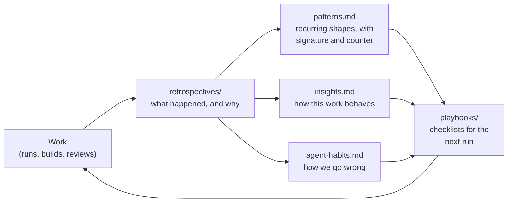

# The lab's engineering knowledge

What the Northstar OWM Lab has learned by doing, kept where the next agent will find it. It turns
one-off experience (an incident, a near miss, a good decision) into knowledge any agent can build
on. It grows with every period of work.

## The layers

| Layer | What it holds | How it changes |
|---|---|---|
| [`retrospectives/`](retrospectives/) | One per period of work: timeline, incidents ranked by consequence with root causes, what worked, insights, decisions, open actions | **Append-only.** A retrospective is a record; a correction is added below it |
| [`patterns.md`](patterns.md) | The recurring shapes behind incidents: signature, root cause, counter, evidence | **Living.** New evidence is added to an existing pattern. A pattern needs one costly incident or two cheap ones |
| [`insights.md`](insights.md) | Durable truths about measuring, cost and time, and working together | **Living.** Rewritten when the evidence changes, saying why |
| [`agent-habits.md`](agent-habits.md) | How agents here go wrong (claims, labels, monitors, sizing, rules, records), and what stops it | **Living.** Honest and blameless, in the first person plural |
| [`playbooks/`](playbooks/) | Checklists for recurring work, each item tied to a pattern | **Living.** An item stays only while it prevents something |

**Playbooks now:**

| Playbook | Use it for |
|---|---|
| [one-shot evaluation](playbooks/one-shot-evaluation.md) | an exam, a baseline, any run that can't be repeated |
| [live foundation runs](playbooks/live-foundation-runs.md) | ingesting, reading, correcting or rebuilding a live knowledge base |
| [agent batch runs](playbooks/agent-batch-runs.md) | readers, judges and graders run as `claude -p` batches |
| [adversarial rounds](playbooks/adversarial-rounds.md) | attack sets against a frozen system |
| [subagent builds](playbooks/subagent-builds.md) | spec → plan → tasks → reviews |
| [writing the record](playbooks/writing-the-record.md) | notes, results, amendments and commits |
| [working with the user](playbooks/working-with-the-user.md) | reports, decisions and handoffs |
| [peer sessions](playbooks/peer-sessions.md) | work split with garbanzo or another session |

## History at a glance

| Retrospective | Period | What it was about |
|---|---|---|
| [R1](retrospectives/2026-10-01-lab-build-and-first-runs.md) | 09-26 → 10-01 | Building the lab, the first live Utopia runs and their scale twin, the OWM measurements, the Ledger, and the first grading pass |
| [R2](retrospectives/2026-10-05-adversarial-experiments-and-the-register.md) | 10-02 → 10-05 | The JEV probe, adversarial experiments 4–6 (credit, SLA), specs as data, instrument guards, attack sets C–F, and the document register |
| [R3](retrospectives/2026-10-10-punch-list-identity-cost-and-bake-off.md) | 10-06 → 10-10 | The board's punch list, G-36 found, identity hybrid, cost per decision, register attacks, title priors, the foundation bake-off |
| [R4](retrospectives/2026-10-16-owm-service-luna-proof-rounds-and-bench.md) | 10-11 → 10-16 | The B-06 OWM service, the luna baselines, B-15 proof rounds, B-19 finish mode, and the foundation bench |
| [R5](retrospectives/2026-10-18-b20-northstar-exam.md) | 10-17 → 10-18 | B-20's one-shot Northstar exam |

**Across all five, five shapes did the most damage:**
- *The unguarded instrument:* the lab guarded the systems it tested, not its own inputs.
- *The visible set is a training set.*
- *The advisory gate:* checks that printed instead of gated.
- *The stranded lesson:* fixes that stayed where they were found.
- *Success-shaped failure.*

The cheapest counter to most of them is the same habit: assert the positive, at the source, before
you act.

## For an agent starting work here

1. Read `agent-habits.md`. It's short, and it's about you.
2. Before planning a run, read the playbook for it, and the patterns it links.
3. Before designing a measurement, read `insights.md`'s measuring section.
4. When a pattern, insight or habit shapes a decision, name it in the commit or the notes ("per
   *Success-shaped failure*").
5. When something goes wrong that this folder should have prevented: fix it, note it for the next
   retrospective, and sharpen the entry that failed.

## How it grows

- **A retrospective** is written at the end of a period of work, after any incident that cost a
  ruling, a day or money, or when the user asks. Name it
  `retrospectives/YYYY-MM-DD-<slug>.md`. It contains:
  - a timeline;
  - incidents ranked by consequence, each with its root cause one level below the symptom, how it
    was found, the fix and its cost;
  - a map of how the incidents connect;
  - what worked;
  - insights;
  - decisions to keep or revisit;
  - open actions.
- **Then distil it:** add evidence to the patterns, insights, habits and playbooks. A
  retrospective that changes nothing else has probably found nothing new, or hasn't been
  distilled.
- **Hypotheses** are labelled as such until checked.

## What never goes in

- **No credential, token, password or key values.** Paths are fine. To show a secret is absent,
  test for it as true or false.
- **No sealed results.** Nothing from a run goes in before that run is recorded.
- **Nothing that shapes a foundation under test.** Under the never-load rule (CLAUDE.md, 854091d),
  run results and anything derived from the answer files never tune or shape a foundation. Here
  that means:
  - entries say how to run, measure and work;
  - they never say what a foundation should extract, resolve or answer;
  - nothing describes the lab's traps beyond what CLAUDE.md states.
- **People by role.** "The user", "garbanzo" (the peer session), "the lab". Use they/them unless
  someone's pronouns are known.

## Related

- **The run's own record:** each run's `runs/<date>-<slug>/notes.md` and `results.md` stay the
  primary record.
- **Garbanzo's side** keeps its own engineering knowledge in glowing-garbanzo
  (`owm/docs/engineering-knowledge/`). This folder is the lab's own. Where the two agree, that's
  corroboration; where they differ, check the evidence.
