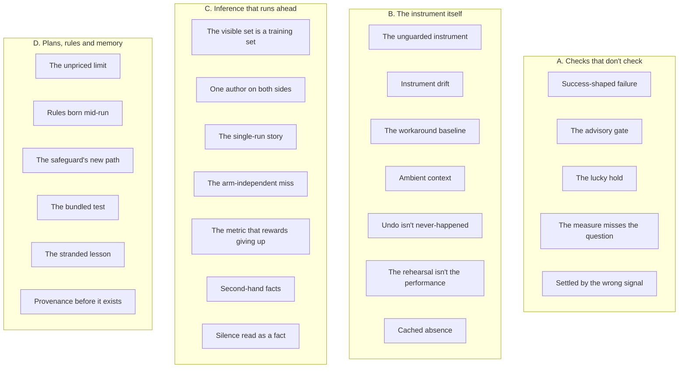

# Patterns

The recurring shapes behind the lab's incidents, drawn from every retrospective since the lab began
(2026-09-26). A pattern earns a place when it has bitten once with consequences, or twice
cheaply. Each one says:
- **how to spot it early** (its signature);
- **why it happens** (the root cause);
- **what counters it.**

Its evidence is in the retrospectives. When you meet a pattern again, add the evidence; don't start
a new entry. A pattern that stops recurring stays here, marked as quiet.

**Retrospectives cited** (R1–R5):

| | Period | File |
|---|---|---|
| R1 | 09-26 → 10-01, the lab's build and first runs | [2026-10-01-lab-build-and-first-runs.md](retrospectives/2026-10-01-lab-build-and-first-runs.md) |
| R2 | 10-02 → 10-05, adversarial experiments and the register | [2026-10-05-adversarial-experiments-and-the-register.md](retrospectives/2026-10-05-adversarial-experiments-and-the-register.md) |
| R3 | 10-06 → 10-10, the punch list, identity, cost and the bake-off | [2026-10-10-punch-list-identity-cost-and-bake-off.md](retrospectives/2026-10-10-punch-list-identity-cost-and-bake-off.md) |
| R4 | 10-11 → 10-16, the OWM service, luna, proof rounds and the bench | [2026-10-16-owm-service-luna-proof-rounds-and-bench.md](retrospectives/2026-10-16-owm-service-luna-proof-rounds-and-bench.md) |
| R5 | 10-17 → 10-18, B-20's Northstar exam | [2026-10-18-b20-northstar-exam.md](retrospectives/2026-10-18-b20-northstar-exam.md) |

## The families

**The costliest across all five periods:**
- *The unguarded instrument:* eight days of reader runs on contradicted inputs.
- *The visible set is a training set:* a headline number that can't be cited.
- *The advisory gate:* a public-history rewrite.
- *Success-shaped failure:* 203 refusals saved as answers.
- *The stranded lesson:* the exam's adapter outage.

---

## A. Checks that don't check

### Success-shaped failure

**Signature:**
- a pass with suspicious numbers: zero hits, $0, 250 ms answers, a whole pass in seconds, or a count
  exactly back to its old value;
- a verdict that holds as well for empty input as for full;
- a status that says `success` on a reply nobody read.

**Root cause:** the check asks for the absence of a failure label ("no mismatch", "not an error",
"count matches") instead of positive evidence ("hits exist", "work was done", "the old value is
gone from every path").

**Counter:**
- **Assert the positive:** non-empty, non-zero cost, the expected count. Before comparing two
  outputs, check that each is non-empty.
- **Classify agent and API results by content,** never by the status field.
- **Test each check once on a known-bad input.** Read the numbers under a verdict.

**Evidence:**
- R5, incident 1: 203 session-limit refusals saved as answers.
- R5, incident 2: parity passed with zero adapter hits.
- R1, incident 6: a curation withdrawal was verified by counts while the values were still readable
  through the audit feed.
- R2: a hand-in check found two replacement files that replaced nothing, which the harness would
  have scored as held. Separately, a run where every merged pair had an empty side nearly tied the
  baseline, and was caught by an anomaly.
- R4: B-15's final review found a fingerprint that read the wrong fields and an ignored connect
  status. Separately, a recording counter printed 0 calls.

### The advisory gate

**Signature:** `check; action` instead of `if check; then action`. The check prints, and someone is
meant to read it.

**Root cause:** no exit code governs the action, so a check that ran reads as a check that passed.
In the worst form, the guard's own definition (a scan pattern) sits in a tracked file.

**Counter:**
- gate by exit code;
- test the gate once with a planted hit;
- route every commit through one helper that gates on the scan and runs lint on the staged files;
- keep sensitive patterns out of tracked files.

**Evidence:**
- R4, incident 1: `scan; commit; push` published the owner's email local part on 10-11. History was
  rewritten to a69b4c9, after about 12 minutes public.
- R3, incident 4: of 82 commit commands from 10-06 to 10-10, 23 ran the scan ungated and 59 ran none.
- R1, incident 9: a provider error carrying an OpenAI project id reached a pushed snapshot (9dc9ca9).
  It was redacted at the next commit, and it's still in history.

### The lucky hold

**Signature:** a "held" result whose mechanism nobody wrote down. It flips under a rename, a
re-save, or a reordering. The system picked "the first" document, or never read the field the attack
changed.

**Root cause:** outcome-only scoring can't tell rejecting an attack from failing to read it.

**Counter:**
- record each hold's mechanism, and mark "held by accident";
- re-run as handed in (`--literal`), and with a harmless perturbation (CRLF, trailing spaces);
- count accidental holds as robustness failures.

**Evidence:** R2, incident 2: four holds came from filename order or an amount never read. One CRLF
re-save changed every prose-reading engine's decisions.

### The measure misses the question

**Signature:** a pre-registered prediction "misses", but the misses show the system did what was
asked. Or the scorer prints a number the plan's definition wouldn't give.

**Root cause:** measures were written as proxies before any data, never run on a known case, and
the code drifted from the definition.

**Counter:**
- write each measure as code at pre-registration;
- run it on one case that should count and one that shouldn't;
- when it misses anyway, report the pre-registered number and a labelled exploratory one, and take
  any change to the user.

**Evidence:** R3, incident 3: five measures in five days (gate C, N2, K1, the M2 scorer, a rescore),
plus two classifier readings.

### Settled by the wrong signal

**Signature:** "settled", "idle" or "no errors" is judged by one surface (documents ready, zero
failed jobs) while background work is still queued, failing, or logging provider errors.

**Root cause:** the cheapest visible signal is taken for the state. A count taken mid-failure reads
as steady.

**Counter:**
- define "settled" as no queued or failed job in any background process, and no provider errors in
  the server log;
- label every count with the state it was read in;
- if the log can't be read, say so.

**Evidence:**
- R1, incident 7: "identity review doesn't scale", read from a queue that governance had stalled on
  a spend limit, went into a pushed commit message.
- R4, bench finding 1 (a hypothesis for the luna runs): governance's second layer failing while
  failed jobs read 0.

---

## B. The instrument itself

### The unguarded instrument

**Signature:**
- controls fail together;
- the systems under test "react" to something the questions claim;
- an engine that bypasses the claim passes, while readers hesitate;
- a "miss" shared by every pipeline.

**Root cause:** the lab guards the systems under test (sealed sets, a blind reader, the oracle's
proof of every scenario), but nothing guards what the harness adds. Request records, counterfactual
edits and gold labels all sit outside the coherence check. A question is a document too, written
from truth/, not from the evidence.

**Counter:**
- **An input-consistency pre-flight:** every record, id or document a question names is found in
  the evidence handed to the reader. It fails on a miss, and runs again after any change to truth,
  scenarios or the corpus.
- **Make reader inputs artifacts of the build,** proven by the oracle, each counterfactual with its
  own id and row.
- **Read a failing control as an instrument alarm first.** Check a gold label before calling a miss
  shared by every pipeline.

**Evidence:**
- **G-36:** 24 of 28 reader questions claimed records the exports didn't hold, for eight days and
  every reader run of R1 and R2. The user's grading surfaced it on 10-02 (R1, incident 2). A fix on
  10-02 moved the contradiction rather than removing it (R2, incident 1). Failed controls found the
  whole scope on 10-06, fixed by the overlay at c033091 (R3, incident 1).
- **R3:** the bake-off's shared "miss" was the gold's error.

### Instrument drift

**Signature:** the system under test, or its configuration, differs from what the baseline ran on,
and nobody recorded the change. Tells:
- a setting changed in a UI for a test;
- an uncommitted patch;
- new jobs or facts in a base;
- a source fingerprint that no longer matches.

**Root cause:** the instrument of record is shared, mutable state, also used for ad hoc tests. A
setting held per workspace changes every base in that workspace.

**Counter:**
- fingerprint what actually runs before every run (the binary's sha256, each workspace's model and
  effort, base counts), and compare it with the baseline;
- new conditions get their own workspace;
- name any instance change in the run's name and notes.

**Evidence:**
- R4, incident 3: a patch test put the experiment workspace on another model and re-extracted a
  document in the main base. Garbanzo found it.
- R5: the source fingerprint had moved by the exam, so the binary's sha256 identified it instead.

### The workaround baseline

**Signature:** a baseline parameter was chosen to get around a blocker, and its findings are written
about "the system", not "the system with that parameter".

**Root cause:** the reason for the choice isn't recorded beside the results, and nobody owns
revisiting it.

**Counter:**
- record each instrument parameter with why it was chosen and what would retire it;
- state findings with their conditions;
- when the blocker lifts, re-run changing that one variable.

**Evidence:**
- R4, incident 2: gpt-4o was the lab's Utopia model only because the build rejected others. An
  identity-safety finding turned out to be specific to gpt-4o (161 and 158 false merges, against 0
  and 2). The user: "gpt-4o is not a realistic baseline model" (10-13).
- R1, incident 3: the model behind the first runs was assumed, unverified.

### Ambient context

**Signature:** an agent knows what no tool or prompt gave it: the operator's account, today's real
date, its working directory. Tells: hesitation over a mismatch nobody designed, or a turn that costs
more because the agent thinks something is stale.

**Root cause:** the agent runtime injects context. Blindness controls cover tools, prompts and
files, not the runtime, and transcripts don't show the injected context unless the agent repeats it.

**Counter:**
- before a counted round, ask the agent directly who it works for and what today's date is;
- run under an empty config directory with the agent's own token;
- hold anything you can't remove equal across arms, and record it as a known limit.

**Evidence:**
- R4, incident 4: B-15's counted round was confounded by the signed-in account (fixed in 081d8e5).
  The real date tripled the cost of B-19's rehearsal.
- R1: an early probe showed the repo's name in the reader's working directory, so readers now run in
  a temp directory outside the repo.

### Undo isn't never-happened

**Signature:** a revert, withdrawal or delete is followed by a "clean" condition, but the old state
is still readable (an audit feed, alias facts), or the operation has no undo at all.

**Root cause:** audited, bitemporal systems keep history by design. Undo is verified by counts, and
each condition's only copy is the live instance.

**Counter:**
- snapshot the instance, or clone a base per condition, before changing it;
- list the irreversible steps and take them to the user;
- after an undo, search the reader's tool results for the withdrawn values, and add a control that
  hides residual paths.

**Evidence:** R1, incident 6: a condition lost for good on the small bases; withdrawn values read
through `changes`; 23 alias facts left live (G-21, open).

### The rehearsal isn't the performance

**Signature:** the dry run used a different instance, data path, scale, concurrency, tool set or
kind of question from the real run.

**Root cause:** rehearsals are built from what's at hand, which differs in exactly the ways nobody
listed.

**Counter:**
- rehearse through the same provisioning path, on a fresh instance;
- pilot every variant and process at the real concurrency;
- price from the same process, never from a borrowed unit cost;
- write down how the rehearsal differs, and close each difference or accept it on purpose.

**Evidence:**
- **R5, incidents 2 and 3:** the dry run was on the live base. The cap was set before any graph-only
  answer.
- **R1:** the probe checked one variant's tools, so another variant's first run was discarded. Small
  ingestion took 6 minutes and was the only price signal for a tenfold corpus, which took 95 minutes
  and hit the spend limit.
- **R2:** a reader was priced from a stale unit cost: $0.18 assumed, $0.31 actual.
- **R4:** B-15's trial couldn't reveal the identity leak. B-19 was priced before any live turn.

### Cached absence

**Signature:** a fix lands upstream, and nothing changes downstream until a restart.

**Root cause:** an empty or "not found" result is cached with no expiry.

**Counter:** don't cache emptiness, or give it a short expiry. After fixing data under a running
service, check the service's answer.

**Evidence:** R5, incident 2: the adapter cached empty version lists.

---

## C. Inference that runs ahead

### The visible set is a training set

**Signature:** a component (a curated fact, a procedure clause, a prompt wording) is added after
reading misses, and the same scenarios are re-scored until they pass. The headline then comes from
the scenarios the work was developed against.

**Root cause:** the experimenter has read the key. Blinding the reader doesn't blind the
experimenter. Until a held-out set exists, the visible set is both training set and test.

**Counter:**
- commit held-out scenarios before tuning ends, with the components frozen first;
- cite held-out numbers only;
- a fix found on held-out scenarios needs fresh ones, never a re-run of the failed ones;
- label every number "visible" or "held-out".

**Evidence:**
- R1, incident 1: 15/15 can't be cited; the held-out 15/18 can. Procedure v2 fixed one class on
  fresh held-out scenarios and regressed another, so it wasn't adopted.
- R3: one wording was tuned on 8 scenarios and confirmed on 10 unseen ones, the counter working.

### One author on both sides

**Signature:** the same agent designs the system, the truth, the key, the scorer and the attacks, and
the results agree suspiciously well. Tells:
- white-box attacks;
- predictions written after reading the attacks;
- a fix checked on the set that shaped it.

**Root cause:** independence is added per experiment, not built into the method, and the independent
author can be unavailable (a refusal, or the user's time).

**Counter:**
- freeze the system before an independent set is opened;
- blind subagents write business content; the user or an outside red team writes attacks;
- label results on a shaping set "a check, not evidence";
- say who wrote what in every table.

**Evidence:** R2, incident 4: the lab's set moved v1 on 4 of 8, the blind set on 1 of 8. G-39,
instrument validity, is still open.

### The single-run story

**Signature:** a before/after with one run per cell, explained by a mechanism read from one trace.
"Variance" offered as the explanation is still a claim: that the change had no effect.

**Root cause:** a trace makes any story look causal, and at n = 1 the story can't be falsified.

**Counter:**
- n ≥ 3 per cell before any before/after claim;
- until then, write "unknown";
- flag a fallen story in place, with a banner.

**Evidence:** R1, incident 4: "variance dominates" was overturned at n = 3 two hours later (8 of 9
against 0 of 9, p ≈ 0.0002).

### The arm-independent miss

**Signature:** the same miss, the same way, on every arm.

**Root cause:** it comes from the shared parts of the instrument (the reader, the prompt, the scorer,
the gold, or the shared input), not from what differs between arms.

**Counter:**
- report it apart, with its cause;
- never read it as a difference or a sameness between arms;
- fix it in the instrument, as its own condition.

**Evidence:**
- R5: the reader's prose and its decision block disagreed on every arm.
- R1: one held-out miss, 6 of 6 in both conditions, came from the shared procedure.
- R3: the bake-off's shared miss was the gold's.
- R4: every unsafe B-15 run flagged the tool's stale fields.

### The metric that rewards giving up

**Signature:** a system that does less scores as well as one that does more. An empty reader gets
perfect precision; an arm that never decides has no unsafe answers; a safe rule that routes
everything is an outage.

**Root cause:** the metric counts one kind of error and leaves abstention and availability out.

**Counter:**
- report decided, right, unsafe, routed-correct, no decision, out of turns and errors side by side;
- run every metric once on empty input;
- keep a strict score and an "acceptable to act on" score.

**Evidence:**
- R5: graph-only SLA.
- R1: the two scores (125fe00).
- R2: availability attacks exposed once routed-correct was counted (G-04).
- R3: forced routes that matched the key had been scored as held.

### Second-hand facts

**Signature:** a claim about live state comes from a plan, a note, a summary, a progress notice or a
peer's message.

**Root cause:** documents describe a system at a moment, through someone's eyes, and reading them is
faster than asking the system.

**Counter:**
- read live state at its source;
- relay identifiers only as read from their store;
- check a peer's claim before passing it on;
- correct a wrong claim everywhere it went.

**Evidence:**
- R5, incident 5: wrong kb ids relayed by a peer; a manifest claimed from a plan's file count.
- R1, incident 3: "cheap on gpt-4o-mini", from an unverified note.
- R2: "spec-local", inferred from an effect.
- R4: U-32's acceptance claims, corrected by garbanzo from Utopia's code.

### Silence read as a fact

**Signature:** a component omits or removes something, and a downstream reader (an engine, an agent
or a reviewer) treats the gap as a negative fact: no rule, out of scope, none owed, no customer.
A variant: a structure built for code, served to an agent without the context the code supplied.

**Root cause:** absence isn't part of the interface. Nothing says whether "missing" means "none" or
"unknown".

**Counter:**
- state coverage and explicit absences;
- when an input is removed, route the decision and withhold whatever was computed from it;
- test each consumer with the item removed;
- in a review, write "the document doesn't say X", never "X isn't so".

**Evidence:**
- R2, incidents 3 and 5: a set-aside schedule read as "out of scope"; a forged instrument passed
  where coverage wasn't stated; a rule stored as a bare `true` dropped who takes over.
- R3: a thesis review said "no customer"; design partners exist.

---

## D. Plans, rules and memory

### The unpriced limit

**Signature:** a run stops or stalls on something other than the dollar cap: an account or provider
spend limit, the session limit, a permission, another session's build, a key or token only the user
can make, or the user's own time.

**Root cause:** budgets list dollars, because dollars get approved. Every other limit is discovered
by hitting it, and the supervising agent shares the account's limit with its workload.

**Counter:**
- budget every limit in the plan: dollars, account windows, rate, concurrency, turns, wall-clock,
  permissions, credentials and people's time;
- pre-register what happens at each;
- ask for credentials at pre-registration.

**Evidence:**
- R5, incidents 1 and 6: four session-limit stops; a peer's permission gate.
- R1, incident 3: the OpenAI spend limit paused ingestion for 12 hours.
- R2 and R3: subagent safety refusals made the user the attacker, and an attack set waited 35 hours.
- R4: the bench waited 2 h 46 min for a key; an identity fix waited overnight for a token.

### Rules born mid-run

**Signature:** a rule for handling a failure is written after the failure appears and while the run
goes on. It fits that failure and is wrong for the next.

**Root cause:** failure handling wasn't pre-registered, so it's designed from a sample of one.

**Counter:**
- pre-register a failure taxonomy before the first answer;
- separate causes local to an item from global ones;
- commit any new rule with its time, before any answer it affects, and take changes to the user.

**Evidence:**
- R5, incident 4: the two-strike rule counted the account's limit.
- R3: a call on one scenario's input was made three minutes before its scope was measured: 24 of 28.

### The safeguard's new path

**Signature:** a guard or mode is added, and the next attack round finds a failure that didn't exist
before. Something new is read, something removed goes silently missing, or a conflict rule routes
everything.

**Root cause:** a safeguard changes what the system reads or drops. Its checks cover the target and
the clean decisions, not the collateral.

**Counter:**
- list what each guard newly reads and newly drops;
- pre-register "creates no unsafe outcome the old version lacks";
- report availability beside safety;
- make removal explicit: route and withhold.

**Evidence:** R2, incident 3: amendments read, then forged; a one-policy rule became an outage; route
mode's silence was read as meaning (G-32).

### The bundled test

**Signature:** "later, bundled", "fold into set X", "with the next attack set".

**Root cause:** the bundle's vehicle depends on something else (often another session's build), and
nobody owns a date.

**Counter:**
- a deferred test gets a date and a fallback vehicle;
- by default, recommend the small fresh test now, unless it costs more than a stated threshold.

**Evidence:** R3, incident 2: the fresh test of the served-register fix (G-31 P1, G-33) has waited 12
days on an idle build. The one bundling the user overrode found G-36 within the hour.

### The stranded lesson

**Signature:** a defect or dependency is found, written down and worked around in one place (a
decision note, a build ledger, a run's notes), then bites again through a path that never saw the
note.

**Root cause:** a lesson is recorded where it was learned, not where it would stop the next failure.
Notes don't run; provisioning, loaders, pre-flights and a spec's precondition list do.

**Counter:**
- put a workaround into the path that creates the next instance, the same day;
- when reusing a component in a new mode, list the old mode's guarantees it relies on, and say for
  each whether the new mode keeps it;
- when a later run changes how an earlier one reads, append an addendum to the earlier notes, and
  log it on its gaps.

**Evidence:**
- R4, incident 9 and R5, incident 2: the upload version-row defect was found on 10-12 and hit the
  exam on 10-17. It's now in provisioning (3c957f3).
- R4, incident 5: a reset precondition from B-15's ledger was missed by B-19, a critical bug caught
  in review.
- R4: a bench finding never reached the earlier luna notes.

### Provenance before it exists

**Signature:** a placeholder ("22:3x", "this commit's parent"), a typed time, a hand sum or a guessed
count reaches the record; or a claim is written from memory of the data.

**Root cause:** the record is written in the same breath as the work, before the hash, time or
number exists, or instead of computing it.

**Counter:**
- write provenance after it exists;
- take times from `date -u` and sums from a computation;
- check every claim against the data before committing;
- grep for placeholders.

**Evidence:**
- R5, incident 7: a placeholder and a wrong cross-reference in the notes; two wrong claims caught
  before commit.
- R2: "no new calls" was 6; "about 28" was 22.
- R3: a $33.46 hand sum that was really $31.46; Ledger log times typed by hand.
- R4: "flagged to garbanzo" written before it was sent.
