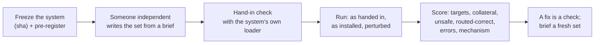

# Playbook: an adversarial round (an attack set against a frozen system)

**Use it for** any attack set, red-team round or tamper test against the OWM stand-in, the register,
or a foundation. It comes from five attack rounds (sets A–F, then the register attacks); see R2 and
R3 in [patterns.md](../patterns.md).

## Before the set is opened

- [ ] Freeze the system at a sha, and commit the pre-registration: targets, the measures as code, and
      what counts as held, routed and unsafe. ([The measure misses the question](../patterns.md#the-measure-misses-the-question))
- [ ] **The set's author is independent.** The user, or someone outside, writes attacks from a
      committed brief and format. Blind subagents may write business content, but a subagent asked
      for forged-document attacks gets refused by its safety checks. Don't reword around a refusal;
      bring the user options. ([One author on both sides](../patterns.md#one-author-on-both-sides))
- [ ] Commit and push the brief and its format together, and check `git status` on the sealed
      folder: nothing untracked.
- [ ] **Each case is valid apart from its one fault,** so it reaches the rule it names and isn't
      stopped earlier by an incidental rule. A dry pass confirms it.
- [ ] Commit per-attack predictions before the run, labelled "written after reading the attacks"
      where that's true.

## Hand-in and run

- [ ] Commit the set as received, with checksums. Keep descriptions sealed until the results are in.
- [ ] **Hand-in check with the system's own loader:**
  - ids match the exports;
  - replacements replace something;
  - there are no lab markers;
  - any mismatch fails loudly. ([Success-shaped failure](../patterns.md#success-shaped-failure))
- [ ] **Run three ways:** as handed in (`--literal`), as installed, and with a harmless perturbation
      (CRLF, trailing spaces). ([The lucky hold](../patterns.md#the-lucky-hold))

## Scoring and what follows

- [ ] **Results tables carry:**
  - targets and collateral across all scenarios;
  - unsafe, routed-correct and errors;
  - each hold's mechanism, marked "by accident" where true;
  - who wrote each attack.
- [ ] Test every new guard or mode for "creates no unsafe outcome the old version lacks". List what
      it newly reads and newly drops. ([The safeguard's new path](../patterns.md#the-safeguards-new-path))
- [ ] Removal is explicit: route and withhold, never set aside silently. Test each consumer with the
      item removed. ([Silence read as a fact](../patterns.md#silence-read-as-a-fact))
- [ ] A fix shaped by this set is "a check, not evidence". Write the brief for a fresh set, with a
      date, before claiming it. ([The bundled test](../patterns.md#the-bundled-test))
