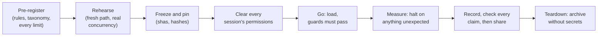

# Playbook: a one-shot evaluation

**Use it for** an exam, a baseline, or any run that can't be repeated without contaminating it.
Each item is here because skipping it cost something once; the patterns are linked.

## Before the go

- [ ] **Pre-register:** the arms, questions, scorers, noise rule, caps and how results are reported.
      Commit it before the first measurement.
- [ ] **Pre-register the failure taxonomy:** for each way an item can end, say whether it counts as
      an answer, a retry or a halt. Causes that hit every item, such as the account's limit, never
      count against one. ([Rules born mid-run](../patterns.md#rules-born-mid-run))
- [ ] **Budget every limit,** not only dollars: account windows, rate, concurrency, turns,
      wall-clock, permissions. Say what happens at each.
      ([The unpriced limit](../patterns.md#the-unpriced-limit))
- [ ] **Rehearse through the real provisioning path:** a fresh instance, the same load command,
      every guard run on it. A dry run on a live or older instance doesn't count.
      ([The rehearsal isn't the performance](../patterns.md#the-rehearsal-isnt-the-performance))
- [ ] **Pilot every variant and process at the real concurrency.** Price per question, and
      re-price after any change to the tools' output.
- [ ] **Make every guard assert the positive:** non-empty, the expected count, positive controls.
      Test each guard on empty input once. ([Success-shaped failure](../patterns.md#success-shaped-failure))
- [ ] **Freeze and pin:** the systems' shas, the instrument's sha (the adapter, the binary's
      sha256), and the corpus by file hashes, all checked before the first upload.
- [ ] **Seal:** no result reaches the side under test until the run is recorded. Pilot outputs stay
      out of the public repo.
- [ ] **Clear every session's permissions before the go:** list what each session will run, and
      have the user approve it there.
- [ ] **Input-consistency pre-flight:** every record, id or document a question names exists in the
      evidence handed to the reader. Re-run it after any change to truth, scenarios or the corpus.
      Run it with `lab/preflight.sh check` (G-50).
      ([The unguarded instrument](../patterns.md#the-unguarded-instrument))
- [ ] **Measures as code at pre-registration,** each run once on a case that should count and one
      that shouldn't. ([The measure misses the question](../patterns.md#the-measure-misses-the-question))
- [ ] **Held-out scenarios are frozen before any component is tuned.** Label every number "visible"
      or "held-out", and cite only held-out.
      ([The visible set is a training set](../patterns.md#the-visible-set-is-a-training-set))
- [ ] **Credentials, keys and tokens are requested at pre-registration,** and checked to exist
      before the go.
- [ ] **Fingerprint the instrument** (binary sha256, workspace models and effort, base counts), and
      **probe agents' ambient context** (account, date). See
      [live foundation runs](live-foundation-runs.md).

## During the run

- [ ] Read each guard's numbers, not only its verdict.
- [ ] Read identifiers (kb ids, tokens by path) from each system's own listing, never from a
      message.
- [ ] Watch for anomalies, not only errors: answers that are too fast or cost $0, identical
      outputs, sudden spend jumps.
- [ ] On anything unexpected: halt, keep the evidence, and bring the user options with a
      recommendation. Don't improvise a rule silently.
- [ ] Log every deviation in the run's notes as it happens, with its time and commit.

## After

- [ ] Score with the pre-registered scorers. Blind any hand-reading: shuffle with a recorded
      seed, strip the labels, and keep the key apart.
- [ ] Write the results with a deviations section and a spend table. Check every claim against
      the data before committing ([writing the record](writing-the-record.md)).
- [ ] Commit the record (sealed pilot outputs included, labelled), then share it.
- [ ] Teardown:
  - revoke tokens and users;
  - archive without the key- and token-bearing tables, and check the archive for key prefixes;
  - stop the servers, drop the throwaway databases, and delete the local secret files.
- [ ] Move every workaround the run needed into provisioning, so the next fresh run doesn't need
      it again. ([The stranded lesson](../patterns.md#the-stranded-lesson))
- [ ] If the run changes how an earlier run reads, append an addendum to that run's notes, and log
      it on the gaps it touches.
- [ ] Write the retrospective while it's fresh.
