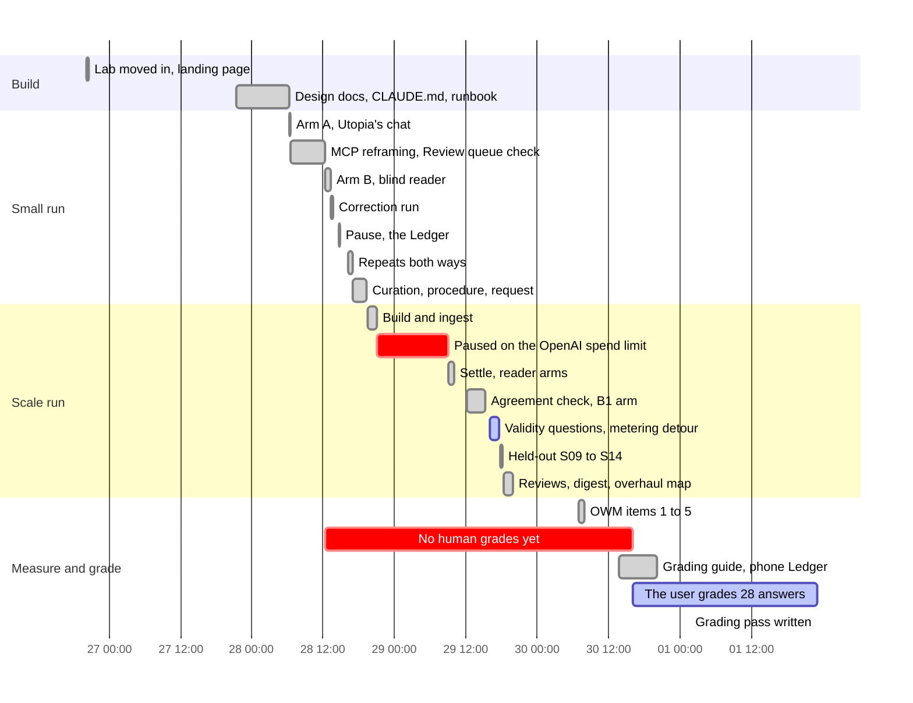
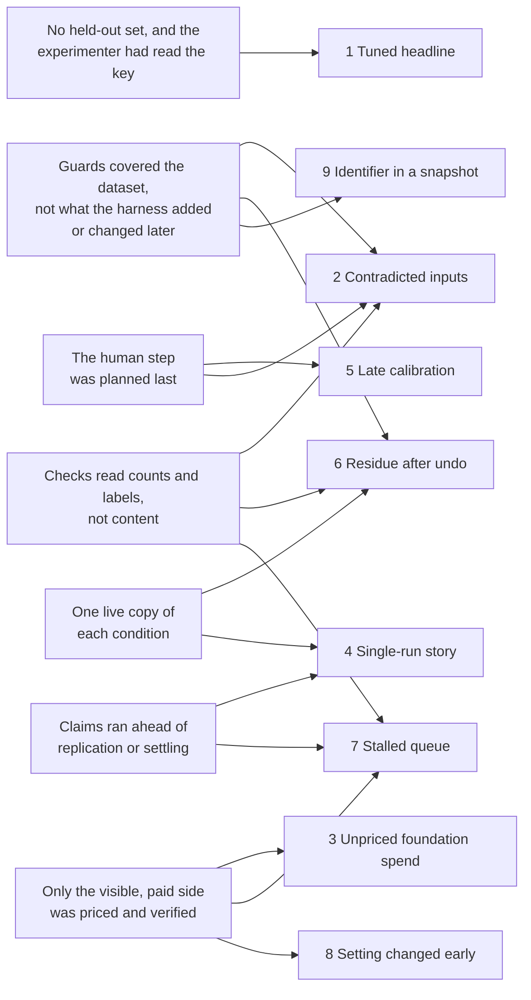

# Retrospective: building the lab and the first live runs (2026-09-26 to 10-01)

**Scope:** from the lab's arrival in this repo to the user's first grading pass. That covers the
seeded enterprise (truth/, the oracle, the generators), the first live Utopia run and its
scale twin, the OWM measurements, the Lab Ledger, the docs dated 09-29 (the assessment, the
response to the external reviews, the BlueLeaf digest and the OWM overhaul map) and the grading
pass.
**Written by:** the lab's agent, on 2026-10-18, from the record, at the user's request.
**Sources:** git history (29 commits, 9048b35 to 6f7a33e); the notes of
`runs/2026-09-28-utopia-aad5b06/`, `runs/2026-09-28-utopia-aad5b06-scale-large/` and
`runs/2026-09-30-owm-measurements/`; the docs of 09-29 to 10-01; the Ledger export (findings
f01–f19, s01–s15, m1–m9, and the gaps); memory; the user's messages (UTC); spot checks of the
session transcript.
**Limits:** the lab itself was built in another session, inside sovera-owm, and moved here in
one commit (2417d42: "Moved from kloudtaxi/sovera-owm labs/northstar-owm-lab"). This
retrospective sees that build only through the commit. Times below are EDT for commits and UTC
for the user's messages, as each source records them.

> **Never-load notice.** This file cites recorded runs. Under the lab's rule (CLAUDE.md,
> 854091d), nothing here may be used to tune or shape a foundation under test. Its lessons are
> about how to run and measure, never about what a foundation should extract.

## At a glance

| | Planned | Actual |
|---|---|---|
| Reader arms | Runbook arms A, B (optional), C | A; then B and ten more arms in 30 hours; then five OWM measurements |
| Foundation model and spend | "cheap on gpt-4o-mini" (09-28 23:25 UTC) | gpt-4o (confirmed only on 10-12); at least $75 by 09-29 (the user's figure); the OpenAI project's enforced spend limit stopped ingestion |
| Scale ingestion | the small run took 6 minutes | 95 minutes, then failed on the spend limit; paused 12 hours |
| Reader spend | ~$12 for the scale arms, ~$40 for the measurements | $12.70 and $31.16; about $110 in the period for 408 answers |
| Human scoring (runbook steps 7–8) | after the run | Step 7 (the fact checklist) was never filled. Step 8 covered 28 answers, graded on 10-01, after about 390 were in the Ledger |
| Headline | 15/15 on the five decision scenarios | not citable, because it was tuned on those scenarios. 15/18 held-out is the citable number |
| Before/after claims at n = 1 | none foreseen | 1 published (00df000), overturned at n = 3 two hours later (d27d31d) |
| Secrets | 0 | 0 credentials. One OpenAI project id reached a pushed snapshot (9dc9ca9), was redacted in the next commit, and is still in history |

## Timeline

The two red bars are the story. The run paused for 12 hours on a limit no plan had priced. And
for two and a half days, every published number was graded only by the lab and its scorer.

## Incidents, by consequence

### 1. The headline was tuned on the scenarios it reports (15/15 isn't citable)

- **What happened:** on 09-28 the graph-only arms were added one at a time: correction, curation,
  procedure, request record. Each was built after reading the previous arm's misses, and each was
  re-scored on the same five decision scenarios, until they reached 15/15 (b1c2086). At scale, the
  last split closed with one more curated fact (a2aeb8c). The session choosing what to add had
  read truth/ and the answer key.
- **How it was found:** two ways at once.
  - The lab's own assessment (09-29, `docs/experiment-assessment-2026-09-29.md`) called it "the
    biggest threat to validity".
  - The CC-OWM seat's review of the lab, quoted in the digest (cd321b0, §4): "the visible-set
    15/15 was reached by adding a component and re-scoring until it matched, so 15/18 (held-out)
    is the only citable number".
- **Root cause, step by step:**
  1. Each arm answered "what's missing?" from the previous arm's misses, on the same scenarios.
  2. The blind reader kept the subject blind. Nothing kept the experimenter blind.
  3. Underneath: there was no held-out set until 09-29, so the visible set was both the training
     set and the test. An arm cost $5–8 and about an hour, so the loop ran fast.
- **What limited the damage:**
  - every curated fact came from its own KB's corpus;
  - the scoring rule was fixed before results (`procedure/score.py`);
  - the B1 arm showed that with text retrieval, curation added nothing: 45/45 curated, uncurated,
    and in a leak-free control (3d9b2df).
- **The fix:**
  - six held-out decisions, written after the procedure froze and committed before any reader saw
    them (fa32ee7). They scored 15/18 in both configurations, with no unsafe miss (55e7fba);
  - the systematic miss stayed a fail: "re-running S13 with a patched procedure would be tuning to
    the test" (`heldout/notes.md`);
  - procedure v2 then met fresh held-out scenarios (8485d4a). It fixed one class and regressed a
    neighbouring one (S18 went from 3/3 to 1/3), so it wasn't adopted (6a88eb8).
- **Cost:** the headline number; the held-out arm ($11.04); and G-39 (one designer wrote the
  truth, the key and the engines), still open.
- **Patterns:** new candidate *The visible set is a training set*.

### 2. Reader inputs that the evidence contradicted (eight days, then G-36)

- **What happened:** from the request-record arm (b1c2086) on, each question carried the request
  "as recorded in Northstar CRM". The lab built those records:
  - for counterfactual scenarios, by editing one real CRM request in the prompt;
  - for held-out scenarios, from truth/.

  But the CRM export loaded into Utopia as evidence held only the original request. So a reader
  that cross-checked the record against the export met a contradiction.
- **How it was found:** through the user's grading.
  - The user passed T1 · S04 · r3 (#11), which the auto-scorer had failed. The prose answered the
    question as asked. The decision block followed the CRM export, which contradicted the record
    the lab had sent.
  - The lab's own item-1 notes had called the answer a reasoning slip. They were wrong, and a
    correction was appended (`01-02-procedure/notes.md`).
  - The user's ruling: "Take a look at #11 it seems the answer key is wrong" (10-02 14:57 UTC).
  - A missed chance: on 10-01 the user asked "Was that crm record retrieved from Utopia MCP?"
    (19:25 UTC). The lab explained that the held-out records were lab-built. It didn't notice that
    the question still said "as recorded in Northstar CRM".
- **Root cause, step by step:**
  1. The question claimed a record that the system of record didn't hold.
  2. The harness assembled those records at prompt time, outside truth/.
  3. Underneath: the oracle (`northstar check`) proves every scenario against the evidence the
     build generates. Nothing proved what the harness added afterwards, so the lab's strongest
     guard didn't cover its newest input.
  4. The scorer read only the decision block, and so did the lab's note.
- **The fix:**
  - S02–S04 got their own request ids (90a4c5e, 10-02). That wasn't enough;
  - on 10-06, G-36 found that 24 of 28 reader questions still claimed records the exports didn't
    hold. A per-scenario overlay (`lab/reader_inputs/overlay.py`) fixed it, and comparability
    broke at c033091.
- **Cost:**
  - one wrong analysis in a run note;
  - over-caution caused by the lab, counted against the reader;
  - eight days of reader experiments with a contradiction in their inputs;
  - one comparability break.
- **Patterns:** new candidate *Inputs outside the coherence check*;
  [Second-hand facts](../patterns.md#second-hand-facts), because a lab-made record was presented
  as the system's.

### 3. The foundation's spend was unverified and unpriced

- **What happened:**
  - The 09-28 note listed Utopia's models as "per `_owm-local` notes: gpt-4o-mini … **Not
    verified**".
  - The scale plan then said "Utopia's own extraction, which is cheap on gpt-4o-mini" (09-28
    23:25 UTC).
  - Ingestion took 95 minutes and hit the OpenAI project's enforced spend limit. The last
    extraction rounds failed in both KBs (28 of 30 and 46 of 53 chunks), and governance failed
    every hour from 01:08 UTC.
  - The ruling came at 09:48 UTC: "Raise limit, run all (Recommended)". Even then, the lab quoted
    the resume as "costing cents on gpt-4o-mini".
- **How it was found:** the user, at 13:01 UTC on 09-29: "so far we have spent $75 on gpt-4o for
  these runs". The lab replied: "I was wrong about Utopia's costs. I kept saying 'cents on
  gpt-4o-mini', but the model was only ever listed as unverified."
- **Root cause, step by step:**
  1. Estimates repeated an unverified line from local notes as if it were fact.
  2. The lab rightly didn't read Utopia's settings table, since it also holds API keys. But
     nothing replaced that check, not even asking the user.
  3. Utopia logs token usage only to a terminal, so the foundation's spend was metered nowhere the
     lab could read.
  4. Underneath: the budget covered only the side the lab paid for and could see, the Claude
     readers. Ingestion spend grows with the corpus, and governance spend with the queue. Neither
     was in any plan.
- **The fix:**
  - from then on, each next step said whether it would call gpt-4o (09-29 17:29 UTC);
  - a LiteLLM meter was evaluated, and the user dropped it: "Nah drop it. We have far more
    important things to do" (21:40 UTC);
  - memory now says to flag the OpenAI cost before any Utopia-heavy step;
  - the model was confirmed as gpt-4o on 10-12, read-only, by garbanzo.
- **Also:** the lab overstated cost the other way the same afternoon. The user asked "Why would we
  have to incur gpt cost again?" (17:28 UTC), and the lab answered "We mostly wouldn't. I wrote that
  too broadly."
- **Cost:** at least $75 of gpt-4o, and no meter after that; a 12-hour pause; one ruling.
- **Patterns:** [The unpriced limit](../patterns.md#the-unpriced-limit),
  [Second-hand facts](../patterns.md#second-hand-facts),
  [The rehearsal isn't the performance](../patterns.md#the-rehearsal-isnt-the-performance): the
  small run's 6 minutes were the only price signal for a corpus ten times the size.

### 4. A single-run story about the correction

- **What happened:** after 18 identity corrections, graph-only B2 fell from 6/4/0 to 4/3/3. With
  one run per cell, `correction/comparison.md` explained the drop from the trace: "The correction
  didn't hide the quotes; this run just didn't find them", and "variance dominates". The run was
  committed and paused on that reading (00df000).
- **How it was found:** by the lab's own repeats.
  - On the corrected graph, B2 was stable at 4/3/3, 4/3/3 and 4/4/2 (d27d31d).
  - Pre-correction repeats, run by reverting 17 merges and then re-applying them, gave 6/4/0,
    6/4/0 and 5/4/1 (9d988e6).
  - The reader's dig through the audit feed went from 8 of 9 runs to 0 of 9 (one-sided Fisher
    p ≈ 0.0002).
- **Root cause:**
  - one run per cell;
  - a trace makes any story look causal;
  - "variance" felt like the cautious reading, but it was a claim in its own right: that the
    correction had no effect. The cautious reading was "unknown until n = 3".
- **The fix:**
  - a banner on `correction/comparison.md` marks findings 3 and 4 superseded;
  - f12 and f13 went into the Ledger;
  - every later arm ran n = 3.
- **Cost:** $11.71 of repeats, well spent, and six minutes with the KBs un-corrected.
- **Patterns:** new candidate *The single-run story*; insight 4 in
  [insights.md](../insights.md) ("a system differs from itself").

### 5. Human calibration came last, on a desktop-only tool

- **What happened:**
  - The runbook put human scoring (steps 7–8) after the run.
  - By 09-30 the Ledger held about 390 answers and 0 human grades.
  - No grading instructions existed until the user asked: "Yes it's about time, I'm holding us up.
    Can you please give me or tell me where I can find instructions…" (09-30 17:46 UTC).
  - The Ledger then failed the user twice: it didn't work on a phone (23:58 UTC), and it showed
    raw JSON ("part b is leaking JSON", 10-01 16:26 UTC).
- **What the calibration found** (6f7a33e):
  - the auto-scorer's passes held, 11 of 11;
  - its fails were overturned in 7 of 8 cases;
  - the user graded the lab's hand reads higher in 4 of 8 cases;
  - every disagreement went the lenient way.

  So the published strict scores were a floor, and the lab's hand reads were too strict about
  framing.
- **Root cause:**
  - the human step was planned as the last step;
  - the tool was built for the developer's desk;
  - the user grades where they are. They had said, "I'm remote without a terminal" (09-28 20:45
    UTC).
- **The fix:**
  - a grading guide with 27 answers, chosen where the provisional grades were most likely wrong
    (2946579);
  - the phone layout, committed five minutes after the report (69278c9);
  - the JSON display, committed two minutes after its report (e0d9932);
  - a second score, "acceptable to act on", next to the strict one (125fe00, 10-02).
- **Cost:** two and a half days of numbers that looked final, and no answer re-run.
- **Patterns:** agent habit candidate *Building the human's step last*.

### 6. The only instrument was changed in place, and undo left residue

- **What happened:**
  - **Irreversible changes:** the correction and the curation were applied to the only small KBs.
    Curation's 26 retractions have no undo, so the small run can never return to its uncurated
    state. That's why the uncurated B1 arm could run only at scale (`b1/notes.md`).
  - **A leak:** at scale, curation was withdrawn exactly, with live facts back to 13,721 and
    14,122. But in the uncurated B1 runs, 13 tool results across 11 answers still showed withdrawn
    values. They came through `changes`, Utopia's audit feed, which keeps every retraction as an
    event.
  - **Residue:** item 4's fixture document was deleted after its arm, and 23 alias facts stayed
    live. The 2027 policy went into one KB only. The KBs now drift from the dataset.
- **How it was found:** the leak by reading the uncurated runs' tool results; the residue by
  checking which facts cited the deleted document.
- **Root cause, step by step:**
  1. Utopia is audited and bitemporal by design. A retraction is a new event, not an erasure, and
     some operations have no undo at all.
  2. The lab verified each undo by counting, and a count can't see paths that read history.
  3. Underneath: each condition's only copy was the live KB. Nothing was cloned per condition.
- **The fix:**
  - B1n, a control with `changes` hidden: 15/15, and no tool result mentioned the curation;
  - every toggle logged step by step (`toggle_correction.py`, `toggle_curation.py`);
  - the residue disclosed in the notes. G-21 (KB drift) is still open.
- **Cost:** a control arm ($4.05), and a condition lost for good on the small KBs.
- **Patterns:** new candidate *Undo isn't never-happened*;
  [Success-shaped failure](../patterns.md#success-shaped-failure), because the count check passed
  while the values were still reachable.

### 7. A stalled queue read as a settled one

- **What happened:** the scale checkpoint said "human identity review doesn't scale", from 2,763
  and 3,828 pending pairs, in both the notes and a pushed commit message (9dc9ca9). Most of those
  pairs were governance's own backlog: it had failed on the spend limit every hour. Once the limit
  was lifted, it drained in 23 minutes and left 232 and 203 for a human. That's 40–46 times the
  small run, not 550 times.
- **How it was found:** before asking the user about governance spend, the lab read the governance
  job history and the queue's predicates in Utopia's source (09-29 13:04 UTC), and corrected the
  notes two minutes later.
- **Root cause:**
  - "settled" was judged by the documents being ready, not by every background job being idle;
  - a count taken mid-failure was read as a steady state;
  - the conclusion went into a commit message, which is permanent once pushed.
- **Cost:** an overclaim in public history, corrected in the notes within 12 hours.
- **Patterns:** candidate *Reading a stalled system as settled* (one instance so far); habits
  [Narrow truths](../agent-habits.md#narrow-truths) and
  [Recording ahead of the facts](../agent-habits.md#recording-ahead-of-the-facts).

### 8. A shared setting changed before the user decided

- **What happened:** governance was about to restart on gpt-4o. The lab sent a PATCH to turn it
  off on both scale KBs (09-29 13:05 UTC) before asking. The auto-mode classifier refused it. The
  lab stopped ("I'll stop there and not retry"), put the choice to the user, and the user chose
  option 1 at 13:31.
- **The same day, the other way round:** the user switched governance back on in Utopia's UI, but
  the change didn't save, because that section has its own Save button. The lab read the state
  back, found it still off, and set it through the API as the user had intended (16:14 UTC).
- **Root cause:** stopping spend felt obviously safe, so the decision was treated as already made.
- **Cost:** none. The classifier caught it.
- **Patterns:** agent habit candidate *Deciding for the user*;
  [The unpriced limit](../patterns.md#the-unpriced-limit), since a permission is a limit too.

### 9. An identifier reached a public commit

- **What happened:** the scale checkpoint's failed-jobs snapshots (9dc9ca9) carried the OpenAI
  project id inside the 429 error text. The pre-commit scan found it at the next commit, and it
  was redacted (e3c7891). A scan with that pattern ran before the later commits I spot-checked.
- **Root cause:** the snapshot copied raw error text from the foundation's job table, and the scan
  either didn't run on it or didn't cover it before 9dc9ca9. Which of the two is a hypothesis.
- **Cost:** the id is still in history at 9dc9ca9 (checked as true or false on 2026-10-18). It's
  an identifier, not a credential. I found no ruling about it.

### 10. Small things

- **The first B2 attempt:**
  - The text tools were left off the allowlist but stayed visible. The reader was refused five
    times and learned that documents existed.
  - It was discarded after one question (`arm-b/B2-discarded/`).
  - The probe had checked B1's tool set, not B2's.
  - The fix: hide tools with `--disallowedTools`, and probe each variant (9 tools, 0 denials).
  - Pattern: [The rehearsal isn't the performance](../patterns.md#the-rehearsal-isnt-the-performance).
- **Run scripts in a scratchpad:** they stayed in the session scratchpad until the user asked for
  them in the repo ("Yes please move them out of sandbox into the repo", 09-28 20:11 UTC; 82c9a2e).
  The earliest notes still cite scratchpad scripts. The move also tightened blindness: the reader
  now runs in a temp directory outside the repo, because the probe had shown the repo's name in
  the reader's working directory.
- **A detour:** an hour went on a metering evaluation that the user then dropped (21:40 UTC). The
  doc was never committed.

## How the incidents connect

**Seven root causes for ten incidents.** The costliest two share a shape: the lab's guards (the
blind reader, the oracle) protected the subject and the dataset, but not the experimenter's
choices or the harness's inputs.

## What worked: keep doing it

- **The blind reader's controls:**
  - an empty temp directory outside the repo;
  - no built-in tools, and a strict MCP config;
  - a read token per run, scoped to the run's KBs and revoked at the end;
  - a fixed system prompt;
  - a probe of each variant before its run.
- **An isolating condition beside the realistic one:** B2 (graph only) next to B1 (all tools). It
  was the condition that showed what the foundation had modelled, the design the exam later relied
  on ([insights](../insights.md), 1).
- **Repeats before conclusions, once burnt:** every arm after 09-28 16:46 ran n = 3.
- **Pre-registration that reports its own failures:** the held-out arm and items 1–5. Predictions
  that failed were listed "reported, not tuned away", and item 4's formatting slip stayed a fail
  under the exact-value rule.
- **A fixed scoring rule, then a second score:** `procedure/score.py` was never changed. The
  user's standard became a separate score, and the strict rule was kept.
- **Reverting and re-applying through the system's own routes,** verified against snapshots in
  both directions.
- **Answering validity questions with an inventory:** when the user asked "did we do anything
  special in B1 to influence Utopia's behavior" (09-29 20:02 UTC), the answer listed every change
  to Utopia's data and every input handed to the reader.
- **Superseded findings flagged in place,** with a banner, never silently rewritten.
- **The Ledger:**
  - MLflow was deferred as "the right tool at the wrong time";
  - the Ledger keeps the user's grades in their own collection, which reseeding never touches;
  - its problems were fixed within minutes of the user reporting them.
- **A targeted grading sample:** 27 answers where the provisional grades were most likely wrong,
  about 45–60 minutes of the user's time.
- **Pushing back on the external reviews with evidence:** correcting their facts, saying where the
  evidence didn't reach yet ("Persistence … is the proposed value, not a finding yet"), and turning
  their strongest claim into a fair test (item 4's document baseline).
- **Reading another repo's instructions as information:** the digest read sovera-owm's seat
  instructions "as information, not acted on".
- **Scanning before committing:** the owner's email was redacted from transcripts before the
  first run commit (00df000), and a pre-commit scan ran from 09-29.
- **A build that refuses to write:** the oracle proves every scenario. Scenarios grew from 8 to 21
  with no new test functions (24 at 2417d42 and at 6f7a33e).

## Insights

### About measuring

- **The reader is the largest variable.** On the same graph, Utopia's chat got 2 of 10 and a blind
  Opus reader 9 of 10 (`comparison.md`). Name the reader in every result, and measure a foundation
  through a fixed reader.
- **Blinding the subject doesn't blind the experimenter.** The reader never saw the key; the
  session choosing what to add had. Only held-out results, frozen before the experimenter sees
  them, measure generalization.
- **A change that looks like a fix can lower a score through the reader's strategy.** Cleaner
  identity cut the reader's dig to the evidence (8 of 9 runs to 0 of 9). After any change to the
  system under test, re-run the readers rather than assume an improvement.
- **A strong reader can hide a defect in the data.** Only 3 of 60 graph-only answers flagged an
  error in what the foundation served. The rest worked around it silently, or never mentioned it
  (`repeats/notes.md`). Check the data under the answer, not only the answer.
- **What you hand in defines the condition.** Every condition given the request record measures
  "foundation + OWM, given the request", not the foundation alone (the lab, 10-01 19:26 UTC). Name
  conditions by their inputs, as the R codes do.
- **A scorer that reads the structured block and a human who reads the prose part where the answer
  hedges.** Calibrate early, with a targeted human sample. Keep both scores, with over-caution and
  abstention beside them.
- **The most useful results are often the unforeseen ones:** item 4's document carrier, and v2's
  regression on S18. Pre-registration is what makes them visible.

### About cost and time

- **Price both sides.** The reader estimates landed close ($12 against $12.70; $40 against $31).
  The foundation's model spend wasn't metered, and was off by orders of magnitude ("cents" against
  at least $75).
- **The foundation's cost scales with ingestion, not questions.** Idle KBs cost nothing, and reader
  runs on a settled KB cost cents on the foundation's side.
- **Graph-only answers take 2–3 times the turns of retrieval answers:** 248 against 85 turns on
  the small run, and 21–43 against 8–26 per decision at scale. This agrees with insight 7, "Turns
  are the cost".
- **Cheap arms tempt fast conclusions.** At $5–8 and an hour each, eleven arms in 30 hours outran
  the held-out discipline until 09-29.

### About working with the user and with agents

- **The user is a validity check.** Four of their questions each surfaced or clarified a confound:
  - the Review queue: "Before you execute can you check the review link" (09-28 16:02 UTC);
  - the cost (09-29 13:01);
  - "Did we ever run a test without handing the reader anything extra" (20:11);
  - the CRM record (10-01 19:25).

  Answer such questions with an inventory, not reassurance.
- **Build the human's tools for where the human is.** The user graded remotely, on a phone.
- **Short options with a recommendation get one-word rulings:** the spend limit, and governance's
  "option 1".
- **The user cuts detours,** so offer the smallest useful step first.
- **Commercial lens, briefly:** for customers and investors, the held-out number is the one that
  supports the claim of AI that can be trusted with confidence.

## Decisions to keep, and to revisit

| Decision | Verdict |
|---|---|
| A blind reader over MCP as the primary measurement, not Utopia's chat | Keep. It separated the reader from the foundation (2/10 against 9/10). |
| Hide tools, don't just withhold them; probe every variant | Keep. A withheld tool told the reader that documents existed. |
| n = 3 per cell before any before/after claim | Keep. It overturned the first story within two hours. |
| Correcting and curating the only KBs in place | Revisit. Clone per condition, or prefer reversible paths, and list the irreversible steps before taking them. |
| Curation and procedure chosen by the session that read the key | Revisit. Cite held-out numbers only; freeze components before held-out scenarios are written. |
| Request records built by the harness and labelled "as recorded in CRM" | Revisit, done on 10-06: the overlay puts each request into its export (G-36). |
| The procedure in the system prompt | Revisit, done on 09-30: served as a tool, it was called in 102 of 102 answers with no loss (item 1). |
| Keep the strict rule, and add "acceptable to act on" plus over-caution | Keep. One score measured vocabulary, the other safety. |
| Don't adopt procedure v2 after its held-out regression | Keep. A rewrite needs fresh held-out scenarios. |
| Governance off while readers run (the user's option 1) | Keep for stillness, and record that the scale KBs then differ from the small ones. |
| Defer MLflow, build the Ledger | Keep. The Ledger carried grades, findings and gaps through 10-18. |
| Drop the foundation-side meter (the user, 09-29) | Revisit if Utopia-heavy runs return. The foundation's spend is still unmetered. |

## Open questions and actions

Checked against later runs, docs, memory and the Ledger export. Only items still open today:

- [ ] **G-39 (P1), instrument validity:** one designer wrote the truth, the key and the engines.
  The 15/15 episode is its earliest evidence. Open in the Ledger.
- [ ] **G-20, the upstream drafts for Utopia** (`docs/upstream/utopia-read-contract.md`): still
  not filed. Open in the Ledger.
- [ ] **G-21, KB drift:** the alias facts left by item 4's fixture are still live, and the 2027
  policy is in one KB only. A resync costs gpt-4o, so it needs the user's OK.
- [ ] **G-19, decision memory at scale:** one decision in memory so far. Open.
- [ ] **Runbook step 7:** `fact-checklist.csv` has never been filled, and no later commit touches
  it. Question: retire it, or fill it?
- [ ] **The OpenAI project id in history at 9dc9ca9.** Question for the user: leave it (it's an
  identifier, not a credential) or rewrite history?
- [ ] **Scale against extraction noise:** each scale corpus was ingested once on gpt-4o
  (assessment, weakness 4). The exam later measured how much a system differs from itself, but
  the scale run was never repeated. Question: does a scale claim still rest on it?
- [ ] **The small run's 34 hand-read partials** were never re-graded to the user's standard (the
  grading pass, point 4). I found no re-grade.

**Resolved later:**
- Counterfactual records: own ids on 10-02 (90a4c5e), then the overlay on 10-06 (G-36, c033091).
- Over-caution and "acceptable to act on": 125fe00 and 426c8da (10-02). The rulings on #6, #11 and
  #13 came on 10-02.
- The decision object disagreeing with the prose: G-16, done. It recurred in the exam, where it is
  open again.
- Procedures as governed, versioned objects: G-13, done.
- The model behind Utopia: gpt-4o, confirmed on 10-12 by garbanzo.
- The reader's silent repair from titles: G-37 tested it on 10-08 and found no dependence on title
  priors.
- Governance on the scale KBs: on again since 09-29 16:14 UTC.

## Follow-up (2026-10-18, appended)

- **The OpenAI project id in history at 9dc9ca9:** the user ruled to leave it. It's an identifier,
  not a credential, and a rewrite would break every existing clone. It's recorded as a known,
  accepted item; the current tree is clean.
