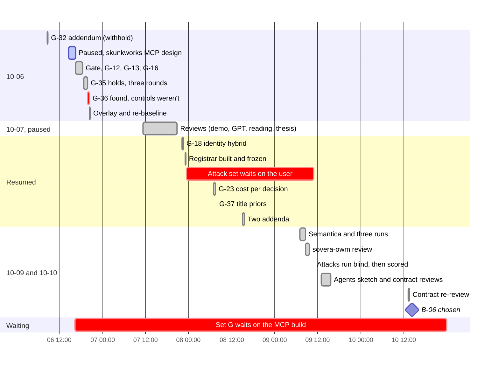
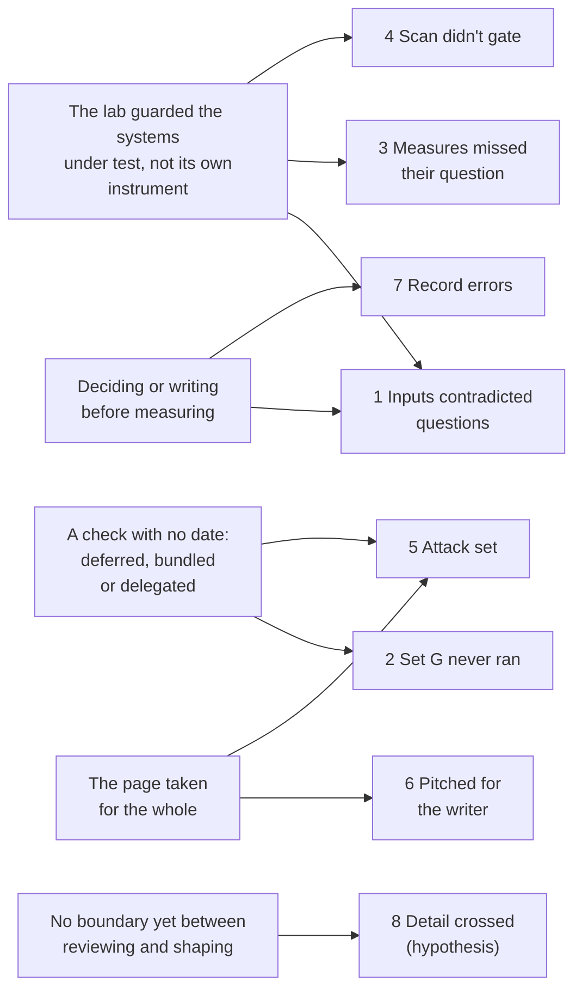

# Retrospective: the punch list, identity, cost and the bake-off (2026-10-06 to 10-10)

**Scope:** five days that started with the register work paused for a skunkworks design and ended
with B-06 chosen. In between:
- the board punch list (admission gate, governed procedures, the rubric rule, holds, the input
  overlay, a new reader baseline);
- a paused day of reviews (demo sequencing, GPT's reviews, a reading list, product type, the
  product thesis);
- the identity hybrid (G-18), cost per decision (G-23), title priors (G-37) and attacks on the
  register;
- Semantica, the knowledge-foundation bake-off, the sovera-owm review, and two reviews for
  garbanzo (the agents sketch, contract v1.2).

**Written by:** the lab's agent on 2026-10-18, from the record rather than from memory of the period.
**Sources:**
- 13 run folders (`runs/2026-10-06-*` to `runs/2026-10-09-*`) and the 10 docs dated 10-07 to 10-09;
- git history: 71 commits on `main`, plus 21 on two branches;
- the Ledger export (gaps G-01 to G-49, with their logs);
- memory;
- the user's typed messages and 35 ruling prompts;
- spot checks in the session transcript.

Times are EDT unless marked Z.

> **Never-load notice.** This file cites recorded runs. Under the lab's rule (CLAUDE.md, 854091d),
> nothing here may be used to tune or shape a foundation under test. Its lessons are about how to
> run, measure and work, never about what a foundation should extract, resolve or answer.

## At a glance

| | |
|---|---|
| Run folders | 13: six on 10-06, one on 10-07, three on 10-08, three on 10-09 |
| Pre-registered before any answer | 12 of 13. The bi-temporal library check had no predictions, and its notes say so |
| Gaps closed | 10: G-04, G-06, G-07, G-12, G-13, G-16, G-32, G-35, G-36 (eight of them in four hours on 10-06), and G-37 |
| Gaps opened | 13: G-34 to G-46 |
| New spend | **$142.55**, all Claude model calls (readers, the identity judge, the bake-off's extractors). Jev cost under a cent, and Utopia nothing |
| Runs at $0 or under a cent | 7 of 13, by replaying recorded judgments |
| User rulings | 35 prompts, 44 answers; 31 took the recommended option |
| User corrections | 3: "way too detailed" (00:26Z 10-06), the thesis review's "no customer" (00:42Z 10-08), and the missing `FORMAT.md` (14:32Z 10-09) |
| Lab errors found by the lab | 8: the S04 call, a recommendation, a cost sum, two committed lint failures, two harness launches, a gold error |
| Secrets leaked | 0. Every commit in the period was re-checked on 10-18; the commit scan wasn't gating (incident 4) |

**Cost estimates against actuals:**

| Run | Estimate | Actual |
|---|---|---|
| G-35 holds: rounds 1, 2, 3 | $15, $7.50, $9.50 | $14.70, $7.53, $9.23 |
| Reader re-baseline | $26 | $25.53 |
| G-18 (3-pair probe first) | $11 | $10.99 |
| G-37, then its no-procedure addendum | $21, $25 | $21.74, $24.91 |
| G-23 (first Haiku arms), then its schema addendum | $16, $4 | $19.16, $4.64 |

Every protocol that had run before landed within 4% of its estimate. The two estimates that
included a model the lab hadn't priced, Haiku, came in 16–20% over.

## Timeline

Two red bars cross the whole period. The attack set waited 35 hours on the user's time. Set G is
still waiting on 10-18 (incident 2). Work done in hours finished in hours; work that waited on
someone else waited for days.

## Incidents, by consequence

### 1. The lab's inputs contradicted its own questions for eight days (G-36)

- **What happened:**
  - 24 of 28 reader questions presented a request "as recorded in" the CRM or ERP export;
  - the exports held only DR-9001 and CR-9201;
  - this had held for every reader experiment since the request-record arm (09-28/29).
  Readers met a contradiction on most scenarios. Some of G-16's 59 "conditional approvals" (06aa41e)
  were readers reacting correctly to it, so a finding filed as reader behaviour was partly caused
  by the lab.
- **How it was found:**
  - G-35's third round ran on fresh scenarios, with controls (de298a8);
  - all 9 controls held, when 0–1 was predicted (F5). "My controls weren't clean" (the lab,
    23:53Z);
  - the scope query then took minutes: 16 of 18 discount and 8 of 10 credit scenarios.
- **Root cause, step by step:**
  1. The question builders asserted where each request was recorded. Experiments 4 and 5 gave
     scenarios their own request ids (S02–S04's from 90a4c5e on 10-02), but the exports kept one
     request each.
  2. The engines take the request as a direct input, so every engine check passed and nothing
     looked wrong.
  3. The lab had guards for the systems under test (sealed attack sets, classifiers, replay
     regression) and none for its own inputs. No check asked whether each record a question
     claims is in the evidence it's paired with.
  4. When the first case surfaced (S04, 437edcb), the lab scoped it as one scenario. The user had
     answered "Your call" (23:47Z). At 23:48:49Z the lab chose to leave S04's input unchanged, to
     keep comparability. It measured the scope three minutes later, at 23:51:47Z, and withdrew the
     call. A standing ruling already said input defects belong to the lab (09-30, #11).
- **The fix:**
  - G-36 was opened at once;
  - the user chose a per-scenario overlay. The lab had first recommended adding the requests to
    the exports, then found that would create duplicates and asked again (incident 7);
  - c033091 is the comparability line, and the re-baseline came back with 0 of 84 answers saying
    their own request was missing (5a1c1d9).
- **Cost:**
  - the $25.53 re-baseline and three rulings;
  - every reader result from the request-record arm (09-28/29) up to c033091 carries the defect;
  - one Ledger finding (G-16) had to be re-read.
- **Patterns:** *The instrument's own fault* (candidate);
  [The arm-independent miss](../patterns.md#the-arm-independent-miss), since the defect was in
  the shared input. **Habit:**
  [Rules from a sample of one](../agent-habits.md#rules-from-a-sample-of-one), for the S04 call.

### 2. A test deferred into a bundle that never came (set G; G-31, G-33)

- **What happened:**
  - the served-register fix (G-31, P1; G-33) had been tested only on the attack that found it;
  - the lab recommended "Later, bundled" into the user's next attack set, and the user agreed
    (00:30Z 10-06);
  - that afternoon the bundle, set G, was tied to the skunkworks MCP server ("Skunkworks first",
    20:18Z);
  - the MCP build, run in another session, stopped after its scaffold and first walls (1848f3e,
    10-08).
  Set G hasn't run. On 10-18, G-31 and G-33 are still partial.
- **The near miss beside it:** the lab recommended the same move for G-35's third sentence, "Fold
  into set G (Recommended)". The user chose "Fresh scenarios now" (23:47Z). That run found G-36
  within the hour. Had the recommendation been taken, incident 1 would still be hidden.
- **Root cause:** a deferred test had no date and no fallback, and its vehicle depended on a build
  the lab doesn't own. Bundling felt efficient, because one fresh set serves several checks. It
  also made each check wait on the slowest piece.
- **Cost:** a P1 fix unverified for 12 days and counting, with no spend.
- **Patterns:** *The bundled test* (candidate).

### 3. Measures that couldn't see their question

Five pre-registered measures missed, and in each case the miss was about the measure, not the
system:

| Run | Measure | What it missed |
|---|---|---|
| Spec admission (8827902) | Gate C, idle reliance on the full decision key | The key included an intermediate field, so over-reliance never counted as idle. P2 and P3 "missed" |
| G-37 addendum (237c45a) | N2, approvals naming the VP | It counted non-approval outcomes with an empty approver |
| Bake-off (41bb685) | K1, "the native span contains the object" | Correct spans anchored on the subject were counted as misses |
| Register attacks (ee786a7) | The scorer's M2 | It reported 6, counting every refused legitimate case. The plan's definition gives 1 |
| G-23 addendum (bf2e64d) | S3, wrong decisions in the rescore code | It counted a missing record as a wrong decision |

- **Two classifier readings** belong here too:
  - one G-35 answer was scored unsafe while being safe in substance;
  - G-32's route-mode classifier judged a forced route by its outcome alone, until the withhold
    rule (`runs/2026-10-06-register-fixes/notes.md`).
- **How they were found:** by reading the misses, not the verdict. Every write-up says which miss
  is the measure's.
- **Root cause:**
  1. Each measure was written as an operational proxy before any data existed.
  2. None was run on a known case before the run: one that should count, and one that shouldn't.
  3. In two cases the scoring code drifted from the plan's own definition.
- **The fix, and what worked:**
  - each run reported the pre-registered number and an exploratory one side by side, labelled;
  - for gate C, the user chose an outcome-level measure (21:14Z 10-06), and it was re-run as its
    own addendum before any spec was re-gated (e8ca7e1).
- **Cost:** one ruling and a re-run, and several "missed" predictions that a reader of the
  headline would misread.
- **Patterns:** *The measure misses the question* (candidate).

### 4. The commit scan printed but didn't gate

- **What happened:** of the 82 commit commands the lab ran in the period, 23 ran the hygiene scan,
  each as a separate step (`scan; git commit`), and 59 ran none. The scan printed its count, and
  the commit ran whatever the count was. Nothing leaked in the period: every commit's added lines
  were re-checked on 10-18, with 0 hits.
- **Why it matters:** on 10-11 the same shape put the owner's email local part into public
  history (3e4ea83). The scan printed the hit after the commit had run, and history was
  rewritten (memory: `commit-hygiene-scan`).
- **Root cause:** the check's result was read by eye, and no exit code governed the action. A
  check whose result nothing depends on reads as a gate, and isn't one.
- **Resolved:** since 10-11 the rule is to gate every commit on the scan's result, `if <scan>;
  then stop; else commit; fi` (memory: `commit-hygiene-scan`).
- **Patterns:** *The advisory gate* (candidate);
  [Success-shaped failure](../patterns.md#success-shaped-failure), its cousin: a check that ran is
  taken for a check that passed.

### 5. The register attack set: not delegable, a missing file, and attacks stopped at the door

- **Delegation failed:**
  - a blind subagent asked to write the sealed attack set wrote nothing, because a safety
    classifier stopped one of its responses (03:20Z 10-08);
  - the lab declined to reword the request or write the attacks itself, and asked the user;
  - it was the second time: set C hit the same wall on 10-03 (ruling, 19:08Z 10-03).
  The user wrote the set. It arrived 35 hours after the stop, while G-23 and G-37 ran.
- **A handoff file was never committed:**
  - "Claude I can't find 'sealed/FORMAT.md' in the folder" (14:32Z 10-09);
  - the lab had written it on 10-07 and never committed it, so it existed only on this machine;
  - the user, away from the desk, was working from GitHub. Fixed in minutes (1a2e8e6).
- **Six of 14 attacks were stopped at the door:**
  - the user's cases were templated, with placeholder text and empty terms;
  - an earlier rule (empty terms) refused six attacks before they reached the rule they targeted;
  - the class P2 most worried about, meaning-changing text, wasn't attempted. It is still
    untested (pinned on G-44, 16:10Z 10-09).
  Measuring which rule fired (M4) made this visible, and post-hoc probes showed the named rule
  firing in 13 of 14.
- **Root causes:**
  - realistic adversarial text trips safety classifiers, and the plan assumed a subagent could
    write it;
  - the files were committed by named paths, with no `git status` on the handoff folder;
  - the brief didn't require each case to be valid apart from its one fault, and the
    registrar's rule order puts the terms check early.
- **Patterns:** *The attack set can't be delegated* (candidate);
  [Second-hand facts](../patterns.md#second-hand-facts): the lab told the user where a file was
  that only its own disk had.

### 6. Reports and reviews pitched for the writer, not the reader

- **Too detailed to decide:** a long set F report ended with three decisions. "Hey Claude this is
  way too detailed for me to make a decision without options and recommendations" (00:26Z 10-06).
  Once the decisions came as options, the user answered at once. This set the shape of all 35
  rulings that followed (memory: `decisions-as-options`).
- **A document's silence taken for the business:** the product-thesis review said there was no
  customer and no evidence for the agent runtime, and it flagged naming inconsistencies. The user
  replied (00:42Z 10-08):
  - design partners exist;
  - the runtime choice came from their research;
  - the naming came from external models and doesn't matter.
  The lab withdrew both points in the doc (e8a8a32).
- **Root cause:**
  - reports were written in the order the work was done, so the decisions came last;
  - the review treated "the document doesn't say" as "it isn't so". The user's commercial context
    lives with the user, not in the documents.
- **Patterns:** [Second-hand facts](../patterns.md#second-hand-facts).

### 7. Small errors in the record and the repo

- **A sum done in the head:** G-35's readers were reported to the user as $33.46; the true figure
  is $31.46. It was corrected the next morning in the notes, the Ledger and memory (7876ee9).
- **A recommendation before its consequence:** the lab recommended "Add them to the exports" for
  G-36 at 23:54Z, and the user approved it at 00:06:05Z. Within a minute the lab asked again: it
  had found that one shared export would put several pending duplicates in front of every
  scenario. The check came after the recommendation, not before.
- **Ledger log times typed by hand:**
  - nearly every log entry the lab wrote from 10-05 to 10-09 carries a round time;
  - some are local time labelled Z: G-23's "started 06:40Z" is the 06:53 EDT commit 23fd2f9;
  - others are invented: G-35's "tested 13:00Z" is b6f71d3 at 22:52Z, and G-45's first entry,
    "created 22:00Z", comes before an entry stamped 16:32:10Z the same day.
  This retrospective nearly took them at face value.
- **Lint committed:**
  - the G-16 scripts went in unformatted, and were fixed in a follow-up (e9ff1fb);
  - f2a322b added two long lines in `runs/`. The other session's fix (c240d33) stayed on its
    branch, and on 10-18 `uv run ruff check` fails on `main` with 71 errors, all in `runs/`
    scripts.
- **Harness first launches failed twice, before any call** (ff38d9d, 32b4528). Cheap, because
  both crashed before spending.
- **Root cause:** writing a number, a time or a recommendation before reading it from the source,
  and committing or launching before the cheap gates (lint, a dry launch) had run.
- **Patterns:** [Provenance before it exists](../patterns.md#provenance-before-it-exists).

### 8. Scenario-level detail crossed to the builder before the never-load rule (hypothesis)

- **What happened:**
  - the contract v1.2 review's paste-ready reply to garbanzo named one scenario's trap and showed
    it replaying through the API (`docs/contract-v1.2-review-2026-10-09.md`);
  - the agents-sketch review was checked against `truth/scenarios/` and cited facts from it;
  - the bake-off ran BlueLeaf's chosen extraction stack on the Northstar corpus, against a gold
    taken from the register's terms and the HR export, and published per-fact errors in a public
    repo.
- **Why it's a hypothesis:**
  - all of it predates the never-load rule (10-16) and its extension to anything derived from the
    answers (854091d, 10-18);
  - guard 2 (10-17) checked B-20's prompt, few-shots and classes against the trap table, and they
    passed;
  - nothing has checked whether the decision contract, which these reviews shaped, touches
    anything the exam measured.
- **Root cause:** in this period no rule separated reviewing a builder's design from shaping it.
  Checking a design against `truth/` felt like rigour.

## How the incidents connect

**Five root causes for eight incidents.** The costliest, incident 1, sits where two of them meet:
an instrument with no guard on itself, and a call made before its scope was measured.

## What worked: keep doing it

- **Pre-registration before code, addenda before re-runs, every miss reported:** 12 of 13 runs. A
  post-freeze fix found by a smoke test was disclosed in `freeze.md` (11d1cf8) before the attack set
  existed.
- **Controls in the design, and confirmation on fresh items.** The failed control found G-36. G-35's
  wording was tuned on eight scenarios and confirmed on ten it had never seen.
- **Pre-registered and exploratory numbers side by side,** each labelled. That includes the
  bake-off's gold error, corrected after scoring with both numbers kept.
- **Replay first:**
  - 7 of 13 runs cost $0 or under a cent;
  - every kernel change was followed by a byte-identical regression over every committed harness
    (P5).
- **Blind by construction:**
  - the user's attack set was committed as received (29e5e45);
  - it was run with the labels unread and committed (b0697b0), then unsealed and scored (ee786a7),
    all in seven minutes.
- **Declining to work around a safety refusal,** and offering the user the choice, with what each
  option does to blindness.
- **Cost probes and early guards:**
  - G-18 priced itself from three pairs;
  - every reader run stopped if its first 6–8 calls averaged over a set figure;
  - known protocols landed within 4%.
- **Extreme numbers checked for a harness bug before reporting:** Semantica's 18,402 false merges
  were traced to its scoring rule before they went out.
- **A desk review followed by cheap measurement:** the Semantica evaluation was a read of the
  repo, and three runs costing $0 to $4.12 then tested its claims.
- **A buildability review against the code before planning:** the MCP spec's B1–B15 found three
  contract changes and no blocker.
- **Re-reviewing the revision, not only the fixes:** the contract re-review found that the fix
  for one hole opened a double-issue path.
- **The board as options with a recommendation:** eight gaps closed in four hours (16:31 to 20:31
  on 10-06). G-16's decision had waited on the user since 10-02, and took one click.
- **Pause labels** (`register-paused-2026-10-06`, `board-paused-2026-10-06b`) made every resume
  clean.
- **Errors corrected everywhere they went:** the cost sum and the S04 call were both withdrawn in
  the notes, the Ledger and memory, and to the user.
- **A commercial claim refuted in the open:** G-23's "a cheap model on the OWM's slice is as safe
  as Opus on everything" failed, and the notes lead with it.

## Insights

### About measuring

- **A control that fails is an instrument alarm first.** Before reading it as behaviour, check that
  the control's inputs are what the design says they are.
- **When a builder writes a claim about the inputs, check the claim against the inputs.** "As
  recorded in the CRM" was generated text, and nothing compared it with the CRM.
- **Run each measure on a known positive and a known negative before the run.** Five measures in
  five days would have shown their blind spot on a hand-built case.
- **Tune on one set, confirm on another.** Wording tuned on the same items will look right on them.
- **Score the record apart from the judgment.** G-23's strict rule mixed empty approver fields with
  wrong decisions. Enforcing the record format took record defects from 9 to 0, and left the
  judgment errors standing.
- **Latency and cost follow output length, not input length.** A quarter of the input tokens cut
  Opus's cost by 68%, but its latency only to 93%. Haiku on the same slice cost half as much as Opus
  ($0.048), not the tenth predicted, because it writes about three times as much.

### About cost and time

- **Replay makes governance experiments nearly free.** Recorded judgments let the gate, the
  registrar, governed procedures and the attacks run for $0.
- **Price new things from a probe.** Repeated protocols landed within 4%; each new model or arm
  overran by 16–20%.
- **The binding limits were people's time and other builds, not dollars.** $143 bought 13 runs.
  Meanwhile the attack set waited 35 hours, and set G has waited 12 days.
- **A paused day isn't lost.** The reviews of 10-07 put G-37 to G-42 on the board, and G-37 ran
  the next morning.

### About working with the user and agents

- **The user delegates method and keeps strategy.** 31 of the 44 recorded answers took the
  recommendation. Where the user departed from one, it was about priorities ("Skunkworks first",
  "Interleave", "Not now", "Not yet") or a test's timing ("Fresh scenarios now"). That timing call
  found the period's biggest defect.
- **A high take-rate is a reason to make each decision easy to read, not a reason to stop.** The
  user said so the next day: diagrams "mitigate humans rubber stamping approvals… I'm guilty of
  that myself" (15:47Z 10-11).
- **The user's commercial context isn't in the documents.** Design partners, research behind a
  choice and the product's name are theirs. Ask before asserting an absence.
- **The user often works from GitHub, away from the desk.** Anything a handoff names must be
  pushed, and `git status` on the handoff folder is part of the handoff.
- **Adversarial sets are the user's to write.** Safety classifiers stop subagents, and the user's
  sets are blinder anyway (G-39).
- **Paste-ready replies for garbanzo, then a re-review,** closed three P1s in a day (b9ab487 to
  896f3f4).

## Decisions to keep, and to revisit

| Decision | Verdict |
|---|---|
| A per-scenario overlay for G-36, leaving `truth/` and `dataset/` untouched | Keep. No dataset tag churned, and the engines didn't change. The email residual (32 of 84 answers notice it) is still open |
| Adopt the `conditions` field and its three sentences together with the fix, breaking comparability once at c033091 | Keep. One break, named, beats two |
| Gate C on the outcome, not the full key | Keep. The mirror test (G-34) is still open |
| Set G only through the MCP server | **Revisit.** Twelve days blocked on a build the lab doesn't own. A plain harness run would test G-31 and G-33 now |
| Bundle fresh tests into the next set | **Revisit.** It never ran once, and was overridden once, which found G-36 |
| The user writes adversarial sets | Keep. It's blind, and it avoids safety refusals. Give the brief a "valid except one fault" rule |
| Pin the meaning-changing-text test (G-44) | Keep pinned, but test it before any claim that registration can't be tampered with, as the notes say |
| R2 (two judges agree) as the identity default, R1 as an opt-in (G-18) | Keep, pending stage 2 on fresh data |
| Enforce the record format for any agent that decides (G-23 addendum) | Keep |
| sovera-owm refactored by extension; the demo API on the `owm-decisions` contract from day one | Keep. B-06 was built on it from 10-11 |
| Docling plus langextract over Semantica's extractor | Keep. It was measured, not argued |
| Run BlueLeaf's chosen extraction stack on the Northstar corpus (the bake-off) | **Revisit** under B-20's rule that Northstar is the exam, never practice. Use the practice bench for tool comparisons |

## Open questions and actions

Each was checked against later docs, runs, memory and the Ledger on 10-18.

- [ ] **Set G (G-31 P1, G-33):** the fresh test of the served register hasn't run. The MCP build's
  last commit was 1848f3e (10-08). **Question for the user:** run set G through a plain harness
  now?
- [ ] **G-18 stage 2:** the fresh-seed confirmation still waits on the user's go. G-18 has been
  partial since 10-08.
- [ ] **G-23:** a cheap model that *retrieves* is untested. G-23 is partial.
- [ ] **G-44:**
  - the meaning-changing-text test is pinned;
  - the registrar's refusals gained `unmatched` and `fix` fields on 10-11 (d4474ae, 64ba07b), but
    G-44's log doesn't record it. **The lab:** log it.
- [ ] **G-43, G-34 and G-39 are open.**
  - G-36 is new evidence for G-39, the "who checked the checker" gap: the designer's own instrument
    hid an input defect for eight days.
  - **The lab:** add it to G-39's log.
- [ ] **Two re-baseline follow-ups were never done.** Neither is in `owm/procedures` on 10-18:
  - the one-line rule "if the explanation says to wait, the condition is blocking";
  - a document overlay for the email residual.
- [ ] **The lab:** make `uv run ruff check` pass on `main`. It fails with 71 errors, all in `runs/`
  scripts, two from this period's f2a322b. Runs are never rewritten, so exclude `runs/` or add
  per-file ignores.
- [ ] **The lab:** take Ledger log times from `date -u`, never typed. Note on the Ledger that
  entries from 10-05 to 10-09 carry approximate times.
- [ ] **Question:** should every headline reader number carry its comparability line (before or
  after c033091)? The 10-07 demo docs cite pre-line numbers without one.
- [ ] **Question (hypothesis, incident 8):** check whether anything shared with garbanzo before 10-16
  touches what the 10-17 exam measured. Guard 2 covered only B-20's prompt, few-shots and classes.
- [ ] **For the next attack set:** each case is valid apart from its one fault. A dry pass confirms
  that each case reaches its named rule before the sealed run.

**Resolved since:** the commit scan has gated the commit since 10-11 (incident 4). Decisions come
as options with a recommendation since 10-06 (incident 6).

## Follow-up (2026-10-18, appended)

- **`uv run ruff check` on main:** the user ruled to exclude `runs/` from lint, since runs are
  recorded results kept as they ran (pyproject `extend-exclude`). Lint passes on main.
  `ruff format --check` still flags two plan documents in `docs/superpowers/plans/`, in Python
  blocks inside markdown.
- **Set G (G-31 P1, G-33):** the user ruled to run it on its own, without waiting for the MCP build.
