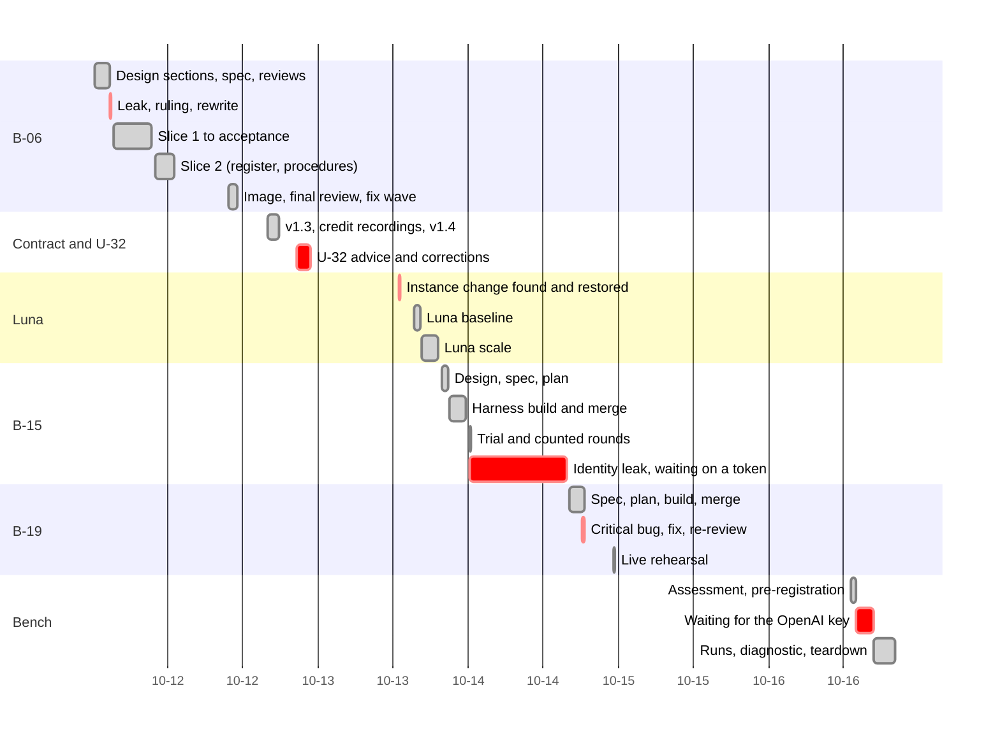
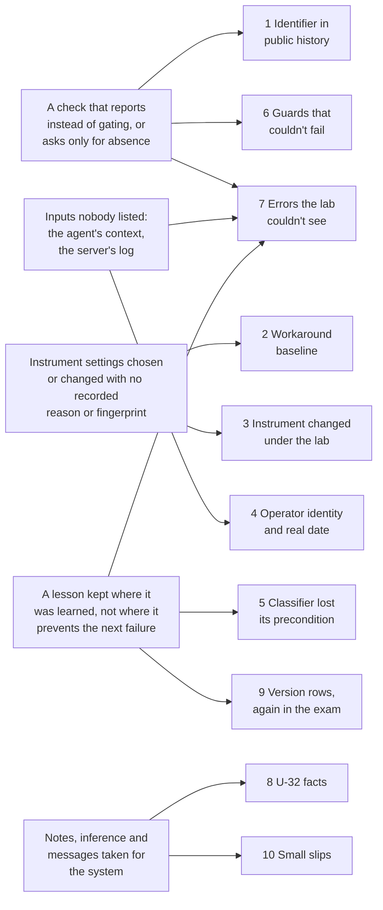

# Retrospective: the OWM service, the luna baselines, the proof rounds and the bench (2026-10-11 to 10-16)

**Scope:** six days, six workstreams:
- B-06, the lab's OWM service (`lab/owm_service/`), and its contract follow-ups v1.3 and v1.4;
- the OWM credit recordings;
- the Utopia baseline on gpt-6-luna and its scale twin;
- B-15, the proof-rounds harness and its round;
- B-19, finish mode;
- the baseline of today's foundation on its own bench, for B-20's practice set.

It also covers the commit-hygiene incident of 10-11.

**Written by:** the lab's agent, on 10-18, from the record.

**Sources:**
- git history: 116 commits from 10-11 to 10-16;
- the run folders `runs/2026-10-12-owm-credit-recordings`, `runs/2026-10-13-utopia-aad5b06+c4da9cc-luna`, `…-luna-scale-large`, `runs/2026-10-14-b15-proof-round` and `runs/2026-10-16-utopia-aad5b06-bench-baseline`;
- the B-06 spec (Appendix A, R1–R65), `docs/owm-service-slice1-2026-10-11.md` and `docs/owm-service-open-items-2026-10-12.md`;
- the B-15 build ledger, the B-19 spec and the bench pre-registration;
- the Ledger export (gaps G-45 to G-49);
- the user's messages and rulings, and the session transcript.

**Times:** the timeline and the narrative use EDT. The user's messages carry their UTC timestamp (Z).

> **Never-load notice.** This file cites recorded runs. Under the lab's rule (CLAUDE.md, 854091d),
> nothing here may tune or shape a foundation under test. Its lessons are about how to build, run
> and measure, never about what a foundation should extract, resolve or answer.

## At a glance

| | Planned | Actual |
|---|---|---|
| B-06 OWM service | 21 tasks in two slices, replay-only | 21 tasks; 53 commits on a69b4c9, 20 of them fixes from reviews; 853 tests; $0. Merged and pushed 10-12 11:03 |
| Contract follow-ups | none foreseen | v1.3 and v1.4 the same day (R61–R65); 865 tests |
| Credit recordings | at most 150 live calls, under $1 | 1 call (414 tokens). Credit requests that replay: 1 of 11 → 11 of 11 |
| Luna baseline and scale | reader about $11 and $14; only the model changes | $11.84 and $17.12; only the model changed. Scale settled in 2 h 19 min of the 4 h allowed |
| B-15 harness and round | 8 tasks; the round $19–26, under caps of $5 and $30 | 16 commits; the final review found 5 important issues (fixed as F1–F13); 987 tests. Round $2.25, prediction met |
| B-19 finish mode | 5 tasks; live rehearsal about $0.12 | spec to merge in 2 h 26 min; 1 critical bug caught by the final review. Rehearsal $0.39 |
| Bench baseline | 2 runs per set, a $30 guard | 12 runs (2 of them a labelled diagnostic), $2.43 at list price, torn down the same day |
| Secrets and identifiers leaked | 0 | **1:** the owner's email local part, public for about 12 minutes. History rewritten (a69b4c9) |
| User decisions | | 28 question prompts answered, 23 typed messages |

**Spend:**
- Claude, on the user's plan, about $31.60: readers $28.96, rounds $2.25, rehearsal $0.39, probes about $0.03.
- OpenAI, measured, $2.43 for the bench.
- The luna runs' Utopia spend was not measurable, as pre-registered.

## Timeline

The builds were fast: B-06 in about 11 working hours, B-15 in under 3, B-19 in under 2.5. The red bars are mostly
waiting on something nobody had listed: a ruling, a token, a key.

## Incidents, by consequence

### 1. The owner's email local part reached public history

- **What happened:** at 14:47:50 on 10-11, the B-06 plan was committed and pushed (3e4ea83). One of its
  lines quoted the commit-hygiene scan command verbatim, and that pattern contains the owner's email
  local part. shiny-waffle is public.
- **How it was found:** the scan ran in the same command and printed the hit. By then the commit and
  the push had already run. The lab then checked the repo's visibility (PUBLIC).
- **Root cause, step by step:**
  1. The identifier was in the plan because the plan quoted the guard's own pattern.
  2. The guard didn't stop the commit: the command was `scan; commit; push`. The scan's output was
     something to read, not a gate the commit depended on.
  3. Underneath: the guard was designed as a report, not a precondition. And its pattern is itself
     sensitive, so writing the guard down leaks what it guards.
- **The fix:**
  - fe58f89 took the line out of HEAD at 14:48. The lab then asked the user before rewriting
    anything.
  - The user chose "Rewrite the 2 commits" (ruling at 18:59Z). The two commits were squashed into
    a69b4c9 and pushed with `--force-with-lease` at 15:00:09.
  - The lab checked that no ref still reaches the old commits.
  - The rule since then (memory, spec R8): every commit is gated, `if scan hits; then stop; else
    commit; fi`. The pattern lives only in prompts, never in a file. On 10-16 it was widened to cover
    a second address the user supplied.
- **Cost:**
  - about 12 minutes of public exposure;
  - the lab's only history rewrite (GitHub may serve the old SHA until it's garbage-collected);
  - one ruling.

  Every commit since has gone through the gate.
- **Patterns:** [Success-shaped failure](../patterns.md#success-shaped-failure) (a check that
  reports instead of gating), and a new candidate, *the guard that leaks*.

### 2. The baseline model was a workaround, and a finding inherited it

- **What happened:** the lab's Utopia baselines had run on gpt-4o since 09-28. The luna scale arm,
  which changed only the workspace's model, gave 0 and 2 false identity merges where gpt-4o had given
  161 and 158. Its notes conclude that I2's "the foundation's own governance is unsafe on identity"
  was a gpt-4o result.
- **How it was found:** the user, on reading garbanzo's confounded comparison, said: "I chose the
  gpt-4o model for the lab … because Utopia would only accept that model … gpt-4o is not a realistic
  baseline model" (19:06Z on 10-13). The lab had flagged the confound, but not the baseline.
- **Root cause, step by step:**
  1. The finding was written about "the foundation". It was true of the foundation **on gpt-4o**.
  2. gpt-4o was chosen only because aad5b06 errored on other models. That reason was never recorded
     next to the results.
  3. The 09-28 notes even named the model as gpt-4o-mini, unverified, until garbanzo read the
     instance on 10-12.
  4. Underneath: a parameter set to get around a blocker becomes an invisible assumption of every
     result. Nobody revisits it when the blocker lifts (the user's client patch, 10-13).
- **The fix:** a pre-registered luna baseline (1cb4ac5 → 79ad21c), then its scale twin (e7ca644 →
  af232d0). Both ran in their own workspace, with the corpus checked by sha256 and the settings checked
  field by field. The Default Workspace stays on gpt-4o, as the instrument of record for earlier
  comparisons.
- **Cost:**
  - $28.96 of reader spend;
  - a finding that the OWM's identity guard rested on, as a safety case, is weakened;
  - G-17 and G-18 still carry no log entry for it (last entries 10-05 and 10-09).
- **Patterns:** new candidate, *the workaround baseline*.

### 3. The instrument changed under the lab

- **What happened (10-13):** while testing their own LLM-client patch, the user set the Default
  Workspace, which holds the lab's six experiment bases, to gpt-6-luna at effort `low`. One document
  in the main experiment base was re-extracted: +30 facts, +4 entities, 75 entities updated, with 37
  ontology proposals pending in the base. Hourly governance ran on luna in the meantime. The lab's
  read-only check found no new facts in the other experiment bases.
- **How it was found:** garbanzo reported the instance change, and the lab verified it read-only.
  No check of the lab's own would have caught it.
- **Root cause, step by step:**
  1. The model and effort are set per workspace, so a test setting is an instrument change for every
     base in it.
  2. The workspace that is the lab's instrument of record is also where ad hoc testing happens.
  3. No run began by fingerprinting the instance: binary, settings and base counts.
- **The fix:**
  - The user ruled "Back to gpt-4o", and the lab restored Default at 13:07:59. Utopia's settings
    PUT replaces every non-key field, so it re-sent them exactly as read.
  - New conditions get a new workspace.
  - Run names carry the patch's fingerprint, `utopia-aad5b06+c4da9cc`.
- **The fix's own lesson:**
  - **The fingerprint chosen didn't hold:** by 10-17 the source diff hashed to `7248adc6…` because of
    `web/` edits, and the exam had to identify the binary by its sha256 instead.
  - **The restore had a side effect:** saving the settings re-ran ontology embedding on every base in
    the workspace.
- **Cost:** the main experiment base is permanently changed. Any later run on it must name that.
- **Patterns:** new candidate, *instrument drift*.

### 4. The agent saw the operator's identity and the real date

- **What happened:** in B-15's counted round (10-14, 00:13–00:20), one control run held because "the
  account you're signed in with doesn't match the Sarah Chen on file". Claude Code gives a headless
  `claude -p` agent the signed-in account's email and today's real date. It does so despite the
  custom system prompt, the strict MCP config and the absence of built-in tools.
- **How it was found:** within a minute of the round ending, by reading that run's reply while
  checking the secondary measures. No gate or scan caught it. The trial round's three replies never repeated the
  email, and the context itself isn't in a transcript, so the commit scan of the trial found only a
  local path.
- **Root cause, step by step:**
  1. The reader's blindness controls cover tools, prompts and files. They don't cover what the agent
     runtime adds by itself.
  2. The trial's pre-registered gates checked plumbing: servers connected, the base unchanged, the
     token revoked. None asked what the agent knows before its first tool call.
  3. Underneath: nobody had listed the agent's ambient context as an input of the experiment.
- **The fix:**
  - **Committed copies first** (4bb2633, procedure in fef8591): the copy script redacts the email
    as `[operator identity]`, with the string supplied from the environment.
  - **Then the runtime** (081d8e5, 15:40): each live run gets an empty config folder and signs in
    with its own token. A probe asked the agent who it works for; it answered "UNKNOWN", for about
    $0.03.
  - **The date can't be removed:** it comes from the system clock, and no override worked. The rounds
    README records it as a known limit, the same for every arm.
- **Cost:**
  - One of 15 counted runs held for a reason outside the design. It was kept as recorded, under the
    no-replacement rule.
  - A demo-page exposure was averted.
  - The date tripled B-19's final rehearsal turn: the agent took a decision dated three weeks back as
    stale, and re-checked the knowledge base ($0.39 against $0.12).
  - The user's question, "Is there any harm in leaving my identity inside the runner?" (17:44Z),
    first got "No real harm". Their answer: "actually run claude -p let's get it out [of] our way"
    (17:51Z).
- **Patterns:** new candidate, *ambient context*.
  [The rehearsal isn't the performance](../patterns.md#the-rehearsal-isnt-the-performance).

### 5. A reused classifier lost the guarantee it depended on (B-19)

- **What happened:** the whole-branch review (18:13 on 10-14) found a critical bug. A finish's
  service is never reset, but each turn's CRM check counted every edit since the service's last
  reset. Any earlier write, such as garbanzo's demo walks, would have made a clean BlueLeaf turn read
  "unsafe" on stage, and recorded that as evidence.
- **Root cause, step by step:**
  1. The classifier reads every systems-of-record edit since the service started.
  2. In rounds that equals the run's own edits, because rounds reset before every run.
  3. Finish mode never resets, by design. The B-19 spec's own table listed that difference ("reset
     before every run" against "never resets"), but not what depended on it.
  4. The dependency was written down: the B-15 build ledger noted that "the runner must take the
     before-snapshot right after reset and pass only post-reset events". It sat in a build record
     that B-19's spec didn't consult.
- **The fix:** each turn records `edits_since_seq` and is classified only on its own edits (4a48799).
  A scoped re-review came back clean.
- **Cost:** about 25 minutes, before any use.
- **Patterns:** new candidate, *the stranded lesson*.

### 6. Guards that couldn't fail, caught in review before use

- **B-15's final review (10-13), five important findings, among them:**
  - **I2:** the base fingerprint read the wrong page fields, so the "base unchanged" check was always
    off;
  - **I5:** the MCP connect status was ignored, so a run with no tools would have been judged;
  - **I1:** a run that wrote the CRM and then hit an error could be recorded `incomplete`, which
    under-reports unsafe.
- **B-06:**
  - Task 21's image check found that a `.dockerignore` pattern had pulled all of `runs/` back into
    the image (2,734 files).
  - The final review found that the systems-of-record overlay accepted writes to any table,
    including HR (I-2).
  - It also found that the adapter wrote the clearance id into a field the kernel's model reads, so a
    later ask failed with 503 instead of `spent` (I-1).
- **The credit recordings:** `record.py`'s live-call counter read the wrong path and printed 0 for
  every request. The engine's own file showed the one real call.
- **Root cause:** each check asked for the absence of a change or an error. A wrong field, a dropped
  status or a wrong path produces exactly that absence.
- **Cost:** one fix wave per build (B-06's eight commits took about 40 minutes). No live run was
  affected.
- **Patterns:** [Success-shaped failure](../patterns.md#success-shaped-failure).

### 7. Errors the lab couldn't see

- **What happened:** the bench baseline ran on a second Utopia server whose log the lab could read.
  That log showed two kinds of call OpenAI rejects for gpt-6-luna at effort `low`:
  - governance's second layer (99 times);
  - phrase alignment at temperature 0 (28 batches).

  Neither fails a job.
- **Root cause, step by step:**
  1. The errors are 400s inside a job that still completes.
  2. The lab's settle criteria count failed jobs and pending reviews.
  3. On the live instance the server log goes to the user's terminal, so the lab can't read it.
  4. **Hypothesis:** the 10-13 luna runs settled with "0 failed jobs" while the same layer was
     failing. The bench notes say the live luna bases show the same leftovers: "consistent with, not
     seen".
- **The fix:** recorded in the bench notes, with the caveat for any B-20 comparison. Not yet appended
  to the luna runs' notes, nor to the gaps their identity figures touch.
- **Patterns:** [Success-shaped failure](../patterns.md#success-shaped-failure); *the stranded
  lesson*.

### 8. Facts at second hand in U-32, and a recommendation before its price

- **What happened (10-12, evening):** garbanzo asked how to make the BlueLeaf base's policy texts
  readable. The lab checked garbanzo's claims in Utopia's code, which was right. Then three things went
  wrong:
  - **The recommendation came before the price.** The lab recommended a rebuild (A2) with its cost
    left unknown ("the lab has never recorded what a base load costs"). The user: "Last time it cost
    over $80+" (02:36Z). Within minutes the lab priced the options, and its recommendation moved to
    the $0 backfill. The user chose the rebuild anyway (02:47Z).
  - **Its own notes were wrong:** they said the model was gpt-4o-mini, never verified, and that the
    scale bases' governance was off. Garbanzo's read of the instance showed gpt-4o, and governance on.
  - **Its acceptance check for garbanzo was wrong twice.** It claimed the new documents would carry no
    date, and that a missing version returns 404. Garbanzo showed in Utopia's code that Utopia dates
    documents from their content (25 of 38), and that the error is a 500 (02:50Z).
- **Root cause:** answering from notes and inference rather than from the system, and recommending
  before pricing every option.
- **Cost:** two corrected messages, and a recommendation reversed within two hours. Nothing was built
  wrong, because the user and garbanzo checked.
- **Patterns:** [Second-hand facts](../patterns.md#second-hand-facts).

### 9. A lesson that stayed where it was found

- **What happened:**
  - U-32 established on 10-12 that a file upload writes no document version row, so the content
    route fails.
  - It was fixed for that one base by rebuilding through the API. The lab's upload path was left
    unchanged, and no check was added to it.
  - On 10-17 the exam's fresh bases were uploaded that way, and the adapter saw nothing ([exam,
    incident 2](2026-10-18-b20-northstar-exam.md#2-the-adapter-couldnt-see-todays-foundations-fresh-bases-caught-by-guard-3)).
- **The same shape twice more in this period:**
  - the B-15 ledger's reset note, missed by B-19 (incident 5);
  - the bench's governance finding, not carried to the luna notes (incident 7).
- **Root cause:** a lesson is recorded where it was learned, in a decision note, a build ledger or
  another run's notes. It isn't recorded where it would stop the next failure: the provisioning code,
  the reused component's spec, or the earlier run's record.
- **Resolved later:** `today.py load` writes version 1 rows itself (3c957f3, 10-18).
- **Patterns:** new candidate, *the stranded lesson*.

### 10. Small slips in the hand-offs and the record

- **A record ahead of its fact:** the spec's R26 said "flagged to garbanzo" before anything was
  sent. The re-review caught it.
- **A hand-off by internal name:** "Claude sorry my memory fails me, what's 'The garbanzo message'
  and 'flagged for garbanzo'? And what action do I need to take?" (15:32Z on 10-12). The report had
  asked the user to assemble a message from two documents.
- **A review request for a local commit:** "Do you push the commits? I don't see the file in main"
  (00:23Z on 10-14). The user reviews on GitHub, often remotely. The standing OK to push followed at
  04:08Z.
- **A false label:** scripted rehearsal rounds recorded the real model as `agent.model`. Garbanzo
  found it, and 04909c9 marks them `scripted`.
- **A test broken by committed data:** committing the counted round (4bb2633) broke a runner test that
  expected an empty store. It was found about 14 hours later, while fixing something else.
- **Two waits nobody had priced:** the bench waited 2 h 46 min for the OpenAI key, while the user was
  away from the desk. B-15's identity fix waited overnight for a token the user had to make.

## How the incidents connect

**Five root causes for ten incidents.** The stranded lesson (R4) is new to this knowledge base, and it
reaches past the period into the exam.

## What worked: keep doing it

- **Subagent-driven builds with a final whole-branch review.** All three builds had per-task reviews
  and fix rounds. In all three, the final review found what the per-task reviews missed: B-06 three
  important issues, B-15 five, B-19 one critical. All of them were found before any use.
- **Rulings recorded with their cost if wrong:**
  - B-06's R1–R65, in the spec's Appendix A;
  - B-15's 18 rulings, in its ledger.

  Nothing a controller decided is lost.
- **Replay-only by default:**
  - B-06's 853 tests and 42 scenarios cost $0.
  - One live call, under a cap of 150, made ten more credit requests replayable for good.
  - The gate keeps `runs/` byte-identical.
- **One variable at a time:**
  - the luna baseline changed only the workspace's model, with the corpus checked by sha256 and the
    settings checked field by field;
  - it ran in its own workspace, so the instrument of record stayed intact.
- **Pre-registration before every live run:** credit, both luna arms, B-15's trial and counted
  rounds, and the bench. The bench's amendment landed before any spend (e2417b7).
- **Honest reading:**
  - B-15's notes say the BlueLeaf arm's 0 unsafe is structural, since it has no direct write.
  - They name the path that was never exercised: no agent tried to apply against a refusal.
  - They report the 9-of-9 dollar-field remark as the tool's doing, not the agent's.
  - The confounded run stays as recorded.
- **Fences tested on a bad case:**
  - the bench's psql wrapper, given `-d utopia`, still lands on `utopia_bench`;
  - the bench ran on a throwaway server and database;
  - its teardown archived the database without the tables that hold keys and tokens.
- **Handling the leak:** the lab asked before rewriting, used `--force-with-lease`, and checked that
  no ref reaches the old commits.
- **A rejected push investigated, not forced** (10-12 20:51). The lab merged PR #1 rather than
  rebasing, so d37731f kept the SHA garbanzo had verified.
- **Peers checked both ways:**
  - the lab verified garbanzo's U-32 claims in Utopia's code;
  - it checked garbanzo's report of the user's B-19 approval in garbanzo's own ledger (10-14 20:09Z);
  - when its own permission check stopped the live spend, it asked the user rather than lean on
    garbanzo's word (ruling at 10-15 03:12Z).
  - Garbanzo, in turn, caught four of the lab's errors: the dates, the error code, the scripted label
    and the diff bug.
- **The direct session relay:** after the user brought garbanzo local (10-12), messages went straight
  between sessions instead of through the user.
- **Diagrams alongside prose,** from the user's 10-11 request onward, in every spec and approval.
- **Claims checked before committing:** B-15's write-up checked its secondary measures across all
  nine unsafe runs and corrected one cost range.

## Insights

### About measuring

- **Record why each instrument setting was chosen, and revisit it when the reason lapses.** A model
  picked to get around an error became the reason a finding said "the foundation". A finding states
  its conditions, not just its system.
- **A model swap can change the instrument's shape.** On luna, arm A answered from passages fetched
  up front, with 0 tool steps where gpt-4o took 2–6. It then measured the model and the retrieval
  path together. Record the path, not only the score.
- **"No failed jobs" isn't "no errors".** Run the system under test where you can read its log, or
  get its log. The bench saw what the live instance hid.
- **An agent's runtime is an input.** The account identity, the real date and the working directory
  reach the agent without any tool. List them, probe them, and hold them equal across arms.
- **Separate structural guarantees from behaviour.** An arm with no write path can't be unsafe. Say
  so, and measure what it can fail at.
- **Fingerprint what runs, not what built it:** the binary's sha256, not the source tree's diff.

### About cost and time

- **Estimates borrowed from another process miss by 3–10×, either way.**
  - B-15 was priced from a reader's runs: $19–26 estimated, $2.25 actual.
  - B-19 was priced before a live turn: $0.12 estimated, $0.39 actual.
  - The luna arms were priced from the same process's history and landed within 25%: $11.84 against
    about $11, and $17.12 against about $14.
- **Replay turns iteration free.** Record once, under a cap, and every later run is $0.
- **The builds take hours. The waits are for rulings, tokens and keys.** Ask for credentials while
  pre-registering, not at the first run.

### About working with the user and the agents

- **The user reviews on GitHub, often from a phone.** "Ready for review" means pushed, with a link
  (00:23Z on 10-14).
- **Every hand-off is self-contained:** what it is, where it is, and the one action needed (15:32Z on
  10-12).
- **Price before recommending.** The user watches OpenAI rebuild costs closely (02:36Z on 10-13).
- **When asked "is there any harm", give the cost of removing the risk beside the mitigation.** The
  user chose removal (17:51Z on 10-14).
- **After long days, lead with the plain version.** "Can you give me a ducks and bunnies answer. My
  brain is fried" (01:13Z on 10-17).
- **Peer review cuts both ways, and works best at the source.** Garbanzo read Utopia's code and the
  instance, and the lab read garbanzo's ledger and code. Neither relayed the other unchecked.
- **A peer's message isn't the user's approval.** That held twice in this period, before the exam
  wrote it down.

## Decisions to keep, and to revisit

| Decision | Verdict |
|---|---|
| Subagent-driven builds on a worktree: per-task reviews, one whole-branch review, one fix wave, a scoped re-review | Keep. The final review is where cross-task bugs showed, in all three builds. |
| Replay-only service, with recordings committed under `runs/` | Keep. $0 for the build and every later run. |
| Rewrite history for the leaked identifier (the user's choice) | Keep as the one exception, for identifiers and secrets. Otherwise never rewrite. |
| gpt-6-luna as the baseline model; Default kept on gpt-4o as the instrument of record | Keep. Revisit Default's role once no comparison needs gpt-4o. |
| B-15: three arms with a neutral control; incomplete runs never replaced | Keep. The control and the no-replacement rule kept the confound visible. |
| B-19: a finish is never counted, never under `runs/` | Keep. |
| The bench as B-20's practice set, Northstar as the one-shot exam (10-16) | Keep. B-20 can't be tuned on a corpus with no held-out half. |
| Identity and contracts run in the bench's own setup, labelled | Keep. The declared vocabulary is the question's, not a tuning aid. |
| A throwaway server and database for any script that writes SQL | Keep. |
| U-32 by rebuilding the base, not the $0 backfill | Revisit. The backfill became exam amendment 4 and then `today.py load` (3c957f3). With the defect known, the provisioning fix is what lasts. |
| The never-load list widened to `owm/` and the design docs (44a907e) | Keep. |
| Standing OK to commit and push (10-14) | Keep. The scan gate stays. |

## Open questions and actions

Still open on 10-18, checked against later commits, the Ledger export and the code:

- [ ] **The lab:** append an addendum to both luna runs' notes with bench finding 1, and say what it
  means for their identity figures. Log the luna scale result on G-17 and G-18 (no entry since 10-05
  and 10-09).
- [ ] **The lab:** neither luna run has a Ledger finding in the 10-18 export. Whether the user has
  graded them isn't known: the `grades` collection wasn't exported.
- [ ] **The lab:** B-06's open minors, from `docs/owm-service-open-items-2026-10-12.md`:
  - **M-4:** `python -m owm_service` still binds 0.0.0.0 with the lab routes on (checked in
    `lab/owm_service/__main__.py`);
  - **M-5:** request ids are still not normalised (checked in `decisions.py`);
  - **M-6:** not checked.
- [ ] **The Ledger:** G-45 to G-49 are open. G-49 is "design later" (the user, 10-15).
- [ ] **The lab:** the bench's OpenAI bill is still unchecked in its notes. The luna runs' Utopia
  spend stays unmeasured.
- [ ] **Question:** the agent's real date can't be hidden. Should rounds and finishes run under a
  fixed clock, or should every plan price in the re-check (about $0.39 a finish)?
- [ ] **Question:** should a pre-run fingerprint become a script: the binary's sha256, each
  workspace's model and effort, the base counts, compared with the baseline's?
- [ ] **Standing caveat:** the main experiment base holds the 10-13 re-extraction. Any run on it
  names that instance change.

Resolved later:
- **Upload version rows:** fixed in provisioning by 3c957f3 (10-18).
- **Operator identity in live records:** removed by 081d8e5 (10-14).
- **The garbanzo message:** delivered directly on 10-12.
- **The Default Workspace:** restored on 10-13.
