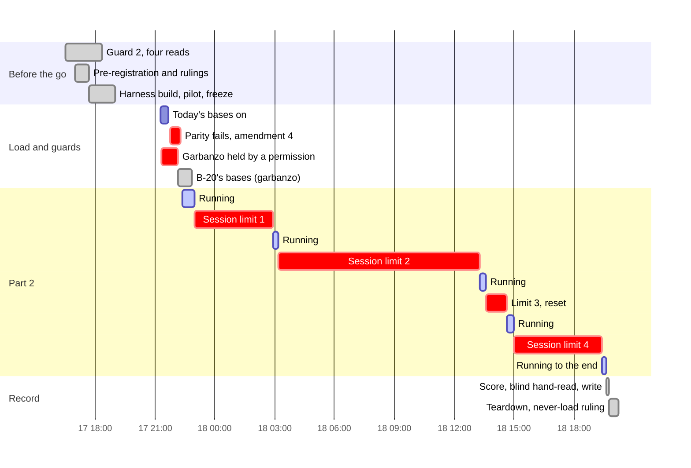
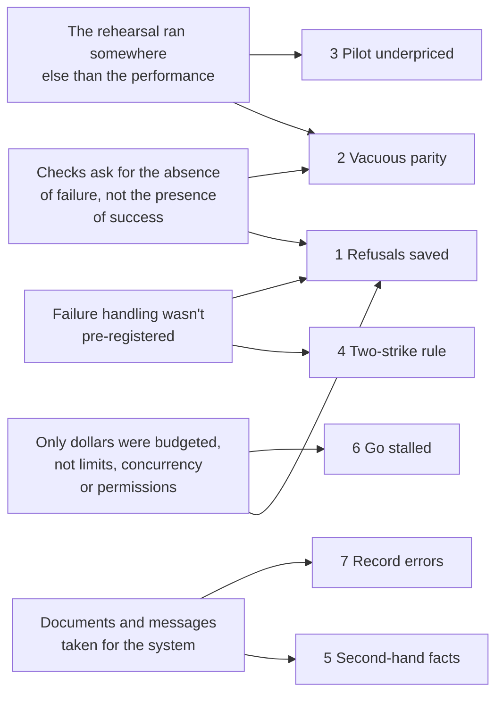

# Retrospective: B-20's Northstar exam (2026-10-17 to 10-18)

**Scope:** the lab's side of B-20's one-shot exam, from guard 2's first review to the teardown.
That covers the review, the pre-registration, the harness build, the pilot, the freeze, the run,
the scoring and the record.
**Written by:** the lab's agent, the day the exam was recorded, at the user's request.
**Sources:** the run's `notes.md` and `results.md`, the pre-registration (amendments 2–4), git
history (27 commits), and the session itself.

> **Never-load notice.** This file cites a recorded exam. Under the lab's rule (CLAUDE.md,
> 854091d), nothing here may be used to tune or shape a foundation under test. Its lessons are
> about how to run and measure, never about what a foundation should extract.

## At a glance

| | Planned | Actual |
|---|---|---|
| Bases loaded | 9 in one window | 9 in one window (3 today's foundation, 6 B-20) |
| Answers | 564 (47 × 4 runs × 3 arms) | 564, plus 203 refused attempts set aside |
| Part 2 wall-clock | one day | 21 h 16 min (22:21 on 10-17 to 19:37 on 10-18), about 3 h of it running |
| Reader spend | cap $180, raised to $550 after the pilot | $402.39 ($13.98 of it refused attempts) |
| Amendments after pre-registration | none foreseen | 3 (2: slimming and the stop; 3: how P2/P4 are judged; 4: version rows) |
| User rulings during the run | none foreseen | 4 (the version fix, "resume", the account limit not counting, "GO" on $115 more) |
| Harness defects found during the run | 0 expected | 3 (vacuous parity, refusals saved as answers, the two-strike rule) |
| Secrets leaked | 0 | 0 (every commit scanned, the archive checked) |

## Timeline

The red bars are the story. The run spent about 3 hours answering and 18 waiting on limits that
no plan had priced.

## Incidents, by consequence

### 1. Refusals saved as answers (203 attempts, four stops, two days)

- **What happened:** at 22:58:57 the account hit its session limit. Every `claude -p` call then
  answered "You've hit your session limit" at once, for $0. The reader saved each one as an
  answer:
  - 186 by the first stop: a whole pass of today's foundation in 14 seconds, and most of both
    B-20 arms' first passes;
  - 131 of the judge's runs as well.
- **How it was found:** not by any check. The lab's own session hit the same limit and stopped.
  After the resume, one log line looked wrong: a pass of 47 answers ending in 14 seconds. Each
  answer took 250 ms and cost $0.
- **Root cause, step by step:**
  1. Claude Code reports that refusal as `is_error: true` with subtype **`success`**, and the
     reader treated a non-empty stdout as an answer.
  2. The lab's monitor classified results by `subtype`, so it saw success.
  3. The first inventory after the stop counted answers by `subtype` too, and reported "nothing cut
     off". That was true, and missed the point.
  4. Underneath all three: no check asked for **positive evidence of an answer** (work done, money
     spent, a decision present). Each asked only for the absence of a failure label.
- **What made it worse:**
  - **Three arms at 10 workers together** burned the account's window quickly. Nobody had piloted
    at that concurrency.
  - **The lab's own session shares the account's limit with the workload.** The batch starved the
    session supervising it, four times.
- **The fix (lab 901da02, 70054d8):**
  - `infra()` classifies by content;
  - a refused attempt is kept aside as `*.infra-error-<k>.jsonl`, and the run halts;
  - the scorer skips those files, and `judge.py --resume` re-asks only refused runs;
  - the account's own limit never counts toward a question's two strikes.
- **Cost:** $13.98 spent, 18 hours of waiting, and two of the user's rulings. No real answer was
  lost or asked twice.
- **Patterns:** [Success-shaped failure](../patterns.md#success-shaped-failure),
  [The unpriced limit](../patterns.md#the-unpriced-limit).

### 2. The adapter couldn't see today's foundation's fresh bases (caught by guard 3)

- **What happened:** all three bases loaded cleanly. Then the adapter answered every search with
  200 and **no hits**. The first version of `parity.py` passed this: nothing failed to match,
  because nothing came back.
- **How it was found:** reading the pass's numbers rather than its verdict: adapter 0, today 380.
- **Root cause, step by step:**
  1. The adapter needs a recorded document version to serve text, passages and hits.
  2. Today's foundation writes no version row for a file upload (`create_from_upload`). It found
     this by reading Utopia's source, after reading the live database was rightly refused.
  3. The harness was dry-run on BlueLeaf's **live** base. That base has version rows, because it
     was loaded another way. So the exam's freshly loaded bases were never run in a rehearsal.
  4. The same defect had been worked around on 10-12 for the live base, but the fix was never put
     into provisioning.
- **Also:** the adapter cached the empty version lists, so web-next had to be restarted after the
  fix.
- **The fix:**
  - parity now fails on an empty answer (4caf4fd);
  - version 1 rows were written the way Utopia's own adopt path writes them (amendment 4, the
    user's choice, ae2098d);
  - after the run, `today.py load` writes them itself (3c957f3).
- **Cost:** about 35 minutes, and one amendment, before any score.
- **Patterns:** [Success-shaped failure](../patterns.md#success-shaped-failure),
  [The rehearsal isn't the performance](../patterns.md#the-rehearsal-isnt-the-performance),
  [Cached absence](../patterns.md#cached-absence).

### 3. The pilot priced the run at a quarter to a half of its cost

- **What happened:** the pre-registered cap was $180. The pilot's answers cost 2–4 times the
  estimate: all-tools answers about $0.40, graph-only ones $0.75–2.03. Slimming the tool output cut
  35–45%. The user raised the stop to $550, and the run spent $402.
- **Root cause:** the first estimate was an average, before any graph-only answer had run. Cost is
  driven by tool turns, and turns grow when the graph is weak: today's foundation needed 47 calls
  per graph-only answer, B-20 27–29.
- **What did work:** after the pilot, a per-question model. It priced each remaining answer from
  the same question's earlier cost on the same arm, and predicted $115 for the last 121 answers.
  They cost $123.
- **Patterns:** [The rehearsal isn't the performance](../patterns.md#the-rehearsal-isnt-the-performance).

### 4. A failure rule made mid-run, then corrected by the user

- **What happened:** the plan had no rule for an attempt that fails on an API error. One was set at
  22:56: keep it aside, ask once more. That was before any B-20 answer, but after today's first
  pass was in. After the first stop it was hardened: two strikes, then the user decides.
- **What went wrong with it:** by the second stop, four questions had two strikes. Both were the
  account's limit, which says nothing about the question.
- **Root cause:** the rule didn't separate causes local to a question from causes that hit every
  question at once. It was designed under pressure, from the one failure seen so far.
- **The fix:** the user ruled that the account's own limit never counts (70054d8).
- **Patterns:** [Rules born mid-run](../patterns.md#rules-born-mid-run).

### 5. Facts at second hand

- **Relayed ids:** garbanzo relayed six kb ids from a progress notice, and they were wrong. The lab
  never used them: it read the ids from :8200's own K1 and matched them by name.
- **The lab's own claims, during the build:**
  - "no reader has run on credit or SLA": experiments 5 and 6 had;
  - "the live base holds MANIFEST.yaml": it didn't. That claim came from a plan's "39 files", and
    the base has 38 documents.

  Both were said to the user before they were checked, and both were corrected.
- **Root cause:** treating a document, or a message, as the system it describes.
- **Patterns:** [Second-hand facts](../patterns.md#second-hand-facts).

### 6. The go stalled in the other session

- **What happened:** the user's "go" reached the lab. Garbanzo's auto-mode permission check then
  refused its exam script, which waited on the user's approval in that session.
- **Root cause:** approval is per session. The runbook listed every step, but not every permission
  each session would need.
- **Cost:** about an hour before B-20's load began. The lab carried on with today's side meanwhile.
- **Patterns:** [The unpriced limit](../patterns.md#the-unpriced-limit), since permissions are a
  limit too.

### 7. Small errors in the written record

- **In the notes:** a placeholder time ("22:3x") and a wrong cross-reference ("this commit's
  parent") were committed. Both were fixed in follow-ups.
- **In the results draft:** two wrong claims, both caught before the commit by checking each
  claim against the data:
  - "today's foundation doesn't serve x-holds": the adapter does;
  - "the ids-on arm puts identifiers on no documents": it puts them on 1.
- **Root cause:**
  - writing provenance before it exists (a commit's own hash, a time not yet known);
  - writing from memory of the data rather than from the data.
- **Patterns:** [Provenance before it exists](../patterns.md#provenance-before-it-exists).

### 8. Garbanzo's once-only script crashed on macOS bash 3.2

- **What happened:** an empty array under `set -u` counts as unbound on bash 3.2. One empty base
  was created before the script stopped.
- **Why it cost little:** the script refused partial state. The store was checked, deleted, and the
  run restarted from fresh. It's recorded here because the guard was the lesson, not the crash.

## How the incidents connect

**Five root causes for eight incidents.** Two of them, checking for absence and rehearsing
elsewhere, account for the costliest three.

## What worked: keep doing it

- **Pre-registration with numbered, timed amendments,** and the user's rulings taken as options
  with a recommendation. Every deviation is on record, with its reason and who decided.
- **Corpora pinned by hash:** every file was checked before the first upload, on both sides.
- **Sealing across sessions:** garbanzo watched counts only, and no result crossed before the
  record.
- **Blind by construction:**
  - the judge never learned the foundation;
  - the hand-read packet was shuffled with a recorded seed, its labels stripped, and matched back
    with a separate key.
- **A resumable reader:** after four stops, no answer was lost or asked twice.
- **Halting on a refusal,** once it was built: the second, third and fourth stops each cost minutes.
- **Reading the source, not guessing:** the version-row cause was found in Utopia's code. The
  permission check had refused reading the live database, rightly, so the lab took the safer path.
- **Checking every claim before committing a report:** it caught two wrong claims in
  `results.md`.
- **A per-question cost model:** it predicted $115, and $123 was spent.
- **Teardown with a secret-free archive:** the key- and token-bearing tables were left out, and
  the archive was checked for key prefixes before anything was dropped.
- **The commit scan gate on every commit:** zero findings, across 2,277 files in the record commit.
- **Peers checked, not trusted:** garbanzo's ids, its docs commits and its `web-next` diff were
  each checked at the source before they were relayed or relied on.

## Insights

### About measuring

- **An end-to-end score with a fallback path hides the part you meant to measure.** With all
  tools, the reader drew 70–75% of its calls from text tools, and the three arms decided alike.
  Only the graph-only condition showed the foundations apart. Design every comparison with an
  isolating condition next to the realistic one.
- **A gold-evidence ceiling turns a score into a gap.** Credit reached its ceiling, 9 of 10 per
  run, so its misses weren't the foundations'. SLA sat 1–3 below its own ceiling on every arm.
- **Safety counts that ignore abstention reward giving up.** In experiment 6's rule, no decision is
  never unsafe. So the arm that stopped without deciding looked safer than the arm that decided and
  was sometimes wrong. Always report the decision rate beside the unsafe rate.
- **A miss identical on every arm is about the instrument, not the arms.** One case: the reader's
  prose and its decision block disagreed in the same way on every arm. Report such misses apart,
  with their cause.
- **One extraction per base is one sample.** Nearly identical corpora on one frozen sha gave
  P5 counts from 15 to 51. Before attributing a difference between systems, measure how much a
  system differs from itself.

### About cost and time

- **Turns are the cost, and a weak graph multiplies turns.** All-tools answers cost about $0.30.
  Graph-only answers cost $0.76–0.89, with 27–47 calls each.
- **The binding limit is rarely the dollar cap.** $402 of $550 was spent, but four session limits
  turned a one-day run into two. Account limits, concurrency, permissions and wall-clock all
  belong in the budget.
- **The supervisor and the workload share one account.** A batch that burns the account's window
  also stops the agent supervising it, mid-sentence. Leave the supervisor headroom: lower
  concurrency, or a separate budget.

### About working as two agents and a user

- **Approval doesn't travel.** A "go" in one session is not a permission in another. List each
  session's permissions in the runbook, and have them cleared before the go.
- **Relay nothing you didn't read at its source.** That includes ids, commits, and "nothing
  changed".
- **Sealing works when the other side cooperates by design.** Garbanzo watched only counts, said
  so, and kept to it, so no result had to be policed.
- **When the user is away, a halt beats a guess.** Every stop ended in a short report with
  options, and the user's rulings were one or two words each.

## Decisions to keep, and to revisit

| Decision | Verdict |
|---|---|
| Run B-20 both ways (identifier rules on and off) from one sha | Keep. It turned an argument into a measurement. |
| One contract reader for both foundations, with slimmed output | Keep. It made one tool surface possible, and the slimming cut 35–45% of cost. |
| Dry-run the harness on the live base | Revisit. Rehearse on a fresh instance through the exam's own load path. |
| Run all three arms concurrently, 3–4 workers each | Revisit. Pilot at that concurrency against the account's limits first. |
| Version-1 backfill instead of patching the adapter | Keep. It changed neither system's code or extraction, and the reason is on record. |
| A blind Sonnet grader for the hand-read questions, with the user's grades over it | Keep. It's cheap, blind and auditable. |

## Open questions and actions

- [ ] **The user:** hand review of S02/S03, the reader's prose against its decision block; and
  Ledger grades for the hand-read questions.
- [ ] **The lab:** make `reader.py` record a pass's start and end time, and refuse to start when
  the account's recent refusal rate is high.
- [ ] **The lab:** a pre-flight script that loads one file into a fresh throwaway instance and runs
  parity before an exam.
- [ ] **Question:** should exam reruns of the reader be budgeted in account-limit windows, not
  dollars, with a pre-registered maximum concurrency?
- [ ] **Question:** should the SLA scorer report decision rate and unsafe rate together, as the
  primary safety figure?
