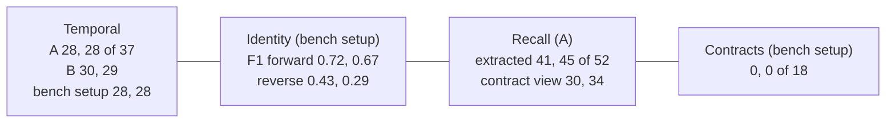

# Today's foundation on the B-20 practice set: baseline run (2026-10-16)

**Status: run complete; scored with the bench's own scorers.** A labelled contracts
diagnostic on gpt-5.6-luna was added the same day (addendum at the end). The contract-path
scoring (garbanzo's scorers through web-next's adapter) is still to come; its read access is in
place. The instance and `utopia_bench` stay up until both scorers have read the bases.

| | |
|---|---|
| **Pre-registration** | `docs/foundation-bench-baseline-preregistration-2026-10-16.md` at c11b4af, copied here as `preregistration-copy.md` (§8 = Amendment 1, the user's rulings) |
| **System** | Utopia aad5b06, a second server on 127.0.0.1:1526, ephemeral database `utopia_bench` |
| **Models** | `gpt-6-luna` at reasoning effort `low`, `text-embedding-3-small` (BlueLeaf's base's settings) |
| **Scripts** | Copied from aad5b06 (`bench-files-aad5b06.sha256`). Patches in `lab-scripts/bench-patches.diff`, drivers in `lab-scripts/` |
| **SEC files** | 4 NVIDIA filings and 15 Blackbaud HQ lease-chain files, fetched 2026-10-16 (`sec-filings.sha256`) |
| **Spend** | $1.74 at gpt-6-luna list price ($0.10 / M input, $0.50 / M output), cached input not discounted, so this is a ceiling. The guard was $30. OpenAI's usage page gives the bill |

## Headline

- **Temporal:**
  - **Arm A** scores 28/37 on both runs. Every world-axis failure is a missing closure (the
    Aurora lead's handover, the corrected start, the salary correction, a title that ended on an
    unknown date). The record axis scores 14/14 in every run.
  - **Declaring** the corpus's axioms (arm B) gives 30 and 29. That's +1.5, inside the bench's
    ±2, so it counts as **no difference** by the pre-registered rule.
  - The bench's own setup (no pack, declared) gives 28 and 28.
- **Recall:** the bench's scorer reads 41 and 45. Through the contract view, without
  `statement_qualifiers` and `time_mentions`, it's 30 and 34. **11 items per run** are reachable
  only through those two tables (listed below). That's a finding about today's foundation (§4),
  not an adapter bug.
- **Identity:**
  - Precision is high and recall low. Forward order gives F1 0.72 and 0.67; reverse order 0.43
    and 0.29, consistently worse.
  - Governance on (arm C) is no different, given the run-to-run spread.
- **Contracts: 0/18 on both runs**, against the bench's own record of 5–12 (DeepSeek-V3.2,
  2026-09-13). See finding 2.

## Findings

### 1. Today's foundation makes two calls that OpenAI rejects for `gpt-6-luna`

Both are 400s from `/v1/chat/completions`, in the instance's own log:

| Call | OpenAI's answer | Where it hit | Effect |
|---|---|---|---|
| Governance, second layer (`utopia_server::governance`) | "Function tools with reasoning_effort are not supported for gpt-6-luna in /v1/chat/completions. To use function tools, use /v1/responses or set reasoning_effort to 'none'." | Every run in every set: 99 times | The first layer (the adjudicator) works: 586 applied keeps and 31 applied merges across the bench. What the second layer should review is left for a human: 92 resolution reviews are `human`/`pending`, and the agent decisions still `proposed` or `unsure` are never ruled on |
| Phrase alignment (`utopia_server::phrase_alignment`) | "Unsupported value: 'temperature' does not support 0.0 with this model. Only the default (1) value is supported." | 28 batches: recall 8 and 12, contracts 3 and 5 | Those batches' phrases aren't bound to a declared predicate in that pass. Most passes complete: 147 started, 147 finished |

- **Not a bench artefact.** BlueLeaf's workspace on the live instance has the same settings
  (`gpt-6-luna`, effort `low`, `text-embedding-3-small`; read-only, no secrets read). The live
  luna bases of 2026-10-13 show the same leftovers: `proposed` and `unsure` agent decisions,
  and `human`/`pending` reviews.
- **Not checked:** the live server's log. So for the live instance this is "consistent with",
  not "seen".
- **For the B-20 comparison:** today's foundation loses these calls on this model. If B-20 runs
  on the same model, the comparison is like for like on the model, and the losses are today's
  foundation's own. Every comparison should carry this caveat.

### 2. Contracts: nothing reaches the declared predicates

- **What the bases hold.** Both bases hold typed `lease`, `amendment`, `property` and
  `organization` entities. But they hold no fact on `landlord`, `tenant`, any deadline, the
  acreage or the price: only `known_as`, `amends` and `effective_date`, plus open statements.
- **Where it stops.** In run 1, phrase alignment bound **9 of about 270** phrases. 238 were
  judged to match no declared property. The phrases are boilerplate ("shall inure to the
  benefit of", "shall be binding upon", "dated", "supersedes"), not the lease terms.
- **The drops.** "A statement's subject is not a listed thing": 95. "A statement's object is not
  a listed thing; written as a value": 90.
- **The cause.** Mostly what luna at effort low extracts from these amendments through this
  pipeline. The 3–5 failed alignment batches (finding 1) cost a little more.
- **What these runs can't tell.** They can't separate the model from the foundation. The bench's
  own record used DeepSeek-V3.2 and got 5–12.

### 3. Recall items the contract can't see (pre-registration §4)

The scorer was run a second time on the same bases, without the `statement_qualifiers` and
`time_mentions` columns (`lab-scripts/bench-patches.diff`, `recall-contract-view.mjs`). These items
are hit only through them:

| Item | What | Run 1 | Run 2 |
|---|---|---|---|
| `nvda-8k-2026-08-17-exhibit` `oh-2028` | 分阶段自 2028 年起上线 |  | ✓ |
| `nvda-8k-2026-08-17-exhibit` `oh-fund` | $40 million 社区基金 | ✓ |  |
| `nvda-8k-2026-08-17-exhibit` `oh-grid` | 至少 $4.2 billion 电网投入 | ✓ | ✓ |
| `nvda-8k-2026-08-17-exhibit` `oh-gw` | 至少 10 GW 新增发电 | ✓ | ✓ |
| `nvda-8k-2026-08-17-exhibit` `oh-invest` | NVIDIA 投资 SB Energy $1.5 billion | ✓ | ✓ |
| `nvda-8k-2026-08-17-exhibit` `oh-itgw` | 8 IT-GW 的 AI factory 容量 | ✓ |  |
| `nvda-8k-2026-09-02` `acq-fy-end` | 财年结束于 2026-01-25 | ✓ |  |
| `nvda-8k-2026-09-02` `acq-price` | 对价约 $11.9 billion | ✓ | ✓ |
| `nvda-8k-2026-09-02` `acq-retention` | 留任股权计划最高约 $1.0 billion | ✓ | ✓ |
| `nvda-8k-2026-09-02` `ticker` | 股票代码 NVDA |  | ✓ |
| `nvda-q2fy27-earnings-release` `er-buyback` | 回购授权余额约 $99.0 billion |  | ✓ |
| `nvda-q2fy27-earnings-release` `er-div` | 股息 $0.25 每股 | ✓ | ✓ |
| `nvda-q2fy27-earnings-release` `er-div-record` | 股息登记日 2026-09-10 | ✓ | ✓ |
| `nvda-q2fy27-earnings-release` `er-return` | 返还股东约 $26.0 billion | ✓ | ✓ |

11 in run 1, 11 in run 2, 8 in both, 14 distinct. The item text is the bench's own (`scripts/bench/truth/nvda-public-docs.json`), in Chinese.

### 4. Arm B was run as arm A plus the declarations

- **The failed first attempt.** The schema-org pack already holds `person`, `organization`,
  `project`, `works_for` and `job_title`. The bench's own declaration step POSTs them, so arm B's
  first two attempts stopped at setup with a 409, before any extraction (no spend).
- **The patch.** Behind `BENCH_ARM=A`, the declaration step now reuses the pack's types. It
  PATCHes the declared axioms onto existing relation types (the same body as the bench's own
  `acceptUniqueness`) and creates only what the pack lacks. Runs `r1b` and `r2b` are that arm.
- **Kept.** The pack's `job_title` stays a *relation*, while the corpus declares a functional
  attribute; the PATCH body has no `kind`.
- **A labelled extra.** The bench's own temporal setup was run twice as a reference, as for
  identity and contracts: no pack, its declarations, the server's default flags. It is reported
  beside the arms, never instead of them.

### 5. Noise

- Every run is reported. Recall's two runs differ by 4 (σ ≈ 2.7), contracts' by 0.
- Identity's spread is wide. Forward-order anchors missing: 6 against 11 for the bench setup;
  F1 0.643 against 0.688 under governance. One run per order isn't evidence.

## Results, every run

Base ids are kept so the contract-path scorers can read the same bases.

### Temporal (37: 23 world axis, 14 record axis)

| Arm | Run | All | World | Record | Absent | Failed questions | Base |
|---|---|---|---|---|---|---|---|
| A | temporal-armA-r1 | 28/37 | 14/23 | 14/14 | 0 | aurora-lead-2024-08, aurora-lead-2025-06, aurora-lead-2025-10, aurora-lead-now, aurora-lead-corrected-start-2023-01-20, lin-zhao-salary-2024-06, lin-zhao-salary-now, lin-zhao-title-ended-unknown, zhou-qi-employer-2024-06 | `01a14675-b9c8-7852-9fe2-1462936c38d2` |
| A | temporal-A-r2 | 28/37 | 14/23 | 14/14 | 0 | aurora-lead-2024-08, aurora-lead-2025-06, aurora-lead-2025-10, aurora-lead-now, aurora-lead-corrected-start-2023-01-20, lin-zhao-employer-2023-07, lin-zhao-salary-2024-06, lin-zhao-salary-now, lin-zhao-title-ended-unknown | `01a14683-c820-7da2-b0de-1bb3004d59d2` |
| B | temporal-B-r1b | 30/37 | 16/23 | 14/14 | 0 | aurora-lead-2024-08, aurora-lead-2025-06, aurora-lead-2025-10, aurora-lead-now, aurora-lead-corrected-start-2023-01-20, lin-zhao-employer-2023-07, lin-zhao-title-ended-unknown | `01a146d5-7438-7961-bb17-7740bbb8d44f` |
| B | temporal-B-r2b | 29/37 | 15/23 | 14/14 | 0 | aurora-lead-2024-08, aurora-lead-2025-06, aurora-lead-2025-10, aurora-lead-now, aurora-lead-corrected-start-2023-01-20, lin-zhao-employer-2023-07, lin-zhao-title-ended-unknown, zhou-qi-employer-2024-06 | `01a146d8-1754-7231-a8ae-7fcfc69aba40` |
| bench setup | temporal-bench-r1 | 28/37 | 14/23 | 14/14 | 0 | aurora-lead-2024-08, aurora-lead-2025-06, aurora-lead-2025-10, aurora-lead-now, aurora-lead-corrected-start-2023-01-20, lin-zhao-employer-2023-07, lin-zhao-title-ended-unknown, li-si-employer-2022, zhou-qi-employer-2024-06 | `01a146da-648a-7252-87bd-72562c4b4434` |
| bench setup | temporal-bench-r2 | 28/37 | 14/23 | 14/14 | 0 | aurora-lead-2024-08, aurora-lead-2025-06, aurora-lead-2025-10, aurora-lead-now, aurora-lead-corrected-start-2023-01-20, lin-zhao-employer-2023-07, lin-zhao-title-ended-unknown, li-si-employer-2022, zhou-qi-employer-2024-06 | `01a146dc-2317-7401-8154-82702cb2630e` |

### Identity (21 anchors, 8 entities; pairwise P/R/F1)

| Arm | Run | Order | P | R | F1 | False merges | False splits | Anchors missing | Pending reviews | Base |
|---|---|---|---|---|---|---|---|---|---|---|
| bench setup | identity-bench-r1 | forward | 1 | 0.563 | 0.72 | 0 | 7 | 6 | 2 | `01a1467a-3fc8-7643-ab18-ff4accfedd75` |
| bench setup | identity-bench-r1 | reverse | 0.5 | 0.375 | 0.429 | 6 | 10 | 3 | 3 | `01a1467e-b1b1-7ba3-9265-663cb150503b` |
| | | order disagreement | 2/66 pairs | | | | | | | |
| bench setup | identity-bench-r2 | forward | 1 | 0.5 | 0.667 | 0 | 3 | 11 | 1 | `01a14685-ac1b-7c33-b58d-a3d9cb10f656` |
| bench setup | identity-bench-r2 | reverse | 1 | 0.167 | 0.286 | 0 | 10 | 8 | 2 | `01a1468c-0c29-7930-b17c-db7c9f12f19f` |
| | | order disagreement | 0/28 pairs | | | | | | | |
| C (governance on) | identity-C-r1 | forward | 0.818 | 0.529 | 0.643 | 2 | 8 | 2 | 3 | `01a146c0-d529-7d40-981b-11764a88362c` |
| C (governance on) | identity-C-r1 | reverse | 1 | 0.143 | 0.25 | 0 | 6 | 10 | 3 | `01a146c5-75e2-7792-97bb-abe5101ebfd0` |
| | | order disagreement | 0/45 pairs | | | | | | | |
| C (governance on) | identity-C-r2 | forward | 0.647 | 0.733 | 0.688 | 6 | 4 | 3 | 2 | `01a146c9-eab3-7ff3-bded-f4d03ef8143a` |
| C (governance on) | identity-C-r2 | reverse | 0.5 | 0.353 | 0.414 | 6 | 11 | 2 | 2 | `01a146ce-8e39-7d03-beb5-fbdf1b52c040` |
| | | order disagreement | 2/120 pairs | | | | | | | |

### Recall (52 items)

| Arm | Run | Extracted (bench scorer) | Contract view (no qualifiers / time mentions) | Edges | Values | Predicate | Base |
|---|---|---|---|---|---|---|---|
| A | recall-A-r1 | 41/52 | 30/52 | 9/12 | 31/39 | 1/1 | `01a14691-2cbb-75c3-abfc-fbae9a32d368` |
| A | recall-A-r2 | 45/52 | 34/52 | 9/12 | 35/39 | 1/1 | `01a146a2-f120-7682-b5a1-dd75ccaef047` |

### Contracts (18 questions, bench scorer)

| Arm | Run | Right | Partial | Lease entities with landlord/tenant | Base |
|---|---|---|---|---|---|
| bench setup | contracts-bench-r1 | 0/18 | 0 | 0 | `01a146b0-f875-7551-ae38-d2768c21bb28` |
| bench setup | contracts-bench-r2 | 0/18 | 0 | 0 | `01a146b8-2a4d-75b1-8f9a-a97b5957d3f7` |

### Tokens and list-price dollars (gpt-6-luna, from the server log)

| Set | Arm | Run | Calls | Prompt | Completion | Cached | $ at list | Minutes |
|---|---|---|---|---|---|---|---|---|
| temporal | A | temporal-armA-r1 | 45 | 64,494 | 7,063 | 1,414 | 0.0100 | 1.8 |
| temporal | A | temporal-A-r2 | 44 | 63,169 | 8,983 | 2,828 | 0.0108 | 2.1 |
| temporal | B | temporal-B-r1b | 43 | 63,673 | 6,780 | 2,828 | 0.0098 | 2.9 |
| temporal | B | temporal-B-r2b | 44 | 64,193 | 6,874 | 1,469 | 0.0099 | 2.5 |
| temporal | bench setup | temporal-bench-r1 | 41 | 50,939 | 6,408 | 2,828 | 0.0083 | 1.9 |
| temporal | bench setup | temporal-bench-r2 | 43 | 51,194 | 6,133 | 2,961 | 0.0082 | 1.9 |
| identity | bench setup | identity-bench-r1 | 174 | 185,826 | 30,594 | 24,038 | 0.0339 | 10.2 |
| identity | bench setup | identity-bench-r2 | 176 | 189,183 | 30,520 | 24,297 | 0.0342 | 12.6 |
| identity | C (governance on) | identity-C-r1 | 188 | 200,480 | 28,778 | 36,835 | 0.0344 | 9.9 |
| identity | C (governance on) | identity-C-r2 | 196 | 209,652 | 30,264 | 40,504 | 0.0361 | 10.2 |
| recall | A | recall-A-r1 | 301 | 5,412,979 | 233,329 | 36,764 | 0.6580 | 19.4 |
| recall | A | recall-A-r2 | 291 | 4,781,336 | 221,498 | 45,248 | 0.5889 | 15.3 |
| contracts | bench setup | contracts-bench-r1 | 277 | 570,463 | 181,401 | 91,910 | 0.1477 | 7.8 |
| contracts | bench setup | contracts-bench-r2 | 277 | 559,530 | 191,354 | 86,254 | 0.1516 | 8.9 |
| **all** | | | 2140 | 12,467,111 | 989,979 | 400,178 | **1.74** | |

The usage windows run from each run's start to its end. Their sum equals the whole log since the
first run (2,140 calls, $1.74), so no spend fell between runs. The raw lines are in `outputs/llm-usage-lines.log` (2,141: the runs plus the key test call before them, 13 prompt tokens). Temporal arm B's two failed
attempts (`temporal-B-r1`, `temporal-B-r2`) made no LLM call.

## Still to do

- [ ] **Contract-path scoring** (pre-registration §4): garbanzo's scorers through web-next's
      adapter, against the bases above. Read access is in place (addendum, "Access").
- [ ] **The bill:** dollars from OpenAI's usage page.
- [ ] **Teardown:** drop `utopia_bench` and stop the :1526 server once both scorers have read the
      bases.

## Addendum (2026-10-16, same day): contracts diagnostic on gpt-5.6-luna

**Asked by the user** after seeing 0/18: tell the model apart from the foundation. This is a
labelled diagnostic, never the baseline. It's the bench setup as above, with only the bench
workspace's chat model switched to `gpt-5.6-luna` (effort `low`, same embeddings), then switched
back to `gpt-6-luna`.

| Arm | Run | Right | Partial | Lease entities with landlord/tenant | Base |
|---|---|---|---|---|---|
| bench setup | contracts-bench-r1 | 0/18 | 0 | 0 | `01a146b0-f875-7551-ae38-d2768c21bb28` |
| bench setup | contracts-bench-r2 | 0/18 | 0 | 0 | `01a146b8-2a4d-75b1-8f9a-a97b5957d3f7` |
| diagnostic: gpt-5.6-luna | contracts-bench-diag56-r1 | 2/18 | 0 | 1 | `01a146ee-5289-73b3-8330-dcd4d695f3e4` |
| diagnostic: gpt-5.6-luna | contracts-bench-diag56-r2 | 0/18 | 0 | 0 | `01a146f6-be81-76e2-94b1-f3bd416802e3` |

| Run | Calls | Prompt | Completion | Cached | $ at list | Minutes |
|---|---|---|---|---|---|---|
| contracts-bench-diag56-r1  |  275  |  554,293  |  195,213  |  80,598  |  0.3451  |  9.2 |
| contracts-bench-diag56-r2  |  266  |  551,680  |  197,396  |  91,952  |  0.3472  |  8.0 |

gpt-5.6-luna is priced at $0.20 / $1.20 per million tokens (input / output), from third-party
pages citing OpenAI. Spend with the diagnostic is **$2.43** in all, a ceiling (cached input not
discounted). The server log has one more gpt-5.6-luna call than the runs: the settings test.

**What it shows:**
- **Not gpt-6-luna alone.** gpt-5.6-luna scores 2 and 0 of 18, the same near-zero.
- **Phrase alignment works on 5.6, and it doesn't help.** gpt-5.6-luna accepts `temperature: 0`,
  so no alignment batch failed (0, against 3 and 5 on gpt-6-luna). Alignment still bound only 12
  of about 215 and 10 of about 192 phrases. So the 0/18 doesn't come from the failed alignment
  batches. What remains is what the luna models extract from these amendments through this
  pipeline. The bench's own record (DeepSeek-V3.2) is 5–12.
- **Governance's second layer** fails on gpt-5.6-luna too: 47 times, with the same "function tools
  with reasoning_effort" 400.
- **The baseline bases weren't touched.** Fact, entity and pending-review counts for all 18
  baseline bases are identical before and after the diagnostic
  (`outputs/snapshot-before-diag.txt`, `outputs/snapshot-after-diag.txt`).

### Access for the contract-path scoring (the user's choices, 2026-10-16)

- **A read token**, minted by the lab from the bench account: read scope, the 18 baseline bases,
  expires 2026-10-23. It's in a gitignored local file (`_owm-local/bench-1526-read.token`, mode
  600), never printed.
  - At aad5b06 a personal token is honoured on the MCP endpoint (`POST /api/v1/kbs/{id}/mcp`);
    the REST routes take only a session. Checked: initialize and tools/list answer.
- **A viewer account** (`webnext-viewer@test.local`) for web-next's REST reads. It has the
  deployment `viewer` role and the `viewer` role on the bench workspace. Its login is in a
  gitignored local file (`_owm-local/bench-1526-viewer.json`, mode 600; random password, never
  printed).
  - Checked: it reads a base (200) and is refused a PATCH on a base and a PUT on the workspace
    settings (403).
  - It goes with the instance at teardown.
