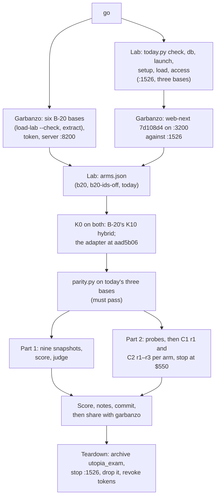

> **STATUS: READY, WAITING FOR THE USER'S GO (2026-10-17).** B-20 is frozen at 02e9cc9 (the user
> accepted it). The lab's harness is built and dry-run on BlueLeaf's live base, sealed. Nothing from
> Northstar has been loaded into an exam base yet. Pre-registration:
> `docs/b20-northstar-exam-preregistration-2026-10-17.md` (amendments 2 and 3 in §§10–11).

# B-20's Northstar exam

## The harness

| Part | Code | Dry run (sealed, BlueLeaf's live base) |
|---|---|---|
| One tool surface | `lab/contract_reader/` | Every tool answers through the adapter. K16 is `not_served` for today's foundation |
| Questions | `lab/exam/questions.py` → `questions.tsv` (47) | — |
| Part 2 reader | `lab/exam/reader.py` | Probes pass (9 tools in C1, 6 in C2). Pilot: 21 C1 answers, then 6 more after the slimming |
| Part 2 scoring | `lab/exam/score_part2.py` | Every pilot answer scored |
| Part 1 snapshot, P1, P3, P5 | `lab/exam/part1.py` | 38 documents and 64 entities read |
| P2, P4 | `lab/exam/judge.py`, `p2_items.yaml` | 38 readings judged, about $0.48 a run |
| Today's bases | `lab/exam/today.py` | Hash check: 38, 35 and 37 files |
| Adapter parity | `lab/exam/parity.py` | 380 of 380 search hits are today's own chunks; 349 at the same rank |

The pilot cost $16.89 of Claude usage, outside this folder (so outside the exam's stop).

## The run, at the user's go

Both foundations load in one window. Garbanzo runs B-20's side; the lab runs everything else.

**Lab commands** (from the repo root, `R=runs/2026-10-17-b20-northstar-exam`):

1. `uv run python lab/exam/today.py check` (recorded below), then `db`, then
   `launch > _owm-local/exam-1526/server.log 2>&1` in the background.
2. `today.py setup --run $R`, `today.py load --run $R`, `today.py access --run $R`.
3. Write `$R/arms.json` with each arm's bases, then check K0 on both foundations.
4. `uv run python lab/exam/parity.py --run $R --app http://127.0.0.1:3200 --person sarah.chen@northstar.example`
5. For each arm and corpus: `part1.py snapshot`, `part1.py score`, `judge.py`.
6. For each arm: `reader.py probe` for C1 and C2, then `reader.py run` for C1 rep 1 and C2 reps 1–3,
   with `--cap-usd 550`.
7. `score_part2.py $R`.

**Spend:**
- OpenAI, on the user's key: about $2 for B-20's six bases and $3–5 for today's three.
- Claude: Part 2's reader, up to the $550 stop, plus about $14 for the judge.

## Recorded before the run

**Today's foundation's binary** (`today.py check`, 2026-10-17):
- **Binary:** `target/debug/utopia-server`, sha256 `162f689113357063eb13149188f11749f0fed2485a9b33c8d454b444caadeaf8`, built
  2026-10-13 12:39.
- **The live instance** on :1516 has run it since 12:43 that day.
- **The source tree:** Utopia's HEAD is aad5b06. Its uncommitted diff now hashes to `7248adc6…`, not
  the `c4da9cc3…` the luna baseline recorded. The extra changes are in `web/`, Docker and env
  files, none of them part of the server binary. So the binary's sha256 is what identifies it.
