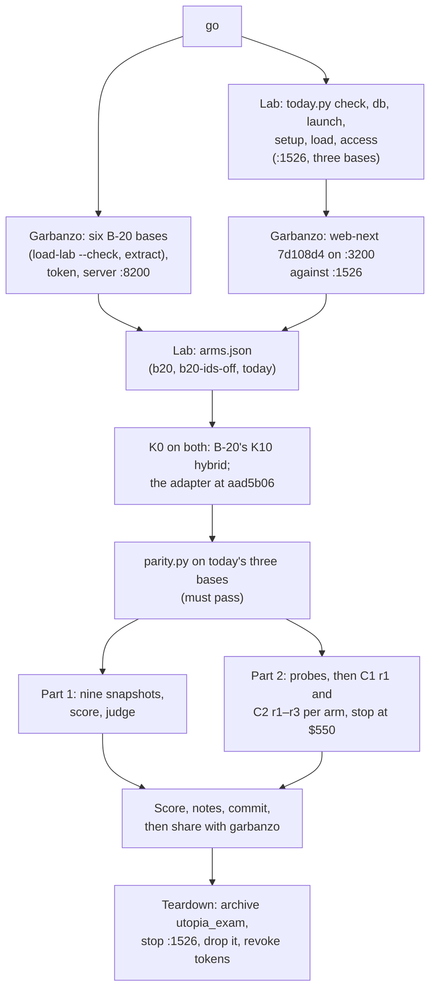

> **STATUS: RUNNING (2026-10-17, from 21:16 EDT).** The user gave the go. Every base is loaded,
> parity passes (after amendment 4), and Part 1 and Part 2 are running on all three arms. Results
> are sealed from garbanzo until the run is recorded. Pre-registration:
> `docs/b20-northstar-exam-preregistration-2026-10-17.md` (amendments 2–4 in §§10–12).

# B-20's Northstar exam

## The harness

| Part | Code | Dry run (sealed, BlueLeaf's live base) |
|---|---|---|
| One tool surface | `lab/contract_reader/` | Every tool answers through the adapter. K16 is `not_served` for today's foundation |
| Questions | `lab/exam/questions.py` → `questions.tsv` (47) | — |
| Part 2 reader | `lab/exam/reader.py` | Probes pass (9 tools in C1, 6 in C2). Pilot: 21 C1 answers, then 6 more after the slimming |
| Part 2 scoring | `lab/exam/score_part2.py` | Every pilot answer scored |
| Part 1 snapshot, P1, P3, P5 | `lab/exam/part1.py` | 38 documents and 64 entities read |
| P2, P4 | `lab/exam/judge.py`, `p2_items.yaml` | 38 readings judged, about $0.48 a run |
| Today's bases | `lab/exam/today.py` | Hash check: 38, 35 and 37 files |
| Adapter parity | `lab/exam/parity.py` | 380 of 380 search hits are today's own chunks; 349 at the same rank |

The pilot cost $16.89 of Claude usage, outside this folder (so outside the exam's stop).

## The run, at the user's go

Both foundations load in one window. Garbanzo runs B-20's side; the lab runs everything else.

**Lab commands** (from the repo root, `R=runs/2026-10-17-b20-northstar-exam`):

1. `uv run python lab/exam/today.py check` (recorded below), then `db`, then
   `launch > _owm-local/exam-1526/server.log 2>&1` in the background.
2. `today.py setup --run $R`, `today.py load --run $R`, `today.py access --run $R`.
3. Write `$R/arms.json` with each arm's bases, then check K0 on both foundations.
4. `uv run python lab/exam/parity.py --run $R --app http://127.0.0.1:3200 --person sarah.chen@northstar.example`
5. For each arm and corpus: `part1.py snapshot`, `part1.py score`, `judge.py`.
6. For each arm: `reader.py probe` for C1 and C2, then `reader.py run` for C1 rep 1 and C2 reps 1–3,
   with `--cap-usd 550`.
7. `score_part2.py $R`.

**Spend:**
- OpenAI, on the user's key: about $2 for B-20's six bases and $3–5 for today's three.
- Claude: Part 2's reader, up to the $550 stop, plus about $14 for the judge.

## Recorded before the run

**Today's foundation's binary** (`today.py check`, 2026-10-17):
- **Binary:** `target/debug/utopia-server`, sha256 `162f689113357063eb13149188f11749f0fed2485a9b33c8d454b444caadeaf8`, built
  2026-10-13 12:39.
- **The live instance** on :1516 has run it since 12:43 that day.
- **The source tree:** Utopia's HEAD is aad5b06. Its uncommitted diff now hashes to `7248adc6…`, not
  the `c4da9cc3…` the luna baseline recorded. The extra changes are in `web/`, Docker and env
  files, none of them part of the server binary. So the binary's sha256 is what identifies it.

## The run's log (2026-10-17, EDT)

**The lab: today's foundation**
- 21:16: `today.py check`. The binary is unchanged: sha256 `162f6891…`; Utopia HEAD aad5b06; diff
  `7248adc6…`.
- 21:18: `utopia_exam` created, and the server started on :1526.
- 21:19: three bases made (`today-bases.json`): packs `schema-org` and `w3c-org`, `gpt-6-luna` at
  effort low, `text-embedding-3-small`.
- 21:19–21:41: every corpus matched the hash list before the first upload; 38, 35 and 37 documents
  loaded, none failed.
- 21:20: the read token and the viewer were made. Garbanzo started web-next 7d108d4 on :3200
  against them (BLUELEAF_ORG northstar).

**Parity, and amendment 4**
- First run: the adapter answered no hits on any query, and the first version of `parity.py`
  passed that (its record is kept in the lab's scratchpad, `parity-first-vacuous.json`). The fix is
  lab 4caf4fd: an empty answer now fails.
- Cause: today's file upload records no version, and the adapter reads text, passages, hits and
  evidence only for a recorded one. The user chose the fix: version 1 rows in `utopia_exam`
  (`today.py versions`, lab ae2098d; pre-registration §12). Garbanzo restarted :3200, at the same
  build, to drop the adapter's cached empty version lists.
- Second run: passes on all three bases. All 1,100 adapter hits matched today's chunks (1,032 at
  the same rank), with the same document counts (`parity.json`).

**B-20 (garbanzo, at 02e9cc9, store `data/exam-02e9cc9`, :8200)**
- Garbanzo's own permission check held its exam script until the user allowed it in that session.
- A first attempt stopped before loading anything: macOS bash 3.2 treats an empty array under
  `set -u` as unbound. That left one empty base. Garbanzo deleted the store, fixed the line in its
  script (not in B-20), and started again from a fresh store.
- Six bases, each loaded only after its files matched the hash list. Ids on, then ids off; the
  ids-off arm is the " (2)" bases. None failed. The model calls, for the record: 656 calls;
  2,302,890 prompt, 1,278,134 completion and 119,296 embedding tokens.
- Garbanzo first relayed six wrong kb ids from a progress notice, then corrected them from its
  store. The lab took the ids from :8200's own K1, read with the reader token, and matched them by
  name (`arms.json`).
- The lab's K0 check: contract 0.2, producer blueleaf-knowledge-foundation 0.1.0. It serves
  K0–K10 and K13–K17. K10 is hybrid; its only note is that valid_at is taken but not applied.

**Probes:** all six pass: C1 shows 9 tools and C2 6, on every arm.

**A rule set before any B-20 answer** (committed in 356141f at 22:56, as B-20's Part 2 started at 22:56:03 and before any of its answers finished; today's 47 C1 answers and some of C2 r1 were in by then, none of them ended by an API error). An answer that ends on an API error with no answer
(a rate limit, an overload, a server error) is not an answer. It's moved aside as
`<id>.infra-error.jsonl` and asked once more. Anything the reader finished stands as it is,
including running out of turns. The same rule applies on every arm.
