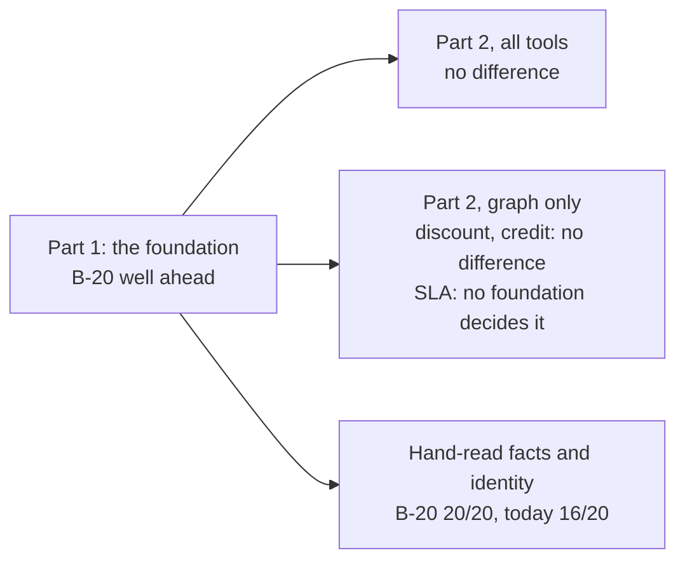

# B-20's Northstar exam: results

**Recorded 2026-10-18.** B-20 (blueleaf-knowledge-foundation 02e9cc9) was tested against today's
foundation (Utopia, the binary with sha256 `162f6891…`, read through web-next 7d108d4's adapter).
The exam ran once, as pre-registered in `docs/b20-northstar-exam-preregistration-2026-10-17.md`,
including amendments 2–4. How the run went is in `notes.md`. The tables come from
`lab/exam/summarize.py`.

## In short

1. **As a foundation, B-20 is clearly better.**
   - **Exact evidence:** 98–99% of its evidence is tied to its source text byte for byte, against
     today's 47–48%. Every exact span was checked, and none was wrong on any arm.
   - **The 26 true facts:** it states 24, against today's 10.
   - **Superseded exceptions:** with identifier rules off, it holds both of Acme's NS-500 exceptions
     with their own validity (4 of 4). Today's foundation holds each only in part (0 stated, 4
     partly).
   - **False customer merges:** none on any arm.
2. **With all tools (C1), the decisions are the same on all three arms:** 17 of 22 discount, 9 of 10
   credit (experiment 5's gold ceiling is 9 per run), and SLA core or better on 7–9 of 10. The
   reader gets most of its evidence from documents (70–75% of its calls are text tools), so the
   foundations' differences don't show in the decision.
3. **Graph only (C2):**
   - **Discount and credit:** no difference, by the pre-registered noise rule.
   - **SLA: no foundation decides it**, at 0–1 of 10 on every run.
   - **How each fails:** today's reader runs out of turns or gives no decision (23 of 30). B-20's
     reader reaches a decision, often a wrong one. Without identifier rules, many of those wrong
     decisions are unsafe: 23 of 30, against 5 of 30 with them.
4. **The hand-read questions** (S06a–c on dated discounts, S07 on provenance, S08 on identity):
   B-20 passed 20 of 20 on both arms. Today's foundation passed 16 of 20; its 4 partials were all
   graph-only, 3 of them on S08's agreement reference.
5. **Effort:** graph-only answers on B-20 take 27–29 tool calls, against 47 on today's foundation,
   at about the same cost per run ($38–42 against $36).

**What it means commercially.** B-20's lead is in what makes AI trustworthy: evidence anyone can
check against the source, the true facts stated, and old terms held with their dates. It loses
nothing on decisions when the reader can read documents. The open risk is an agent deciding SLA
cases from the graph alone. Neither foundation holds the operational detail (times with their
zones) for that, and B-20 without identifier rules then commits to unsafe answers instead of
stopping. That should be fixed before an agent is allowed to decide from B-20's graph alone.

## The blind comparison: B-20 with identifier rules off against today's foundation

| | B-20, ids off | Today | Reading |
|---|---|---|---|
| Exact evidence (P1, base) | 2,103 of 2,122 (99%) | 1,222 of 2,565 (48%) | B-20 ahead |
| The 26 facts stated (P2, base) | 24, 1 partly, 1 not | 10, 11 partly, 5 not | B-20 ahead |
| Superseded exceptions (P4, base) | 4 of 4 stated | 0 stated, 4 partly | B-20 ahead |
| False customer merges (P3b) | 0 on all three bases | 0 on all three bases | the same |
| SLA data held with its zone (P5, base, of 76) | 26 (41 day only) | 24 (1 day only) | no difference; see below |
| C1 discount / credit / SLA core or better | 17 / 9 / 7 | 17 / 9 / 9 | one run each; no difference shown |
| C2 discount (r1, r2, r3) | 16, 17, 17 | 17, 16, 17 | no difference |
| C2 credit | 8, 9, 9 | 8, 9, 8 | no difference |
| C2 SLA core or better | 0, 0, 1 | 0, 0, 0 | both fail |
| C2 unsafe (of 42) | 10, 9, 9 | 5, 4, 5 | a difference: B-20 ids off decides SLA cases wrongly; today gives no decision |
| C2 out of turns | 0, 0, 1 | 8, 8, 7 | B-20 ahead |
| Hand-read S06–S08 (of 20) | 20 pass | 16 pass, 4 partly | B-20 ahead |

**The noise rule (§4)** says a difference smaller than the spread of the three C2 runs is no
difference. The spreads here are 1–2, so for C2 only unsafe answers and running out of turns
differ. C1 ran once per arm, so its differences of 2 or less aren't claimed.

## What identifier rules add: B-20 on against B-20 off

| | Ids on | Ids off |
|---|---|---|
| U-31 (P3a, a feature check) | 2 of 3: CRM-2048 and C-1001 on "ACME Manufacturing" | the same 2 of 3 |
| Acme's identifiers placed on documents | 1 (CR-9201 carries C-1001) | 4 (DR-9001, CR-9201, INV-62011, SR-39385) |
| P2 stated (base) | 24 | 24 |
| P4 stated (base) | 1 (3 partly) | 4 |
| C2 SLA unsafe (of 30) | 5 | 23 |
| C2 unsafe, all processes (r1, r2, r3) | 5, 6, 6 | 10, 9, 9 |

- **U-31:** both arms link the CRM and ERP ids. Neither links ACME-MFG-2025, the master supply
  agreement's reference, to the customer.
- **With the rules off,** Acme's ids land on more of the documents that mention them. That may be why
  ids-off's graph-only SLA answers pick the wrong records. It's a hypothesis: the exam doesn't test
  it.
- **On P4,** ids on scores lower than ids off: 1 against 4 stated. Both arms hold the two
  exceptions. Which one is judged fully stated varies between bases. On ids-on's no-guarantee base
  it's 3 of 4, so this is extraction variance more than the feature.

## Part 1, every base

| Arm | Base | Facts | Evidence | Exact (verified) | U-31 (P3a) | False merges (P3b) | SLA data held (P5, of 76) | Day only |
|---|---|---|---|---|---|---|---|---|
| b20 | base | 2,041 | 2,260 | 2,241 (99%; 2,241) | 2 of 3 | 0 | 32 | 42 |
| b20 | no contract | 2,014 | 2,243 | 2,207 (98%; 2,207) | 2 of 3 | 0 | 51 | 16 |
| b20 | no guarantee | 1,902 | 2,137 | 2,113 (99%; 2,113) | 2 of 3 | 0 | 22 | 54 |
| b20-ids-off | base | 2,003 | 2,122 | 2,103 (99%; 2,103) | 2 of 3 | 0 | 26 | 41 |
| b20-ids-off | no contract | 1,989 | 2,100 | 2,062 (98%; 2,062) | 2 of 3 | 0 | 15 | 51 |
| b20-ids-off | no guarantee | 2,128 | 2,237 | 2,213 (99%; 2,213) | 2 of 3 | 0 | 21 | 54 |
| today | base | 2,424 | 2,565 | 1,222 (48%; 1,222) | not served | 0 | 24 | 1 |
| today | no contract | 2,412 | 2,606 | 1,226 (47%; 1,226) | not served | 0 | 33 | 1 |
| today | no guarantee | 2,368 | 2,574 | 1,237 (48%; 1,237) | not served | 0 | 17 | 0 |

| Arm | Base | P2 stated / partly / not (26) | P2 dated, x-holds (4) | P4 stated / partly / not (4) | P4, x-holds | U-31 facts F01–F03 |
|---|---|---|---|---|---|---|
| b20 | base | 24 / 2 / 0 | 2 / 2 / 0 | 1 / 3 / 0 | 1 / 3 / 0 | stated, stated, stated |
| b20 | no contract | 19 / 4 / 3 | 0 / 1 / 3 | 0 / 1 / 3 | 0 / 1 / 3 | stated, stated, partly |
| b20 | no guarantee | 23 / 3 / 0 | 3 / 1 / 0 | 3 / 1 / 0 | 3 / 1 / 0 | stated, stated, stated |
| b20-ids-off | base | 24 / 1 / 1 | 3 / 1 / 0 | 4 / 0 / 0 | 4 / 0 / 0 | stated, stated, stated |
| b20-ids-off | no contract | 19 / 5 / 2 | 0 / 1 / 3 | 0 / 1 / 3 | 0 / 1 / 3 | stated, stated, partly |
| b20-ids-off | no guarantee | 23 / 3 / 0 | 2 / 2 / 0 | 1 / 3 / 0 | 1 / 3 / 0 | stated, stated, partly |
| today | base | 10 / 11 / 5 | 2 / 2 / 0 | 0 / 4 / 0 | 0 / 4 / 0 | stated, partly, not_stated |
| today | no contract | 10 / 8 / 8 | 0 / 1 / 3 | 0 / 0 / 4 | 0 / 0 / 4 | stated, stated, partly |
| today | no guarantee | 9 / 11 / 6 | 0 / 2 / 2 | 2 / 1 / 1 | 1 / 2 / 1 | stated, partly, partly |

**How to read Part 1:**
- **The variant bases lack some facts by design.** "No contract" has no agreement or exception
  documents, so P4 and the dated P2 items are rightly not stated there. The base corpus is the
  comparison.
- **P5 swings widely on B-20 itself,** from 15 to 51 of 76 across bases built from nearly the same
  files. So its extraction of the CSV time rows isn't stable from run to run.
- **B-20 often keeps only the day of a timestamp** (41–54 items "day only"). Today's foundation
  keeps the instant or nothing. Neither holds most of the SLA's operational data, which fits the
  graph-only SLA failures.
- **x-holds** (the interval served beside a fact, by B-20 and by the adapter for today's
  foundation) changed no verdict on either foundation's base corpus. On the variant bases it moved
  a few:
  - B-20: F13 and F14 down to not stated on no-contract, and F15 up to stated on no-guarantee;
  - today: F15 and P4a down to partly on no-guarantee.

  Each reading is its own three judge runs, so some of this movement is the judge's own noise.

## Part 2, every run

| Measure | b20 C1 | b20-ids-off C1 | today C1 | b20 C2 (r1, r2, r3) | b20-ids-off C2 (r1, r2, r3) | today C2 (r1, r2, r3) |
|---|---|---|---|---|---|---|
| Discount pass (of 22) | 17 | 17 | 17 | 17, 17, 17 | 16, 17, 17 | 17, 16, 17 |
| Credit pass (of 10) | 9 | 9 | 9 | 9, 8, 7 | 8, 9, 9 | 8, 9, 8 |
| SLA strict (of 10) | 5 | 5 | 7 | 0, 0, 1 | 0, 0, 0 | 0, 0, 0 |
| SLA core or strict (of 10) | 8 | 7 | 9 | 0, 0, 1 | 0, 0, 1 | 0, 0, 0 |
| Unsafe (of 42) | 3 | 3 | 3 | 5, 6, 6 | 10, 9, 9 | 5, 4, 5 |
| Out of turns | 0 | 0 | 0 | 0, 0, 0 | 0, 0, 1 | 8, 8, 7 |
| Cost ($) | 14.81 | 13.76 | 14.21 | 39.70, 42.06, 41.37 | 37.70, 37.86, 38.64 | 35.91, 36.76, 35.63 |

**Against the gold-evidence ceilings** (the same reader with every document in its message):
- **Credit:** the ceiling is 27 of 30, 9 per run. Every arm's C1 run reaches 9.
- **SLA:** the ceiling is 16 of 20 strict and 20 of 20 core, which is 8 and 10 per run. C1 gets 5–7
  strict and 7–9 core or better. That is what finding the evidence costs the reader on any
  foundation.

**The unsafe count, by process:**

| Arm | C1 discount / credit / SLA | C2, three runs: discount / credit / SLA |
|---|---|---|
| b20 | 2 / 1 / 0 | 6 / 6 / 5 |
| b20-ids-off | 2 / 1 / 0 | 2 / 3 / 23 |
| today | 2 / 1 / 0 | 6 / 3 / 5 |

**What counts as unsafe here:**
- **SLA, experiment 6's rule:** a decision that misses a credit owed, grants one that isn't owed, or
  misses an engage or notify duty. No decision is neither held nor unsafe. Today's graph-only SLA
  answers mostly reach no decision (23 of 30), so they can't be unsafe.
- **The discount unsafes are the same on every arm: S02 and S03.** The reader writes "No, not at
  18%" and then approves the 15% the CRM logged, in its decision block (S02). The scorer reads the
  block. Since it's identical across arms, it says nothing about the foundations. **For the user's
  hand review.**

**Tool use:**

| Arm | Variant | Calls per answer | Text-tool share | Errors (non-200) | Top tools |
|---|---|---|---|---|---|
| b20 | C1 | 12.4 | 70% | 9 | read_passages 271, search 97, find_entities 70, lookup_identifier 46 |
| b20 | C2 | 29.1 | 0% | 37 | find_entities 1391, get_entity 1181, list_facts 1047, neighbourhood 287 |
| b20-ids-off | C1 | 12.6 | 75% | 5 | read_passages 305, search 103, find_entities 71, lookup_identifier 46 |
| b20-ids-off | C2 | 27.1 | 0% | 45 | find_entities 1402, get_entity 1241, list_facts 678, neighbourhood 284 |
| today | C1 | 14.1 | 73% | 47 | read_passages 336, search 114, find_entities 72, get_entity 51 |
| today | C2 | 46.9 | 0% | 178 | find_entities 2030, get_entity 1978, neighbourhood 1315, list_facts 647 |

Today's errors are mostly identifier lookups (K16, which it doesn't serve, so they answer 501).

## The hand-read questions (S06a–c, S07, S08)

These were read blind:
- **The packet:** 60 answers (5 questions × 4 runs × 3 arms), shuffled with seed 20261018, every
  arm label removed (`hand/packet.md`).
- **The grader:** Claude Sonnet, which read only the packet. Its rubric is the answer key's, with
  the user's grading approach.
- **Then matched back:** to each arm with `hand/key.json`. The grades are in `hand/grades.json`.

| Arm | S06a | S06b | S06c | S07 | S08 |
|---|---|---|---|---|---|
| b20 | 4 pass | 4 pass | 4 pass | 4 pass | 4 pass |
| b20-ids-off | 4 pass | 4 pass | 4 pass | 4 pass | 4 pass |
| today | 4 pass | 4 pass | 4 pass | 3 pass, 1 partly | 1 pass, 3 partly |

**Today's partials** are all graph-only:
- **S08, three times:** right on CRM-2048, C-1001 and Acme Industrial Supply, but ACME-MFG-2025 left
  unconfirmed.
- **S07, once:** says the agreement states no rate.

**Two passes the grader called borderline** are both B-20 ids off, graph-only: A005 and A026 on S07.
They name the exception as the agreement's Schedule B without citing the agreement. **The user's
grades in the Ledger settle all of these.**

## Where the run departed from the plan

- **Amendment 4 (§12):** today's file uploads got version 1 rows, so the adapter could read them.
  Parity's first version had passed an empty answer. Both fixes were made before any score.
- **Part 2 spanned two days,** from 22:21 on 2026-10-17 to 19:37 on 2026-10-18, against the plan's
  "all three arms, the same day". The account's session limit refused 203 attempts.
  - **Handled by a rule set before any B-20 answer:** each refused attempt was kept aside as
    `*.infra-error-<k>.jsonl` and asked again (`infra-errors-2026-10-17.json` lists the first 186).
  - **The user's ruling:** the account's own limit never counts toward a question's two refusals.
  - **No real answer was dropped or asked twice.** The 8 out-of-turns answers in today's C2 r1
    stand.
- **The judge:** 131 judge runs refused by the limit were asked again with `judge.py --resume`. Every
  reading has its three real runs.
- **Garbanzo's side:** a first attempt stopped before loading anything, and was restarted from a
  fresh store. Six kb ids it relayed were wrong; the lab took them from :8200's K1 instead.
- **The exam's sealing held:** no Northstar result reached garbanzo before this record.

## Spend

| | |
|---|---|
| Reader (Part 2), the exam's stop $550 | $402.39: answers $388.41, refused attempts $13.98 |
| Judge (Part 1) | $12.57 |
| Probes | about $0.30 |
| Pilot, before the freeze (outside the stop) | $16.89 |
| OpenAI, B-20's six bases | 656 calls; 2.30M prompt, 1.28M completion and 0.12M embedding tokens (gpt-6-luna, effort low) |
| OpenAI, today's three bases | not metered by the lab; the estimate was $3–5 |

## Files

- `part1/<arm>/<corpus>.json.gz`: each base's snapshot. `.score.json` holds P1, P3 and P5, and
  `.judge.json` holds P2 and P4. A judge file from before the resume is kept as
  `.judge.infra-1.json`.
- `part2/<arm>/<variant>/r<k>/`: each answer's stream (`S*.jsonl`), summary (`.md`) and tool
  calls (`.calls.jsonl`), plus `setup.json`. Refused attempts are the `*.infra-error-*` files.
  `part2/scores.json` and `scores.md` hold the auto-scores.
- `hand/`: the blind packet, its key and the grades.
- `parity.json` and `parity-first-vacuous.json`; `arms.json`; `today-bases.json`.
- `pilot-sealed/`: the pilot and the dry runs on BlueLeaf's live base from before the freeze, sealed
  until now. They're never results.
